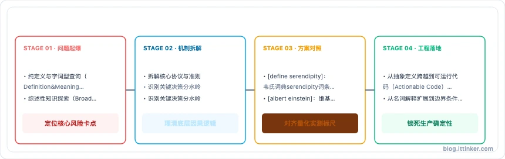
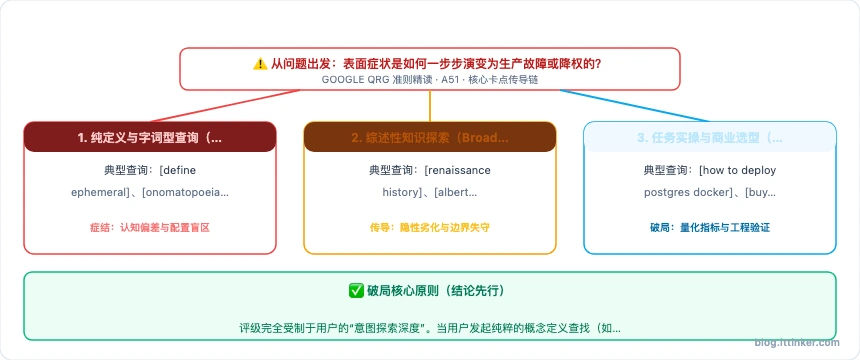
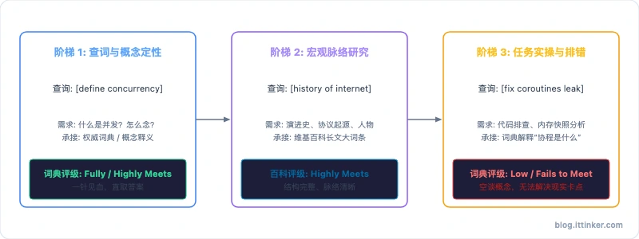
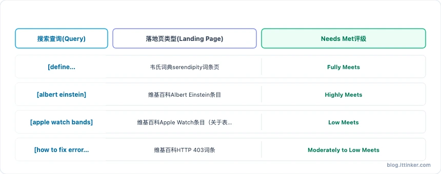
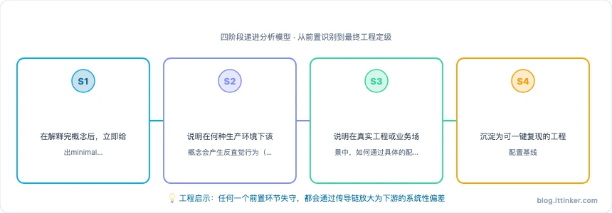
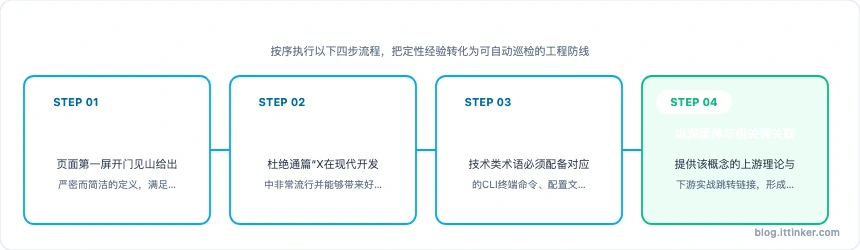

# “广告伪装成按钮多赚钱”？欺骗性广告（Deceptive Ads）惩罚 | 读懂 Google Search 基础认知 系列 051

> 🌐 **在线阅读与互动版**：[“广告伪装成按钮多赚钱”？欺骗性广告（Deceptive Ads）惩罚 | 读懂 Google Search 基础认知 系列 051](https://blog.ittinker.com/posts/词典和百科为什么有时是最佳答案-有时完全不够/)
> 📚 **所属专栏**：[《读懂 Google Search：110篇搜索质量与SEO实战指南》](../README.md)

---

### 📌 结论先行（TL;DR）
> **根据 QRG 24.0，词典（Dictionary）与百科（Encyclopedia）类结果的满足度评级完全受制于用户的“意图探索深度”。**
> **维基百科（Wikipedia）和韦氏词典（Merriam-Webster）是互联网上公认的权威站点，它们的域名权重（Domain Authority）极高。**
> **然而，在日常搜索中，你经常会发现维基百科并没有始终霸占第一名。对于很多具体问题，排在首位的反而是独立技术博客、开源社区的实操指引或详尽的产品评测。**
> **维基百科和词典在何时是满分答案？又在何时沦落为“不够解渴”的平庸结果？QRG 第 24 节《Rating Dictionary and Encyclopedia Results for Different Queries》给出了清晰的解题脉络。**
>
> - 当用户发起纯粹的概念定义查找（如 [define oxymoron]、[meaning of heuristic]）时，权威词典的简明音标与释义能够拿下 Fully Meets 或 Highly Meets。
> - 但在面对实操指引、商业决策或复杂工程课题（如 [how to set up kubernetes cluster] 或 [best crm software]）时，词典与通用百科只能提供浅层背景，评级会急剧衰减至 Moderately Meets 甚至更低。
> - 出海独立站做 Glossary 术语库时，如果仅做两句话的词条搬运，根本无法在专业搜索中确立排名。

---

### 🚨 2026 → 2024 官方最新风向预警：Google 对Google 本地搜索算法（Local Pack）与地理位置意图的演进的策略演进

#### 🕒 2026 → 2024 Google 官方对Google 本地搜索算法（Local Pack）与地理位置意图的演进的策略演进

- **2026 · 高精度地理位置感知与即时距离衰减（Geographic Decay Factor）**
  针对修锁、外卖、牙医等线下履约词，算法严格根据用户实时 GPS / IP 施加距离惩罚。脱离实际物理服务半径的泛化网页被完全挤出本地推荐包（Local Pack）。

- **2025 · Google Business Profile (GBP) 与本地落地页双向绑定**
  本地意图页面必须与权威地图主体数据完全一致（NAP: Name, Address, Phone），任何编造虚拟服务地址的黑帽站群被自动化清洗。

- **2024 · QRG 25.0 节关于 Visit-in-Person 意图与用户位置（User Location）的裁决指南**
  规范明确：任何评估员在评定本地查询时，必须首先设定其物理坐标。脱离用户当前坐标谈本地搜索质量毫无意义，这是本地商户 SEO 的第一铁律。

---

## 1. 拆解 QRG 24.0：查词定义 vs 深度探究

QRG 24.0 明确划分了用户在检索特定专有名词时的心理状态：

> *"Dictionary and encyclopedia results can be very helpful for some queries, but unhelpful for others. For queries that seek a quick definition, spelling, or pronunciation, a dictionary result is often Fully Meets or Highly Meets. However, for queries where the user wants to buy something, find a local business, or complete a practical task, dictionary definitions do not meet the need."*

评估员在审视词典与百科结果时，会将其放入三个不同的意图阶梯中衡量：

1. **纯定义与字词型查询（Definition & Meaning Queries）**：
   - 典型查询：`[define ephemeral]`、`[onomatopoeia pronunciation]`。
   - 落地评估：词典页面给出清晰发音、词源、例句，用户可以在 5 秒内离开并解决问题。评级直接给出 **Fully Meets**。
2. **综述性知识探索（Broad Knowledge Queries）**：
   - 典型查询：`[renaissance history]`、`[albert einstein bio]`。
   - 落地评估：维基百科提供了详实的生平时间线、重大著作与外部权威引注，全面满足探索型需要。评级给出 **Highly Meets**。
3. **任务实操与商业选型（Actionable & Commercial Queries）**：
   - 典型查询：`[how to deploy postgres docker]`、`[buy office standing desk]`。
   - 落地评估：维基百科对 Docker 或 PostgreSQL 的技术历史介绍，或者词典对“办公桌”名词的解释，无法指导用户写出 yaml 文件，更无法完成采购。评级跌落至 **Moderately Meets** 或 **Low Meets**。

---

## 2. 意图深度与百科/词典满足度衰减曲线

用户意图越偏向任务实操与决策，词典与百科的价值衰减越明显：

---

## 3. QRG 场景对照：词典与百科的打分矩阵

以下是评估员手册中具有代表性的打分示范：

| 搜索查询 (Query) | 落地页类型 (Landing Page) | Needs Met 评级 | 评估员定级依据解读 |
| :--- | :--- | :--- | :--- |
| `[define serendipity]` | 韦氏词典 serendipity 词条页 | **Fully Meets** | 用户目的就是查这个生僻词的意思与发音，词典页精准满足。 |
| `[albert einstein]` | 维基百科 Albert Einstein 条目 | **Highly Meets** | 宽泛的人物查询，维基条目全面覆盖生平、相对论、诺贝尔奖与名言。 |
| `[apple watch bands]` | 维基百科 Apple Watch 条目（关于表带材质的历史小节） | **Low Meets** | 用户大概率是想为自己的手表购买或挑选表带，百科条目没有现货选购支持。 |
| `[how to fix error 403 forbidden nginx]` | 维基百科 HTTP 403 词条 | **Moderately to Low Meets** | 仅解释了 403 是“禁止访问”，没有给出具体的配置文件修改方案与 chmod 命令。 |
| `[rust borrow checker explained]` | 资深 Rustacean 博客（带代码示例与生命周期图解） | **Highly Meets** | 远远超越词典机械定义，提供了工业实战中的理解模型。 |

---

## 4. 独立站 Glossary 页面重构法则

很多出海独立开发者与 SaaS 团队，为了捕获长尾搜索流量，热衷于在站内建立“术语表/知识库”（Glossary / Dictionary pSEO）。

但绝大多数这类尝试都以失败告终，因为他们只是用脚本调用 LLM，生成了成百上千个千篇一律的结构：
> “What is X? X is a concept in software engineering... Why is X important? ... Summary: X is good.”

根据 QRG 24.0 与前面所讲的 MC 质量原则，这种页面在面对具体工程师时毫无竞争力。

要把一个技术词汇页打造成具备高满足度的排位资产，必须完成三次意图升级：

1. **从抽象定义跨越到可运行代码（Actionable Code）**：
   在解释完概念后，立即给出 minimal reproducible example（最小可运行示例）。
2. **从名词解释扩展到边界条件与踩坑记录（Gotchas & Edge Cases）**：
   说明在何种生产环境下该概念会产生反直觉行为（例如并发与并行的内存开销差异）。
3. **与自家产品/工具自然结合（Practical Integration）**：
   说明在真实工程或业务场景中，如何通过具体的配置或工具链来落地该术语所指代的方法。

---

## 5. 技术站与知识库页面深度自查清单

在规划 Glossary 模块或评估概念解释型页面时，对照以下清单自检：

- [ ] **定义首段直接作答（Direct Answer）**：页面第一屏开门见山给出严密而简洁的定义，满足快速查词的直接需求。
- [ ] **拒绝“正确的废话”**：杜绝通篇“X 在现代开发中非常流行并能够带来好处”等空洞套话。
- [ ] **附带代码或流程演示**：技术类术语必须配备对应的 CLI 终端命令、配置文件片段或逻辑图。
- [ ] **纵深延伸与相关词关联**：提供该概念的上游理论与下游实战跳转链接，形成有机的技术知识脉络。
- [ ] **标注适用版本与更新记录**：明确标明该术语解释所适用的技术版本（如 Python 3.12+、React 19），维持内容的时效性与准确性。

---

## 下一篇预告

至此，我们已经完整研读了 Needs Met 体系下的各类专门场景：从拼写纠错、URL 导航、产品选型，到本地意图、语言版本以及百科词典。

但所有这些规则，究竟是如何被数以万计的评估员在日常工作中稳定执行的？Google 的评估员平台长什么样？一次评测任务是怎样被派发、审计与回流的？

QRG 附录 1（第 25 至 29 节）掀开了这一庞大工程的面纱。下一篇 [“脱离用户上下文谈优化就是耍流氓”？千人千面的真实世界：设备、地点与即时情境对搜索结果的决定性重塑（A52）](/posts/google-rater-的工作流告诉了我们什么/) 将带你走进质量量化工程的流水线。

---

## 读懂 Google Search 专栏导航

> 📚 **专栏收录**：本文为 [《读懂 Google Search：110篇搜索质量与SEO实战指南》](/posts/google-search-guide/) 第 **A51** 篇。

* **专栏主页**：[《读懂 Google Search：110篇搜索质量与SEO实战指南》全景地图与路线图](/posts/google-search-guide/)
