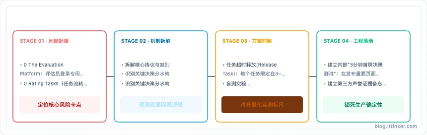
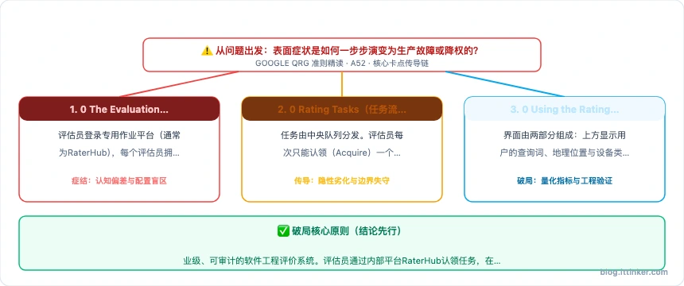
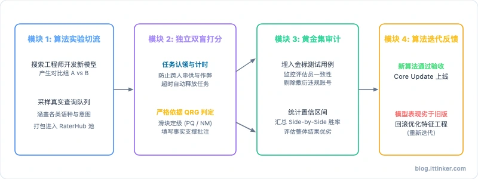
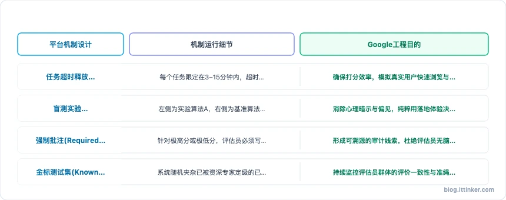
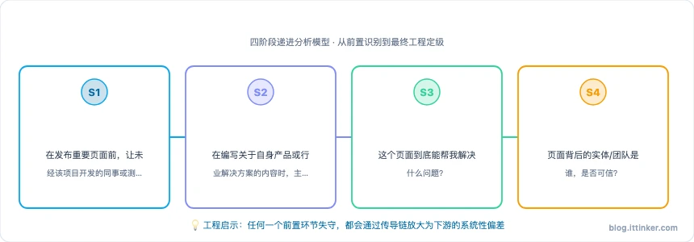
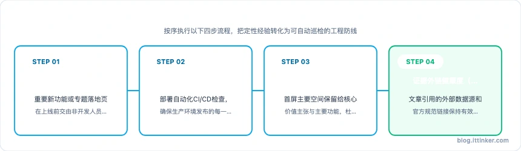

# “脱离用户上下文谈优化就是耍流氓”？千人千面的真实世界：设备、地点与即时情境对搜索结果的决定性重塑 | 读懂 Google Search 基础认知 系列 052

> 🌐 **在线阅读与互动版**：[“脱离用户上下文谈优化就是耍流氓”？千人千面的真实世界：设备、地点与即时情境对搜索结果的决定性重塑 | 读懂 Google Search 基础认知 系列 052](https://blog.ittinker.com/posts/google-rater-的工作流告诉了我们什么/)
> 📚 **所属专栏**：[《读懂 Google Search：110篇搜索质量与SEO实战指南》](../README.md)

---

### 📌 结论先行（TL;DR）
> **QRG 附录 1（第 25 至 29 节）揭示了 Google 如何把高度主观的“搜索体验”解构为工业级、可审计的软件工程评价系统。**
> **许多站长误以为 Google 的质量评估是一群人在后台手动调整排名：给某个喜欢的网页点一下“升权”，或者给某个不顺眼的网站打一个“降权”标记。**
> **这种理解彻底偏离了搜索工程的实际运行方式。**
> **Google 拥有全球数十亿计的网页索引与每日数十亿次的搜索量，单靠人类评估员手动调权在规模上根本行不通。QRG 附录 1 详细展示了评估员所使用的内部平台机制（The Evaluation Platform）。**
> **这一工作流呈现的，是一套极其精密、基于统计学抽样与机器学习监督学习的质量量化基础设施。**
>
> - 评估员通过内部平台 RaterHub 认领任务，在严格受限的倒计时内独立完成定级，并被强制要求撰写证据链批注（Rater Comments）。
> - 这些评级数据绝不直接参与单次排名的实时改写，而是作为黄金标注集（Ground Truth）喂给排序机器学习模型，并通过海量 Side-by-Side 实验裁决算法上线与否。
> - **理解这套平台架构**：能帮助独立站建立可量化的内部内容审查准则。

---

### 🚨 2026 → 2024 官方最新风向预警：Google 对Google 个性化与情境感知搜索（User Context）的发展演进的策略演进

#### 🕒 2026 → 2024 Google 官方对Google 个性化与情境感知搜索（User Context）的发展演进的策略演进

- **2026 · 即时情境意图动态渲染（Real-time Contextual Personalization）**
  Google 搜索根据用户所使用的终端设备（手机/桌面/车机）、网络环境、历史探索行为即时重塑结果权重。手机端优先交付即用微组件，桌面端提供全景工作台。

- **2025 · 跨设备体验一致性门禁**
  算法严打‘PC 端内容丰富、手机端残缺不全且全是弹窗’的双面网页，强制要求在移动优先索引（Mobile-first Indexing）下实现全情境平权。

- **2024 · QRG 26.0 节对用户上下文（User Context）在质量评级中权重的强调**
  指南指出：世界上根本不存在孤立于真实用户情境的‘客观好结果’，评估员必须代入特定设备与时空场景进行综合考量。

---

## 1. 拆解 QRG 25.0 至 29.0：评估平台的五大支柱

QRG 附录 1 由五个专门小节构成，涵盖了评估员从登入系统到提交结果的全部动作：

1. **25.0 The Evaluation Platform**：
   评估员登录专用作业平台（通常为 RaterHub），每个评估员拥有唯一身份凭据，所有操作被全量埋点与审计。
2. **26.0 Rating Tasks（任务流转与认领）**：
   任务由中央队列分发。评估员每次只能认领（Acquire）一个 Task；每个任务附带预估时长（Estimated Time），超时未提交会被系统自动回收（Release Task）并重新分配，防止评估员挂机或查阅过久引入偏差。
3. **27.0 Using the Rating Interface（交互界面）**：
   界面由两部分组成：上方显示用户的查询词、地理位置与设备类型；下方展开待评测的落地页卡片，包含 Needs Met 滑块与 Page Quality 滑块。
4. **28.0 Rating Details（打分详情与证据链）**：
   打分不是单选勾选就结束。系统要求评估员针对极端评分（Lowest、FailsM、Fully Meets）必须在文本框中填写详细批注（Comments），提供第三方权威信源支撑。
5. **29.0 Researching Tasks（背调规范）**：
   评估员被明确要求使用高级搜索语法（如 `site:`、排除特定域名搜索、新闻归档检索）对创作者声誉进行独立交叉比对。

---

## 2. 评估任务从分发到算法反馈的全生命周期

Google 评估系统并不是孤立的打分表，它是算法实验效果的关键校验链路：

---

## 3. 评估平台的五大机制对比表

下表梳理了 RaterHub 平台背后的工程化约束机制：

| 平台机制设计 | 机制运行细节 | Google 工程目的 | 对站长的启示 |
| :--- | :--- | :--- | :--- |
| **任务超时释放 (Release Task)** | 每个任务限定在 3–15 分钟内，超时自动收回并重新入池。 | 确保打分效率，模拟真实用户快速浏览与判断的决策节奏。 | 用户的注意力是毫秒级的，首屏若无法在数秒内说服用户，就会流失。 |
| **盲测实验 (Side-by-Side)** | 左侧为实验算法 A，右侧为基准算法 B，评估员不知道哪个是新版。 | 消除心理暗示与偏见，纯粹用落地体验决定算法胜负。 | A/B 测试是衡量改版有效性的唯一准绳，切忌拍脑袋决定结构。 |
| **强制批注 (Required Comments)** | 针对极高分或极低分，评估员必须写明“为什么给该评级”。 | 形成可溯源的审计线索，杜绝评估员无脑刷单勾选。 | 站内内容需要经得起严苛推敲，经不起第三方背调的页面站不住脚。 |
| **金标测试集 (Known Ground Truth)** | 系统随机夹杂已被资深专家定级的已知样本，若评估员打偏则被警告。 | 持续监控评估员群体的评价一致性与准绳对齐度。 | 制定团队内部内容审核标准时，需要有锚定样例保持尺度稳定。 |
| **无直接权限干预 (No Direct Rank Editing)** | 评估员界面没有任何“提升排名/降低排名”按钮。 | 杜绝寻租与舞弊，保障评估数据作为机器学习训练集的纯洁性。 | 所谓“认识 Google 内部人员可以花钱修改排名”的传言纯属骗局。 |

---

## 4. 从 Rater 工作流反推独立站内部质量管理

既然 Google 依靠这样一套严谨的流水线来约束质量，出海独立站的技术与内容团队完全可以借鉴这套思想，构建自己的站内质量审核机制：

### 4.1 建立内部“3 分钟首屏决策测试”
在发布重要页面前，让未经该项目开发的同事或测试人员打开页面，限定在 3 分钟内回答三个问题：
1. 这个页面到底能帮我解决什么问题？
2. 页面背后的实体/团队是谁，是否可信？
3. 我能否在不需要额外检索的情况下立即执行下一步？

如果测试者在 3 分钟内感到困惑或找不到转化入口，该页面在真实搜索环境中大概率也会遭遇高跳出率。

### 4.2 建立第三方声誉证据备忘录
在编写关于自身产品或行业解决方案的内容时，主动整理“外部第三方独立证据”：行业评测、知名用户评价推文、GitHub Star 趋势或学术引用。把这些证据自然外链或引用至页面中，能够直接降低访问者核实信息的阻力。

---

## 5. 团队内部内容质量工程化自查清单

对照以下工程化标准，检查站内发布流水线是否具备足够的质量底盘：

- [ ] **盲测评审机制**：重要新功能或专题落地页在上线前交由非开发人员进行盲测体验打分。
- [ ] **全量状态码与渲染审计**：部署自动化 CI/CD 检查，确保生产环境发布的每一条 URL 状态码均为 200，且在无 JavaScript 状态下依然具备可读文本。
- [ ] **首屏有效信息密度（Fold Information Density）**：首屏主要空间保留给核心价值主张与主要功能，杜绝全屏广告或无关氛围图霸屏。
- [ ] **证据外链健康度（Outbound Link Audit）**：文章引用的外部数据源和官方规范链接保持有效，定期跑死链脚本清理失效引注。
- [ ] **拒绝主观臆断打分**：内容审核建立固定的评分表，以“用户需求是否得到满足”为唯一核心判卷。

---

## 下一篇预告

评估员通过标准化平台对成千上万个页面进行审阅；而在实际 SERP 呈现中，系统面临着另一个重大考验：**内容重复**。

当同一个搜索词被输入后，如果前 5 个结果都是彼此抄袭、换汤不换药的同质化页面，哪怕每个页面单独看质量尚可，整体搜索体验依然是彻底的灾难。

QRG 第 30 节专门探讨了重复结果（Duplicate Results）与多样性（Variety）。下一篇 [“同一套内容复制到五个域名”？自相残杀的站群恶果：Duplicate Results 去重法则与站内竞争消解（A53）](/posts/duplicate-results-搜索结果为什么不应该都是同一种答案/) 将为你深度拆解站内与站外去重算法。

---

## 读懂 Google Search 专栏导航

> 📚 **专栏收录**：本文为 [《读懂 Google Search：110篇搜索质量与SEO实战指南》](/posts/google-search-guide/) 第 **A52** 篇。

* **专栏主页**：[《读懂 Google Search：110篇搜索质量与SEO实战指南》全景地图与路线图](/posts/google-search-guide/)
