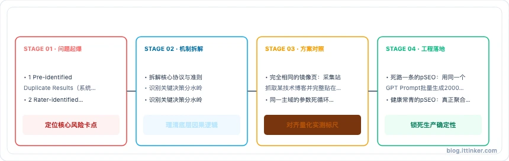
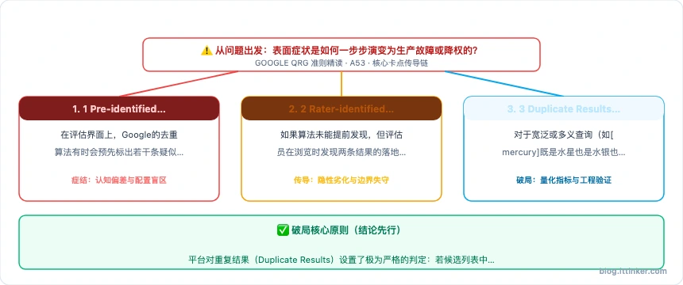
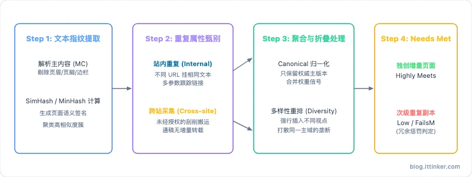
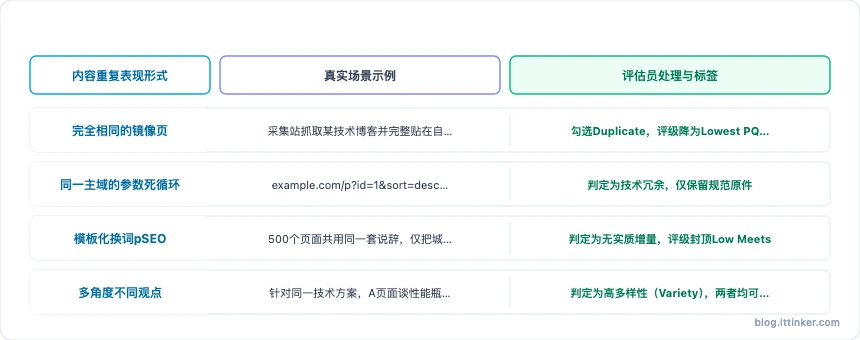
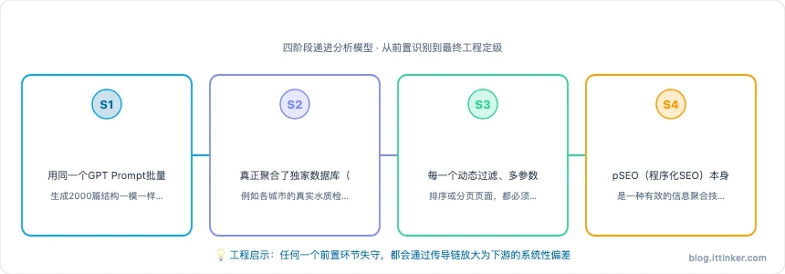
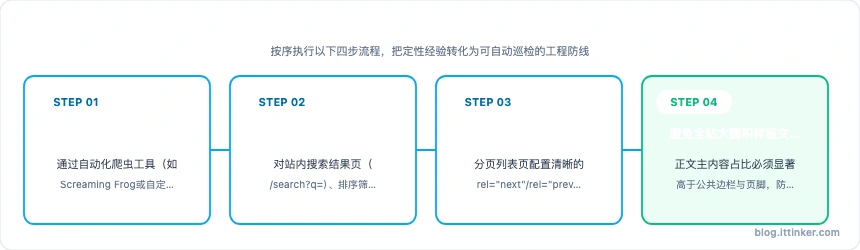

# Duplicate Results：搜索结果为什么不应该都是同一种答案？SERP 多样性与站内去重法则 | 读懂 Google Search 基础认知 系列 053

> 🌐 **在线阅读与互动版**：[Duplicate Results：搜索结果为什么不应该都是同一种答案？SERP 多样性与站内去重法则 | 读懂 Google Search 基础认知 系列 053](https://blog.ittinker.com/posts/duplicate-results-搜索结果为什么不应该都是同一种答案/)
> 📚 **所属专栏**：[《读懂 Google Search：110篇搜索质量与SEO实战指南》](../README.md)

---

### 📌 结论先行（TL;DR）
**根据 QRG 30.0 至 30.3，Google 视内容同质化为对搜索分发效率的严重破坏。**

1. 评估平台对重复结果（Duplicate Results）设置了极为严格的判定：若候选列表中出现完全相同或实质雷同（Substantially Similar）的页面，后续重复结果不仅必须被标记（Flag as Duplicate），其 Needs Met 分值还会遭到大幅压低。
2. Google 追求的是 SERP 的结果多样性（Variety & Diversity）——在有限的首屏卡位中容纳不同的主观立场、业态分类与媒介形态。
3. 出海站点靠换地名、换参数批量生成的模板化 pSEO 页面，必然会触发算法折叠甚至全站降权。

在搜索技术演进史上，一个令人头疼的现象叫做“结果集坍缩”：

当用户输入一个稍微宽泛或兼具多义性的词汇（例如 [jaguar] 或 [apple return policy]）时，如果搜索结果前 5 条全是由同一个采集站群或者不同域名转发的同一篇通稿，整个搜索体验就会宣告破产。

用户在找不到增量信息的情况下，只能被迫放弃搜索。

评估员在看到 SERP 中出现重复内容时该怎么打分？Google 内部是如何定义“重复（Duplicate）”与“多样性（Variety）”的？QRG 第 30 节为此构建了严密的处置准则。





---

## 1. 拆解 QRG 30.0 至 30.3：重复标记与多样性法则

QRG 第 30 节将重复结果分为预识别与评估员自检两类，并明确了多样性的价值：

> *"Users want variety in search results. Having many results that provide the exact same information or come from the exact same source is a poor user experience. When duplicate results appear in a task, raters must identify them and assign lower Needs Met ratings to redundant copies."*

1. **30.1 Pre-identified Duplicate Results（系统预判重复）**：
   在评估界面上，Google 的去重算法有时会预先标出若干条疑似内容镜像（例如同一个新闻集团旗下的多个分站转载的通稿）。评估员需要核实它们是否真为内容克隆。
2. **30.2 Rater-identified Duplicate Results（人工核验重复）**：
   如果算法未能提前发现，但评估员在浏览时发现两条结果的落地页主内容 90% 以上文字雷同，哪怕域名不同、排版不同，评估员也必须勾选“Duplicate”标签，并对第二条重复结果降档打分。
3. **30.3 Duplicate Results and Variety（多样性压制冗余）**：
   对于宽泛或多义查询（如 [mercury] 既是水星也是水银也是汽车品牌），首屏必须展示不同维度的分支结果。如果整页全是水星天文科普，即便文章写得再好，也因为缺失多样性而无法评为高分组合。





---

## 2. 搜索去重机制与 SERP 多样性调度流

Google 排序流水线处理内容重复与多样性分发的逻辑如下图所示：





---

## 3. 重复内容在评级系统中的表现对照

下表系统展示了不同类型的重复现象在评估员眼中的定级结果：

| 内容重复表现形式 | 真实场景示例 | 评估员处理与标签 | 对排名的长期影响 |
| :--- | :--- | :--- | :--- |
| **完全相同的镜像页** | 采集站抓取某技术博客并完整贴在自己域名下 | 勾选 **Duplicate**，评级降为 **Lowest PQ / FailsM** | 触发 Google 抄袭过滤（Scraped Content），采集站被除名。 |
| **同一主域的参数死循环** | `example.com/p?id=1&sort=desc` 与 `example.com/p?id=1` | 判定为技术冗余，仅保留规范原件 | 浪费抓取配额，分散内部 PageRank，导致正牌页排名不稳。 |
| **模板化换词 pSEO** | 500 个页面共用同一套说辞，仅把城市名从“Austin”换为“Dallas” | 判定为无实质增量，评级封顶 **Low Meets** | 核心算法更新时会被判定为 Thin Content，全域遭降权。 |
| **多角度不同观点** | 针对同一技术方案，A 页面谈性能瓶颈，B 页面谈开发效率 | 判定为 **高多样性（Variety）**，两者均可评 **High** | 算法会同时展示两者，丰富 SERP 首屏的决策覆盖面。 |





---

## 4. 出海技术团队的站内防重与多样性设计准则

理解了 QRG 30.0，出海独立站在设计 URL 架构与内容生产时，应严格落实以下工程规范：

### 4.1 规范部署 Canonical 标签
每一个动态过滤、多参数排序或分页页面，都必须在 `<head>` 中明确声明指向权威干净版本的 Canonical 链接：
```html
<!-- 在带追踪参数的 URL https://example.com/blog/seo-guide?utm_source=x 中 -->
<link rel="canonical" href="https://example.com/blog/seo-guide" />
```
这不仅告诉抓取蜘蛛把权重汇聚到原版，更直接从根源上消除了评估员在界面中遇到技术性重复页面的可能。

### 4.2 警惕“同质化 Programmatic SEO”的覆灭
pSEO（程序化 SEO）本身是一种有效的信息聚合技术，但其生死的界线完全在于**数据维度的真实性与独创性**：
- **死路一条的 pSEO**：用同一个 GPT Prompt 批量生成 2000 篇结构一模一样的文章，除了关键词替换毫无新意。
- **健康常青的 pSEO**：真正聚合了独家数据库（例如各城市的真实水质检测指标、各国机场的真实充电桩分布），每个页面都提供了独一无二的数据支撑与洞察。





---

## 5. 站内去重与多样性自查清单

在审查网站索引健康度时，可对照以下清单逐一排查：

- [ ] **全站 Canonical 覆盖率**：通过自动化爬虫工具（如 Screaming Frog 或自定义脚本）确保 100% 的页面均配置了自指向或规范指向的 Canonical 标签。
- [ ] **robots.txt 封禁纯技术参数**：对站内搜索结果页（`/search?q=*`）、排序筛选过滤参数，在 robots.txt 中明确 Disallow，防止蜘蛛无休止抓取参数迷宫。
- [ ] **分页深度优化**：分页列表页配置清晰的 `rel="next"` / `rel="prev"` 逻辑或直接链接，避免深层翻页造成海量空洞重复结构。
- [ ] **避免全站大面积样板文本（Boilerplate Text）**：正文主内容占比必须显著高于公共边栏与页脚，防止被 SimHash 算法判定为重复模板。
- [ ] **提供独特的视角与数据增量**：写同题热门文章时，必须加入自己的一手踩坑案例、独特的基准测试结果或与众不同的思考模型。





---

## 下一篇预告

到这里，我们已经穿越了 QRG 的重重迷宫：从第 1 节的页面目的、第 3 节的 E-E-A-T、第 5 节的声誉调查，到第 13 至 24 节的意图满足度，再到第 30 节的多样性去重。

这一整套体系极为庞大、精细且严密。

但如果有一天，我们必须在 60 秒内对一个页面的价值做出根本性的判断；或者说，当 Google 自身在处理数以亿计的初筛任务时——**当复杂的评分细则被全部剥离，真正剩下的最纯粹、最根本的内核究竟是什么？**

下一篇 [把复杂 Needs Met 简化之后，真正剩下的是什么？A 系列收官之作与搜索第一性原理（A54）](/posts/把复杂-needs-met-简化之后-真正剩下的是什么/) 作为 A 系列的收官之作，将带你回归搜索质量的第一性原理。


---

## 读懂 Google Search 专栏导航

> 📚 **专栏收录**：本文为 [《读懂 Google Search：110篇搜索质量与SEO实战指南》](/posts/google-search-guide/) 第 **A53** 篇。

* **专栏主页**：[《读懂 Google Search：110篇搜索质量与SEO实战指南》全景地图与路线图](/posts/google-search-guide/)
