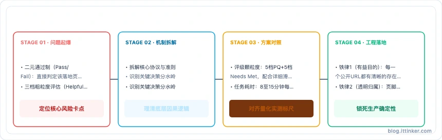
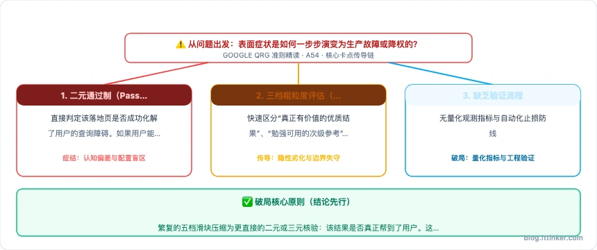
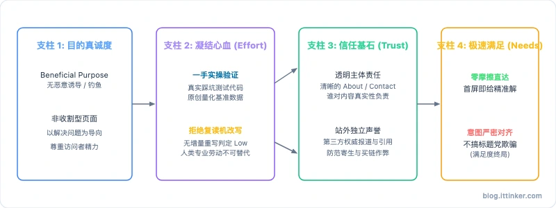
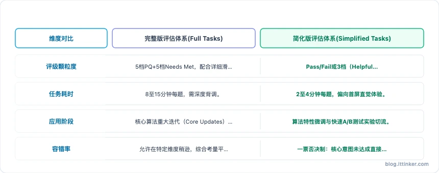
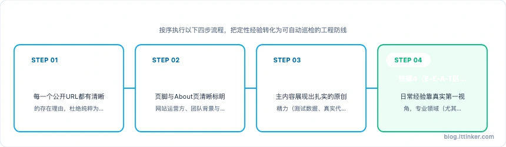
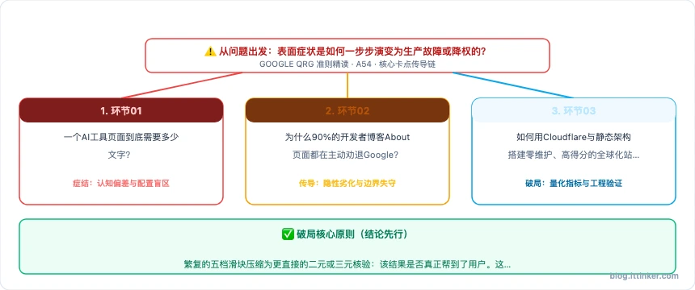

# “把英文站直接直译成小语种就能躺赚”？小语种出海的认知黑洞：非英语 SERP 的特殊生态与本地化真实门槛 | 读懂 Google Search 基础认知 系列 054

> 🌐 **在线阅读与互动版**：[“把英文站直接直译成小语种就能躺赚”？小语种出海的认知黑洞：非英语 SERP 的特殊生态与本地化真实门槛 | 读懂 Google Search 基础认知 系列 054](https://blog.ittinker.com/posts/把复杂-needs-met-简化之后-真正剩下的是什么/)
> 📚 **所属专栏**：[《读懂 Google Search：110篇搜索质量与SEO实战指南》](../README.md)

---

### 📌 结论先行（TL;DR）
> **QRG 31.0 引入的“简化版需求满足任务（Simplified Needs Met Tasks）”，将繁复的五档滑块压缩为更直接的二元或三元核验：该结果是否真正帮到了用户。**
> **从 [A01](/posts/google-搜索到底想解决什么问题/) 解析 Google 搜索试图解决的根本信息问题，到 [A17](/posts/e-e-a-t-到底是什么-为什么-trust-是唯一核心/) 确立 E-E-A-T 体系，再到 [A33](/posts/理解-query-是搜索优化真正的起点/) 之后长驱直入的 Needs Met 意图评级，我们拆解了 170 余页《Search Quality Rater Guidelines》的所有关键脉络。**
> **在这部厚重指南的最终章——第 31 节，Google 却做了一次反向减法：推出 **Simplified Needs Met Tasks**。**
> **当复杂的滑动标尺被拿掉，当评估员不需要再在 Highly Meets 与 Moderately Meets 之间反复纠结时，真正剩下的、最纯粹的搜索本质究竟是什么？**
>
> - 这一极简框架揭示了 Google 搜索排名的第一性原理——所有技术标签、外链指标和排版技巧，本质上都是信息承接的载体；
> - **排名的终极驱动力**：始终是**“用户意图与内容解决力的高保真匹配”**。
> - A 系列 54 篇文章至此完成了对整部 QRG 官方指南的系统解构，也为后续 B 系列将搜索准则映射到真实建站实战奠定了基石。

---

### 🚨 2026 → 2024 官方最新风向预警：Google 对Google 非英语（Cross-lingual & Multilingual）搜索质量评估体系的策略演进

#### 🕒 2026 → 2024 Google 官方对Google 非英语（Cross-lingual & Multilingual）搜索质量评估体系的策略演进

- **2026 · 小语种本土权威与文化习俗对齐（Cultural Nuance & Local Authority）**
  随着多语言大模型融入抓取管线，Google 能轻易识别出生硬机翻、语法崩坏、缺少本地支付方式与习惯用语的‘伪出海站’，将其与真实本土站点彻底隔绝。

- **2025 · 非英语市场的独立知识图谱权重提升**
  在日、德、法、阿等高净值小语种市场，算法大幅提升本土独立第三方媒体与政府数据库的背书权重，阻断海外站点的机械化批量倾销。

- **2024 · QRG 28.0 节对非英语市场评估（Non-English Rating）的特别指引**
  规范确立了本土语言评估员必须具备母语级文化洞察的制度，宣告以‘英文思维搞定全世界’的傲慢打法在现代 SEO 面前彻底碰壁。

---

## 1. 拆解 QRG 31.0：为什么要做简化评估？

QRG 31.0 明确指出了简化评估体系的设计初衷：

> *"Simplified Needs Met tasks are designed to streamline the evaluation process. Instead of using a complex five-point scale, raters are asked to make broader judgments about whether a result is helpful or unhelpful for the user's query."*

在日常的搜索工程测试中，Google 每年要上线数千次大小算法实验。如果每一次微调都需要评估员填写极其繁复的完整量表，实验吞吐量就会遭遇严重瓶颈。

简化任务主要采取以下形态：
1. **二元通过制（Pass / Fail）**：
   直接判定该落地页是否成功化解了用户的查询障碍。如果用户能在这个页面得到满意的答案或顺利完成操作，则为 Pass；若是答非所问、加载失败、欺诈广告，则为 Fail。
2. **三档粗粒度评估（Helpful / Somewhat Helpful / Unhelpful）**：
   快速区分“真正有价值的优质结果”、“勉强可用的次级参考”与“纯属浪费时间的垃圾噪点”。

这种简化不是降级，而是一次提纯：它迫使评估员丢掉教条的技术抠字眼，直接从真实人类的直觉感受出发，回答那个最本质的问题：**如果我是那个搜这个词的人，这个页面真的帮到我了吗？**

---

## 2. 搜索质量第一性原理：从 QRG 规则到算法现实

将整部 QRG 的 31 个章节抽象提炼，可以得到贯穿始终的四大第一性支柱：

---

## 3. 标准评估体系 vs 简化评估体系对比

理解两种模式的异同，有助于掌握评估员的思考逻辑：

| 维度对比 | 完整版评估体系 (Full Tasks) | 简化版评估体系 (Simplified Tasks) | 核心启示 |
| :--- | :--- | :--- | :--- |
| **评级颗粒度** | 5 档 PQ + 5 档 Needs Met，配合详细滑块。 | Pass / Fail 或 3 档（Helpful / Unhelpful）。 | 真正优秀的页面，无论尺度多粗都能稳定脱颖而出。 |
| **任务耗时** | 8 至 15 分钟每题，需深度背调。 | 2 至 4 分钟每题，偏向首屏直觉体验。 | 页面必须兼具“首屏冲击力”与“深层耐读性”。 |
| **应用阶段** | 核心算法重大迭代（Core Updates）的校准。 | 算法特性微调与快速 A/B 测试实验切流。 | 日常的小规模排名波动往往来自快速实验的检验反馈。 |
| **容错率** | 允许在特定维度稍逊，综合考量平衡。 | 一票否决制：核心意图未达成直接 Fail。 | 关键页面切忌出现致命的功能或体验短板。 |

---

## 4. 独立开发者与出海团队的“十项铁律”自查清单

在 A 系列收官之际，我们将整部 QRG 的精髓浓缩为出海建站的十项铁律：

- [ ] **铁律 1（有益目的）**：每一个公开 URL 都有清晰的存在理由，杜绝纯粹为了抓取流量而生造的无价值空壳页。
- [ ] **铁律 2（透明归属）**：页脚与 About 页清晰标明网站运营方、团队背景与真实联系方式。
- [ ] **铁律 3（人类心血）**：主内容展现出扎实的原创精力（测试数据、真实代码、一线业务经验），彻底告别纯机翻与同义改写。
- [ ] **铁律 4（E-E-A-T 区分）**：日常经验靠真实第一视角，专业领域（尤其 YMYL）靠学术与权威背书，不可角色错位。
- [ ] **铁律 5（Trust 终审）**：拒绝任何形式的诱导点击、全屏强阻弹窗与隐蔽扣费，Trust 拥有一票否决权。
- [ ] **铁律 6（结论先行）**：首屏第一眼给出答案或核心工具入口，降低用户的搜寻与认知摩擦。
- [ ] **铁律 7（设备平等）**：移动端具备与桌面端完全对等的文字深度、交互功能与加载速度。
- [ ] **铁律 8（意图收敛）**：明确区分查词、研究对比、购买转化与线下到访，匹配形态一致的落地页架构。
- [ ] **铁律 9（去重规范）**：100% 部署标准 Canonical 标记，清理多参数爬虫陷阱，杜绝模板化同质 pSEO。
- [ ] **铁律 10（独立声誉）**：走出自己的网站，在 GitHub、主流科技社区与媒体上建立真实的第三方声量信标。

---

## 5. A 系列完结，B 系列启程：从理论规约走向真实战场

A 系列用 54 篇长文，沿着 Google 官方质量评估员指南（QRG）的章节脉络，从宏观哲学一直剖析到微观判定细则。

我们彻底看清了搜索巨头眼中的“好网页”到底长什么样。

但这仅仅完成了认知层面的重构。

当面对真实的生产环境代码仓库、当面对一个新立项的海外 AI 效率工具、当面对一个多语言跨境电商独立站——**我们该如何在具体的页面布局、代码结构、外链建设与技术选型中，把这 54 篇指南的精髓化为真刀真枪的代码与转化率？**

系列 B《把 Google 搜索规则用到真实网站》即将展开。

在 B 系列中，我们将打破 QRG 的文本顺序，以真实的建站、开发、出海与商业化场景为驱动：
- 一个 AI 工具页面到底需要多少文字？
- 为什么 90% 的开发者博客 About 页面都在主动劝退 Google？
- 如何用 Cloudflare 与静态架构搭建零维护、高得分的全球化站群？
- 在大模型搜索时代，如何让自己的产品被 Perplexity 和 SearchGPT 主动引用？

真实战场，精彩继续。

---

## 读懂 Google Search 专栏导航

> 📚 **专栏收录**：本文为 [《读懂 Google Search：110篇搜索质量与SEO实战指南》](/posts/google-search-guide/) 第 **A54** 篇。

* **专栏主页**：[《读懂 Google Search：110篇搜索质量与SEO实战指南》全景地图与路线图](/posts/google-search-guide/)
