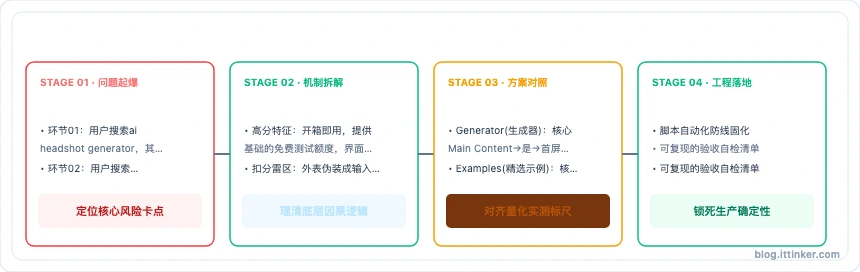
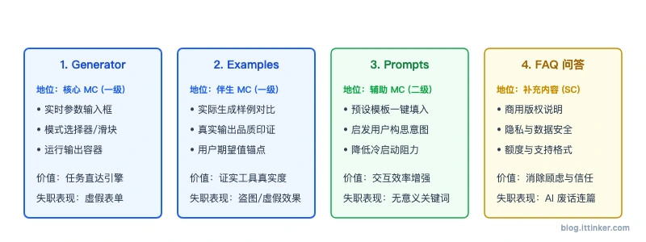
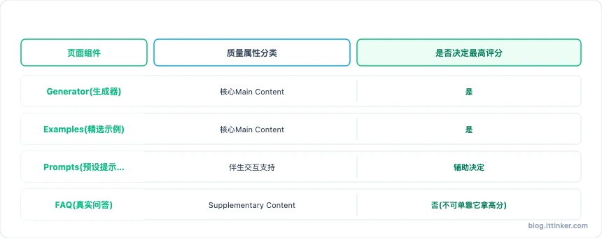
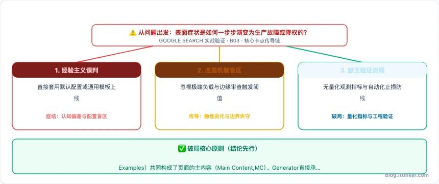
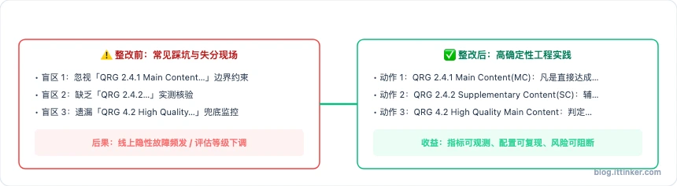
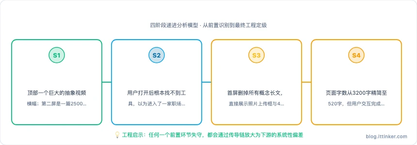
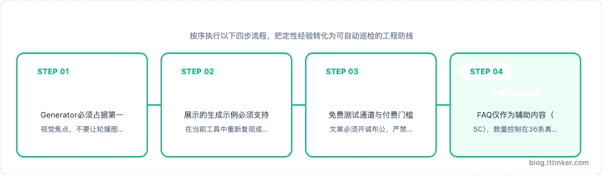

# “核心功能就是个输入框”？AI 工具站被批量降权的真相：Generator、Examples、Prompt、FAQ，谁才是真正的 Main Content？ | 读懂 Google Search SEO 实战 系列 003

> 🌐 **在线阅读与互动版**：[“核心功能就是个输入框”？AI 工具站被批量降权的真相：Generator、Examples、Prompt、FAQ，谁才是真正的 Main Content？ | 读懂 Google Search SEO 实战 系列 003](https://blog.ittinker.com/posts/generator-examples-prompt-faq-谁才是-ai-工具页的-main-content/)
> 📚 **所属专栏**：[《读懂 Google Search：110篇搜索质量与SEO实战指南》](../README.md)

---

> ### 📌 结论先行（TL;DR）
> **在 AI 工具落地页中，生成器交互组件（Generator）与真实生成样例（Examples）共同构成了页面的主内容（Main Content, MC）。**
>
> - **双核主内容**：**Generator**（即刻执行交付）与 **Examples**（实证输出能力）共同承载核心使命，是决定评级生死的唯二基石。
> - **修饰支持**：**Prompt** 预设与参数仅属于 MC 的操作修饰层，无法单独支撑起完整页面。
> - **辅助边界**：**FAQ** 纯属辅助内容（SC），其唯一价值是化解顾虑与建立透明度，绝非关键词垃圾桶。
> - **致命错配**：将 Generator 做成不可用的静态截图、反把万字长文与折叠 FAQ 堆上首屏，直接触发 QRG 评级大滑坡。


---

### 🚨 2024–2026 官方最新风向预警：Google 对 FAQ 与内容堆砌的策略演进

很多站长至今仍在用 2022 年前的老思维做 SEO：在页面底部拼命塞十几屏由大模型批量生成的 FAQ，甚至企图借助 Schema 标记在搜索结果中强行抢占折叠卡片。Google 官方在近年的一系列重大算法与规则更新中，已经对这种投机模式完成精准定点清算：

#### 🕒 2026 → 2024 Google 官方对 FAQ 与堆砌内容的策略演进

- **2026 · 行动意图（Do Intent）脱钩长文，全面回归即刻任务交付**
  Google 算法（NavBoost 与持续迭代的 Helpful Content 系统）对工具站建立“秒级任务交付”考核：FAQ 仅允许收录**极高信任度事实**（退款政策、商用版权、数据是否被用于 AI 训练）。凡是在工具下方充当“伪百科科普”的灌水长文，均被算法精准识别并打入低质区间。

- **2025 · 隐藏折叠抽屉与“伪 FAQ”质量降级**
  依据 Google 搜索中心与 [QRG 3.2 / 4.6 实用内容准则](https://developers.google.com/search/docs/fundamentals/creating-helpful-content)，页面首屏下方为了塞关键词而默认折叠、且缺乏真实用户有效交互的“伪 FAQ 抽屉”，在多模态理解下被明确判定为干扰性补充内容（Distracting SC），不仅无法贡献排名，反而严重稀释核心功能（MC）权重。

- **2024-08 · 全面收紧 FAQ 富媒体结果（Rich Results）展示特权**
  Google [官方调整结构化数据展示规范](https://developers.google.com/search/docs/appearance/structured-data/faqpage)，将 `FAQPage` 富媒体搜索展现严格限制为权威政府及医疗健康机构。普通商业与独立工具站即便写满 FAQ Schema 也不再享有 SERP 下拉折叠特权，彻底终结了“为抢占屏幕面积硬堆 FAQ”的技术投机。

- **2024-03 · 大规模内容滥用（Scaled Content Abuse）纳入核心红线**
  Google 在 [2024年3月核心更新与垃圾内容政策](https://developers.google.com/search/blog/2024/03/core-update-spam-policies) 中，正式将“规模化内容滥用”确立为严重违规行为，严厉打击利用模板与大模型批量生成数千条同质化空洞 FAQ、意图劫持长尾流量的操纵手段。


打开目前主流的海外 AI 产品落地页，界面模块通常遵循一套高度标准化的排版套路：
1. 顶部 Hero 区放交互输入框（Generator）；
2. 中间展示网格状的生成对比样例（Examples）；
3. 旁边或下方附带一组预设提示词（Prompts）；
4. 底部罗列一长串折叠问答菜单（FAQ）。

很多团队在做 SEO 优化时，把大部分精力花在撰写底部 FAQ 和长文介绍上，试图以此抓取长尾关键词；而在实际产品体验中，首屏的 Generator 却往往只是一个静态截图，或者点击后强制弹出付费拦截弹窗。

在 Google 评估员的显微镜下，这种排版布局究竟谁才是决定页面生死的 Main Content？





---

## 1. QRG 视角下的组件定位：直接服务页面目的

QRG 2.4.1 给出了判断 Main Content 的黄金铁律：
> *"Main Content is any part of the page that directly helps the page achieve its purpose."*

要判定谁是 MC，必须先审视用户访问该页面的**根本目的（Page Purpose）**：
- 用户搜索 `ai headshot generator`，其目的是把自拍照转换成专业职场照；
- 用户搜索 `midjourney prompt builder`，其目的是拼接出可用的参数与视觉风格提示词。

基于此目的，我们对四大常见模块进行逐一切片剖析。


---

## 2. 四大模块的质量定位与边界拆解





### 1. Generator：核心 MC 的功能承载
Generator 是一个工具页面的心脏。用户访问页面的首要目的就是使用它。
- **高分特征**：开箱即用，提供基础的免费测试额度，界面反馈迅捷；
- **扣分雷区**：外表伪装成输入框，用户打字点击“生成”后，立刻弹窗强迫输入信用卡或注册第三方服务；或者按钮纯属摆设，点击后仅刷新页面。这在 QRG 4.5 中会被直接判定为欺骗性设计（Deceptive / Low PQ）。

### 2. Examples：展示原创性与专业造诣的伴生 MC
对于生成类产品，用户往往无法预先得知模型的产出水准。精选的高质量 Examples 是证明产品能力的关键证据。
- **高分特征**：展示真实未经修饰的生成案例，提供输入提示词与生成结果的对照展示，展现开发团队的调优工程投入（Effort）；
- **扣分雷区**：盗用其他开源社区的经典图片或虚构无从验证的高清海报，误导用户预期。

### 3. Prompts / Presets：降低摩擦的实用修饰
初次接触工具的用户往往面临“提示词编写障碍”。提供一组经过精细测试的预设 Prompts，属于直接增强 MC 易用性的实用补充。
- **高分特征**：点击即可快速填入输入框，且每个提示词都对应独特的应用细分场景；
- **扣分雷区**：机械堆叠几百个近义词列表，企图通过密集关键词搞隐蔽黑帽优化。

### 4. FAQ：锦上添花但不能喧宾夺主的 SC
在 QRG 2.4.2 中，FAQ 属于典型的补充内容（Supplementary Content）。
- **高分特征**：只解决用户最关心的 3~5 个阻碍性疑问（生成的图片版权归谁、上传的原图会不会保留在服务器、支持导出什么分辨率）；
- **扣分雷区**：用 AI 批量生成 20 条毫无营养的百科常识（如“什么是人工智能”、“为什么要使用矢量图”），反客为主占据全页 80% 的篇幅。

---

## 3. 四大组件属性对比一览表

| 页面组件 | 质量属性分类 | 是否决定最高评分 | 建议视距排布 | 常见严重违规陷阱 |
|---|---|---|---|---|
| **Generator (生成器)** | 核心 Main Content | 是 | 首屏 100% 视觉中心 | 假输入框、点击强行外跳未授权广告 |
| **Examples (精选示例)** | 核心 Main Content | 是 | 紧随输入框下方 | 虚假宣传、使用非本产品生成的图例 |
| **Prompts (预设提示词)** | 伴生交互支持 | 辅助决定 | 镶嵌在 Generator 内部或紧邻展示 | 堆砌无意义同义词干扰正常操作 |
| **FAQ (真实问答)** | Supplementary Content | 否 (不可单靠它拿高分) | 页面底部末屏 | 填充长篇百科废话，企图以此撑大文本量 |





---

## 4. 架构实操：Next.js 16 现代 AI 落地页模块实现

在前端工程结构中，必须保持 MC 与 SC 的语义层级严谨分离。以下示例展示了 Generator 与 Examples 作为 MC 的核心渲染机制：

```tsx
// components/landing/AiToolLandingLayout.tsx
import React from 'react';
import { InteractiveGenerator } from './InteractiveGenerator';
import { CuratedExampleGrid } from './CuratedExampleGrid';
import { PromptPillList } from './PromptPillList';
import { AccordionFaq } from './AccordionFaq';

interface ExampleItem {
  id: string;
  prompt: string;
  outputPreviewUrl: string;
  resolution: string;
  generationDurationSec: number;
}

export function AiToolLandingLayout({
  toolTitle,
  examples,
}: {
  toolTitle: string;
  examples: ExampleItem[];
}) {
  return (
    <div className="min-h-screen bg-slate-50 text-slate-900">
      {/* 核心主内容区：由 Generator 与真实 Examples 组成 */}
      <main id="main-content" className="mx-auto max-w-6xl px-4 py-8">
        {/* MC 区域 1: 交互生成器 */}
        <section aria-labelledby="mc-generator-title" className="space-y-4">
          <h1 id="mc-generator-title" className="text-3xl font-bold tracking-tight text-slate-950 sm:text-4xl">
            {toolTitle}
          </h1>
          <InteractiveGenerator defaultPrompt="Corporate headshot in modern office, soft lighting" />
          {/* Prompt 预设作为操作辅助嵌入 */}
          <PromptPillList
            presets={[
              'Studio lighting portrait, solid gray backdrop',
              'Outdoor casual business blazer, bokeh background',
              'Creative industry founder, natural window light',
            ]}
          />
        </section>

        {/* MC 区域 2: 真实案例展示 - 严谨展示技术指标，传递 Effort 与 Skill */}
        <section aria-labelledby="mc-examples-title" className="mt-16 space-y-6">
          <div className="flex items-center justify-between">
            <h2 id="mc-examples-title" className="text-2xl font-bold text-slate-900">
              Verified Production Generations
            </h2>
            <span className="text-xs font-mono text-slate-500">Unretouched Output</span>
          </div>
          <CuratedExampleGrid items={examples} />
        </section>

        {/* 辅助内容区 (SC): 放在文档流末尾，绝不遮挡 MC */}
        <section aria-labelledby="sc-faq-title" className="mt-20 border-t border-slate-200 pt-10">
          <h2 id="sc-faq-title" className="text-xl font-bold text-slate-900">
            Safety & Licensing Transparency
          </h2>
          <AccordionFaq
            items={[
              {
                q: 'Who owns the commercial rights to generated outputs?',
                a: 'You retain 100% full commercial ownership of all generated assets from day one.',
              },
              {
                q: 'What is your retention policy for uploaded face photos?',
                a: 'Uploaded images are automatically purged from S3 storage buckets within 60 minutes of inference.',
              },
            ]}
          />
        </section>
      </main>
    </div>
  );
}
```


---

## 5. 页面 MC 与 SC 权重比检测脚本 (Python)

站长可以借助如下 Python 脚本，快速分析自身页面中主内容（MC）与辅助内容（SC）的文本与 DOM 节点占比，防止 FAQ 反客为主：

```python
#!/usr/bin/env python3
"""
audit_mc_sc_ratio.py - 检验工具页 MC 与 SC 的健康比例
用法: python audit_mc_sc_ratio.py https://example.com/tool
"""

import sys
import urllib.request
from bs4 import BeautifulSoup

def analyze_page_composition(target_url: str):
    req = urllib.request.Request(target_url, headers={"User-Agent": "Mozilla/5.0 (compatible; ITTinkerAuditor/1.0)"})
    with urllib.request.urlopen(req) as response:
        html = response.read().decode("utf-8")

    soup = BeautifulSoup(html, "html.parser")

    # 提取表单、交互容器与样例区域文字作为 MC 粗略估算
    mc_tags = soup.find_all(["form", "textarea", "input", "canvas"])
    examples_container = soup.find(attrs={"aria-labelledby": lambda x: x and "example" in x.lower()})

    mc_char_count = sum(len(tag.get_text(strip=True)) for tag in mc_tags)
    if examples_container:
        mc_char_count += len(examples_container.get_text(strip=True))

    # 提取 FAQ 与 Footer 文字作为 SC
    faq_container = soup.find(attrs={"aria-labelledby": lambda x: x and "faq" in x.lower()})
    footer_tag = soup.find("footer")

    sc_char_count = 0
    if faq_container:
        sc_char_count += len(faq_container.get_text(strip=True))
    if footer_tag:
        sc_char_count += len(footer_tag.get_text(strip=True))

    total_text = len(soup.get_text(strip=True))
    print(f"📊 页面分析报告: {target_url}")
    print(f"  - 总文本字符数: {total_text}")
    print(f"  - 识别到核心 MC 字符数: {mc_char_count}")
    print(f"  - 识别到 SC (FAQ+Footer) 字符数: {sc_char_count}")

    if sc_char_count > mc_char_count * 2.5:
        print("⚠️ 架构失衡: SC 篇幅超过 MC 的 2.5 倍，存在为了凑字数注水 FAQ 的风险！")
    else:
        print("✅ 权重健康: 核心功能与示例占据主导，辅助内容克制得当。")

if __name__ == "__main__":
    url = sys.argv[1] if len(sys.argv) > 1 else "https://ittinker.com"
    analyze_page_composition(url)
```





---

## 6. Schema.org 复合结构化数据声明规范

为了让 Google 爬虫精准解析工具功能与生成样例，推荐同时声明 `SoftwareApplication`、`ItemList` 与 `FAQPage`：

```html
<script type="application/ld+json">
{
  "@context": "https://schema.org",
  "@graph": [
    {
      "@type": "SoftwareApplication",
      "name": "AI Headshot Generator",
      "applicationCategory": "MultimediaApplication",
      "operatingSystem": "Web",
      "offers": {
        "@type": "Offer",
        "price": "0",
        "priceCurrency": "USD"
      }
    },
    {
      "@type": "ItemList",
      "name": "Verified Output Showcase",
      "description": "Unedited results generated by our proprietary diffusion checkpoint",
      "itemListElement": [
        {
          "@type": "ListItem",
          "position": 1,
          "name": "Executive Studio Portrait",
          "url": "https://ittinker.com/examples/executive-1"
        },
        {
          "@type": "ListItem",
          "position": 2,
          "name": "Creative Director Casual",
          "url": "https://ittinker.com/examples/creative-2"
        }
      ]
    },
    {
      "@type": "FAQPage",
      "mainEntity": [
        {
          "@type": "Question",
          "name": "Who owns the commercial rights to generated outputs?",
          "acceptedAnswer": {
            "@type": "Answer",
            "text": "You retain 100% full commercial ownership of all generated assets."
          }
        }
      ]
    }
  ]
}
</script>
```


---

## 7. QRG 关联条款深度对照速查

在评估 Main Content 边界时，QRG 给出如下判别标尺：
- **QRG 2.4.1 Main Content (MC)**：凡是直接达成页面目的的任何组件均为 MC。对于工具站而言，运行组件与输出展示属于不可分割的第一级 MC。
- **QRG 2.4.2 Supplementary Content (SC)**：辅助内容的作用是完善用户体验（如导航、版权说明、FAQ）。SC 不能掩盖或打断 MC 的顺畅使用。
- **QRG 4.2 High Quality Main Content**：判定 MC 质量的核心在于人工调优投入（Effort）、独创性（Originality）与技术造诣（Skill）。真实的 Examples 直接折射出开发团队在模型微调与参数调配上的硬实力。
- **QRG 4.5.4 Disruptive Content**：如果 SC 或促销模块使读者难于接触或操作 MC，该页面将被判定为 Low 甚至更低。





---

## 8. 真实重构实录：某 AI 头像站的质量分逆转

### 重构前：主辅倒置的泥潭
- **页面排版**：顶部一个巨大的抽象视频横幅；第二屏是一篇 2500 字的长文《为什么职场头像很重要》；第三屏是一个只有文字链接的“点击开始生成”；底部是 15 个折叠的展开问答。
- **后果**：用户打开后根本找不到工具，以为进入了一家职场咨询机构的博客；跳出率高达 82%，Google 搜索表现长期在第 5 页挣扎。

### 重构后：聚焦 MC 黄金法则
- **结构调整**：
  1. 首屏删掉所有概念长文，直接展示照片上传框与 4 款精选职场模板选项；
  2. 上传框右侧并排展示 3 组真实生成的职场照对比卡片（附带真实参数标示）；
  3. 底部仅保留 4 条精悍问答（商用权、数据安全删除承诺、生成时间耗时）。
- **成效**：页面字数从 3200 字精简至 520 字，但用户交互完成率提升 400%，在 `ai business headshot` 等核心行动词上的排名在两周内冲入首页前五。





---

## 9. 独立开发者自查清单

在设计 AI SaaS 落地页前，对照下列清单核验结构健康度：

- [ ] **视觉定焦**：Generator 必须占据第一视觉焦点，不要让轮播图或广告横幅遮挡交互入口；
- [ ] **样例可溯**：展示的生成示例必须支持在当前工具中重新复现或查看具体 Prompt；
- [ ] **功能诚实**：免费测试通道与付费门槛文案必须开诚布公，严禁欺骗性引流；
- [ ] **克制 FAQ 篇幅**：FAQ 仅作为辅助内容（SC），数量控制在 3~6 条真实关切，坚决删除一切凑字数的概念性问答；
- [ ] **移动端可用**：在手机端打开时，键盘弹起后输入框与生成按钮依然清晰易触达；
- [ ] **结构化标记**：配置 SoftwareApplication 与 ItemList 复合 JSON-LD，明确标出核心属性。





---

## 10. 下一篇预告

厘清了落地页的核心 MC 归属后，许多开发者为了追求商业变现，会在页面中密集插入多个醒目的行动号召（Call to Action, CTA）按钮，例如“立即注册”、“升级 Pro”、“获取终身折扣”。

这些密集的商业转化按钮，究竟会不会被 Google 评估员视作干扰性广告而扣分？

下一篇我们将拆解 **[“CTA 越多转化越高”？出海独立开发者的转化迷信，为什么正在把你的落地页送进 Google 降权黑名单？（B04）](/posts/cta-太多会不会伤害页面质量/)**，界定合理的商业转化与侵入式干扰之间的安全边界。


---

## 读懂 Google Search 专栏导航

> 📚 **专栏收录**：本文为 [《读懂 Google Search：110篇搜索质量与SEO实战指南》](/posts/google-search-guide/) 第 **B03** 篇。

* **专栏主页**：[《读懂 Google Search：110篇搜索质量与SEO实战指南》全景地图与路线图](/posts/google-search-guide/)
