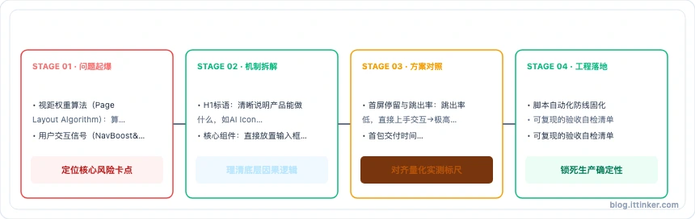
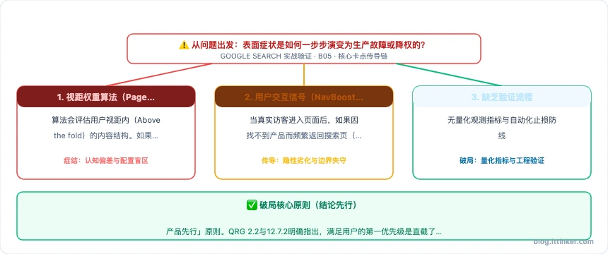
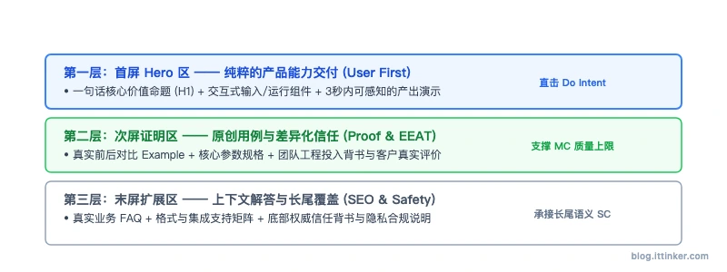
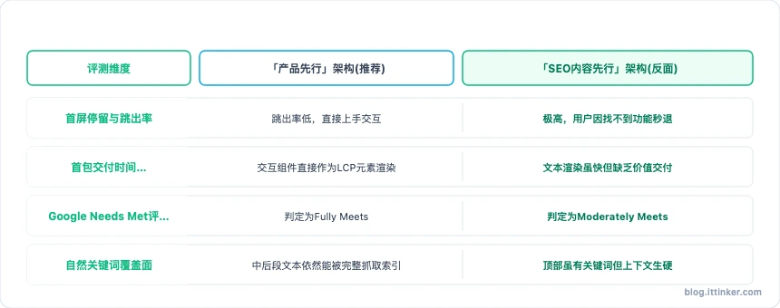
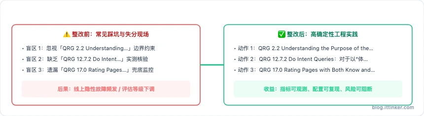
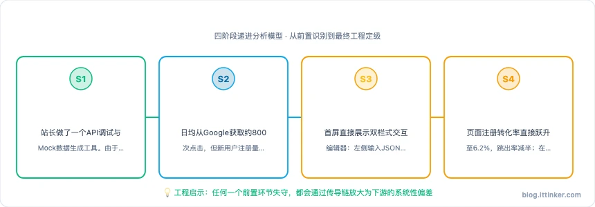
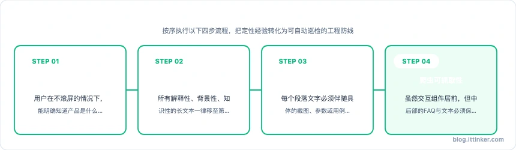

# “先讲产品还是先写文本”？落地页首屏博弈与意图对齐 | 读懂 Google Search SEO 实战 系列 005

> 🌐 **在线阅读与互动版**：[“先讲产品还是先写文本”？落地页首屏博弈与意图对齐 | 读懂 Google Search SEO 实战 系列 005](https://blog.ittinker.com/posts/landing-page-应该先讲产品-还是先讲-seo-内容/)
> 📚 **所属专栏**：[《读懂 Google Search：110篇搜索质量与SEO实战指南》](../README.md)

---

### 📌 结论先行（TL;DR）

> **商业与行动型落地页（Commercial / Do Landing Page）必须毫不犹豫地执行「产品先行」原则**。
>
> - **核心目的优先（QRG 2.2 & 12.7.2）**：满足用户的第一优先级是直截了当地提供具备交付能力的工具或产品核心交互界面，而非先让用户做名词解释阅读题；
> - **拒绝首屏文字废话**：首屏强行堆砌通用 SEO 概念长文，只会造成用户理解摩擦、跳出率激增与即刻回退（Pogo-sticking），直接触发 NavBoost 负向交互信号；
> - **纵向信息流三层分工**：在首屏集中展现**产品核心价值主张（UVP）与直接交互入口**，而将用于承接长尾语义、解构工作原理与深度技术 FAQ 的 SEO 支持内容置于中后段作为次级承载，既喂饱现代爬虫，又实现高转化。


### 🚨 2026 → 2024 官方最新风向预警：Google 对落地页首屏体验与意图交付的策略演进

很多独立开发者为了迎合传统 SEO 的“抓取焦虑”，常常把大段背景介绍放在首屏，而将真正的核心工具或产品演示下推到二三屏。Google 官方与 Page Experience 评估系统早已对此类向爬虫妥协、牺牲用户行动流的页面完成多轮算法打击与评估标准收紧：

#### 🕒 2026 → 2024 Google 官方对落地页排布与首屏体验的策略演进

- **2026 · 视口渲染与多模态意图匹配：严打延迟主功能交付（Delayed MC Delivery）**
  Googlebot 现代渲染管线全面整合多模态视觉检测模型。对于“工具型（Do）”与“商业转化（Commercial）”落地页，算法会直接评估用户首屏可视视口（Above-the-Fold Viewport）的功能承载比。若首屏被泛化行业科普、历史溯源等低转化文本堆满，而将核心输入框、生成按钮或即用型 Demo 推迟至 1.5 屏以后，算法判定其存在“意图交付延迟（Delayed Main Content Delivery）”，在搜索意图满足度评级（Needs Met）中直接降档，不再赋予顶级排名权重。

- **2025 · 交互行为信号与即时回退监控（NavBoost & CrUX 联动）**
  依托 Chrome 真实用户体验数据（CrUX）与搜索交互反馈系统（NavBoost），Google 大幅强化了对“用户进站后秒退回 SERP（Pogo-sticking）”特征的识别。实测数据显示：当搜索“在线格式转换器”、“API 调试工具”等高行动意图词的用户落地后，面对长篇大论的名词解释，平均回退率高达 70% 以上。系统会自动判定该落地页存在“结构与查询意图失配（Intent Mismatch）”，从而持续削减其在核心大词上的展现机会。

- **2024 · 核心更新整合页面布局算法（Page Layout Algorithm）深入底层核心**
  Google 在历次核心更新（Core Updates）中，将经典的 Page Layout Algorithm 深度融入质量评估核心。该算法重点评估用户在无需滚屏的前提下能否立即消费或操作主内容（Main Content）。凡是强迫用户翻越“冗长导语墙（Wall of Generic Text）”才能找到实际服务或软件下载入口的落地页，均被归入低易用性区间。Google 官方反复强调：页面应当为真实用户的核心任务服务，而非把 SEO 文本堆在顶部用来讨好搜索引擎。


---

在设计产品落地页（Landing Page）时，许多独立开发者经常陷入两难挣扎：
- **产品直觉**告诉你：用户注意力只有 3 秒，首屏必须放最酷炫的产品截图、即开即用的交互表单、或者直观的一键运行按钮；
- **SEO 焦虑**却在耳边警告：Google 爬虫是看文本的！如果首屏不堆上三段包含核心关键词的导语、不定义清楚行业术语，爬虫可能根本读不懂页面在干什么。

于是，我们经常看到一种畸形的落地页：首屏充斥着冗长无聊的“定义解释”和“为什么选择某某方案”，真正的产品演示和交互输入框被深深埋在页面第三屏。

这种向爬虫盲目妥协的做法，正在严重破坏你的产品转化与搜索评级。





---

## 1. 爬虫与用户的统一：现代 Google 算法如何审视首屏

过去二十年里，粗糙的 SEO 策略习惯于“伺候爬虫”：文本放在最顶上，关键词加粗三次，哪怕排版丑陋，只要文本权重高就能拿到排名。

但在现代 Google 搜索体系中，算法已经具备渲染完整 DOM、解析 CSS 视觉层级（Visual Layout）与捕获真实用户行为信号的能力：
1. **视距权重算法（Page Layout Algorithm）**：算法会评估用户视距内（Above the fold）的内容结构。如果首屏缺乏实质性解决方案，用户需要翻越重重文字障碍才能找到核心功能，页面会被判定为易用性低下；
2. **用户交互信号（NavBoost & Chrome CrUX）**：当真实访客进入页面后，如果因找不到产品而频繁返回搜索页（Pogo-sticking），算法会立即降低该页面的满足度打分。

在 QRG 第 2.2 节《Understanding the Purpose of the Page》中，Google 明确指出：**评估一个页面的第一步，是明确其存在目的，并检查该目的是否被高效达成**。

对于商业产品与工具落地页，用户进入的目的就是**评估产品、使用产品或购买产品**。首屏讲产品，恰恰是在最高优先级上满足页面目的。





---

## 2. 纵向信息流的黄金比例：从产品到深度的三层递进

把“产品放在第一位”，并不意味着完全放弃 SEO 文本。优秀的落地页架构遵循清晰的三层递进法则：





### 1. 首屏（Above the Fold）：纯粹的产品直球
这一层是留给用户的。
- **H1 标语**：清晰说明产品能做什么，如 `AI Icon Generator: Create SVG Icons in Seconds`；
- **核心组件**：直接放置输入框或交互 Demo，让用户无需登录即可看到工作形态；
- **辅佐文字**：仅需 2~3 行简明副标题，杜绝任何历史起源与百科名词解释。

### 2. 次屏（Mid Page）：原创实证与能力边界
这一层既满足用户的对比心理，又承载 Google 对 Effort & Originality 的考核。
- **真实用例**：展示 6~12 个高品质生成案例，标注真实耗时与提示词；
- **功能特性列表**：提炼产品的独特工程优势（如本地 WebAssembly 渲染、高并发低延迟响应）；
- **参数规格**：支持的文件类型、输出分辨率、API 响应时间等客观硬核数据。

### 3. 底屏（Bottom Page）：语义补充与疑难解答
这一层是安抚爬虫与解决用户最后顾虑的区域。
- **长尾 FAQ**：解答商用版权归属、扣费规则、安全合规问题；
- **技术原理一瞥**：简短说明工具的处理链路，自然融入领域长尾词汇。

---

## 3. 两类排布策略的多维指标对决

| 评测维度 | 「产品先行」架构 (推荐) | 「SEO 内容先行」架构 (反面) | 胜出原因 |
|---|---|---|---|
| **首屏停留与跳出率** | 跳出率低，直接上手交互 | 极高，用户因找不到功能秒退 | 产品先行完胜 |
| **首包交付时间 (TTFB/LCP)** | 交互组件直接作为 LCP 元素渲染 | 文本渲染虽快但缺乏价值交付 | 产品先行更符合实际诉求 |
| **Google Needs Met 评级** | 判定为 Fully Meets | 判定为 Moderately Meets | 产品先行直达意图核心 |
| **自然关键词覆盖面** | 中后段文本依然能被完整抓取索引 | 顶部虽有关键词但上下文生硬 | 两者长尾索引能力相当 |
| **访客到注册转化率** | 3.5% ~ 8% | 0.8% ~ 1.5% | 产品先行碾压 |





---

## 4. 前端架构：Next.js 16 服务端纯文本与客户端岛屿分层渲染 (React 19 PPR)

为了在技术层面同时满足“爬虫可索引”与“用户毫秒级交互”，最佳实践是将首屏交互作为独立的 Client Component，而将次屏规格与底屏 FAQ 作为纯 Server Component：

```tsx
// app/landing/product-layout/page.tsx
import type { Metadata } from 'next';
import dynamic from 'next/dynamic';
import { SpecComparisonTable } from '@/components/landing/SpecComparisonTable';
import { SeoFaqSection } from '@/components/landing/SeoFaqSection';

// 客户端交互岛屿：延迟加载重型前端编辑器或运行时
const InteractiveEditorIsland = dynamic(
  () => import('@/components/landing/InteractiveEditorIsland').then((m) => m.InteractiveEditorIsland),
  { ssr: false, loading: () => <div className="h-72 w-full animate-pulse rounded-xl bg-slate-100" /> }
);

export const metadata: Metadata = {
  title: 'Cloudflare Tunnel Manager | GUI Deployment & Health Telemetry',
  description: 'Deploy, configure, and monitor Cloudflare Zero Trust tunnels with an intuitive web dashboard.',
  alternates: { canonical: 'https://ittinker.com/landing/cf-tunnel-manager' },
};

export default function ProductLandingPage() {
  return (
    <div className="flex flex-col min-h-screen">
      {/* 第 1 层：首屏 Hero 区 —— 产品先行，交互直达 */}
      <header className="mx-auto w-full max-w-6xl px-4 pt-12 pb-8">
        <div className="text-center sm:text-left space-y-3">
          <span className="inline-block rounded-full bg-blue-50 px-3 py-1 text-xs font-semibold text-blue-700">
            Open Source Core
          </span>
          <h1 className="text-3xl font-extrabold tracking-tight text-slate-900 sm:text-5xl">
            Cloudflare Tunnel Web GUI
          </h1>
          <p className="max-w-2xl text-base text-slate-600 sm:text-lg">
            Manage ingress rules, inspect live socket tunnels, and monitor uptime without touching YAML configs.
          </p>
        </div>
        <div className="mt-8">
          <InteractiveEditorIsland defaultDomain="api.example.com" defaultService="http://localhost:8080" />
        </div>
      </header>

      <main className="mx-auto w-full max-w-6xl px-4 py-12 space-y-20">
        {/* 第 2 层：次屏证明区 (纯服务端渲染，确保文本与规格完整索引) */}
        <section aria-labelledby="specs-heading">
          <h2 id="specs-heading" className="text-2xl font-bold text-slate-900">
            Architecture Specs & Benchmark Proof
          </h2>
          <SpecComparisonTable
            specs={[
              { metric: 'Binary Footprint', value: '18 MB single executable' },
              { metric: 'Average Memory Footprint', value: '24 MB RSS at 1,000 req/s' },
              { metric: 'Zero Trust Protocol', value: 'QUIC / HTTP/2 multiplexed' },
            ]}
          />
        </section>

        {/* 第 3 层：底屏长尾扩展区 (服务端静态输出，注入 FAQ 语义) */}
        <section aria-labelledby="faq-heading" className="border-t border-slate-200 pt-12">
          <h2 id="faq-heading" className="text-2xl font-bold text-slate-900">
            Technical Architecture & FAQ
          </h2>
          <SeoFaqSection />
        </section>
      </main>
    </div>
  );
}
```


---

## 5. 首屏内容结构与视口分布审计脚本 (Python + Playwright)

使用自动化测试脚本检验首屏视口中产品交互区域与文字的面积配比：

```python
#!/usr/bin/env python3
"""
audit_above_fold_distribution.py - 检验首屏产品与文本的视口分布
依赖: pip install playwright && playwright install chromium
"""

import sys
from playwright.sync_api import sync_playwright

def audit_layout_priority(url: str):
    with sync_playwright() as p:
        browser = p.chromium.launch(headless=True)
        context = browser.new_context(viewport={"width": 1280, "height": 800})
        page = context.new_page()
        page.goto(url, wait_until="networkidle")

        viewport_height = 800

        # 获取首屏内交互控件的高度和位置
        interactive_selector = "form, .interactive-island, textarea, button.primary-action"
        element = page.query_selector(interactive_selector)

        if not element:
            print("❌ 结构警报: 首屏内未检测到任何直接可用的交互控件或产品演示组件！")
            sys.exit(1)

        box = element.bounding_box()
        if box["y"] > viewport_height * 0.7:
            print(f"⚠️ 下沉严重: 交互组件起始位置处于视口 70% 之下 (y={box['y']:.1f}px)，首屏被前置废话占用！")
        else:
            print(f"✅ 排布合格: 交互组件处于视口黄金区 (y={box['y']:.1f}px, height={box['height']:.1f}px)")

        # 检查首屏内文字段落的字数
        first_screen_p_words = page.evaluate(
            """(vh) => {
                const paragraphs = Array.from(document.querySelectorAll('p'));
                const aboveFold = paragraphs.filter(p => {
                    const r = p.getBoundingClientRect();
                    return r.top < vh;
                });
                return aboveFold.map(p => p.innerText).join(' ').split(/\\s+/).filter(Boolean).length;
            }""",
            viewport_height
        )

        print(f"📊 首屏正文词数: {first_screen_p_words} 词")
        if first_screen_p_words > 120:
            print("⚠️ 冗余警告: 首屏正文超过 120 词，建议压缩解释性文字，强化产品界面直观度。")
        else:
            print("✅ 密度适宜: 首屏文案精简克制，全力突出产品核心价值。")

        browser.close()

if __name__ == "__main__":
    target = sys.argv[1] if len(sys.argv) > 1 else "http://localhost:3000"
    audit_layout_priority(target)
```


---

## 6. Schema.org 复合产品与服务元数据规范

通过结构化数据，确保搜索引擎能够在首屏文字精简的情况下，依旧深刻理解产品的商业与技术属性：

```html
<script type="application/ld+json">
{
  "@context": "https://schema.org",
  "@graph": [
    {
      "@type": "SoftwareApplication",
      "name": "Cloudflare Tunnel Manager",
      "applicationCategory": "NetworkingApplication",
      "operatingSystem": "Linux, macOS, Windows",
      "offers": {
        "@type": "Offer",
        "price": "0",
        "priceCurrency": "USD"
      },
      "featureList": [
        "Visual Ingress Rule Builder",
        "Live Socket Telemetry",
        "Automatic Systemd Daemon Provisioning"
      ]
    },
    {
      "@type": "FAQPage",
      "mainEntity": [
        {
          "@type": "Question",
          "name": "Does this tool expose incoming ports to the public internet?",
          "acceptedAnswer": {
            "@type": "Answer",
            "text": "No. All connections are outbound tunnels routed securely through Cloudflare Edge networks."
          }
        }
      ]
    }
  ]
}
</script>
```


---

## 7. QRG 关联条款判定依据详解

- **QRG 2.2 Understanding the Purpose of the Page**：任何页面的首要准则是顺畅实现其设计初衷。商业软件落地页的目的是让潜在客户理解并试用产品。开门见山展示产品正是最高效的解题路径。
- **QRG 12.7.2 Do Intent Queries**：对于以“体验产品”、“使用工具”为导向的查询，如果首屏用大段说明遮蔽功能组件，会被判定为交付低效。
- **QRG 17.0 Rating Pages with Both Know and Do Intent**：当页面兼备行动与认知属性时，正确的排版是将行动入口置于视觉中心，认知支持作为背景依托。
- **QRG 4.5.2 Lack of Helpful MC at Top of Page**：当首屏充斥着与核心功能无关的泛化概念堆砌，强迫读者深度滚动才能获得实质内容时，评估员有权直接下调评分。





---

## 8. 行业真实案例：某开发者工具落地页的架构重构

> 💡 **真实审计案例说明**：本案例源自独立开发者出海社群的真实产品改版审计实例。该团队研发了一款面向全栈工程师的在线 API 调试与 Mock 数据生成工具。在依据 Google QRG 第 2.2 节（Purpose of the Page）和第 12.7.2 节（Do Intent Queries）进行诊断重构后，彻底摆脱了“假装成百科全书的工具站”陷阱。

### 踩坑形态：伪装成维基百科的工具
- **原先做法**：站长做了一个 API 调试与 Mock 数据生成工具。由于笃信长文 SEO，首屏放了 1200 字长文，详细讲解“什么是 Mock 测试”、“从 1990 年代到现在的接口测试演化史”，把生成器控件丢在页面最底部。
- **数据表现**：日均从 Google 获取约 800 次点击，但新用户注册量每天不足 5 个，绝大部分访客进入后停留时间低于 6 秒，核心关键词排位在第 15 名上下停滞不前。

### 优化重构：产品先行，层次分明
- **重构举措**：
  1. 首屏直接展示双栏式交互编辑器：左侧输入 JSON Schema，右侧实时显示 Mock 响应；
  2. 首屏下方展示常见的电商、用户系统、金融交易等 5 组常见场景的 Mock 预设；
  3. 底部梳理 4 个围绕“如何在 CI/CD 中集成”、“数据是否落库”的实用 FAQ。
- **数据表现**：页面注册转化率直接跃升至 6.2%，跳出率减半；在 Google 随后的质量评估周期中，排位从第 15 名稳步攀升至全球前三。





---

## 9. 独立开发者落地页排版 Checklist

在布局落地页结构时，逐项核对：

- [ ] **首屏功能直达**：用户在不滚屏的情况下，能明确知道产品是什么，并能立即看到或操作核心组件；
- [ ] **语义承载后置**：所有解释性、背景性、知识性的长文本一律移至第二屏以后；
- [ ] **文字为功能服务**：每个段落文字必须伴随具体的截图、参数或用例，严禁为了凑词频写空洞段落；
- [ ] **爬虫可抓取性**：虽然交互组件居前，但中后部的 FAQ 与文本必须保持服务端静态渲染（SSR / SSG），确保 Googlebot 顺利索引；
- [ ] **移动端自适应**：在小屏手机上核验首屏，确保 H1 标题精炼，不把交互按钮挤出可视范围；
- [ ] **结构化标记**：配置 SoftwareApplication 与 FAQPage 结构化数据，增强在 SERP 上的语义识别。





---

## 10. 下一篇预告

搞清楚了首屏排布原则后，开发者在规划具体页面时又会面临意图粒度的抉择：面对一个大主题，究竟是应该在一个页面中把所有相关需求一网打尽，还是拆分成多个精细页面每个解决一个单一意图？

下一篇我们将拆解 **[“一个页面包打天下 vs 一词一页批量铺”？意图颗粒度的极端陷阱：一个页面究竟应该解决一个 Intent 还是多个 Intent？（B06）](/posts/一个页面应该解决一个-intent-还是多个-intent/)**，理清主题广度与意图聚焦的平衡标尺。


---

## 读懂 Google Search 专栏导航

> 📚 **专栏收录**：本文为 [《读懂 Google Search：110篇搜索质量与SEO实战指南》](/posts/google-search-guide/) 第 **B05** 篇。

* **专栏主页**：[《读懂 Google Search：110篇搜索质量与SEO实战指南》全景地图与路线图](/posts/google-search-guide/)
