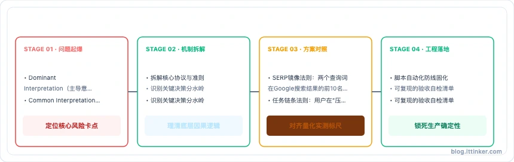
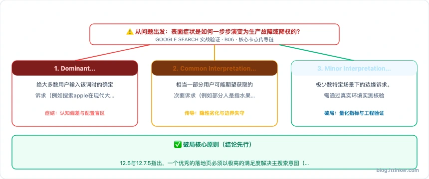
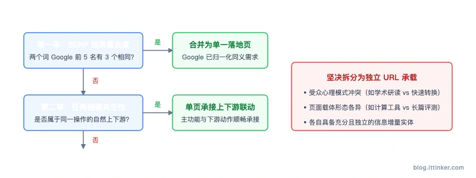
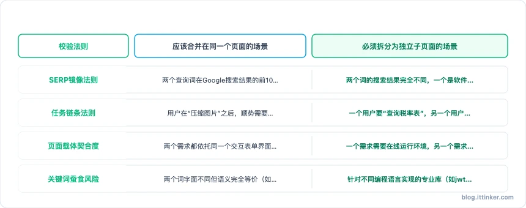
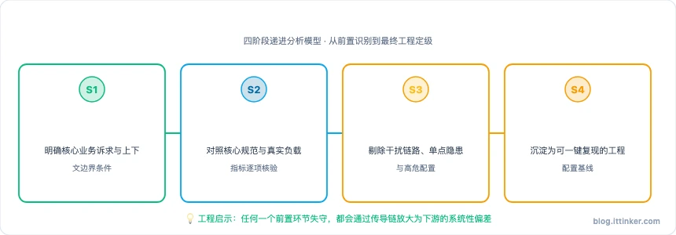
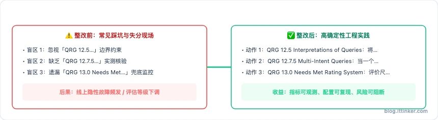
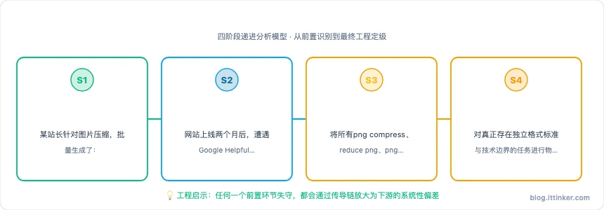
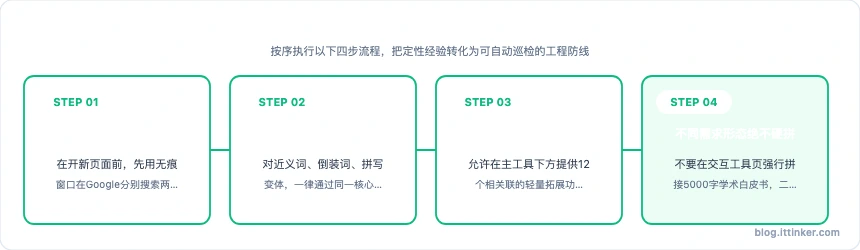

# “一个页面包打天下 vs 一词一页批量铺”？意图颗粒度的极端陷阱：一个页面究竟应该解决一个 Intent 还是多个 Intent？ | 读懂 Google Search SEO 实战 系列 006

> 🌐 **在线阅读与互动版**：[“一个页面包打天下 vs 一词一页批量铺”？意图颗粒度的极端陷阱：一个页面究竟应该解决一个 Intent 还是多个 Intent？ | 读懂 Google Search SEO 实战 系列 006](https://blog.ittinker.com/posts/一个页面应该解决一个-intent-还是多个-intent/)
> 📚 **所属专栏**：[《读懂 Google Search：110篇搜索质量与SEO实战指南》](../README.md)

---

### 📌 结论先行（TL;DR）
> **页面意图规划的核心原则是**「主意图绝对聚焦，近缘微意图顺势解决」**。**
> **在进行网站信息架构设计时，独立开发者常陷入两极摇摆：**
> **到底一个页面应该承载单一意图，还是覆盖多个意图？回答这个问题，需要拆解 Google QRG 对用户意图层次的定义。**
>
> - QRG 12.5 与 12.7.5 指出，一个优秀的落地页必须以极高的满足度解决主搜索意图（Dominant Intent）；
> - **切忌走入两个极端**：既不能搞「一词一页」的极端拆分导致大量低质桥页（Doorway Pages）和自相竞争（Keyword Cannibalization），也不能搞「一页包打天下」强行将异构任务（如既要工具转换又要长篇学术综述）杂糅在一起。
> - **凡是同一用户任务链条上的自然下游动作**：合在一个页面解决是最佳实践；
> - **而相互冲突的受众意图则必须物理隔离**：
> - **极端 A（机械细分）**：迷信所谓的 Long-tail SEO，为 `png to svg`、`convert png to svg`、`online png to svg free` 分别建立三个几乎一模一样的页面，结果遭遇 Google 关键词内部自相残杀（Cannibalization），甚至被判定为恶意批量桥页（Doorway Pages）；
> - **极端 B（大杂烩堆砌）**：试图用一个首页解决所有事情：既想排 `svg editor`，又想排 `learn svg tutorial`，还想兼顾 `buy vector illustrations`，最后页面定位模糊，哪个词都排不上去。





---


### 🚨 2026 → 2024 官方最新风向预警：Google 对Google 对单页多意图与主题聚焦（Topic Topicality）的评估演进的策略演进

#### 🕒 2026 → 2024 Google 官方对Google 对单页多意图与主题聚焦（Topic Topicality）的评估演进的策略演进

- **2026 · 意图层级化树状网络架构（Intent Hierarchy Architecture）**
  Google 算法全面青睐‘核心通用词承接高阶意图，微观纵深词拆解为专题岛屿’的拓扑结构。试图用一个页面搞定数十个差异化意图的‘缝合怪页面’遭遇相关度稀释与排名滑坡。

- **2025 · 同质化拆页（Intent Splintering）算法打击**
  对于为了抢占长尾把一个简单问题强行拆解成数十个只有几行差异的子页面的做法，Google 直接触发 Doorway Page 清理机制，强制合并索引。

- **2024 · QRG 12.5 节对复合意图与单一意图承载模式的界定**
  指引指导站长：紧密关联的衍生子意图应当作为辅助模块整合在同一页面中，而具有独立决策路径的异构意图必须果断设立独立实体页面。


---


## 1. QRG 12.5 与 12.7.5：意图的多层结构

在 QRG 第 12.5 节中，Google 将搜索词所映射的用户需求细分为三类层次：
1. **Dominant Interpretation（主导意图）**：绝大多数用户输入该词时的确定诉求（例如搜索 `apple` 在现代大概率是苹果公司及其数码产品）；
2. **Common Interpretation（常见意图）**：相当一部分用户可能期望获取的次要诉求（例如部分人是指水果苹果）；
3. **Minor Interpretation（小众意图）**：极少数特定场景下的边缘诉求。

进一步在 12.7.5 节《Multi-Intent Queries》中，指南指明：一个优秀的页面如果能够彻底搞定主导意图，并顺带解决用户在执行该任务时自然产生的**次要伴生意图（Associated Secondary Needs）**，就会被赋予极高的 Needs Met 评分。

这里的核心分水岭在于：**这些意图是否属于同一条用户任务链（User Task Chain）？**





---

## 2. 意图拆分与合并的决策流模型





---

## 3. 四大检验法则：合还是拆？

要精准划定单个页面的意图边界，使用以下四项指标进行对照：

| 校验法则 | 应该合并在同一个页面的场景 | 必须拆分为独立子页面的场景 |
|---|---|---|
| **1. SERP 镜像法则** | 两个查询词在 Google 搜索结果的前 10 名中有 4 个以上完全相同的主机 URL | 两个词的搜索结果完全不同，一个是软件工具，一个是维基长文 |
| **2. 任务链条法则** | 用户在“压缩图片”之后，顺势需要“调整尺寸（Resize）”，属于连续工作流 | 一个用户要“查询税率表”，另一个用户要“购买报税 SaaS 软件” |
| **3. 页面载体契合度** | 两个需求都依托同一个交互表单界面（只需增加一个参数下拉框） | 一个需求需要在线运行环境，另一个需求需要详细的代码 API 文档 |
| **4. 关键词蚕食风险** | 两个词字面不同但语义完全等价（如 `jpg to png` 与 `convert jpg into png`） | 针对不同编程语言实现的专业库（如 `jwt in golang` 与 `jwt in python`） |





---

## 4. 工程化判定：SERP URL 重合度分析脚本 (Python)

不用凭感觉猜测两个词该不该合并，可以直接写一段 Python 脚本，提取两个 Query 在 Google 搜索结果前 10 名的落地页 URL，计算杰卡德相似系数（Jaccard Index）：

```python
#!/usr/bin/env python3
"""
calculate_serp_overlap.py - 依靠真实 SERP 重叠度决策页面拆合
运行依赖: pip install requests
"""

import sys
from typing import List, Set
from urllib.parse import urlparse

def clean_domain_path(url: str) -> str:
    parsed = urlparse(url)
    return f"{parsed.netloc}{parsed.path}".rstrip("/")

def evaluate_intent_overlap(query_a_urls: List[str], query_b_urls: List[str]):
    set_a: Set[str] = {clean_domain_path(u) for u in query_a_urls[:10]}
    set_b: Set[str] = {clean_domain_path(u) for u in query_b_urls[:10]}

    intersection = set_a.intersection(set_b)
    union = set_a.union(set_b)
    jaccard_score = len(intersection) / len(union) if union else 0.0

    print(f"📊 SERP 意图分析报告:")
    print(f"  - Query A 前10条独特页面数: {len(set_a)}")
    print(f"  - Query B 前10条独特页面数: {len(set_b)}")
    print(f"  - 共同上榜的相同落地页数: {len(intersection)}")
    print(f"  - Jaccard 相似度得分: {jaccard_score:.3f}")

    if len(intersection) >= 4 or jaccard_score >= 0.28:
        print("💡 架构决策建议: [强烈推荐合并]")
        print("   Google 算法已将这两个搜索词归一化为同质需求。建立独立分拆页会导致内部自相竞争与门页风险。")
    elif len(intersection) <= 1:
        print("💡 架构决策建议: [坚决物理拆分]")
        print("   两者的搜索结果高度异构，用户期望的载体或业务约束存在根本差异，必须使用独立专属 URL。")
    else:
        print("💡 架构决策建议: [条件合并/父子级承接]")
        print("   可采用主功能单页承接，并在正文设置二级锚点或通过 Tab 标签顺应轻量拓展。")

if __name__ == "__main__":
    # 示例模拟数据测试
    sample_a = [
        "https://example.com/svg-editor", "https://vectr.com/design", "https://editor.method.ac",
        "https://boxy-svg.com", "https://svgpath.com"
    ]
    sample_b = [
        "https://example.com/svg-editor", "https://vectr.com/design", "https://editor.method.ac",
        "https://inkscape.org/learn", "https://w3schools.com/graphics/svg_intro.asp"
    ]
    evaluate_intent_overlap(sample_a, sample_b)
```


---

## 5. GSC 关键词自相残杀（Cannibalization）排查 SQL 与数据模型

当开发者过去错误地进行了“一词一页”的机械拆分时，可以通过 Google Search Console 的导出数据，运行如下 SQL 定位产生流量内耗的冲突 URL：

```sql
-- 检测同一关键词被两个以上内部页面争抢曝光，导致平均排名受压制
WITH query_page_stats AS (
    SELECT
        query,
        page,
        SUM(impressions) AS total_impressions,
        SUM(clicks) AS total_clicks,
        ROUND(AVG(position), 1) AS avg_position
    FROM gsc_search_performance
    WHERE date >= CURRENT_DATE - INTERVAL '30 day'
    GROUP BY query, page
),
conflicted_queries AS (
    SELECT
        query,
        COUNT(DISTINCT page) AS competing_pages_count,
        SUM(total_clicks) AS aggregate_clicks,
        SUM(total_impressions) AS aggregate_impressions
    FROM query_page_stats
    GROUP BY query
    HAVING COUNT(DISTINCT page) > 1
       AND SUM(total_impressions) > 500
)
SELECT
    cq.query,
    qps.page,
    qps.total_impressions,
    qps.total_clicks,
    qps.avg_position
FROM conflicted_queries cq
JOIN query_page_stats qps ON cq.query = qps.query
ORDER BY cq.aggregate_impressions DESC, cq.query, qps.total_clicks DESC;
```


---

## 6. 前端架构：多任务链顺畅承接的单页 Tab 组件

在处理属于同一工作链条的近缘需求时（例如“图片压缩”与“尺寸重设”），推荐采用前端状态化 Tab 组件承接，避免派生出两个重复度极高的薄弱页面：

```tsx
// components/tools/ImageWorkflowStudio.tsx
'use client';

import React, { useState } from 'react';

type ActiveTask = 'compress' | 'resize' | 'convert';

export function ImageWorkflowStudio() {
  const [activeTask, setActiveTask] = useState<ActiveTask>('compress');

  return (
    <div className="rounded-2xl border border-slate-200 bg-white p-6 shadow-sm">
      {/* 意图切换标签栏：同一页面无缝切换，不派生重复 URL */}
      <div className="flex border-b border-slate-200 pb-3 gap-4" role="tablist">
        <button
          role="tab"
          aria-selected={activeTask === 'compress'}
          onClick={() => setActiveTask('compress')}
          className={`pb-2 text-sm font-semibold transition border-b-2 ${
            activeTask === 'compress'
              ? 'border-blue-600 text-blue-600'
              : 'border-transparent text-slate-500 hover:text-slate-800'
          }`}
        >
          1. Compress File
        </button>
        <button
          role="tab"
          aria-selected={activeTask === 'resize'}
          onClick={() => setActiveTask('resize')}
          className={`pb-2 text-sm font-semibold transition border-b-2 ${
            activeTask === 'resize'
              ? 'border-blue-600 text-blue-600'
              : 'border-transparent text-slate-500 hover:text-slate-800'
          }`}
        >
          2. Resize Dimensions
        </button>
        <button
          role="tab"
          aria-selected={activeTask === 'convert'}
          onClick={() => setActiveTask('convert')}
          className={`pb-2 text-sm font-semibold transition border-b-2 ${
            activeTask === 'convert'
              ? 'border-blue-600 text-blue-600'
              : 'border-transparent text-slate-500 hover:text-slate-800'
          }`}
        >
          3. Convert Format
        </button>
      </div>

      {/* 动态工作区 */}
      <div className="mt-6">
        {activeTask === 'compress' && (
          <div className="space-y-4">
            <h3 className="text-base font-bold text-slate-900">Lossless Image Compressor</h3>
            <p className="text-xs text-slate-500">Reduce payload up to 80% without perceptible artifacting.</p>
            <div className="h-40 rounded-xl border-2 border-dashed border-slate-300 flex items-center justify-center text-slate-400">
              Drag images here to compress
            </div>
          </div>
        )}
        {activeTask === 'resize' && (
          <div className="space-y-4">
            <h3 className="text-base font-bold text-slate-900">Exact Pixel Canvas Scaler</h3>
            <p className="text-xs text-slate-500">Adjust width and height while locking aspect ratio.</p>
          </div>
        )}
        {activeTask === 'convert' && (
          <div className="space-y-4">
            <h3 className="text-base font-bold text-slate-900">Format Transcoder</h3>
            <p className="text-xs text-slate-500">Export target as WebP, AVIF, or PNG instantly.</p>
          </div>
        )}
      </div>
    </div>
  );
}
```





---

## 7. QRG 关联条款深度对照速查

在评估意图覆盖度与多义性时，可直接参考指南中的以下条款：
- **QRG 12.5 Interpretations of Queries**：将搜索词划分为主导理解（Dominant）、普遍理解（Common）与次要小众理解（Minor）。页面主内容必须毫不妥协地服务于 Dominant 诉求。
- **QRG 12.7.5 Multi-Intent Queries**：当一个 Query 天然具备多种衍生诉求时，优秀的搜索结果如果在完美解决核心诉求的基础上顺畅支持伴生意图，能获得评估员的高度肯定。
- **QRG 13.0 Needs Met Rating System**：评价尺度为“结果对目标受众的直接效用”。多余且不相关的杂糅意图会被打上 Off-topic 标签并严重扣分。
- **QRG 4.6.5 Scaled Content Abuse & Doorways**：为了覆盖细微关键词变体而制造出大批几乎完全雷同的衍生页面，在算法中直接被归类为垃圾门页。





---

## 8. 真实工程案例：格式转换工具的架构复盘

### 典型翻车案例：机械拆分 500 个近义词页面
- **操作方式**：某站长针对图片压缩，批量生成了：
  - `/compress-png`
  - `/reduce-png-size`
  - `/shrink-png-image`
  - `/online-png-optimizer`
  每个页面的内容、代码和布局有 95% 重合，仅仅是 H1 和文本里的近义词做了替换。
- **Google 惩罚结果**：网站上线两个月后，遭遇 Google Helpful Content 算法识别。多个近义页面产生严重内部关键词竞争，排名相互拉扯并在第 3~5 页震荡，最终全站被标记为低附加值批量模板页（Scaled Content Abuse），索引被大面积剥离。

### 成功突围案例：意图归一 + 差异化分离
- **合并策略**：将所有 `png compress`、`reduce png`、`png optimizer` 的请求统一由单一高权重权威页面 `/png-compressor` 承接。不仅没有损失流量，反而由于反向链接和用户互动数据集中，核心主词直接登顶第一。
- **差异拆分策略**：对真正存在**独立格式标准与技术边界**的任务进行物理分拆：
  - `/png-to-svg`（涉及位图到矢量描边的特殊算法）
  - `/heic-to-jpg`（涉及苹果专属格式转码与色彩空间映射）
  每个分拆页面都有量身定制的转换引擎与参数微调选项，页面之间互不重叠，各自斩获所在类别的头部流量。





---

## 9. 独立开发者意图规划 Checklist

在新建页面或重构栏目层级时，对照核验：

- [ ] **搜索测试验证**：在开新页面前，先用无痕窗口在 Google 分别搜索两组关键词，比对前五名落地页是否高度重叠；
- [ ] **坚决不为同义词建新页**：对近义词、倒装词、拼写变体，一律通过同一核心页面的 Title、正文自然变体词与语义富集来覆盖；
- [ ] **围绕任务链设计次级功能**：允许在主工具下方提供 1~2 个相关联的轻量拓展功能，但绝不能反客为主破坏首屏视觉；
- [ ] **不同需求形态绝不硬拼**：不要在交互工具页强行拼接 5000 字学术白皮书，二者受众心智完全不同，应分设独立 Blog 文章并建立内链；
- [ ] **监控 GSC 竞争报警**：在 Google Search Console 中定期筛选核心关键词，若发现两个内部页面在争夺同一个 Query 的展示曝光，立即执行 301 重定向合并或 Canonical 规范化。





---

## 10. 下一篇预告

探讨完核心意图的拆合分工后，在实际出海 SaaS 尤其 AI 领域，很多开发者会尝试搭建“作品展示流”或“画廊页”（Gallery Page），比如几千张 AI 生图样例、几十组 Prompt 模板库。

这种图片占大头的 “图片库页面根本没有文字怎么可能有排名”？视觉资产的偏见：Gallery 页面到底有没有 SEO 价值？如何做出高质量多模态收录？它会不会被 Google 判为无实质内容的模板瘦页面（Thin Content）？

下一篇我们将拆解 **[“图片库页面根本没有文字怎么可能有排名”？视觉资产的偏见：Gallery 页面到底有没有 SEO 价值？如何做出高质量多模态收录？（B07）](/posts/gallery-页面到底有没有-seo-价值/)**，剖析浏览型意图与灵感搜索的质量评判之道。


---

## 读懂 Google Search 专栏导航

> 📚 **专栏收录**：本文为 [《读懂 Google Search：110篇搜索质量与SEO实战指南》](/posts/google-search-guide/) 第 **B06** 篇。

* **专栏主页**：[《读懂 Google Search：110篇搜索质量与SEO实战指南》全景地图与路线图](/posts/google-search-guide/)
