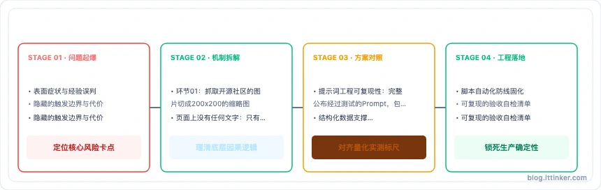
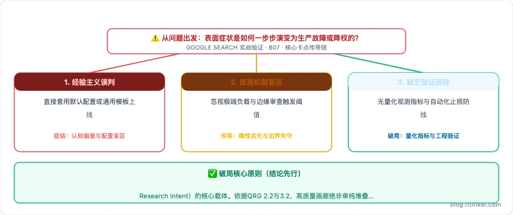
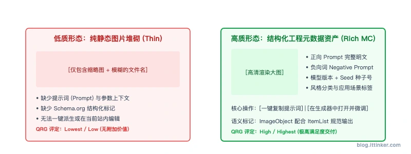
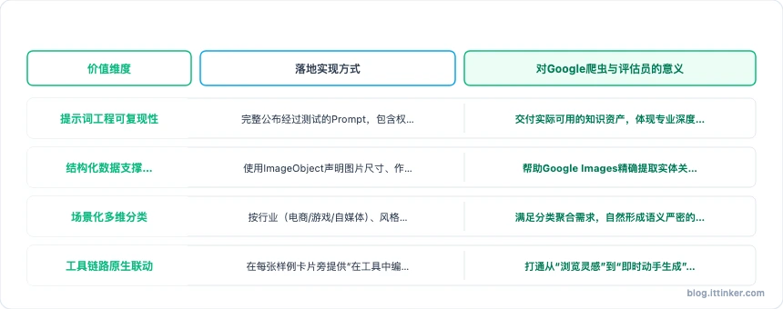
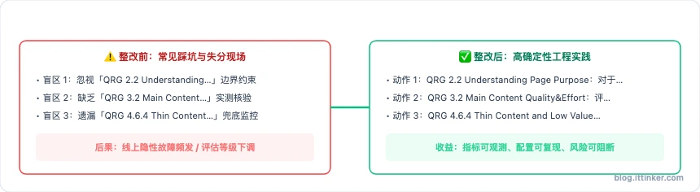
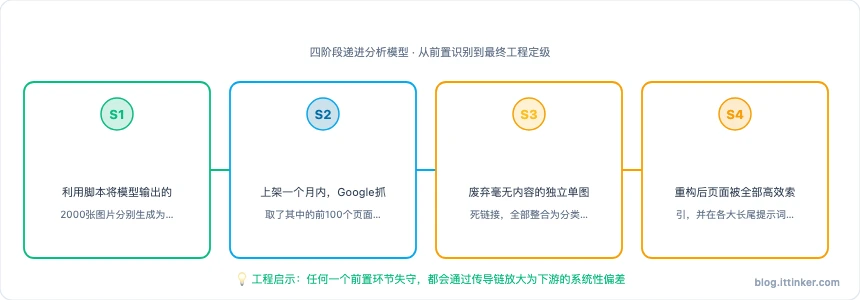
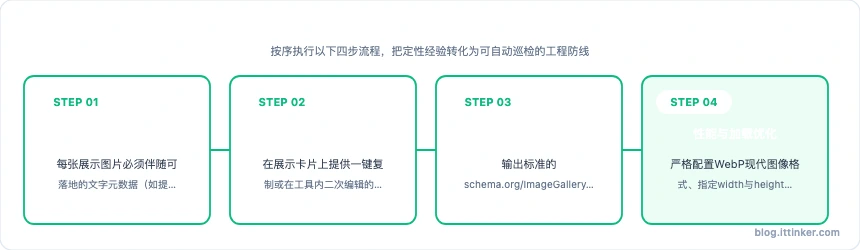

# “没文字就没有排名”？Gallery 页面到底有没有 SEO 价值？ | 读懂 Google Search SEO 实战 系列 007

> 🌐 **在线阅读与互动版**：[“没文字就没有排名”？Gallery 页面到底有没有 SEO 价值？ | 读懂 Google Search SEO 实战 系列 007](https://blog.ittinker.com/posts/gallery-页面到底有没有-seo-价值/)
> 📚 **所属专栏**：[《读懂 Google Search：110篇搜索质量与SEO实战指南》](../README.md)

---

### 📌 结论先行（TL;DR）
> **Gallery 画廊页面不仅具备确凿的 SEO 价值，更是承接灵感探索型意图（Browse / Research Intent）的核心载体。**
> **在 AI 生图、图标设计、网站 UI 模板以及 3D 素材等赛道，很多独立开发者都会批量生成或聚合数千个视觉样例，并为其搭建专门的画廊栏目（如 `/gallery` 或 `/explore`）。**
> **然而，这类画廊在 Google 搜索中的表现往往冰火两重天：**
> **一个图片占绝对主导的 Gallery 页面，究竟该如何设计，才能跨过 Google 评估指南中对高质量主内容（High PQ MC）的严苛考核？**
>
> - **依据 QRG 2.2 与 3.2**：高质量画廊绝非单纯堆叠无序图片的「图片墙」，其主内容（MC）价值在于**「结构化元数据 + 可复用工程提示词 + 真实效果展示」**。
> - 如果一个画廊只展示缩略图而缺乏可交互的具体提示词（Prompts）、模型版本、负向参数与一键派生功能，就会沦为空洞的薄弱内容（Thin Content）；
> - **反之**：具备高密度独创工程资产的画廊页，能够精准捕获数以万计的灵感类长尾流量。
> - 有的画廊不仅能把缩略图送上 Google Image 首页，还能借由“Midjourney logo prompt ideas”、“minimalist icon examples”等海量长尾词获取源源不断的高意向自然流量；
> - **更多的站点却在一次算法更新后**：全站上千个画廊单页被集体移除索引，甚至被打上“无附加价值模板聚合（Unhelpful Content）”的标签。





---


### 🚨 2026 → 2024 官方最新风向预警：Google 对Google 图像搜索与多模态资产页面（Gallery Pages）的索引机制演进的策略演进

#### 🕒 2026 → 2024 Google 官方对Google 图像搜索与多模态资产页面（Gallery Pages）的索引机制演进的策略演进

- **2026 · 多模态图像嵌入与视觉语义反查（Visual Embedding Indexing）**
  Google 图像搜索与通用 SERP 彻底打通。不仅提取 alt 文本，更结合视觉模型解析图片内部细节，具备高审美、结构化 Prompt 和技术参数标注的 Gallery 页面直接享有大词顶级展现。

- **2025 · 低质无描述素材库降权出清**
  缺乏上下文说明、无版权出处、无分辨率参数且无下载交互的‘冷冰冰死图堆砌页’被系统判定为缺乏 Main Content 的低质资产，清退出搜索推荐流。

- **2024 · QRG 第 2 章关于图片与多媒体作为 MC 的判例认可**
  规范白纸黑字确认：在壁纸、图标设计、Prompt 示范等视觉导向查询中，高品质图像本身就是不可替代的 Main Content，彻底为视觉出海站点正名。


---


## 1. QRG 16.0：解构“灵感探索型意图”

在 QRG 第 16.0 节中，Google 专门讨论了非确定性诉求的搜索心智：
用户在搜索诸如 `cyberpunk character design ideas` 或 `modern saas landing page examples` 时，他们并不是在寻找某一个特定的既定事实答案，而是在进行**启发式研究（Exploratory & Researching）**。

在这类场景下，文字并不是最高效的媒介，**高质量、高相关度的视觉与结构化样例本身就是最直接的 Main Content**。

Google 评估指南明确肯定了画廊形态的合法性，但对画廊的“内容厚度与工程投入（Effort & Added Value）”有着极其清晰的评判红线。





---

## 2. 为什么单纯的“图片墙”会被打入冷宫？

在 QRG 第 3.2 节中，评估员必须回答一个核心命题：**这个页面付出了多少心智创造（Effort）与专业造诣（Skill）？**

如果你的 Gallery 页面只是：
1. 抓取开源社区的图片切成 200x200 的缩略图；
2. 页面上没有任何文字，只有一张 `` 标签和一个下载按钮；
3. 图片的 Alt 标签千篇一律地写着 `AI image 1`, `AI image 2`。

这种页面对 Google 爬虫而言，就是一个彻底的“数据荒漠”，在评估模型中属于典型的 **Low / Lowest 级别 Thin Content**。因为爬虫和用户都无法获知该图片背后的生成参数、技术上下文以及适用范围。

相反，一个高权重的 AI Gallery 具备高度结构化的内容骨架：





---

## 3. 高质量画廊的四大工程支撑

要想让画廊不仅被 Google 收录，还能享有极高的页面质量评级，必须植入以下四个层面的增量价值（Added Value）：

| 价值维度 | 落地实现方式 | 对 Google 爬虫与评估员的意义 |
|---|---|---|
| **1. 提示词工程可复现性** | 完整公布经过测试的 Prompt，包含权重控制与参数细节 | 交付实际可用的知识资产，体现专业深度（Effort） |
| **2. 结构化数据支撑 (JSON-LD)** | 使用 `ImageObject` 声明图片尺寸、作者、许可证与适用场景 | 帮助 Google Images 精确提取实体关系，提升富摘要展示 |
| **3. 场景化多维分类** | 按行业（电商/游戏/自媒体）、风格（赛博朋克/极简矢量）归类 | 满足分类聚合需求，自然形成语义严密的内部拓扑 |
| **4. 工具链路原生联动** | 在每张样例卡片旁提供“在工具中编辑（Remix this）”按钮 | 打通从“浏览灵感”到“即时动手生成”的流畅任务链路 |





---

## 4. 前端架构：高密度元数据画廊卡片组件实现 (React 19 / Next.js 16)

在前端实现中，画廊卡片不能只是一个单薄的 ``，而必须是结构完整的语义容器。以下为零 CLS 抖动、支持无障碍与即时参数复制的工程化组件：

```tsx
// components/gallery/GalleryCard.tsx
'use client';

import React, { useState } from 'react';
import Image from 'next/image';

export interface GalleryAsset {
  id: string;
  title: string;
  imageUrl: string;
  width: number;
  height: number;
  prompt: string;
  negativePrompt?: string;
  model: string;
  seed: number;
  category: string;
}

export function GalleryCard({ asset }: { asset: GalleryAsset }) {
  const [copied, setCopied] = useState(false);

  const handleCopyPrompt = async () => {
    await navigator.clipboard.writeText(asset.prompt);
    setCopied(true);
    setTimeout(() => setCopied(false), 2000);
  };

  return (
    <figure className="group flex flex-col overflow-hidden rounded-xl border border-slate-200 bg-white shadow-sm transition hover:shadow-md">
      {/* 现代图像容器：固定宽高比防止视口抖动 (CLS = 0) */}
      <div className="relative aspect-square w-full overflow-hidden bg-slate-100">
        <Image
          src={asset.imageUrl}
          alt={`${asset.title} - ${asset.category} AI Prompt Example`}
          fill
          sizes="(max-width: 640px) 100vw, (max-width: 1024px) 50vw, 33vw"
          className="object-cover transition duration-300 group-hover:scale-105"
          loading="lazy"
        />
        <span className="absolute left-2.5 top-2.5 rounded-md bg-slate-900/75 px-2 py-0.5 text-xs font-medium text-white backdrop-blur">
          {asset.model}
        </span>
      </div>

      {/* 结构化元数据文本区：提供充足的语义切入点与专业信息 */}
      <figcaption className="flex flex-1 flex-col p-4 space-y-3">
        <div className="flex items-center justify-between">
          <h3 className="text-sm font-bold text-slate-900 truncate">{asset.title}</h3>
          <span className="text-xs font-mono text-slate-400">Seed: {asset.seed}</span>
        </div>

        <p className="line-clamp-2 text-xs text-slate-600 font-mono bg-slate-50 p-2 rounded border border-slate-100">
          {asset.prompt}
        </p>

        {/* 交互链路：复制提示词与直接进入工作台二次编辑 */}
        <div className="mt-auto flex items-center gap-2 pt-2">
          <button
            type="button"
            onClick={handleCopyPrompt}
            className="flex-1 rounded-lg border border-slate-300 py-1.5 text-xs font-medium text-slate-700 hover:bg-slate-50 active:scale-95"
          >
            {copied ? 'Copied Prompt' : 'Copy Prompt'}
          </button>
          <a
            href={`/tools/image-generator?remix_prompt=${encodeURIComponent(asset.prompt)}&model=${asset.model}`}
            className="rounded-lg bg-blue-600 px-3 py-1.5 text-xs font-medium text-white hover:bg-blue-700 active:scale-95"
          >
            Remix
          </a>
        </div>
      </figcaption>
    </figure>
  );
}
```


---

## 5. 画廊内容质量与“薄内容”自动化巡检脚本 (Python)

为了防止画廊单页或列表页因为信息过薄被判定为 Thin Content，可以使用自动化脚本巡检数据库或接口中的画廊数据：

```python
#!/usr/bin/env python3
"""
audit_gallery_quality.py - 检测画廊数据丰满度与 Thin Content 风险
"""

import sys
import json
from typing import List, Dict

def inspect_gallery_dataset(records: List[Dict]):
    total_count = len(records)
    thin_count = 0
    missing_prompt_count = 0
    missing_metadata_count = 0

    print(f"🔍 开始扫描画廊资产库: 共 {total_count} 个展示项...")

    for idx, item in enumerate(records):
        prompt = item.get("prompt", "").strip()
        model = item.get("model", "").strip()
        seed = item.get("seed")

        # 校验规则 1: 必须包含具备实质指导意义的 Prompt (>= 25 字符)
        if len(prompt) < 25:
            missing_prompt_count += 1

        # 校验规则 2: 必须包含具体工程复现参数
        if not model or seed is None:
            missing_metadata_count += 1

        # 综合判定: 缺乏提示词与参数的单纯图片归为薄内容
        if len(prompt) < 25 and (not model or seed is None):
            thin_count += 1

    thin_ratio = (thin_count / total_count) * 100 if total_count else 0.0

    print("\n📊 扫描结果汇总:")
    print(f"  - 提示词缺失或过短 (<25字符): {missing_prompt_count} 项")
    print(f"  - 核心参数 (Model/Seed) 缺失: {missing_metadata_count} 项")
    print(f"  - 严重 Thin Content 单项占比: {thin_ratio:.2f}%")

    if thin_ratio > 10.0:
        print("❌ 质量告警: 超过 10% 的画廊单品缺乏工程元数据！上线后大概率被 Google 标记为 Unhelpful 图像墙。")
        sys.exit(1)
    else:
        print("✅ 质量合规: 画廊资产结构化厚度良好，符合高质量灵感库标准。")

if __name__ == "__main__":
    # 模拟测试载入
    sample_data = [
        {"id": "1", "prompt": "isometric 3d glass icon, figma style, octane render, 8k", "model": "v6.0", "seed": 482910},
        {"id": "2", "prompt": "nice icon", "model": "", "seed": None},
        {"id": "3", "prompt": "minimalist flat vector emblem for fintech startup, blue tones", "model": "v5.2", "seed": 91823},
    ]
    inspect_gallery_dataset(sample_data)
```


---

## 6. Schema.org 结构化标记：ImageGallery 与 ItemList 规范声明

注入符合 Google Images 与富媒体摘要规范的结构化数据：

```html
<script type="application/ld+json">
{
  "@context": "https://schema.org",
  "@type": "ImageGallery",
  "name": "Curated SaaS Icon Prompt Showcase",
  "description": "High-fidelity production prompts and generation parameters for modern app icons.",
  "url": "https://ittinker.com/gallery/saas-icons",
  "mainEntity": {
    "@type": "ItemList",
    "itemListElement": [
      {
        "@type": "ListItem",
        "position": 1,
        "item": {
          "@type": "ImageObject",
          "name": "Isometric Glass Analytics Icon",
          "contentUrl": "https://assets.ittinker.com/gallery/glass-analytics.webp",
          "thumbnailUrl": "https://assets.ittinker.com/gallery/glass-analytics-thumb.webp",
          "caption": "Prompt: isometric 3d glass icon, figma style, octane render, 8k",
          "author": {
            "@type": "Organization",
            "name": "ITTinker Studio"
          }
        }
      }
    ]
  }
}
</script>
```


---

## 7. QRG 关联条款深度对照速查

在理解 Google 对图片型与画廊型内容的评估准则时，遵循以下条款标准：
- **QRG 2.2 Understanding Page Purpose**：对于灵感启发与设计探索类搜索，高密度的视觉样例与直接提示词恰好构成最直接的 Page Purpose 履约载体。
- **QRG 3.2 Main Content Quality & Effort**：评估员考察的是内容背后的心血投入（Effort）与专业水准（Skill）。公开提示词、调试细节与负向词正是开发者专业调参工程投入的直接物证。
- **QRG 4.6.4 Thin Content and Low Value Pages**：无文字说明、无来源背景、千篇一律抓取聚合的静态图片墙，属于典型的极低附加值页面（Low or Lowest）。
- **QRG 16.0 Exploratory & Research Queries**：研究型用户在寻找创意方向，画廊必须具备场景细分与跨维度检索能力才能达成 Highly Meets 评级。





---

## 8. 行业真实案例：AI 提示词画廊的逆袭之路

### 踩坑初期：2000 个毫无意义的单图薄页面
- **设计模型**：利用脚本将模型输出的 2000 张图片分别生成为 `/image/1.html` 至 `/image/2000.html`。页面上只有一张图和一个“点赞”图标。
- **GSC 数据表现**：上架一个月内，Google 抓取了其中的前 100 个页面后便戛然而止，GSC 控制台提示大量“已抓取 - 尚未编入索引”或“发现 - 尚未编入索引”。整站权威度被严重拖累。

### 重构举措：画廊即产品，示例即灵感
- **升级改造**：
  1. 废弃毫无内容的独立单图死链接，全部整合为分类聚合画廊（如 `/prompts/pixel-art-icons`）；
  2. 每个画廊聚合 20~30 个精选案例，每张图配套清晰的 Prompt 提示词卡片、生成所耗费的参数与推荐替代词；
  3. 点击任意案例均可将该 Prompt 直接写入顶部的交互生成器中开始在线生成。
- **成效反转**：重构后页面被全部高效索引，并在各大长尾提示词搜索中迅速崭露头角，成为高转化落地页。





---

## 9. 独立开发者画廊搭建 Checklist

在上线画廊与图库模块前，对照下列清单进行质量把关：

- [ ] **严禁空图罗列**：每张展示图片必须伴随可落地的文字元数据（如提示词、配色色值、适用业务场景）；
- [ ] **具备操作下游出口**：在展示卡片上提供一键复制或在工具内二次编辑的快捷交互；
- [ ] **完善结构化标记**：输出标准的 `schema.org/ImageGallery` 或 `ItemList` 结构化 JSON-LD；
- [ ] **性能与加载优化**：严格配置 WebP 现代图像格式、指定 `width` 与 `height` 防止视距抖动（CLS），并对次屏图片启用 `loading="lazy"`；
- [ ] **避免机械单图分页**：宁可做一个高浓度、富上下文的聚合专题画廊，也绝不要把单张图片拆分成毫无增量价值的孤立单页。





---

## 10. 下一篇预告

搞清楚了画廊页的结构化资产价值后，很多独立开发者在扩大产品规模时，常常采用“程序化 SEO（Programmatic SEO）”批量生成上千个细分页面：比如换一个行业名生成一个新页面，或者换一个格式后缀生成一个新页面。

这种换一个关键词生成的模板页，在 Google 眼中到底算不算一个新页面？如何划定真正的高质量细分落地与遭遇严厉算法惩罚的恶意“桥页”之间的分界线？

下一篇我们将拆解 **[“模板不变只换一个城市名/行业词”？披着羊皮的垃圾站：模板页换一个关键词到底算不算新页面？Google 是怎么一秒识破的？（B08）](/posts/模板页换一个关键词-算不算一个新页面/)**，为你构建独立需求、独立 MC 与独立 Added Value 的判断准绳。


---

## 读懂 Google Search 专栏导航

> 📚 **专栏收录**：本文为 [《读懂 Google Search：110篇搜索质量与SEO实战指南》](/posts/google-search-guide/) 第 **B07** 篇。

* **专栏主页**：[《读懂 Google Search：110篇搜索质量与SEO实战指南》全景地图与路线图](/posts/google-search-guide/)
