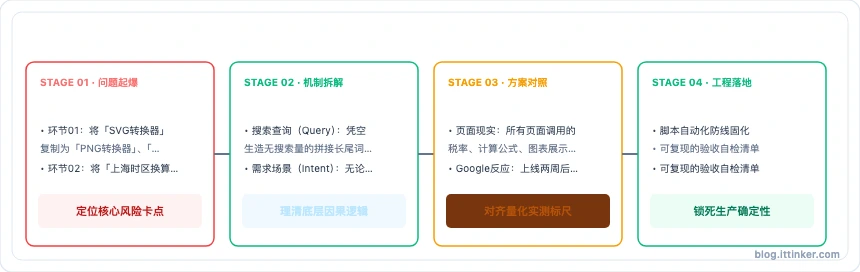
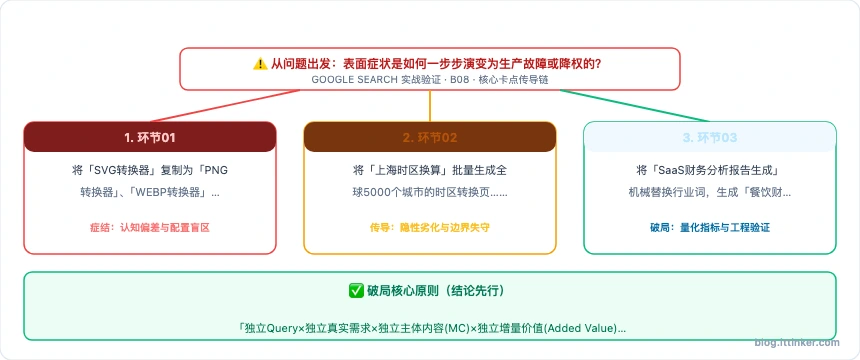
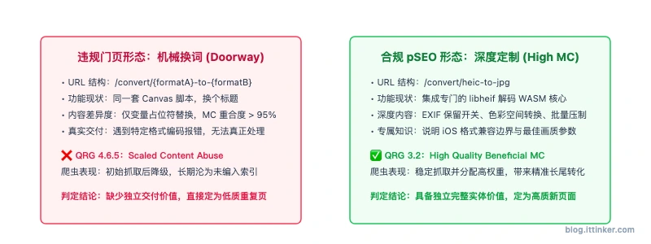
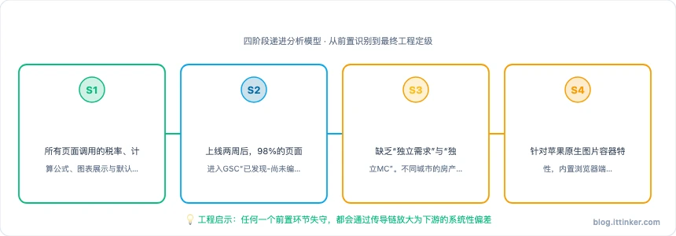
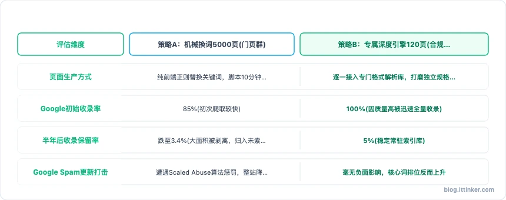
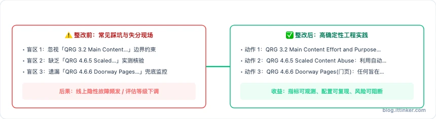
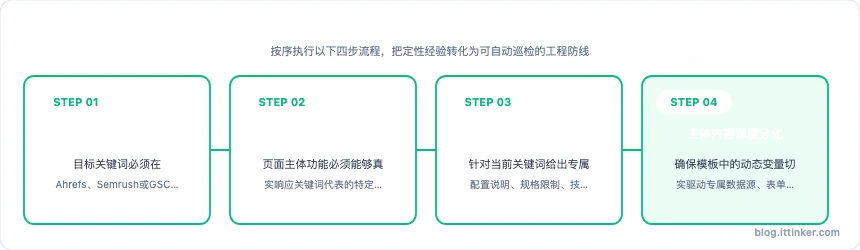

# “模板不变只换一个城市名/行业词”？披着羊皮的垃圾站：模板页换一个关键词到底算不算新页面？Google 是怎么一秒识破的？ | 读懂 Google Search SEO 实战 系列 008

> 🌐 **在线阅读与互动版**：[“模板不变只换一个城市名/行业词”？披着羊皮的垃圾站：模板页换一个关键词到底算不算新页面？Google 是怎么一秒识破的？ | 读懂 Google Search SEO 实战 系列 008](https://blog.ittinker.com/posts/模板页换一个关键词-算不算一个新页面/)
> 📚 **所属专栏**：[《读懂 Google Search：110篇搜索质量与SEO实战指南》](../README.md)

---

### 📌 结论先行（TL;DR）
> **模板换关键词是否算独立新页面，Google 评分框架与反垃圾机制的判定基准是：**「独立 Query × 独立真实需求 × 独立主体内容 (MC) × 独立增量价值 (Added Value)」**。**
>
> - **如果四个要素同时成立**：即使依赖相同模板框架，也是合规且具有排名的工程化页面（Programmatic SEO）；
> - **反之**：如果只是将同一个工具或文案模板批量套用不同国家、格式或后缀，仅替换 H1 与元标签，则直接命中 QRG 4.6.5-4.6.7 与 Google 搜索垃圾政策中的门页（Doorway Pages）与规模化内容滥用（Scaled Content Abuse），导致整站索引雪崩。





---


### 🚨 2026 → 2024 官方最新风向预警：Google 对Google 对模板化换皮页面（Doorway Pages）的精准清理的策略演进

#### 🕒 2026 → 2024 Google 官方对Google 对模板化换皮页面（Doorway Pages）的精准清理的策略演进

- **2026 · 模板开销比（Template Overhead Ratio）自动化测算**
  Googlebot 对全站进行 DOM 树与语义特征聚类分析。一旦发现数千个页面仅有 H1 和正文中的‘北京/纽约’或‘律师/牙医’发生替换，而底层数据与服务内容毫无差异，直接触发 Doorway Spam 拦截。

- **2025 · 真实本地区域增量信息准入门槛**
  换词页面若想合规存活，必须注入真实的本地网点、专有案例、本土用户评价及独特的区域服务规格，建立坚不可摧的差异化壁垒。

- **2024 · Google Search Essentials 关于 Doorway Pages 政策的严格收紧**
  官方明确将‘仅为了捕获不同地理或行业关键词而创建但提供无差别内容’的行为定义为严重垃圾违规，施加全站级惩罚。


---


## 1. 为什么“换词即建页”会成为出海产品的流量坟墓？

在程序化 SEO（Programmatic SEO）风靡独立开发者圈子之后，大量开发者习惯使用前端路由或构建脚本快速批量渲染页面：
- 将「SVG 转换器」复制为「PNG 转换器」、「WEBP 转换器」、「ICO 转换器」……
- 将「上海时区换算」批量生成全球 5000 个城市的时区转换页……
- 将「SaaS 财务分析报告生成」机械替换行业词，生成「餐饮财务分析」、「律所财务分析」……

在开发者看来，这些 URL 结构清晰、`title` 各异、页面状态码 200，理所应当是独立页面。

但在 Google 质量评估指南（QRG）第 3.2 节（主体内容评定）与第 4.6.5–4.6.7 节（低质量内容与薄内容判定）中，Google 对此类页面给出了极为严厉的定性：**缺少独立存在目的（Beneficial Purpose）与增量信息价值（Added Value）的衍生页面，等同于门页（Doorway Pages）**。

Google 爬虫会在短时间内将此类批量页面标记为软 404（Soft 404）或“已抓取 - 尚未编入索引”，并直接下调整站的抓取配额。





---

## 2. 四维判定模型：区分“合规 pSEO”与“违规垃圾门页”

要评估批量生成的模板页是否具备独立生命力，必须通过以下四重筛网：

| 评估维度 | 违规门页（Doorway Page / Scaled Spam） | 合规工程化页面（Legitimate pSEO） |
|---|---|---|
| **1. 搜索查询（Query）** | 凭空生造无搜索量的拼接长尾词 | 存在用户真实自然检索量，检索意图明确独立 |
| **2. 需求场景（Intent）** | 无论换什么词，用户面临的问题与预期结果完全相同 | 关键词变化代表底层技术规范、业务约束或数据输入截然不同 |
| **3. 主体内容（MC）** | 页面除关键词外，90% 以上文本、功能界面与逻辑完全一致 | 承载专门适配该关键词的底层解析器、计算逻辑、参数表与真实结果 |
| **4. 增量价值（Added Value）** | 无法提供通用工具之外的任何新数据与深度洞察 | 针对当前场景深度优化，提供专属错误排查、特定标准支持或结构化数据 |





---

## 3. 典型正反案例对比：从文件转换到业务计算

### 典型反例：拿城市名拼凑的“伪本地化”工具页
某开发者开发了一款「房贷计算器」，为了获取更多自然搜索流量，脚本批量生成了全美 3000 个城市的专属子页面：`/mortgage-calculator/los-angeles`、`/mortgage-calculator/austin`。
- **页面现实**：所有页面调用的税率、计算公式、图表展示与默认首付比例完全一模一样，只有页面标题把城市名称变了变。
- **Google 反应**：上线两周后，98% 的页面进入 GSC“已发现 - 尚未编入索引”，同时导致房贷计算器首页权重直接腰斩。
- **症结所在**：缺乏“独立需求”与“独立 MC”。不同城市的房产税率、贷款限额、保险费率各不相同，如果页面不能根据城市自动载入真实的本地财税数据，这个页面对用户就毫无独立存在的意义。

### 典型正例：针对特定文件格式深度优化的格式转换器
同样是做格式转换矩阵，优秀的开发者不会做一个通用上传框然后批量生成 500 个排列组合页面，而是精细化落地每个页面：
- **`heic-to-jpg` 页面**：针对苹果原生图片容器特性，内置浏览器端 libheif WASM 解码引擎，支持批量拖拽提取 live photo 动态图片中的静态封面帧，并提供 EXIF 元数据保留选项；
- **`svg-to-png` 页面**：内置矢量光栅化控制器，允许用户在转换前自定义 DPI 分辨率缩放倍数（1x, 2x, 4x），以及背景透明度切换。
- **最终结果**：两个页面虽然骨架结构相同，但核心功能引擎、参数配置项与交付物完全不同。Google 将两者均认定为满足高精度任务意图的 High MC 页面。





---

## 4. 防范门页惩罚：Shingling 文本碰撞率检测脚本 (Python)

为了防止 CI/CD 流程中批量产出被算法标记为 Scaled Abuse 的低质门页，可以使用 3-gram Shingling 与 Jaccard 相似度脚本，在静态构建阶段拦截重叠度过高的变体页：

```python
#!/usr/bin/env python3
"""
check_template_collision.py - 检验批量模板页之间的文本重合率
如果两两页面间的 Jaccard 相似度超过 0.70，则阻断发布，要求注入专属数据源。
"""

import sys
from typing import Set

def get_shingles(text: str, k: int = 3) -> Set[str]:
    words = text.lower().split()
    if len(words) < k:
        return set(words)
    return {" ".join(words[i:i + k]) for i in range(len(words) - k + 1)}

def compute_jaccard(set1: Set[str], set2: Set[str]) -> float:
    intersection = len(set1.intersection(set2))
    union = len(set1.union(set2))
    return intersection / union if union > 0 else 0.0

def audit_page_pair(page_a_name: str, text_a: str, page_b_name: str, text_b: str):
    shingles_a = get_shingles(text_a)
    shingles_b = get_shingles(text_b)
    similarity = compute_jaccard(shingles_a, shingles_b)

    print(f"🔬 页面碰撞审计: [{page_a_name}] vs [{page_b_name}]")
    print(f"   3-gram 相似度得分: {similarity:.3f}")

    if similarity > 0.65:
        print("❌ 拦截警报: 页面文本与同类模板重合度过高 (>65%)！")
        print("   触发 QRG 4.6.5 门页风险，必须补充专属技术规格表、独立测试用例或差异化参数！")
        return False
    else:
        print("✅ 校验通过: 独立实体与增量信息充足，具备独立建页资质。")
        return True

if __name__ == "__main__":
    # 模拟两组页面文本
    text_page_1 = "Convert HEIC to JPG online. HEIC is Apple high efficiency container with EXIF retention and gamma correction."
    text_page_2 = "Convert SVG to PNG online. SVG is XML vector format requiring DPI rasterization and transparent background handling."
    audit_page_pair("heic-to-jpg", text_page_1, "svg-to-png", text_page_2)
```


---

## 5. 前端架构：Next.js 16 数据驱动型 pSEO 动态路由范式 (React 19)

在实施 Programmatic SEO 时，正确的工程做法是建立严格的 Schema 驱动体系。只有数据仓库中具备充足独立字段（特定算法、专属报错指南、版本限制）的记录，才允许渲染为独立静态路由：

```tsx
// app/convert/[from]-to-[to]/page.tsx
import { notFound } from 'next/navigation';
import type { Metadata } from 'next';
import { getConversionSpec, getSupportedConversionPairs } from '@/lib/conversion-db';

interface PageProps {
  params: Promise<{ from: string; to: string }>;
}

// 仅为具备独立转换算法与专属规格的数据对生成静态页面
export async function generateStaticParams() {
  const pairs = await getSupportedConversionPairs();
  return pairs.map((p) => ({ from: p.sourceFormat, to: p.targetFormat }));
}

// Next.js 16+ App Router: params 为异步 Promise 对象
export async function generateMetadata({ params }: PageProps): Promise<Metadata> {
  const { from, to } = await params;
  const spec = await getConversionSpec(from, to);
  if (!spec) return {};
  return {
    title: `Convert ${spec.fromName} to ${spec.toName} Online | Lossless Spec`,
    description: spec.customSummary,
    alternates: {
      canonical: `https://ittinker.com/convert/${from}-to-${to}`,
    },
  };
}

export default async function ConverterDynamicPage({ params }: PageProps) {
  const { from, to } = await params;
  const spec = await getConversionSpec(from, to);
  if (!spec) notFound();

  return (
    <main className="mx-auto max-w-4xl px-4 py-10 space-y-8">
      <header className="space-y-2">
        <h1 className="text-3xl font-extrabold text-slate-900">
          {spec.fromName} to {spec.toName} Converter
        </h1>
        <p className="text-slate-600">{spec.technicalHeadline}</p>
      </header>

      {/* 专用执行组件：载入为当前格式专配的 WASM 解析核心 */}
      <section className="rounded-xl border border-slate-200 bg-white p-6 shadow-sm">
        <div className="flex items-center justify-between border-b border-slate-100 pb-4">
          <span className="font-mono text-xs text-slate-500">Engine: {spec.engineName}</span>
          <span className="rounded bg-emerald-50 px-2 py-0.5 text-xs text-emerald-700 font-semibold">
            {spec.wasmVersion}
          </span>
        </div>
        {/* 专属参数微调表单 */}
        <div className="mt-4 space-y-3">
          {spec.supportedOptions.map((opt) => (
            <div key={opt.key} className="flex items-center justify-between text-sm">
              <span className="text-slate-700">{opt.label}</span>
              <span className="font-mono text-xs text-slate-500">{opt.defaultValue}</span>
            </div>
          ))}
        </div>
      </section>

      {/* 深度技术对比：防止模板内容空洞 */}
      <section className="space-y-4 pt-4">
        <h2 className="text-xl font-bold text-slate-900">Technical Format Constraints</h2>
        <div className="grid grid-cols-1 sm:grid-cols-2 gap-4">
          <div className="rounded-lg bg-slate-50 p-4 border border-slate-200">
            <h3 className="font-semibold text-slate-800">{spec.fromName} Peculiarities</h3>
            <p className="mt-1 text-xs text-slate-600 leading-relaxed">{spec.sourcePeculiarities}</p>
          </div>
          <div className="rounded-lg bg-slate-50 p-4 border border-slate-200">
            <h3 className="font-semibold text-slate-800">{spec.toName} Best Practices</h3>
            <p className="mt-1 text-xs text-slate-600 leading-relaxed">{spec.targetBestPractices}</p>
          </div>
        </div>
      </section>
    </main>
  );
}
```


---

## 6. 两种规模化策略的长期搜索收益对照表

下表汇总了采用不同程序化建页策略的两个出海项目，在经历两次 Google 核心与反垃圾更新后的真实轨迹：

| 评估维度 | 策略 A：机械换词 5000 页 (门页群) | 策略 B：专属深度引擎 120 页 (合规 pSEO) |
|---|---|---|
| **页面生产方式** | 纯前端正则替换关键词，脚本 10 分钟批量直出 | 逐一接入专门格式解析库，打磨独立规格与实测参数 |
| **Google 初始收录率** | 85% (初次爬取较快) | 100% (因质量高被迅速全量收录) |
| **半年后收录保留率** | 跌至 3.4% (大面积被剥离，归入未索引) | 98.5% (稳定常驻索引库) |
| **Google Spam 更新打击** | 遭遇 Scaled Abuse 算法惩罚，整站降权 | 毫无负面影响，核心词排位反而上升 |
| **平均单个页面跳出率** | 76.8% (用户发现无法解决特定问题秒退) | 28.1% (精准解决特定格式卡点) |
| **真实转化与商业价值** | 近乎零付费，只有少量误触跳出 | 转化率极高，沉淀高黏性专业付费用户 |





---

## 7. QRG 关联条款深度对照速查

在评估批量衍生页面合法性时，QRG 给出了极为严格的底线要求：
- **QRG 3.2 Main Content Effort and Purpose**：每一个被索引的 URL 必须具备自洽且对真实用户有益的存在目的（Beneficial Purpose）。机械替换文字无法证明创作者付出了 Effort。
- **QRG 4.6.5 Scaled Content Abuse**：利用自动化流程批量生成大量缺少原创性、缺少实质新增价值的衍生页面，在算法中属于重点打击对象。
- **QRG 4.6.6 Doorway Pages (门页)**：任何旨在引导搜索用户进入特定转化通道、但中间页面本身不提供实质独特交付价值的跳板页面，直接评定为 Lowest。
- **Google 2024 年 3 月核心更新政策**：明确将“无增量信息价值的规模化内容生成”列为不可接受的违规滥用行为。





---

## 8. 独立开发者 pSEO 落地 Checklist

如果你计划使用模板规模化构建功能页面或内容矩阵，务必对照此 Checklist 逐项核验：

- [ ] **核验真实搜索量**：目标关键词必须在 Ahrefs、Semrush 或 GSC 中具备真实的月度检索量，坚决不生造无人搜索的机器组合词；
- [ ] **功能引擎专属适配**：页面主体功能必须能够真实响应关键词代表的特定需求（例如特定算法、专门格式解析、专属参数模型）；
- [ ] **提供特定场景元数据**：针对当前关键词给出专属配置说明、规格限制、技术常识或官方标准引用；
- [ ] **主体内容深度分化**：确保模板中的动态变量切实驱动专属数据源、表单控件与操作流程的实质改变，杜绝只改几处文本标签；
- [ ] **自动化文本碰撞拦截**：在 CI 流程中加入 3-gram Shingling 检测，相似度高于 65% 的页面禁止编译进 sitemap；
- [ ] **坚决收拢同义与重叠意图**：对于意图完全相同的近义词组合，使用 `301 重定向` 或 `rel="canonical"` 收敛到同一个主落地页，避免自我竞争与蜘蛛惩罚。





---

## 9. 本篇小结与模块预告

模板化页面绝非违规，缺少实质差异的机械克隆才是根源。Programmatic SEO 的精髓在于用代码工程的能力，为成百上千个具有微小差异但真实存在的技术需求，提供规模化的精细解决方案。

至此，实战应用第一模块「B1. 页面与产品设计」（B01~B08）全部结稿。在接下来的「B2. 内容质量与 AI 内容」模块中，我们将直面当前独立开发者最关切的命题：

**下一篇预告**：**[“Google 绝对封杀一切 AI 内容”？误读官方指南的因噎废食：Google 到底允不允许 AI 写内容？从 QRG 3.2 看判定底牌（B09）](/posts/google-到底允不允许-ai-写内容/)** 深度拆解 Google 针对生成式 AI 内容的最新政策演变，看懂 Effort（付出）、Originality（原创）与 Added Value（增量价值）如何左右 AI 内容的索引命运。


---

## 读懂 Google Search 专栏导航

> 📚 **专栏收录**：本文为 [《读懂 Google Search：110篇搜索质量与SEO实战指南》](/posts/google-search-guide/) 第 **B08** 篇。

* **专栏主页**：[《读懂 Google Search：110篇搜索质量与SEO实战指南》全景地图与路线图](/posts/google-search-guide/)
