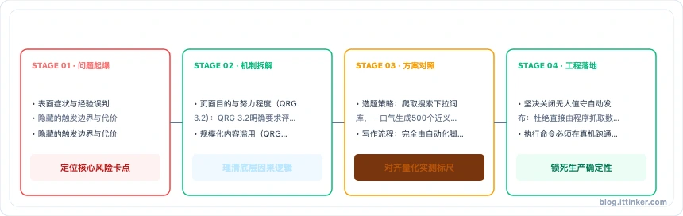
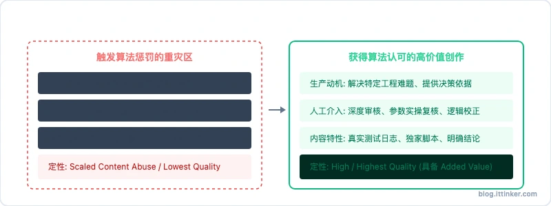
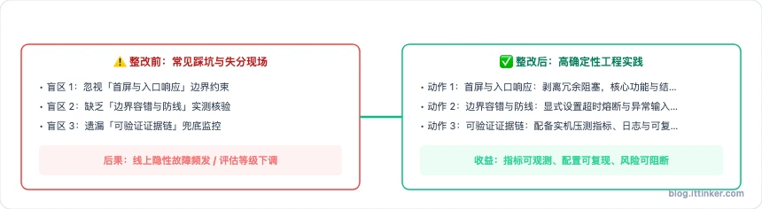
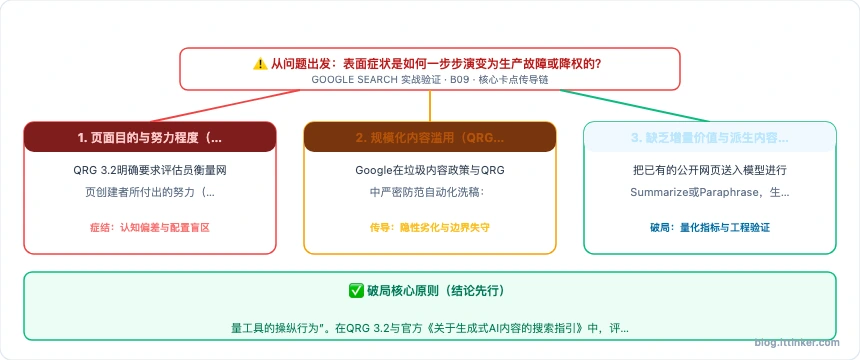
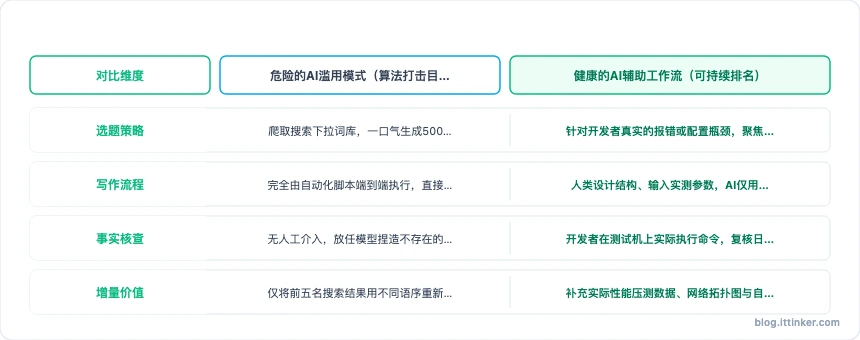
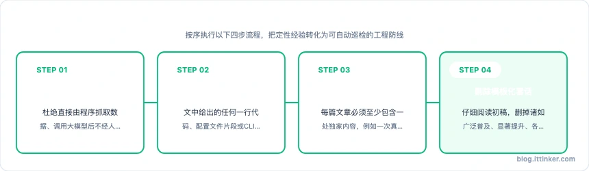

# Google 到底允不允许 AI 写内容？从 QRG 3.2 与官方指南看判定底牌 | 读懂 Google Search SEO 实战 系列 009

> 🌐 **在线阅读与互动版**：[Google 到底允不允许 AI 写内容？从 QRG 3.2 与官方指南看判定底牌 | 读懂 Google Search SEO 实战 系列 009](https://blog.ittinker.com/posts/google-到底允不允许-ai-写内容/)
> 📚 **所属专栏**：[《读懂 Google Search：110篇搜索质量与SEO实战指南》](../README.md)

---

### 📌 结论先行（TL;DR）
**Google 从未封杀“由 AI 辅助生成的内容”，但极其严厉地打击“把 AI 当成排位刷量工具的操纵行为”。**

1. 在 QRG 3.2 与官方《关于生成式 AI 内容的搜索指引》中，评分标准对工具完全中立。
2. 评估员与算法审视的是页面成果：是否有真实的人工付出（Effort）、是否具备独家原创增量（Added Value）、是否出于服务用户的善意目的（Purpose），以及是否安全可信（Trust）。
3. 用大模型自动化炮制千篇缺乏验证的平庸文章，直接触犯“规模化滥用内容”（Scaled Content Abuse），必遭算法全面清理。

出海开发者在涉足内容站与产品技术文档时，经常会陷入两种极端的讨论：

一批人将 AI 视为洪水猛兽，认为只要页面里包含了大语言模型生成的字句，Google 就会自动打上标记并在后续核心算法更新中予以惩罚；
另一批人则走向另一个极端，认为既然 Google 官方发文澄清“不反对使用 AI”，便开始编写 Python 脚本，调用 API 接口批量抓取同行标题，每天自动发布数百篇洗稿文章，试图以量取胜。

这两种认知都脱离了 Google 真实的评估体系。要准确把握尺度，我们需要结合 QRG 核心评级原则与 Google 官方反滥用政策展开推演。

---

## 1. 官方立场：工具中立，唯质量与意图论

Google 搜索团队在官方文档《Google 搜索关于生成式 AI 内容的指南》（Google Search's guidance about AI-generated content）中，给出了清晰的界定：

> *"Automation has long been used in publishing to create useful content. AI can provide new levels of capability and creativity, and can be a key tool in helping people create great content for the web."*
> 
> *"Using automation—including AI—to generate content with the primary purpose of manipulating ranking in search results is a violation of our spam policies."*

这段声明奠定了 Google 对待 AI 内容的基本底线：**工具本身不分高下，意图与质量决定命运**。

早在十多年前，各大财经媒体与体育新闻平台就普遍使用自动化程序汇总股价波动或赛事比分，Google 长期正常索引并展示这类结构化信息。生成式大模型在本质上是一种更强大的辅助创作工具。

然而，一旦使用该工具的出发点是为了“操控排名（Manipulating Ranking）”，而非“解答用户疑问”，该页面就会直接触犯垃圾内容政策。

---

## 2. 深入 QRG：质量评估员如何审视 AI 产物？

在评估员手册中，并不存在一个名为“检测是否由 AI 生成”的评分按钮。质量评估员主要依据以下三个维度来测定页面的水准：

### 2.1 页面目的与努力程度（QRG 3.2）
QRG 3.2 明确要求评估员衡量网页创建者所付出的努力（Effort）、原创性（Originality）和才能（Talent/Skill）。
如果一个网页充满平庸的文本，用语规范通畅，但找不到任何作者亲自实践、调研、测试的痕迹，评估员给出的定级往往止步于 Medium，甚至直接落入 Low Quality。

### 2.2 规模化内容滥用（QRG 4.6.5）
Google 在垃圾内容政策与 QRG 中严密防范自动化洗稿：
> *"Scaled content abuse is when many pages are generated for the primary purpose of manipulating search rankings and not helping users. This practice typically involves producing large amounts of unoriginal content that provides little to no value to users, no matter how it is created."*

注意后半句：“**no matter how it is created**”（不论它是通过何种方式创建的）。无论雇佣低成本写手手工改写，还是用 Python 脚本调用模型批量生成，只要特征符合“大量、缺乏原创、没有增量”，都会受到相同等级的严惩。

### 2.3 缺乏增量价值与派生内容（QRG 4.6.6）
把已有的公开网页送入模型进行 Summarize 或 Paraphrase，生成一篇涵盖双方观点的综合文章，看似条理分明，但站在用户的立场上，该页面提供的事实与思考与源网页别无二致。这种缺乏 Added Value 的派生产物，在 QRG 中属于典型的 Low 或 Lowest。

---

## 3. 被惩罚的 AI 内容与被认可的辅助创作

为了让工程实践更加清晰，我们将两类典型做法对照如下：

| 对比维度 | 危险的 AI 滥用模式（算法打击目标） | 健康的 AI 辅助工作流（可持续排名） |
|---|---|---|
| **选题策略** | 爬取搜索下拉词库，一口气生成 500 个近义长尾词页面 | 针对开发者真实的报错或配置瓶颈，聚焦单个深度问题 |
| **写作流程** | 完全由自动化脚本端到端执行，直接写入数据库并发布 | 人类设计结构、输入实测参数，AI 仅用于草拟初步文字或代码骨架 |
| **事实核查** | 无人工介入，放任模型捏造不存在的命令参数或过时依赖 | 开发者在测试机上实际执行命令，复核日志并修正幻觉 |
| **增量价值** | 仅将前五名搜索结果用不同语序重新表述一遍 | 补充实际性能压测数据、网络拓扑图与自研配置脚本 |
| **代码交付** | 提供未经调试的片断代码，缺乏运行环境说明 | 提供完整的测试环境参数、依赖版本与已验证的部署指令 |

---

## 4. 独立开发者在 AI 时代的实操守则

如果正在使用或计划引入大语言模型协助站点建设，建议在内容流水线中固化以下规则：

- [ ] **坚决关闭无人值守自动发布**：杜绝直接由程序抓取数据、调用大模型后不经人工审校就推上生产环境的做法。
- [ ] **执行命令必须在真机跑通**：文中给出的任何一行代码、配置文件片段或 CLI 命令，必须在干净的测试容器或虚拟主机上完整验证。
- [ ] **注入第一手工程记录**：每篇文章必须至少包含一处独家内容，例如一次真实的性能基准对比、一张特定架构拓扑图、或一段自研脚本仓库引用。
- [ ] **剔除模板化套话**：仔细阅读初稿，删掉诸如广泛普及、显著提升、各种场景等没有事实信息的修饰词，保留直奔主题的排错指令。
- [ ] **定期复盘搜索表现**：通过 Search Console 观察页面的展现与跳出率，发现展示量大但停留时间极短的页面，立即人工重构并增加深度示例。

---

## 下一篇预告

明白了 Google 对 AI 内容的态度在于“质量与意图而非工具本身”之后，另一个常见困惑接踵而至：

**“我的文章明明让 AI 仔细核实过，每一个技术术语和参数都挑不出事实毛病，为什么在 Google 眼里依然被判定为低质量（Low Quality）？”**

答案是：**在现代搜索质量评价体系中，事实正确仅仅是入场底线**。

下一篇，我们将剖析这道深水区难题：**[AI 写得事实正确，为什么依然可能是 Low Quality？QRG 5.2.1 的底线思维（B10）](/posts/ai-写得事实正确-为什么依然可能是-low-quality/)**。

---

_这是「读懂 Google Search」系列第 33 篇（分卷 B 第 9 篇），系统拆解 Google 官方质量指南，帮你建立长期抗算法波动的出海 SEO 护城河。_

---

## 读懂 Google Search 专栏导航

> 📚 **专栏收录**：本文为 [《读懂 Google Search：110篇搜索质量与SEO实战指南》](/posts/google-search-guide/) 第 **B09** 篇。

* **专栏主页**：[《读懂 Google Search：110篇搜索质量与SEO实战指南》全景地图与路线图](/posts/google-search-guide/)
