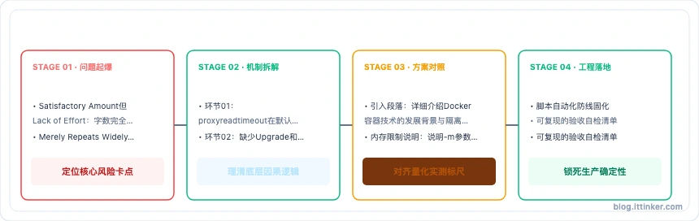
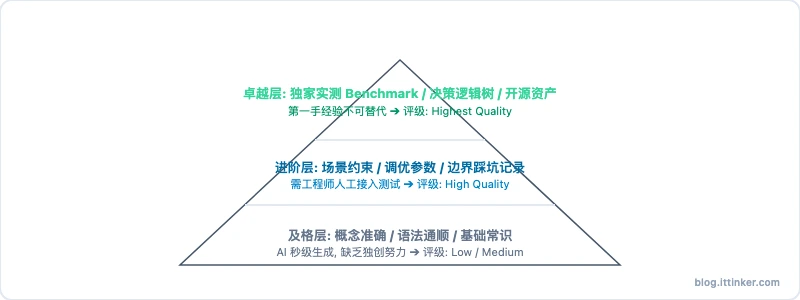
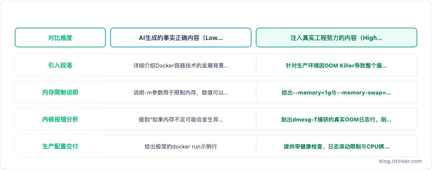
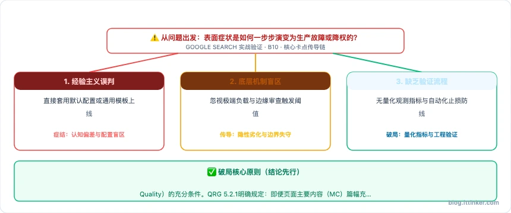
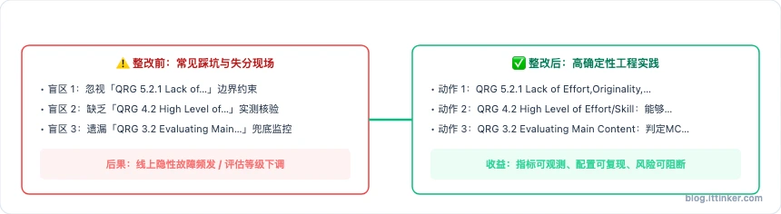
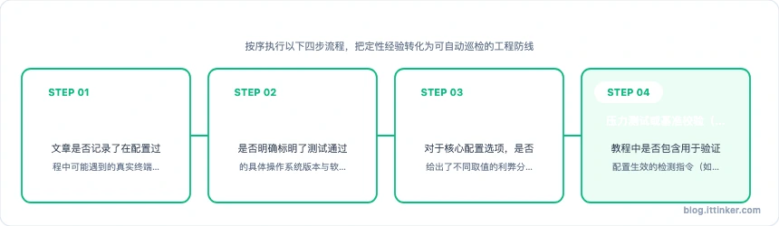

# “AI 生成的内容事实全对就能拿第一”？空洞正确的慢性自杀：为什么内容事实正确依然可能被 Google 判定为 Low Quality？ | 读懂 Google Search SEO 实战 系列 010

> 🌐 **在线阅读与互动版**：[“AI 生成的内容事实全对就能拿第一”？空洞正确的慢性自杀：为什么内容事实正确依然可能被 Google 判定为 Low Quality？ | 读懂 Google Search SEO 实战 系列 010](https://blog.ittinker.com/posts/ai-写得事实正确-为什么依然可能是-low-quality/)
> 📚 **所属专栏**：[《读懂 Google Search：110篇搜索质量与SEO实战指南》](../README.md)

---

### 📌 结论先行（TL;DR）
> **事实正确（Factual Accuracy）是内容的准入门槛，绝非高质量（High Quality）的充分条件。**
> **不少技术站长在接入大模型后，常常感到委屈：**
> **“我的文章让 Claude 或 GPT-4 严格校对过，每一个 Linux 命令的语法都对，Docker 架构图解释得滴水不漏，维基百科上的历史背景也写得清清楚楚，为什么几个月过去，页面曝光寥寥无几，甚至在核心更新后被批量降权？”**
> **产生这种困惑的根源，在于混淆了“无害（Not Bad）”与“优质（High Quality）”的边界。在 Google 的评估雷达中，事实正确仅仅意味着你的页面没有触犯 QRG 4.5 的“虚假与欺诈”红线，但距离赢得高排名所需的 High 评级，中间隔着巨大的价值鸿沟。**
>
> - **QRG 5.2.1 明确规定**：即便页面主要内容（MC）篇幅充足、概念无误，只要它缺乏创作者的人工努力（Effort）、独创性（Originality）或专业技能（Skill），就必须定级为 Low。
> - 大模型能够轻易输出完美无瑕的教科书定义与标准配置示例，但无法提供真实云环境下的内核报错、无法给出成本与并发的抉择权衡。
> - 当数万个站点充斥着雷同的“正确常识”时，算法只会将其判定为平庸无奇甚至直接压制。





---


### 🚨 2026 → 2024 官方最新风向预警：Google 对Google 对内容无增量价值（Low Effort）与缺乏第一手实证的降权演进的策略演进

#### 🕒 2026 → 2024 Google 官方对Google 对内容无增量价值（Low Effort）与缺乏第一手实证的降权演进的策略演进

- **2026 · ‘空洞正确（Factually Correct but Zero Added Value）’淘汰机制**
  在全网充斥教科书式 AI 标准答案的背景下，Google 算法大幅提高优质内容门槛。仅仅事实正确、毫无错误的内容只能拿到及格分，缺乏真实案例、测试环境和独特思考的页面在排名中被边缘化。

- **2025 · 第一手实操经验加权（Experience Signal Amplification）**
  针对技术与商业教程，算法对包含真实配置报错记录、性能损耗对比表及踩坑心得的内容给予最高优先级展现，彻底拉开与 AI 泛化回答的差距。

- **2024 · QRG 5.2.1 节关于‘缺乏作者实质性努力’的低质量定性**
  规范指出：如果一篇内容只是在复述全网公知常识且没有付出任何独特的创作劳动，即便毫无事实谬误，依然必须定为 Low Quality。


---


## 1. 拆解 QRG 5.2.1：努力与独创性的缺席

在 QRG 第 5.2.1 节《Lack of Effort, Originality, Talent, or Skill》中，Google 给评估员下达了极具穿透力的判定指引：

> *"A rating of Low is appropriate if the page has a satisfactory amount of Main Content, but the MC lacks effort, originality, talent, or skill, such that the page fails to achieve its purpose well... This includes content that is produced with minimal effort, such as automated content that has not been edited or verified, or content that merely repeats widely available information without adding any new insight or perspective."*

这段指引给出了两个极具杀伤力的定级信号：
1. **Satisfactory Amount 但 Lack of Effort**：字数完全达标，排版整整齐齐，但通篇看不到创作者付出实质性心血（如实测、调优、排错）。
2. **Merely Repeats Widely Available Information**：把全网随处可见的公知常识用大模型重新揉碎重述了一遍，缺乏任何新增的视角或分析。

根据这一条款，即便你的文章事实完全正确，评估员也可以合法地给出 **Low Quality** 评定。





---

## 2. 为什么“正确常识”在搜索引擎中贬值？

在互联网内容生产成本极高的年代，整理一份格式优良的技术术语表能给用户带来极大便利。但生成式模型将通用文本的生产成本压到了趋近于零。

当一个用户在 Google 搜索 `nginx reverse proxy websocket 502` 时，他并不是想读一段关于“什么是 Nginx”、“什么是 WebSocket 全双工通信”的科普定义。这些定义固然千真万确，但对解决眼前掉线的生产事故毫无意义。

他迫切需要的是：
- `proxy_read_timeout` 在默认 60s 下导致长连接断开的实机排查；
- 缺少 `Upgrade` 和 `Connection` 请求头导致的协议降级抓包分析；
- 真实可复制的完整 server 配置块。

大语言模型如果不经专门引导，倾向于输出大段符合统计概率的“中庸废话”。这类内容没有语法硬伤，但也没有实际价值。在 QRG 6.0 节的 Medium 页面与 5.0 节的 Low 页面对比中，核心差距正是**信息密度与解决现实问题的有效性**。


---

## 3. 对照实验：平庸的正确 vs 具备高信息密度的工程落地

以下对比展示了同样面对“配置 Docker 资源限制”主题时，普通 AI 生成内容与高价值实战指南的本质差距：

| 对比维度 | AI 生成的事实正确内容（Low / Medium） | 注入真实工程努力的内容（High / Highest） |
|---|---|---|
| **引入段落** | 详细介绍 Docker 容器技术的发展背景与隔离概念 | 针对生产环境因 OOM Killer 导致整个服务崩溃的问题，直接切入核心参数 |
| **内存限制说明** | 说明 `-m` 参数用于限制内存，取值可以使用 `512m` 或 `1g` | 给出 `--memory=1g` 与 `--memory-swap=2g` 的内存溢出触发机制，说明 swap 关闭状态下的行为差异 |
| **内核报错分析** | 提到“如果内存不足可能会发生异常” | 贴出 `dmesg -T` 捕获的真实 OOM 日志行，剖析 `oom-kill:constraint=CONSTRAINT_MEMCG` 的判定依据 |
| **生产配置交付** | 给出极简的 `docker run` 示例行 | 提供带健康检查、日志滚动限制与 CPU 绑核配置的完整 `docker-compose.yml` 生产模板 |
| **测试验证方案** | 建议“用户可以在自己的电脑上多做尝试” | 给出利用 `stress --vm 1 --vm-bytes 1200M` 模拟瞬时内存峰值的完整压测命令与观测脚本 |





---

## 4. 硬核实证示范：生产级 Docker OOM 防护配置与内核排障

要跨越平庸正确的鸿沟，技术文章必须交出能直接用于生产环境的工程交付物。以下是针对 Linux 宿主机上容器内存跑满导致整机瘫痪的真实解决方案配置：

```yaml
# docker-compose.prod.yml - 包含严格资源硬约束与日志隔离
version: '3.8'

services:
  worker-service:
    image: myapp/worker:v1.4.2
    restart: on-failure:5
    # 强制限制非 root 执行
    user: "10001:10001"
    deploy:
      resources:
        limits:
          cpus: '1.50'
          memory: 1024M
        reservations:
          cpus: '0.25'
          memory: 256M
    # 明确设定内核 swappiness 为 0，避免宿主机 swap 颠簸拖死磁盘 I/O
    mem_swappiness: 0
    # 避免日志未作滚动配置撑爆磁盘
    logging:
      driver: "json-file"
      options:
        max-size: "20m"
        max-file: "3"
    healthcheck:
      test: ["CMD", "curl", "-f", "http://localhost:8080/healthz"]
      interval: 15s
      timeout: 5s
      retries: 3
      start_period: 10s
```

当容器发生内存超限被内核处死时，AI 教程只会说“检查程序错误”，而工程师指南会给出明确的内核日志排障指令：

```bash
# 捕获 cgroup 内存溢出的真实系统调用日志
dmesg -T | grep -E -i 'oom[-_]killer|Out of memory|killed process'

# 典型真实生产报错特征行解析:
# [Tue Nov 11 10:14:22 2026] Memory cgroup out of memory: Killed process 38491 (node) total-vm:1488120kB, anon-rss:1044216kB, file-rss:3284kB, shmem-rss:0kB
# [Tue Nov 11 10:14:22 2026] oom_reaper: reaped process 38491 (node), now anon-rss:0kB, file-rss:0kB, shmem-rss:0kB
```


![核心架构与机制深度拆解：[Tue Nov 11 10:14:22 2026] oom_reaper: reaped process 38491 (node), now anon-rss:0kB, file-rss:0kB, shmem-rss:0kB](../assets/seo-b10/05-diagram.webp)


---

## 5. 独创信息增量（Information Gain）自动化检测脚本 (Python)

Google 在近年核心更新中广泛应用了“信息增量（Information Gain）”专利模型。如果一篇文章与 SERP 前三名的语义向量余弦相似度极高（>0.92），且未出现任何新的实体词，就会被判定为搬运复述。以下脚本可用于自检内容增量：

```python
#!/usr/bin/env python3
"""
audit_information_gain.py - 检验技术草稿相较竞争对手的信息增量
依赖: pip install scikit-learn
"""

import sys
import re
from typing import List, Set
from sklearn.feature_extraction.text import TfidfVectorizer
from sklearn.metrics.pairwise import cosine_similarity

def extract_code_and_flags(text: str) -> Set[str]:
    # 提取技术参数、CLI 选项与配置键名作为硬核实体
    flags = set(re.findall(r"--[a-zA-Z0-9_-]+", text))
    sysctl_keys = set(re.findall(r"[a-z0-9_]+\.[a-z0-9_.]+", text))
    return flags.union(sysctl_keys)

def compute_information_gain(draft_text: str, competitor_texts: List[str]):
    vectorizer = TfidfVectorizer(stop_words="english", ngram_range=(1, 2))
    all_corpus = competitor_texts + [draft_text]
    tfidf_matrix = vectorizer.fit_transform(all_corpus)

    # 计算草稿与竞品文本之间的余弦相似度
    draft_vec = tfidf_matrix[-1]
    competitor_vecs = tfidf_matrix[:-1]
    similarities = cosine_similarity(draft_vec, competitor_vecs).flatten()

    avg_sim = float(similarities.mean()) if len(similarities) else 0.0
    max_sim = float(similarities.max()) if len(similarities) else 0.0

    draft_entities = extract_code_and_flags(draft_text)
    comp_entities = set()
    for c in competitor_texts:
        comp_entities.update(extract_code_and_flags(c))

    # 计算草稿独家贡献的配置参数/硬核实体数
    exclusive_entities = draft_entities - comp_entities

    print("📊 文本信息增量 (Information Gain) 评估:")
    print(f"  - 与 SERP 头部内容平均语义相似度: {avg_sim:.3f}")
    print(f"  - 最高重合度: {max_sim:.3f}")
    print(f"  - 草稿独家新参数/配置项数: {len(exclusive_entities)} ({list(exclusive_entities)[:5]})")

    if max_sim > 0.88 and len(exclusive_entities) == 0:
        print("❌ 警告: 命中 QRG 5.2.1！文章内容高度雷同且缺乏独家工程实体，面临 Low Quality 评定风险！")
        return False
    else:
        print("✅ 合格: 具有明确的信息增量与工程实体差异化。")
        return True

if __name__ == "__main__":
    competitors = [
        "Docker memory limit can be set using -m 512m flag to prevent crashes.",
        "To limit docker resources specify cpus and memory in docker run command."
    ]
    my_draft = "Set --memory=1024m and mem_swappiness: 0 with json-file max-size 20m. Check dmesg -T for oom-killer traces."
    compute_information_gain(my_draft, competitors)
```





---

## 6. Schema.org 结构化数据：TechArticle 强化作者实证

在技术博文中，注入 `TechArticle` 结构化标记，标明受众专业等级与作者的实战背景：

```html
<script type="application/ld+json">
{
  "@context": "https://schema.org",
  "@type": "TechArticle",
  "headline": "Docker OOM Killer Prevention & Kernel Swappiness Tuning",
  "proficiencyLevel": "Expert",
  "dependencies": "Linux Kernel 5.15+, Docker Engine 24.0+",
  "author": {
    "@type": "Person",
    "name": "Richardson",
    "url": "https://github.com/richardson",
    "jobTitle": "Lead Infrastructure Engineer"
  },
  "publisher": {
    "@type": "Organization",
    "name": "ITTinker",
    "url": "https://blog.ittinker.com"
  }
}
</script>
```


---

## 7. QRG 关联条款判定依据详解

- **QRG 5.2.1 Lack of Effort, Originality, Talent, or Skill**：明确裁定字数充足但缺乏实质心血的内容应打入 Low 档。全网公知常识的改写重述无论词汇多高级，一律被判定为零信息增量。
- **QRG 4.2 High Level of Effort / Skill**：能够赢得 High 或 Highest 评价的文章，必须展现出创作者亲自搭建实验、真实捕获报错、深入权衡利弊的技术造诣。
- **QRG 3.2 Evaluating Main Content**：判定 MC 的关键尺度是准确性、独创性与投入程度。
- **QRG 5.0 Low Quality Page Types**：针对技术教程页面，缺乏可执行性、缺乏边界约束与环境说明的空谈文章，属于典型的不合格 MC。





---

## 8. 消除“正确平庸”的实操升级清单

如果要让现有技术内容从 Low 跃迁至 High，出海独立开发者需要给每篇文章补齐以下五个维度的工程实证：

- [ ] **前置错误与排错日志（Logs）**：文章是否记录了在配置过程中可能遇到的真实终端报错日志（如 exit code、权限拒绝、端口占用）？
- [ ] **版本与系统环境锁定（Environment）**：是否明确标明了测试通过的具体操作系统版本与软件发行版本（例如 Ubuntu 24.04 LTS、Docker Engine 27.1.1）？
- [ ] **硬核参数权衡（Trade-offs）**：对于核心配置选项，是否给出了不同取值的利弊分析，而非简单照搬官方默认值？
- [ ] **压力测试或基准校验（Verification）**：教程中是否包含用于验证配置生效的检测指令（如 curl 抓头、wrk 压测、ps 检查）？
- [ ] **去除科普性铺垫（De-fluffing）**：坚决删减前两段针对成熟技术的基础定义介绍，直接将核心方案与配置代码提到首屏。





---

## 9. 下一篇预告

既然简单的正确文本无法打动 Google，许多站长便将心思花在“改写技巧”上：

**“我用模型把同行的优质文章拆散，换了完全不同的词汇、句式甚至跨语言翻译，用抄袭检测软件查出来重复度低于 5%，这难道还算不上原创吗？”**

答案是：**文本改写得再精妙，只要信息增量为零，在语义索引与知识图谱面前依然是搬运**。

下一篇，我们将揭开这个技术幻觉：**[“用洗稿工具绕过检测就是原创”？掩耳盗铃的自嗨：‘改写得不像原文’为什么不等于原创？文本相似度与信息原创度的鸿沟（B11）](/posts/改写得不像原文-为什么不等于原创/)**。

---

_这是「读懂 Google Search」系列第 34 篇（分卷 B 第 10 篇），系统拆解 Google 官方质量指南，帮你建立长期抗算法波动的出海 SEO 护城河。_


---

## 读懂 Google Search 专栏导航

> 📚 **专栏收录**：本文为 [《读懂 Google Search：110篇搜索质量与SEO实战指南》](/posts/google-search-guide/) 第 **B10** 篇。

* **专栏主页**：[《读懂 Google Search：110篇搜索质量与SEO实战指南》全景地图与路线图](/posts/google-search-guide/)
