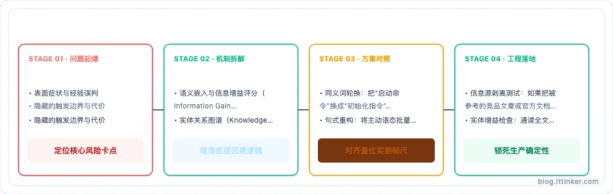
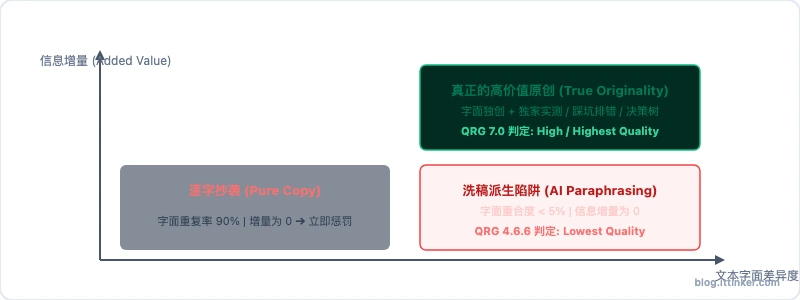
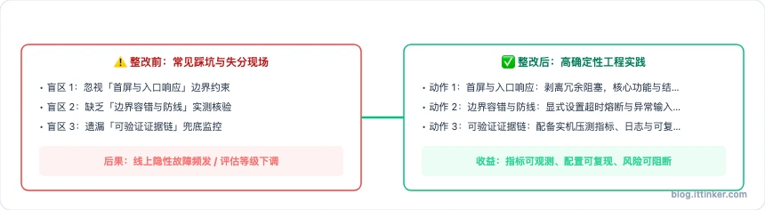
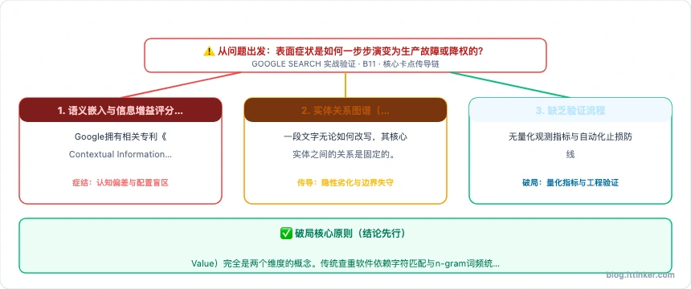
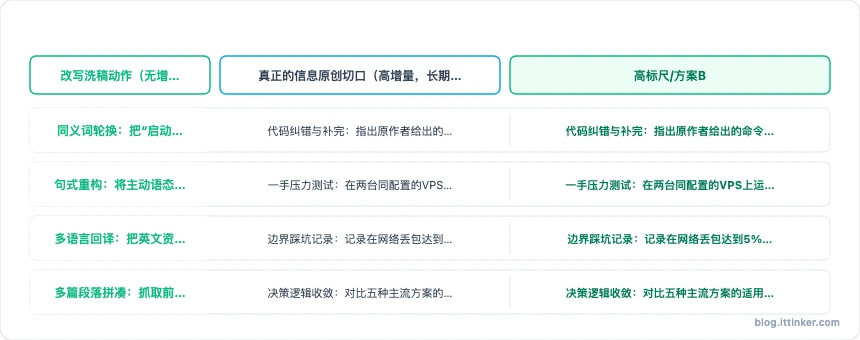
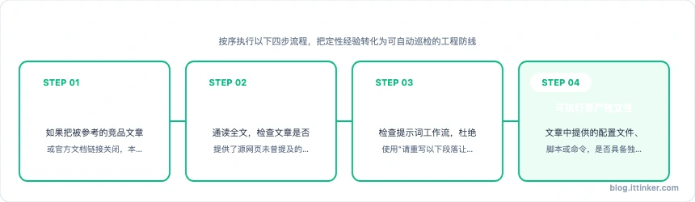

# “用洗稿工具绕过检测就是原创”？掩耳盗铃的自嗨：‘改写得不像原文’为什么不等于原创？文本相似度与信息原创度的鸿沟 | 读懂 Google Search SEO 实战 系列 011

> 🌐 **在线阅读与互动版**：[“用洗稿工具绕过检测就是原创”？掩耳盗铃的自嗨：‘改写得不像原文’为什么不等于原创？文本相似度与信息原创度的鸿沟 | 读懂 Google Search SEO 实战 系列 011](https://blog.ittinker.com/posts/改写得不像原文-为什么不等于原创/)
> 📚 **所属专栏**：[《读懂 Google Search：110篇搜索质量与SEO实战指南》](../README.md)

---

### 📌 结论先行（TL;DR）
> **文本字面距离（Lexical Distance）与信息增量价值（Informational Added Value）完全是两个维度的概念**。**
> **在出海 SEO 的灰色讨论中，经常能听到这样的“聪明技巧”：**
> **找到排名前三的高权重竞品文章，复制下来喂给模型，提示词写着：“请用完全不同的学术词汇改写以下段落，颠倒被动语态，确保 Copyscape 查重率低于 5%”。更有甚者，使用脚本进行“英语 ➔ 德语 ➔ 日语 ➔ 英语”的多重回译洗稿。**
> **完成上述流程后，站长看着查重报告上绿色的“100% Unique”，误以为自己完成了一次高水平的原创。**
> **然而，一旦遇上 Google 核心算法更新，这类站点往往首当其冲被批量拔毛。为什么字面上完全挑不出抄袭痕迹的内容，依然逃不过算法的清理？**
>
> - 传统查重软件依赖字符匹配与 n-gram 词频统计，容易被同义词轮换或跨语言回译所迷惑；
> - 但 Google 现代检索算法基于稠密语义向量与实体知识图谱运作。
> - QRG 4.6.6 明确将“仅进行同义词替换或自动改写的派生内容”（Derived Content with Little or No Added Value）打入 Lowest / Low。
> - **改写得再天衣无缝**：只要没有为搜索生态贡献新的事实、测试、数据或排错结论，在算法眼里依然属于零价值的信息搬运。

---

### 🚨 2026 → 2024 官方最新风向预警：Google 对Google 对语义重写、同义词替换与伪原创的算法穿透识别的策略演进

#### 🕒 2026 → 2024 Google 官方对Google 对语义重写、同义词替换与伪原创的算法穿透识别的策略演进

- **2026 · 高维语义指纹穿透（High-dimensional Semantic Invariance）**
  Google 核心抓取管线通过高维语义向量对文章思想内核进行比对。哪怕洗稿工具将词汇和句序全部打乱，其底层论据链条与信息拓扑只要与被抄袭源 100% 重合，直接判定为无价值伪原创。

- **2025 · 信息增量测算与排他性收录**
  针对同一新闻或技术事件，Google 仅优先收录最先报道的源头与提供了独特解读的深度跟进，单纯做降重改写的‘搬砖站’被系统折叠隐藏。

- **2024 · QRG 4.6 节对‘伪装成原创的轻微改写’的严厉清算**
  条款明确警告：使用同义词替换或自动化重构工具掩盖抄袭本质的行为，直接被定性为欺骗性质的 Low MC，剥夺一切排名资格。

---

## 1. 拆解 QRG 4.6.6：Google 眼中的“派生内容”

在 QRG 第 4.6.6 节《Copied Content with Little or No Added Value》中，官方对“抄袭”的定义远比普通人理解的宽泛且深刻：

> *"Content which is copied or derived with little or no added value from other sources, including: content that is slightly modified (e.g., automated paraphrasing or replacing words with synonyms), content that is aggregated from multiple sources with little or no original thought, or automated summaries that do not add new insight... Pages with little or no added value should be rated Lowest."*

请特别注意定义中的连词：**Copied or Derived（复制或派生）**。

在 Google 的质量评估规则中，如果你的文章推导逻辑、事实清单、步骤顺序完全继承自另一篇既有文献，即便你把所有动词和形容词替换成同义词，这篇内容依然被定性为“派生内容”。

评估员受训去寻找的核心线索是：**如果把被参考的源网页从互联网上拿掉，你的页面是否还拥有独立存在的信息生命力？**
如果答案是否定的，如果你的内容离开原文就失去了事实来源，那么它在本质上就是寄生性的搬运工。

---

## 2. 现代搜索引擎如何看穿改写？

许多站长对技术的认知停留在十年前。现代搜索引擎识别洗稿并不依靠简单的字词重合比对，而是依靠两大技术基石：

### 2.1 语义嵌入与信息增益评分（Information Gain Score）
Google 拥有相关专利《Contextual Information Gain Generation》。当搜索引擎向用户展示搜索结果时，会评估某个新页面相比用户已经看过的网页，能否带来额外的信息增益（Information Gain）。
如果用户已经浏览了关于“PostgreSQL 连接池配置”的基准文章，再打开你的网页，模型经过语义向量映射后发现两者的事实集（Fact Sets）完全重合，系统会判定你的页面信息增益趋近于零，自然不会给予靠前的展示位。

### 2.2 实体关系图谱（Knowledge Graph & Entity Extraction）
一段文字无论如何改写，其核心实体之间的关系是固定的。
例如原文表述为：“Redis 在内存不足时会根据 maxmemory-policy 触发逐出机制，volatile-lru 仅淘汰设置了过期时间的键”。
你用大模型改写为：“当系统 RAM 告急，开源键值存储器通过配置项执行数据清理，其中一种策略只对标注了 TTL 的记录生效”。
在人类眼里这是两句用词迥异的表述，但在信息抽取系统眼中，提取出来的实体关系元组完全一样：
`Entity(Redis) ➔ Action(Eviction) ➔ Trigger(Memory Limit) ➔ Target(Keys with TTL)`。
图谱中没有增加任何新节点，没有补充生产案例，这种文字游戏毫无信息增量。

---

## 3. 洗稿改写操作 vs 真正信息原创的对比

为了在日常写作中划清界限，以下是典型的洗稿技巧与工程化原创动作的清晰对照：

| 改写洗稿动作（无增量，面临降权） | 真正的信息原创切口（高增量，长期壁垒） |
|---|---|
| **同义词轮换**：把“启动命令”换成“初始化指令”，把“高可用”改写为“冗余容灾架构” | **代码纠错与补完**：指出原作者给出的命令在最新操作系统中会报 `Permission denied`，并补充相应的 systemd 服务配置单元 |
| **句式重构**：将主动语态批量转为被动语态，把长句拆分成三个短句 | **一手压力测试**：在两台同配置的 VPS 上运行基准测试，列出真实的延迟分位数（P50/P99）与内存占用对比表 |
| **多语言回译**：把英文资料翻译成法文再翻译回英文，消除语言指纹 | **边界踩坑记录**：记录在网络丢包达到 5% 时该配置引发的重传雪崩现象，并给出修改 keepalive 参数的完整推导 |
| **多篇段落拼凑**：抓取前五名的段落拼成大清单，通篇充斥相互矛盾的参数定义 | **决策逻辑收敛**：对比五种主流方案的适用场景，画出清晰的二选一选型逻辑图，明确告诉读者什么情况下绝不要选方案 A |

---

## 4. 独立开发者内容原创度自查清单

在任何内容上线前，用以下 5 个关卡检验真实的信息原创度：

- [ ] **信息源剥离测试**：如果把被参考的竞品文章或官方文档链接关闭，本文是否仍然包含至少 3 个只属于作者本人的实操观点或排错发现？
- [ ] **实体增益检查**：通读全文，检查文章是否提供了源网页未曾提及的新参数、新报错代码或新版本兼容警告？
- [ ] **消除字面伪装**：检查提示词工作流，杜绝使用“请重写以下段落让它通过查重”这类自欺欺人的指令，改为“请根据以下测试日志帮我提炼故障原因”。
- [ ] **可执行资产独立性**：文章中提供的配置文件、脚本或命令，是否具备独立运行能力，而非从第三方碎片拼接后未经测试的代码段？
- [ ] **搜索任务终结度**：读者在阅读完这篇文章后，是否能够直接解决终端里的具体阻碍，而无需退回搜索结果页寻找第二篇补充教程？

---

## 下一篇预告

既然单纯改写单篇文章行不通，许多精明的创作者转向了另一种模式：

**“我找了网络上排名前十的文章，去粗取精，把十篇文章的精华浓缩提炼为一篇超级长文。读者看我一篇等于看十篇，这难道还没有新增价值吗？”**

答案是：**聚合本身可能创造价值，但 90% 的聚合只做到了物理搬运，没有跨过 QRG 的增量门槛**。

下一篇，我们将深入聚合内容的判定深水区：**[“把 Top 10 搜索结果抓取总结就是绝世好文”？借鸡生蛋的幻觉：聚合类内容到底有没有新增价值？QRG 视角下的聚合生死线（B12）](/posts/把十篇文章总结成一篇-有没有新增价值/)**。

---

_这是「读懂 Google Search」系列第 35 篇（分卷 B 第 11 篇），系统拆解 Google 官方质量指南，帮你建立长期抗算法波动的出海 SEO 护城河。_

---

## 读懂 Google Search 专栏导航

> 📚 **专栏收录**：本文为 [《读懂 Google Search：110篇搜索质量与SEO实战指南》](/posts/google-search-guide/) 第 **B11** 篇。

* **专栏主页**：[《读懂 Google Search：110篇搜索质量与SEO实战指南》全景地图与路线图](/posts/google-search-guide/)
