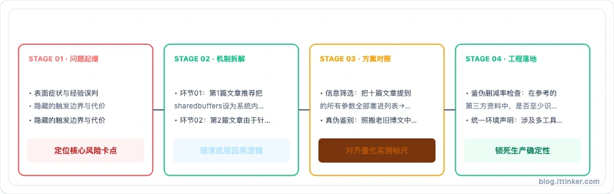
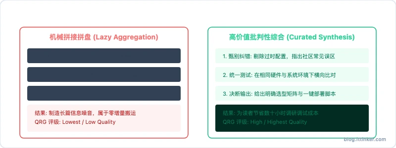
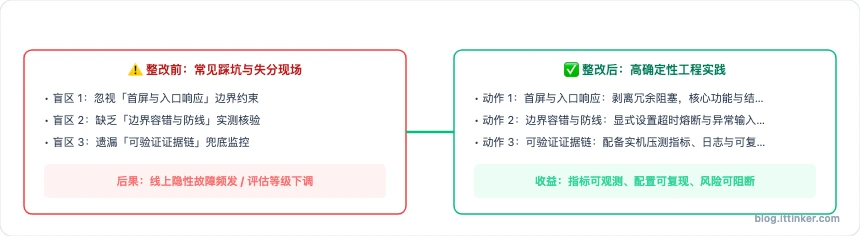
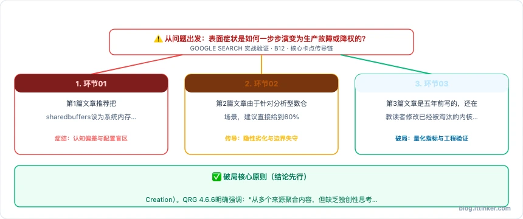
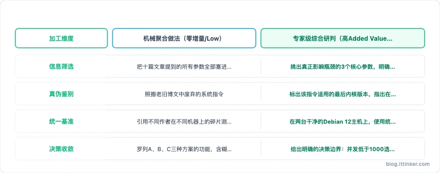
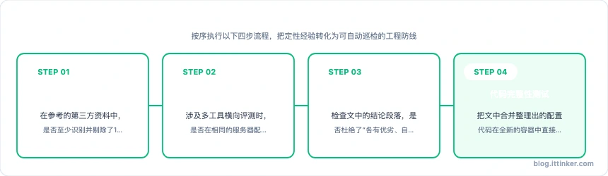

# 把十篇文章总结成一篇，有没有新增价值？QRG 视角下的聚合质量边界 | 读懂 Google Search SEO 实战 系列 012

> 🌐 **在线阅读与互动版**：[把十篇文章总结成一篇，有没有新增价值？QRG 视角下的聚合质量边界 | 读懂 Google Search SEO 实战 系列 012](https://blog.ittinker.com/posts/把十篇文章总结成一篇-有没有新增价值/)
> 📚 **所属专栏**：[《读懂 Google Search：110篇搜索质量与SEO实战指南》](../README.md)

---

### 📌 结论先行（TL;DR）
**单纯的“信息聚合”（Aggregation）绝不等于“价值创造”（Value Creation）**。**

1. QRG 4.6.6 明确强调：“从多个来源聚合内容，但缺乏独创性思考与新增见解”（aggregated from multiple sources with little or no original thought），依然属于零增量派生产物。
2. 把十篇互相矛盾或过时的网页拼装成万字大杂烩，只会成倍增加用户的筛选成本。
3. 真正的增量价值来源于深层次的工程化加工：筛选去伪、统一基准测试、横向矩阵比对、边界条件澄清、明确场景决断与落地实操验证。
4. 缺少这些实质投入，聚合文章在算法眼中不过是一座低质的信息垃圾场。

在内容营销与技术写作领域，“摩天大楼技术”（Skyscraper Technique）曾被无数站长奉为圭臬：
搜索一个目标词，打开前十个搜索结果，把每一篇的要点摘录下来，然后拼成一篇涵盖所有细节的“终极大全指南”。大语言模型的普及更让这个过程缩短到了几秒钟。

创作者往往理直气壮：“原先用户要点开十个网页，现在看我这一篇就能看全，我为用户节省了九次点击，这难道不算巨大的 Added Value 吗？”

然而，Google 质量评估员与核心排序算法给出的反馈往往残酷冷血：这类聚合长文常常在算法更新中排名暴跌。到底是哪个环节出了致命偏差？

---

## 1. QRG 4.6.6 怎么定义“平庸聚合”？

在 QRG 第 4.6.6 节中，关于聚合内容的定级标准没有任何模糊地带：

> *"Content which is copied or derived with little or no added value from other sources, including: ...content that is aggregated from multiple sources with little or no original thought, or automated summaries that do not add new insight."*

Google 使用了“**Little or no original thought**（极少或完全没有原创思考）”这个极其具体的判据。

在信息过载的网络中，如果十个源网页本身都充斥着互相抄袭的陈旧代码、缺乏维护的脚本和含混不清的解释，你仅仅把它们物理拼接在同一个页面上，不仅没有降低阅读成本，反而把十份混乱打包成了一份超级噪音。

用户来到搜索引擎，要的不是“全网相关文献大汇总”，而是“针对当前具体阻碍的精准解决路径”。

---

## 2. 机械聚合的典型事故：噪音放大

以技术开发者常见的“PostgreSQL 性能调优指南”为例：
- 第 1 篇文章推荐把 `shared_buffers` 设为系统内存的 25%；
- 第 2 篇文章由于针对分析型数仓场景，建议直接给到 60%；
- 第 3 篇文章是五年前写的，还在教读者修改已经被淘汰的内核 shmmax 参数；
- 第 4 篇文章的示例代码里存在严重的 SQL 注入漏洞。

如果创作者只是让大模型“把这十篇文章合并为一份 5000 字的完整宝典”，模型会毫无愧色地把这些互相矛盾、过时甚至危险的内容通通罗列在文中：
“有人建议设置 25%，也有人建议设置 60%，用户可根据情况调整，同时可以配合修改 shmmax……”。

这种文章在 Google 质量评估员眼中，属于典型的 **Unhelpful & Low Quality**：
1. 创作者根本没有亲自验证过任何一条建议；
2. 缺乏判断力，把错误和正确的内容等量齐观；
3. 将决策难度全部转嫁给读者。

---

## 3. 聚合产生增量价值的六大工程转化

要把多源资料转化为具备 High Quality 水准的独创资产，创作者必须注入具体的工程动作：

| 加工维度 | 机械聚合做法（零增量 / Low） | 专家级综合研判（高 Added Value / High） |
|---|---|---|
| **信息筛选** | 把十篇文章提到的所有参数全部塞进列表 | 挑出真正影响瓶颈的 3 个核心参数，明确指出其余 7 个属于过早优化 |
| **真伪鉴别** | 照搬老旧博文中废弃的系统指令 | 标出该指令适用的最后内核版本，指出在当前主流 LTS 发行版中的替代命令 |
| **统一基准** | 引用不同作者在不同机器上的碎片测试结果 | 在两台干净的 Debian 12 主机上，使用统一的 sysbench 脚本执行复现测试 |
| **决策收敛** | 罗列 A、B、C 三种方案的功能，含糊其辞 | 给出明确的决策边界：并发低于 1000 选 A，涉及事务强一致选 B，严禁选 C |
| **代码交付** | 复制第三方不完整的配置片段 | 整理为经过实测验证的统一生产模版或单行初始化命令 |
| **踩坑预警** | 通篇只写成功的理想路径 | 重点展示按照常规教程配置时一定会遇到的 2 个典型报错及修复方案 |

---

## 4. 独立开发者聚合内容上线前审查表

在发布任何具有汇编、汇总性质的技术指南前，严格对照以下规则审查：

- [ ] **鉴伪删减率检查**：在参考的第三方资料中，是否至少识别并剔除了 1 到 2 处过时、错误或不再适用的陈旧技术建议？
- [ ] **统一环境声明**：涉及多工具横向评测时，是否在相同的服务器配置、相同的网络拓扑与明确的基准参数下进行比对？
- [ ] **消灭模棱两可**：检查文中的结论段落，是否杜绝了“各有优劣、自行选择”等空洞表述，给出了基于具体约束条件（预算、并发、团队技术栈）的明确建议？
- [ ] **代码完整性测试**：把文中合并整理出的配置代码在全新的容器中直接运行，确认能否一次性通过，杜绝缺漏依赖？
- [ ] **增量观点占比**：通读全文，作者本人的实测数据、架构评述与避坑批注，篇幅是否占据核心比例？

---

## 下一篇预告

既然大模型能够高效完成信息梳理与语言组织，很多独立开发者不禁反思：

**“在 AI 能够以毫秒级速度写出技术框架的当下，到底还有哪些内容是真正需要人类一行一行亲自手写的？”**

答案是：**那些大模型永远无法凭空捏造的一手真实经历与失败教训**。

下一篇，我们将探讨创作者不可替代的护城河：**[AI 时代，什么内容值得人亲自写？构建不可替代的 E-E-A-T 护城河（B13）](/posts/ai-时代-什么内容值得人亲自写/)**。

---

_这是「读懂 Google Search」系列第 36 篇（分卷 B 第 12 篇），系统拆解 Google 官方质量指南，帮你建立长期抗算法波动的出海 SEO 护城河。_

---

## 读懂 Google Search 专栏导航

> 📚 **专栏收录**：本文为 [《读懂 Google Search：110篇搜索质量与SEO实战指南》](/posts/google-search-guide/) 第 **B12** 篇。

* **专栏主页**：[《读懂 Google Search：110篇搜索质量与SEO实战指南》全景地图与路线图](/posts/google-search-guide/)
