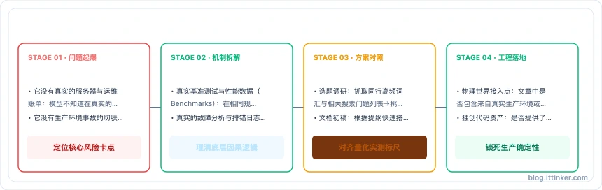
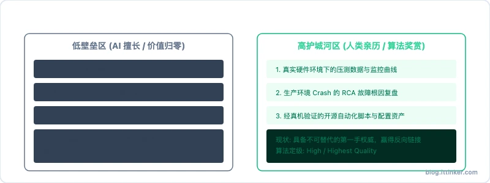
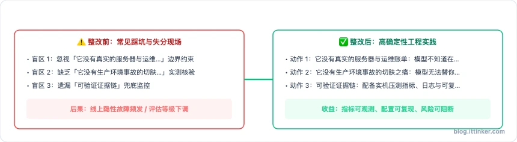
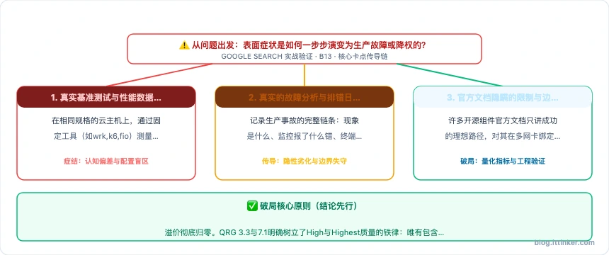
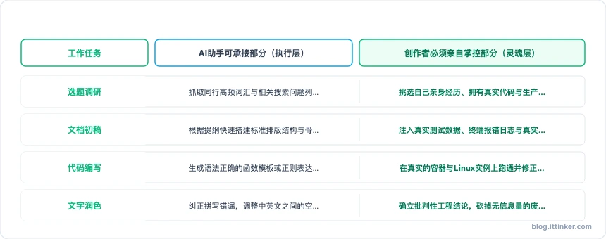
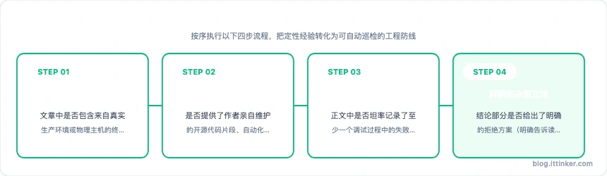

# “AI 时代什么内容值得亲自写”？不可替代的人类心力（Effort） | 读懂 Google Search SEO 实战 系列 013

> 🌐 **在线阅读与互动版**：[“AI 时代什么内容值得亲自写”？不可替代的人类心力（Effort） | 读懂 Google Search SEO 实战 系列 013](https://blog.ittinker.com/posts/ai-时代-什么内容值得人亲自写/)
> 📚 **所属专栏**：[《读懂 Google Search：110篇搜索质量与SEO实战指南》](../README.md)

---

### 📌 结论先行（TL;DR）
> **当大模型能以毫秒级速度输出结构完整、文笔流畅的通用教程时，通用常识的搜索溢价彻底归零**。**
> **当大语言模型能够轻易写出完美的 Python 爬虫架构、详尽的 Kubernetes 调度原理解析时，很多独立开发者陷入了创作迷茫：**
> **“如果输入一句提示词就能生成一篇条理清晰、排版优雅的完整长文，那么人类创作者花几天时间查资料、写文字，还有什么竞争优势？”**
> **答案隐藏在 Google 近年对质量评估指南（QRG）的核心修订中。Google 之所以将传统的 E-A-T 升级为包含两个 E 的 **E-E-A-T**，并在首位赫然加入 **Experience（亲身体验）**，正是为了在海量由算法生成的无感知文本浪潮中，精准识别出那些来自物理世界真实搏杀的高价值信息。**
>
> - QRG 3.3 与 7.1 明确树立了 High 与 Highest 质量的铁律：唯有包含第一手亲身经历（First-hand Experience）、不可捏造的实验基准数据（Benchmark Data）、真实的生产事故复盘（Real Failures）、独创的开源脚本资产与鲜明的工程决断权衡（Trade-offs），才能赢得评估员与排序算法的核心信任。
> - 人类作者应当彻底退出公知概念的平庸复述，把精力聚焦在模型无法凭空生成的现实摩擦力上。

---

### 🚨 2026 → 2024 官方最新风向预警：Google 对Google 针对第一手经验（First-hand Experience）与真人实证的排名倾斜的策略演进

#### 🕒 2026 → 2024 Google 官方对Google 针对第一手经验（First-hand Experience）与真人实证的排名倾斜的策略演进

- **2026 · 真人实操签名与多模态证据验证（Human Craft Signature）**
  Google 大幅提高具有真人视频演示、带终端水印的排障日志、签名版 GitHub 实名提交等一手实证页面的展现权重，形成抵御 AI 泡沫的绝对护城河。

- **2025 · 作者真实影响力与全网实体共识联动**
  通过检索作者在行业开源社区、学术机构或顶级技术峰会上的长期声誉沉淀，算法赋予具有真实工程信用的专家以最高的内容豁免与推荐加分。

- **2024 · QRG 3.4 节关于真实经验（Experience）不可替代性的定调**
  官方指引重申：只有亲身经历过痛苦、亲手调试过 Bug 的人所沉淀的真实顿悟，才是互联网最宝贵的内容资产，也是任何模型无法伪造的质量基石。

---

## 1. 拆解 QRG 3.3 与 7.1：亲历经验的绝对统治力

在 QRG 第 3.3 节《Experience, Expertise, Authoritativeness, and Trust (E-E-A-T)》中，Google 对亲身体验给出了极其具体的描述：

> *"Consider the extent to which the creator of the MC has necessary first-hand or life experience for the topic. Many types of pages are trustworthy and achieve their purpose well when created by people with a wealth of personal experience."*
> 
> *"Pages with a High level of E-E-A-T are trustworthy or very trustworthy... Trust is the most important member of the E-E-A-T family because untrustworthy pages have low E-E-A-T no matter how experienced, expert, or authoritative they may seem."*

再看 QRG 7.1 节关于最高等级内容（Highest Quality MC）的要求：
评估员被要求寻找的是**独特的独创成果（Original Content）**、**高超的专业技艺（High Level of Skill）**，以及**大量真实劳动投入（Significant Amount of Effort）**。

大模型拥有全网的语料统计概率，但它拥有两个致命缺陷：
1. **它没有真实的服务器与运维账单**：模型不知道在真实的 AWS 账单激增 800 美元那一刻，哪一个配置开关挽救了现金流；
2. **它没有生产环境事故的切肤之痛**：模型无法替你在凌晨三点抓取堆栈日志并定位到特定内核补丁的竞争态死锁。

这些无法被算法预测的现实阻碍与调试过程，正是今天搜索结果中最稀缺、权重最高的黄金资产。

---

## 2. 属于人类开发者的六大核心写作资产

在日常技术博客与站点运营中，应当果断放弃撰写平庸的科普，把精力集中在以下六类资产上：

### 2.1 真实基准测试与性能数据（Benchmarks）
在相同规格的云主机上，通过固定工具（如 wrk, k6, fio）测量实际 QPS、延迟分布（P95/P99）和内存占用。给出机器配置、系统内核版本、完整的压测参数与未经篡改的数据对比表。这类数据在全网具有唯一性，直接体现 QRG 所推崇的“Effort”。

### 2.2 真实的故障分析与排错日志（RCA & Debugging Logs）
记录生产事故的完整链条：现象是什么、监控报了什么错、终端打印了哪一行异常栈、排查时走了哪些弯路、最终定位到的根本原因是什么。真实报错日志中的唯一 Hash 或错误代码（如 `OOM command not allowed when used memory > 'maxmemory'`），是极其精准的长尾流量入口。

### 2.3 官方文档隐瞒的限制与边界地雷（Edge Cases）
许多开源组件官方文档只讲成功的理想路径，对其在多网卡绑定下的路由失效、并发连接超限时的隐式丢包避而不谈。把你在实战中踩到的这些隐形地雷及绕过方案记录下来，就是不可替代的独家经验。

### 2.4 财务账单与架构成本优化（Cost Optimization）
记录如何通过调整 Cloudflare 缓存规则节省了 70% 的回源流量费用，或者通过自建 Tunnel 代替昂贵的公网弹性 IP。包含真实数字、账单明细和取舍过程的分享，天然具备极高的 E-E-A-T 信任度。

### 2.5 具备明确主观立场的工程抉择（Opinionated Trade-offs）
大模型喜欢四平八稳地说“各有各的好”。但真正的工程落地必须做取舍。勇敢表达你的判断：“在当前单体架构未超过 5000 RPS 之前，盲目引入微服务与服务网格纯属浪费生命”。有理有据的鲜明立场不仅能赢得读者共鸣，更能促成高质量的自然外链。

### 2.6 自研开源工具与自动化脚本（Executable Artifacts）
在文章中提供由你本人维护的 GitHub 开源仓库地址、一键部署脚本指令或可直接运行的 Docker Compose 生产配置模版。例如结合 ITTinker 自动化脚本套件，给出经过长期实机验证的自动化运维指令。这种可执行资产，是任何纯文本洗稿站点永远无法模仿的硬核壁垒。

---

## 3. 人类工程师 vs AI 助手的任务边界对照

| 工作任务 | AI 助手可承接部分（执行层） | 创作者必须亲自掌控部分（灵魂层） |
|---|---|---|
| **选题调研** | 抓取同行高频词汇与相关搜索问题列表 | 挑选自己亲身经历、拥有真实代码与生产日志的问题 |
| **文档初稿** | 根据提纲快速搭建标准排版结构与骨架 | 注入真实测试数据、终端报错日志与真实服务器环境参数 |
| **代码编写** | 生成语法正确的函数模板或正则表达式 | 在真实的容器与 Linux 实例上跑通并修正报错 |
| **文字润色** | 纠正拼写错漏，调整中英文之间的空格排版 | 确立批判性工程结论，砍掉无信息量的废话导语 |
| **图表制作** | 协助生成初版 SVG 矢量图代码框架 | 规划清晰的架构拓扑与逻辑流转，校对参数连线 |

---

## 4. 独立开发者高价值内容自查工程

在准备发布一篇深度文章时，对照以下五项指标进行验收：

- [ ] **物理世界接入点**：文章中是否包含来自真实生产环境或物理主机的终端截图、压测图表或系统日志片段？
- [ ] **独创代码资产**：是否提供了作者亲自维护的开源代码片段、自动化部署脚本或经过真机验证的参数配置？
- [ ] **真实失败记录**：正文中是否坦率记录了至少一个调试过程中的失败尝试或报错排查过程？
- [ ] **鲜明的决策立场**：结论部分是否给出了明确的拒绝方案（明确告诉读者什么场景下坚决不要用某方案），而非中庸罗列？
- [ ] **声誉背书机制**：作者信息栏是否明确展示了创作者的技术背景、GitHub 个人主页或长期沉淀的专业领域标签？

---

## 下一篇预告

确立了第一手亲身经验的核心地位后，很多创作者又走向了另一个形式主义误区：

**“既然要体现努力，那我是不是把文章写得越长越好？动辄八千字、上万字的内容，Google 是不是天然会给更高的排名？”**

答案是：**字数从未成为 Google 的质量评分维度；为了凑字数而注水，反而会直接触发 Low Quality**。

下一篇，我们将打破字数迷信：**[“越长越能体现专业度”？字数通胀时代的笑话：打破文章长度迷信与 QRG 任务完成度法则（B14）](/posts/内容越长-google-越喜欢吗/)**。

---

_这是「读懂 Google Search」系列第 37 篇（分卷 B 第 13 篇），系统拆解 Google 官方质量指南，帮你建立长期抗算法波动的出海 SEO 护城河。_

---

## 读懂 Google Search 专栏导航

> 📚 **专栏收录**：本文为 [《读懂 Google Search：110篇搜索质量与SEO实战指南》](/posts/google-search-guide/) 第 **B13** 篇。

* **专栏主页**：[《读懂 Google Search：110篇搜索质量与SEO实战指南》全景地图与路线图](/posts/google-search-guide/)
