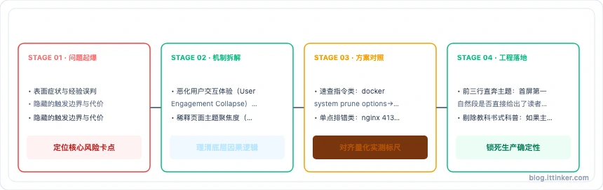
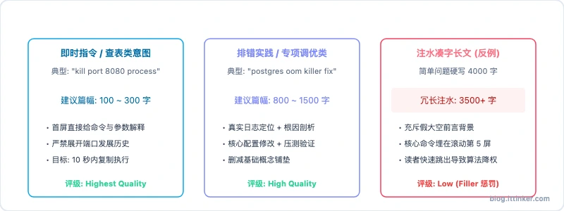
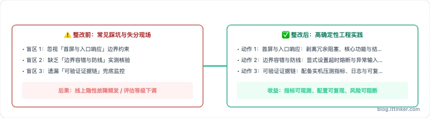
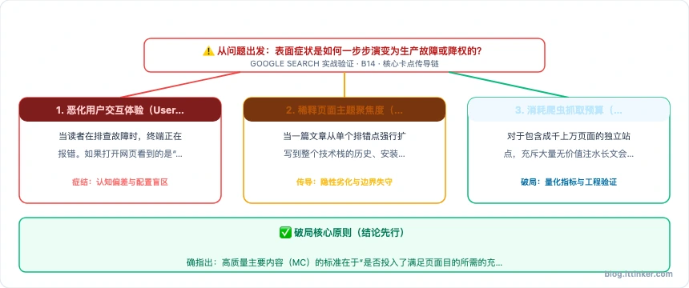
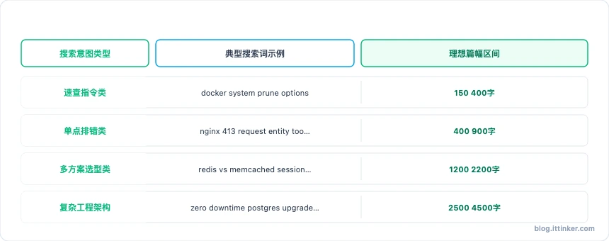

# “越长越能体现专业度”？字数通胀时代的笑话：打破文章长度迷信与 QRG 任务完成度法则 | 读懂 Google Search SEO 实战 系列 014

> 🌐 **在线阅读与互动版**：[“越长越能体现专业度”？字数通胀时代的笑话：打破文章长度迷信与 QRG 任务完成度法则 | 读懂 Google Search SEO 实战 系列 014](https://blog.ittinker.com/posts/内容越长-google-越喜欢吗/)
> 📚 **所属专栏**：[《读懂 Google Search：110篇搜索质量与SEO实战指南》](../README.md)

---

### 📌 结论先行（TL;DR）
> **字数从来不是 Google 的排名因素，信息密度与任务完成度才是**。**
> **在出海内容运营圈子里，有一条流传了十几年的所谓“金科玉律”：**
> **“要想获得 Google 首页排名，文章篇幅必须超过 2000 字，最好达到 3500 字，因为统计数据显示排名前三的页面平均长度都在两千字以上”。**
> **在大模型普及后，这个误区被进一步推向极致：**
> **开发者只需输入一个简单问题，模型便自动生成从发明历史、基础架构、优缺点分析到未来趋势的长篇大论，硬生生把一个单行命令扩写成鸿篇巨制。**
> **然而，打开 Google 官方质量评估指南（QRG），你会发现官方的态度截然相反：**字数不仅不能代表质量，盲目扩写注水反而会直接毁掉页面排名**。**
>
> - **QRG 3.2 与 7.1 明确指出**：高质量主要内容（MC）的标准在于“是否投入了满足页面目的所需的充分努力”，而非绝对篇幅。
> - 如果用户的搜索意图是“如何查看当前端口占用”，一段 80 字且包含确切命令 `ss -tulpn` 的代码块，其质量评级就是 Highest；
> - 若为了所谓 SEO 篇幅硬塞进 2000 字关于 TCP 协议握手的科普注水废话，反而会触发 QRG 5.2.2 的 Filler 惩罚。
> - 文章的长短应完全取决于搜索任务的复杂程度。

---

### 🚨 2026 → 2024 官方最新风向预警：Google 对Google 对冗长废话（Filler Content）与高效交付的评估演进的策略演进

#### 🕒 2026 → 2024 Google 官方对Google 对冗长废话（Filler Content）与高效交付的评估演进的策略演进

- **2026 · 信息密度与阅读转化率算法化考核（Information Density Metric）**
  Google 核心系统不再以字数论英雄，转而测算‘有效解决问题所需的最少字符’。300 字能够清晰交付的代码片段，其权重远胜 3000 字充满背景铺垫的注水长文。

- **2025 · 长文停留与跳出率反向惩戒**
  针对很多站长为凑字数故意把核心答案藏在文章最后、导致用户频繁滑动的糟糕行为，系统自动将其判定为不佳页面体验（Poor Page Experience）。

- **2024 · QRG 3.2 节关于 MC 篇幅与页面目的相称性的规定**
  规范明确：页面内容的篇幅必须与其目的相匹配。简单查询给精炼回答，复杂研究才需要万字架构，字数通胀是典型的不合格内容表现。

---

## 1. 拆解 QRG 3.2 与 5.2.2：让篇幅回归页面目的

在 QRG 第 3.2 节关于主要内容（Main Content）的描述中，Google 开宗明义地写道：

> *"The amount of content needed for a page to be satisfying depends on the topic and purpose of the page. Some topics require very little content to be satisfying, while other topics require a large amount of content."*
> 
> *"A High quality broad informational topic may need a lot of content to be satisfying. However, a page on a very specific topic, such as a recipe or a conversion calculator, may require much less content."*

指南清晰指出：**篇幅需求由主题与目的决定**。
一个换算汇率的计算器页面，哪怕只有 20 个单词和一个输入框，只要换算精准顺畅，它就是 Highest Quality。

更具警示意义的是 QRG 第 5.2.2 节《Filler as a Poor User Experience》：

> *"Filler is content that is included to make a page appear longer or more substantial, but which adds little to no value for the user... Pages with large amounts of filler provide a poor user experience and should be rated Low."*

当评估员看到一个原本 30 秒就能解决的技术问题被硬生生塞入 8 个小标题和 3000 字废话时，他们的任务不是被创作者的“勤奋”打动，而是将其判定为 **Low Quality**。

---

## 2. 为什么长文注水会恶化实际排名？

盲目追求长篇大论，不仅在 QRG 人工评估中拿不到高分，在实际线上算法排序中同样会遭到三重反噬：

### 2.1 恶化用户交互体验（User Engagement Collapse）
当读者在排查故障时，终端正在报错。如果打开网页看到的是“引言：在现代化微服务体系中，网络通信扮演着不可忽视的角色”，读者会感到厌烦并立即点击回退按钮。高频的快速回退（Pogo-sticking）是搜索引擎判定内容无法满足搜索意图的核心负向信号。

### 2.2 稀释页面主题聚焦度（Topic Dilution）
当一篇文章从单个排错点强行扩写到整个技术栈的历史、安装、运维与哲学思考时，文本中的关键词稠密度与主题语义向量会被严重稀释。搜索引擎难以判定页面的核心解决目标，最终导致核心长尾词排不上去，宽泛词竞争不过权威大站。

### 2.3 消耗爬虫抓取预算（Crawl Budget Waste）
对于包含成千上万页面的独立站点，充斥大量无价值注水长文会迅速耗尽爬虫抓取预算。Googlebot 花费大量算力抓取无意义的废话段落，导致站点真正有价值的深度代码页面迟迟无法建立索引。

---

## 3. 意图驱动：技术内容的四阶篇幅决策表

写多少字，应当严格根据读者的搜索任务类型来定：

| 搜索意图类型 | 典型搜索词示例 | 理想篇幅区间 | 核心交付物 | 绝不能犯的注水错误 |
|---|---|---|---|---|
| **速查指令类** | `docker system prune options` | 150 ~ 400 字 | 准确的命令列表、各个选项参数说明、安全警告提示 | 花 800 字科普容器虚拟化与物理机的区别 |
| **单点排错类** | `nginx 413 request entity too large` | 400 ~ 900 字 | 真实报错日志、配置文件修改位置、参数计算公式、重新加载指令 | 讲述 HTTP 协议从 1.0 到 2.0 的演变历史 |
| **多方案选型类** | `redis vs memcached session storage` | 1200 ~ 2200 字 | 性能对比表格、内存碎片开销对比、双机持久化选型逻辑图 | 机械摘抄双方官方网站的整段营销宣传语 |
| **复杂工程架构** | `zero downtime postgres upgrade guide` | 2500 ~ 4500 字 | 详细的读写分离配置、主从延迟监控指标、回滚演练步骤与全套检查脚本 | 堆砌大段未经验证的代码，缺乏实测日志 |

---

## 4. 独立开发者内容脱水裁决表

在定稿前，通过以下 5 个剪刀动作剔除冗余字数，大幅提高信息密度：

- [ ] **前三行直奔主题**：首屏第一自然段是否直接给出了读者检索的核心答案或核心命令，杜绝“本文将详细介绍……”等废话？
- [ ] **剔除教科书式科普**：如果主题是讲解某个特定进阶参数，是否把文中针对基础概念的普及性文字删减干净？
- [ ] **表格化替代文字堆砌**：对于连续罗列多参数或工具优缺点的长段文字，是否全部重构为一眼可见的 Markdown 对比表格？
- [ ] **终结无信息量收尾**：文章末尾是否删除了“以上就是全部内容，希望对大家有所帮助”等无意义客套话，替换为具体的验证指令或延伸排错指引？
- [ ] **高亮核心关键行**：长代码块或配置文件中，是否使用注释清晰标明了读者真正需要修改的核心行？

---

## 下一篇预告

明白了盲目扩写注水的危害后，我们必须把手术刀精准对准那些最容易产生注水废话的典型区域：

**“在 AI 写作流水线中，大模型为什么总是不可抑制地吐出一堆‘开场假大空、中间车轱辘话、结尾毫无信息量的总结’？”**

答案是：**这就是大模型概率采样的天然缺陷——Filler（注水废话）**。

下一篇，我们将解剖这种最常见的 AI 病灶：**[“从宇宙大爆炸开始铺垫背景”？AI 内容充斥注水废话的致命绝症：如何彻底清除 Filler，避免页面被降档？（B15）](/posts/什么叫-filler/)**。

---

_这是「读懂 Google Search」系列第 38 篇（分卷 B 第 14 篇），系统拆解 Google 官方质量指南，帮你建立长期抗算法波动的出海 SEO 护城河。_

---

## 读懂 Google Search 专栏导航

> 📚 **专栏收录**：本文为 [《读懂 Google Search：110篇搜索质量与SEO实战指南》](/posts/google-search-guide/) 第 **B14** 篇。

* **专栏主页**：[《读懂 Google Search：110篇搜索质量与SEO实战指南》全景地图与路线图](/posts/google-search-guide/)
