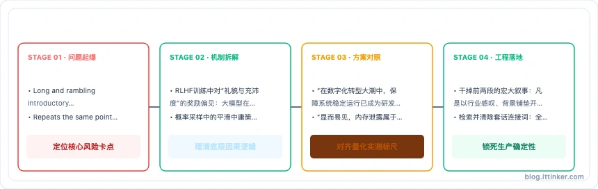
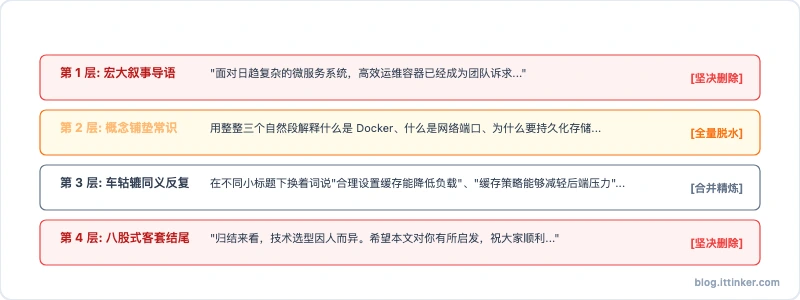
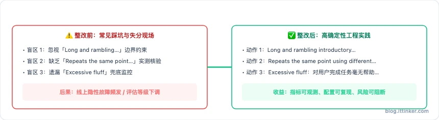
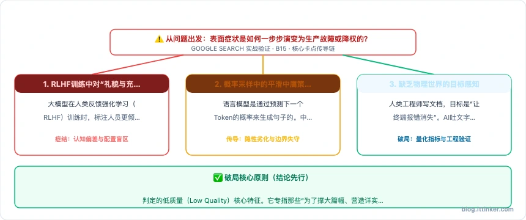
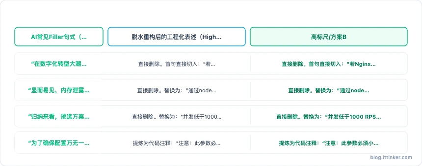

# 什么叫 Filler？AI 内容为什么充斥着致命的注水废话 | 读懂 Google Search SEO 实战 系列 015

> 🌐 **在线阅读与互动版**：[什么叫 Filler？AI 内容为什么充斥着致命的注水废话 | 读懂 Google Search SEO 实战 系列 015](https://blog.ittinker.com/posts/什么叫-filler/)
> 📚 **所属专栏**：[《读懂 Google Search：110篇搜索质量与SEO实战指南》](../README.md)

---

### 📌 结论先行（TL;DR）
**Filler（注水废话）是大语言模型概率采样的天然副产物，更是 QRG 5.2.2 明文判定的低质量（Low Quality）核心特征**。**

1. 它专指那些“为了撑大篇幅、营造详实假象，但对读者解决问题毫无实质帮助的冗余文本”。
2. AI 初稿之所以充斥着假大空的宏大叙事、同义反复的车轱辘话、公知常识科普与八股式结尾总结，是因为模型训练中的强化学习对“安全中庸与篇幅充实”存在固有偏好。
3. 消灭 Filler 是技术文章脱离 Low 泥潭、跻身 High Quality 的第一道必修脱水手术。

阅读由大模型端到端生成的文章时，经常会产生一种强烈的生理疲劳感：
整篇文章字句工整、结构对称、词藻华丽，但看完了前三屏，却找不到一句实质性的参数配置，读者脑海中唯一的念头就是“赶紧说重点”。

这种让人昏昏欲睡的冗余文本，在 Google 搜索质量体系中拥有一个专门的定性名词：**Filler（注水填充料）**。

在 QRG 5.2.2 节中，Google 正式将 Filler 确立为评定 Low Quality 的独立红线。

---

## 1. 拆解 QRG 5.2.2：Google 为什么厌恶 Filler？

在 QRG 第 5.2.2 节《Filler as a Poor User Experience》中，评估员手册给出了直截了当的定义与定级要求：

> *"Filler is content that is included to make a page appear longer or more substantial, but which adds little to no value for the user... Pages with large amounts of filler provide a poor user experience and should be rated Low."*
> 
> *"Examples of filler include: long and rambling introductory material that delays getting to the main point, content that repeats the same point over and over using different words, or excessive fluff that does not help the user achieve their purpose."*

Google 明确指出了 Filler 的三大恶疾：
1. **Long and rambling introductory material**：漫长且东拉西扯的引言，拖延用户获取核心答案的时间；
2. **Repeats the same point using different words**：换汤不换药，用不同的句式车轱辘式重复同一个已知点；
3. **Excessive fluff**：对用户完成任务毫无帮助的虚假修饰词与假大空套话。

在移动端搜索场景中，用户的耐心以秒计算。当一个人在机房紧急调试线上事故，或者急于查找某个 CLI 命令的参数时，阻挡在他面前的长篇废话不仅是在浪费时间，更是在直接摧毁搜索体验。

---

## 2. 为什么大语言模型天然喜欢制造 Filler？

了解大模型的生成机制，就能明白为什么 Filler 会像杂草一样在 AI 草稿中疯长：

### 2.1 RLHF 训练中对“礼貌与充沛度”的奖励偏见
大模型在人类反馈强化学习（RLHF）训练时，标注人员更倾向于给“回答详实、条理分明、态度严谨”的答案打高分。这导致模型养成了“即使面对一个简单问题，也要先铺垫背景、列出三个维度、最后给出平衡性总结”的八股肌肉记忆。

### 2.2 概率采样中的平滑中庸策略
语言模型是通过预测下一个 Token 的概率来生成句子的。中庸、通识、符合全网统计平均值的套话，其预测概率往往高于具有破坏性、具体指向特定版本 bug 的硬核排错命令。模型下意识地用套话填充篇幅，以保证输出文字的“语法流畅度”。

### 2.3 缺乏物理世界的目标感知
人类工程师写文档，目标是“让终端报错消失”。AI 吐文字，目标是“完成提示词设定的字数与结构要求”。由于缺乏具体的任务完结反馈，模型只能靠堆砌同义词和虚饰修饰词来拉长篇幅。

---

## 3. 对照表：典型 Filler 句式与工程化脱水重构

在审核与修改草稿时，必须无情地将下列典型 AI 句式转换为直接利落的工程语言：

| AI 常见 Filler 句式（Low Quality 诱因） | 脱水重构后的工程化表述（High Quality） |
|---|---|
| “在数字化转型大潮中，保障系统稳定运行已成为研发团队必须面对的严峻考验。” | 直接删除。首句直接切入：“若 Nginx upstream 节点在 3 秒内连续失败 2 次，按如下配置切换备用机。” |
| “显而易见，内存泄露属于头疼的技术难题，它拖慢机器运行，还会造成服务整体瘫痪。” | 直接删除。替换为：“通过 `node --inspect` 抓取 Heap Snapshot，重点排查全局 Map 未释放导致的内存爬升。” |
| “归纳来看，挑选方案取决于业务场景，建议大家在项目中结合现状权衡利弊。” | 直接删除。替换为：“并发低于 1000 RPS 优先选用 SQLite；涉及多实例集群读写则直接上 PostgreSQL。” |
| “为了确保配置万无一失，我们需要遵循以下几点注意事项，这对于后续运维工作具有重要意义。” | 提炼为代码注释：“# 注意：此参数必须小于物理内存的 75%，否则在内核触发 OOM 时容器会被强制终止。” |

---

## 4. 独立开发者内容脱水执行清单

在发布任何文章前，对整篇文稿执行“脱水手术”：

- [ ] **干掉前两段的宏大叙事**：凡是以行业感叹、背景铺垫开头的句子，一律整段删除。
- [ ] **检索并清除套话连接词**：全局搜索并清理空泛概括、无信息量的客套过渡句。
- [ ] **消除常识性定义凑字**：如果文章讲的是进阶调优，坚决删掉那些解释该工具是什么、谁发明的、有什么优点的教科书式前言。
- [ ] **合并车轱辘话**：检查文中是否在不同小标题下反复强调同一件事；如有，将其合并为一个清晰的参数项。
- [ ] **首屏有效交付物检验**：读者打开网页不滑动屏幕，第一眼能否直接看到核心配置、报错根因或决策对照表？

---

## 下一篇预告

消灭了显性的注水废话后，我们面临着一个更加隐蔽、杀伤力更大的致命隐患：

**“有些 AI 写出来的技术文章，不仅没有废话，而且逻辑严密、专业术语极其丰富，看起来比资深架构师写的还要专业——然而里面的核心命令或安全参数，竟然是模型凭空捏造出来的！”**

答案是：**“看起来很专业”的 AI 幻觉，在 Google 评估体系中属于触碰 YMYL 底线的致命炸弹**。

下一篇，我们将剖析最危险的内容雷区：**[“看起来很专业”的 AI 幻觉为什么比明显错误更危险？QRG 事实准确度与信任崩塌（B16）](/posts/看起来很专业-的-ai-幻觉为什么比明显错误更危险/)**。

---

_这是「读懂 Google Search」系列第 39 篇（分卷 B 第 15 篇），系统拆解 Google 官方质量指南，帮你建立长期抗算法波动的出海 SEO 护城河。_

---

## 读懂 Google Search 专栏导航

> 📚 **专栏收录**：本文为 [《读懂 Google Search：110篇搜索质量与SEO实战指南》](/posts/google-search-guide/) 第 **B15** 篇。

* **专栏主页**：[《读懂 Google Search：110篇搜索质量与SEO实战指南》全景地图与路线图](/posts/google-search-guide/)
