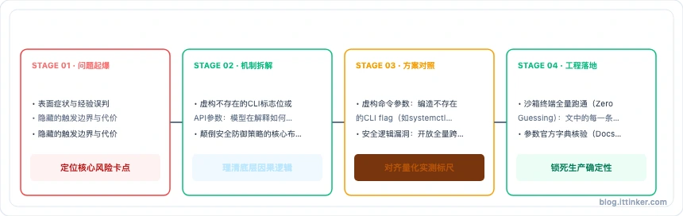
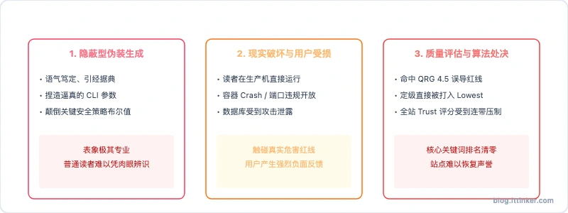
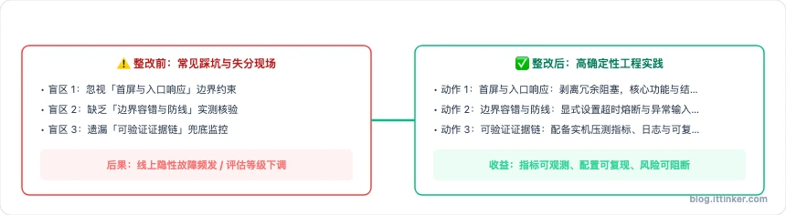
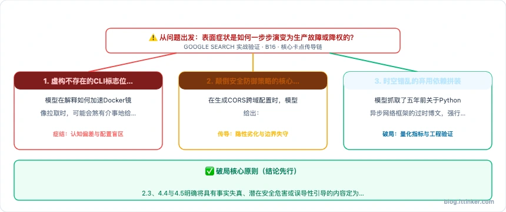
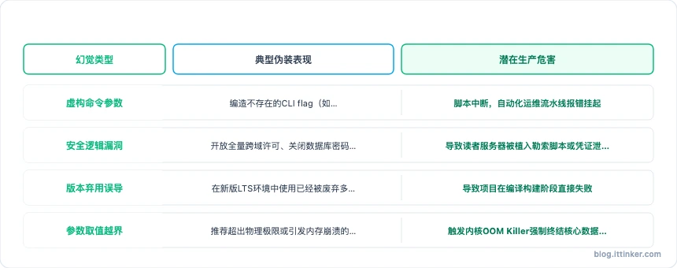
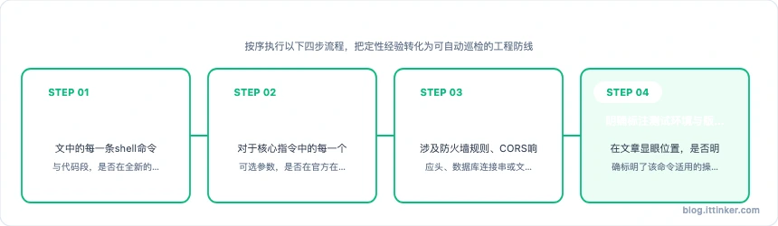

# “看起来很专业的 AI 幻觉更危险”？错误信息的降权机制 | 读懂 Google Search SEO 实战 系列 016

> 🌐 **在线阅读与互动版**：[“看起来很专业的 AI 幻觉更危险”？错误信息的降权机制 | 读懂 Google Search SEO 实战 系列 016](https://blog.ittinker.com/posts/看起来很专业-的-ai-幻觉为什么比明显错误更危险/)
> 📚 **所属专栏**：[《读懂 Google Search：110篇搜索质量与SEO实战指南》](../README.md)

---

### 📌 结论先行（TL;DR）
> **在搜索质量评估体系中，“看似专业的错误”远比“显而易见的荒谬”致命**。**
> **许多技术站长在检查大模型生成的文稿时，只做粗略的通读：**
> **“排版精细、用词讲究、术语到位、逻辑层层递进，通篇挑不出语病，甚至连代码缩进都挑不出毛病，那肯定是一篇优秀的技术指南”。**
> **然而，真正致命的危险往往潜伏在这些“极具专业相”的文本之下。**
> **如果文章里的一行 Linux 命令捏造了一个不存在的标志位，或者在一个防火墙配置示例中把白名单逻辑写反，读者在服务器执行后可能直接导致生产集群瘫痪或数据库在公网裸奔。**
> **在 Google 的质量评估规则里，这属于触碰核心红线的违规行为。**
>
> - QRG 2.3、4.4 与 4.5 明确将具有事实失真、潜在安全危害或误导性引导的内容定为 Lowest Quality。
> - 大语言模型善于生成语气笃定、符合行业术语规范的假参数与虚构 CLI 选项。
> - 这类暗藏陷阱的内容在普通读者眼中极具迷惑性，但一旦被运维人员在生产环境中执行，就会引发数据被清空、端口暴露甚至资产受损等恶果。
> - 在涉及服务器安全、系统运维与开发实践中，单次重大失真即可直接归零域名的 Trust 评分。





---


### 🚨 2026 → 2024 官方最新风向预警：Google 对Google 对细微虚构与事实准确性（Factual Accuracy）的考核收紧的策略演进

#### 🕒 2026 → 2024 Google 官方对Google 对细微虚构与事实准确性（Factual Accuracy）的考核收紧的策略演进

- **2026 · 微小事实漏洞交叉穿透检测（Subtle Hallucination Verification）**
  Google 核心反作弊系统引入事实图谱实时比对。对于大模型生造的虚构 API 参数、不存在的代码方法或捏造的权威引用，算法直接对全站触发 Untrustworthy 信任清零。

- **2025 · 虚构引用与造假外链惩处机制**
  严厉打击 AI 内容中煞有介事标注的伪学术引用与虚构专家发言，将其定性为蓄意欺骗用户，实施长期降权。

- **2024 · QRG 4.1 节对‘伪装成高度专业但事实失真’内容的顶格惩治**
  指南严正指出：披着精美学术外衣但事实经不起推敲的内容，比粗制滥造的垃圾更具欺骗性和危险性，必须坚定判定为 Lowest。


---


## 1. 拆解 QRG 2.3、4.4 与 4.5：对误导与伤害的零容忍

Google 在 QRG 第 2.3 节《Harmful to Self or Others》中，给出了极具警示意义的定义：

> *"Content should be considered harmful if it can cause real-world physical, financial, or technical harm... For topics where accuracy is critical, factually inaccurate content can cause significant harm and should be rated Lowest."*

在 QRG 第 4.5 节《Lowest Quality Pages: Inaccurate or Misleading MC》中，官方进一步细化：

> *"A rating of Lowest is appropriate if the page contains demonstrably inaccurate information that could mislead users in a way that causes harm, or if the page presents fabricated facts as reality."*

请注意这里的判定关键词：**Demonstrably Inaccurate（可被证伪的事实失真）** 与 **Causes Technical Harm（造成技术损失）**。

在 Google 的技术视野中，技术开发与服务器运维同样具备强烈的 YMYL 属性（Your Money or Your Life）——因为错误的配置指南会直接摧毁个人开发者的业务可用性，甚至导致商业公司的数据资产丢失。

一旦评估员或算法检测到页面给出的核心执行步骤存在严重捏造，整篇页面会被无条件定级为 **Lowest Quality**，并对全站的 Trust 评分产生全局拖累。








---

## 2. 技术写作中三类典型的“高智商”幻觉

在大语言模型的生成物中，最凶险的不是语法错乱，而是以下三类披着专业马甲的捏造：

### 2.1 虚构不存在的 CLI 标志位或 API 参数
模型在解释如何加速 Docker 镜像拉取时，可能会煞有介事地给出一行命令：
`docker pull --concurrent-chunks=8 nginx:latest`。
在英文语境下，`--concurrent-chunks` 听起来极其符合常理，符合分布式下载的直觉。但事实上，Docker CLI 从未存在过这个参数。读者执行后只会得到 `unknown flag`。如果出现在无人值守的自动化部署脚本中，会导致整个流水线直接报错中断。

### 2.2 颠倒安全防御策略的核心布尔值
在生成 CORS 跨域配置时，模型给出：
```nginx
add_header 'Access-Control-Allow-Origin' '$http_origin';
add_header 'Access-Control-Allow-Credentials' 'true';
```
并在正文中声称：“这样配置可以完美解决前端跨域限制，保障接口安全”。
任何具备安全常识的工程师都会冒一身冷汗：这种盲目反射 Origin 并开启凭证允许的做法，相当于向全互联网黑客敞开了 CSRF 提权的大门。这种“一本正经胡说八道”的安全配置，是 QRG 2.3 明文打击的 Harmful Content。

### 2.3 时空错乱的弃用依赖拼装
模型抓取了五年前关于 Python 异步网络框架的过时博文，强行杂交到 Python 3.12 的环境中，教读者调用早已从标准库中移除的旧模块，并煞有介事地分析该模块的内部循环机制。这不仅浪费读者大量调试时间，更展现出站点极低的技术维护水平。





---

## 3. 专业型 AI 幻觉分类与防御拦截矩阵

| 幻觉类型 | 典型伪装表现 | 潜在生产危害 | 唯一正确的工程防御动作 |
|---|---|---|---|
| **虚构命令参数** | 编造不存在的 CLI flag（如 `systemctl --deep-restart`） | 脚本中断，自动化运维流水线报错挂起 | 必须在沙箱终端运行 `man <cmd>` 或 `--help` 逐项核对标志 |
| **安全逻辑漏洞** | 开放全量跨域许可、关闭数据库密码验证或授予 777 权限 | 导致读者服务器被植入勒索脚本或凭证泄露 | 人工审查安全参数，对照官方安全基线检查表核查 |
| **版本弃用误导** | 在新版 LTS 环境中使用已经被废弃多年的老 API | 导致项目在编译构建阶段直接失败 | 明确标出软件测试环境版本，核验官方 Changelog 发布记录 |
| **参数取值越界** | 推荐超出物理极限或引发内存崩溃的极端配置 | 触发内核 OOM Killer 强制终结核心数据库进程 | 使用压测工具实际运行，观测系统各项系统指标波动 |





---

## 4. 独立开发者技术文稿防幻觉核验表

如果文稿中有 AI 协助生成的片段，上线前必须通过以下五道硬性防线：

- [ ] **沙箱终端全量跑通（Zero Guessing）**：文中的每一条 shell 命令与代码段，是否在全新的测试容器中由开发者亲手完整粘贴运行了一遍？
- [ ] **参数官方字典核验（Docs Verification）**：对于核心指令中的每一个可选参数，是否在官方在线参考手册中找到了对应的参数解释条目？
- [ ] **安全边界逆向审查（Security Check）**：涉及防火墙规则、CORS 响应头、数据库连接串或文件读写权限的配置，是否排除了高危放行与敏感凭证泄露？
- [ ] **明确标注测试环境与版本号（Env Tagging）**：在文章显眼位置，是否明确标明了该命令适用的操作系统版本与软件版本（如 Debian 12 / PostgreSQL 16.2）？
- [ ] **拒绝全自动流水线（Human In The Loop）**：坚决避免任何由 AI 自动生成后直接存入数据库发布的内容，坚持人类技术工程师的逐字终审。





---

## 全卷小结与下一分卷预告

至此，我们完成了「读懂 Google Search」分卷 **B2. 内容质量与 AI 内容** 的全部 8 篇深度剖析（B09 ~ B16）：
- 我们理清了 Google 对 AI 工具的判定底牌（B09）；
- 破解了“事实正确仍然可能是 Low Quality”的底线认知（B10）；
- 厘清了文本相似度低与信息原创度高的本质鸿沟（B11）；
- 划定了多源内容聚合的真伪价值边界（B12）；
- 确立了 AI 时代唯有人类亲历经验不可替代的写作护城河（B13）；
- 戳破了字数长短与排名高低的伪规律迷信（B14）；
- 剖析并切除了 AI 概率生成带来的注水废话 Filler（B15）；
- 构筑起防御“看起来很专业”的技术幻觉与信任崩塌的坚实城墙（B16）。

解决了单篇内容的质量与原创性后，我们即将面对出海技术站长最为关注、也最容易踩坑的规模化实践领域：

**“如果每个页面的质量都能过关，那么一口气生成十万个城市页面、或者通过数据库生成上万个工具查询页面，究竟是站点的核心增长资产，还是 Google 算法眼里必定遭受清洗的垃圾滥用？”**

下一分卷 **B3. pSEO 与规模化页面**，我们将全面切入规模化内容工程的深水区。

敬请期待第一篇：**[“手里有 10 万个长尾关键词就等于有 10 万流量”？pSEO 狂欢背后的坟场：10 万个页面上线前，必须通过的五道质量门禁（B17）](/posts/10-万个-pseo-页面-是资产还是-10-万个垃圾页面/)**。

---

_这是「读懂 Google Search」系列第 40 篇（分卷 B 第 16 篇），系统拆解 Google 官方质量指南，帮你建立长期抗算法波动的出海 SEO 护城河。_


---

## 读懂 Google Search 专栏导航

> 📚 **专栏收录**：本文为 [《读懂 Google Search：110篇搜索质量与SEO实战指南》](/posts/google-search-guide/) 第 **B16** 篇。

* **专栏主页**：[《读懂 Google Search：110篇搜索质量与SEO实战指南》全景地图与路线图](/posts/google-search-guide/)
