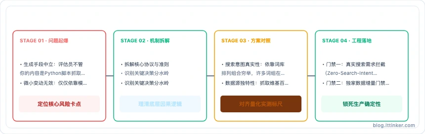
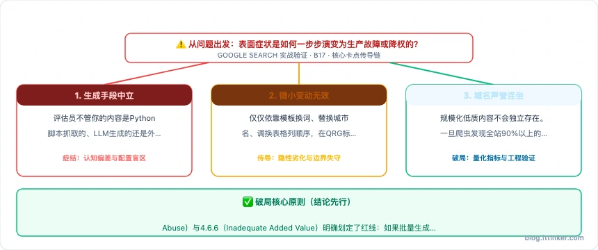
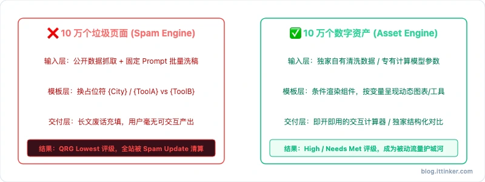
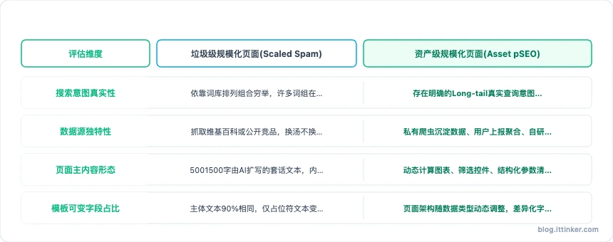
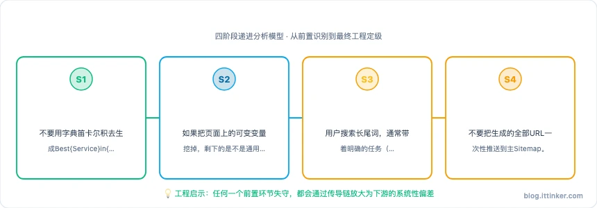
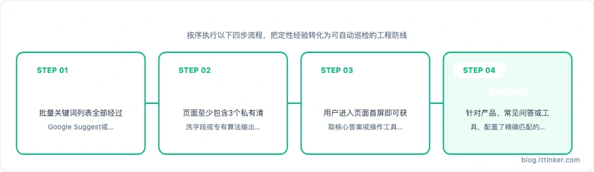

# “手里有 10 万个长尾关键词就等于有 10 万流量”？pSEO 狂欢背后的坟场：10 万个页面上线前，必须通过的五道质量门禁 | 读懂 Google Search SEO 实战 系列 017

> 🌐 **在线阅读与互动版**：[“手里有 10 万个长尾关键词就等于有 10 万流量”？pSEO 狂欢背后的坟场：10 万个页面上线前，必须通过的五道质量门禁 | 读懂 Google Search SEO 实战 系列 017](https://blog.ittinker.com/posts/10-万个-pseo-页面-是资产还是-10-万个垃圾页面/)
> 📚 **所属专栏**：[《读懂 Google Search：110篇搜索质量与SEO实战指南》](../README.md)

---

### 📌 结论先行（TL;DR）
> **规模本身不是原罪，空壳复制才是灾难。**
> **许多刚接触出海的独立开发者常陷入一种算力幻觉：找一个公开 API，拉一份城市或竞品列表，写一段 Python 脚本配合 Headless CMS，一夜之间渲染出数万条 URL。**
> **在提交 Sitemap 后的前两周，Googlebot 疯狂抓取，Search Console 里的 Discover 与 Index 图表一路飙升，开发者以为自己发现了流量印钞机。**
> **可往往在第三周或紧接着的核心算法更新（Core / Spam Update）中，整站收录断崖式下跌，新发页面彻底停留在「已检测 - 尚未编入索引」状态。**
> **这 10 万个页面到底是你的流量资产，还是一堆直接将整站拖入深渊的数字垃圾？**
>
> - Google QRG 4.6.5（Scaled Content Abuse）与 4.6.6（Inadequate Added Value）明确划定了红线：如果批量生成的页面没有承载独立的真实搜索意图、没有提供独家可验证的数据增量、无法帮助用户在当前页面闭合任务，那么生成 10 万页等同于自制 10 万个低质炸弹，会直接拉垮整站的域名级质量分（Site-level Quality Score）。





---


### 🚨 2026 → 2024 官方最新风向预警：Google 对Google 对大规模程序化页面（Programmatic Pages）的收录门禁与风控演进的策略演进

#### 🕒 2026 → 2024 Google 官方对Google 对大规模程序化页面（Programmatic Pages）的收录门禁与风控演进的策略演进

- **2026 · 程序化收录五道门禁制度化（Programmatic Quality Gate Standard）**
  现代工业级 pSEO 必须建立包含数据独占性、动态模板差异、真实履约入口、用户留存验证与死链熔断的五道门禁，盲目铺量的站点在首发周期即遭遇全网未索引（Crawled - currently not indexed）。

- **2025 · 海量薄内容聚合惩治**
  针对从公开公开数据库无脑爬取、做简单字符串拼接的‘空心 pSEO 站’，Google 实施批量降权与整站屏蔽。

- **2024 · QRG 2.4.1 节对大规模生成内容 Added Value 的审查红线**
  规范明确要求评估员：面对数据库驱动的页面，必须检查其是否提供了超越原始数据库的深度计算、独家解读或实用工具功能。


---


## 1. QRG 4.6.5 与 4.6.6 原文穿透：评估员如何定性规模化内容

在 Google 质量评估指南中，规模化生产的低质页面被划分到了极其严厉的 Lowest / Low 评级区间。

评估员在审查成批出现的相似页面时，主要依据 QRG 4.6.5《Scaled Content Abuse》与 4.6.6《Inadequate Added Value》：

> *"Scaled content abuse occurs when many pages are generated for the primary purpose of manipulating search rankings and not helping users. This practice typically involves producing large amounts of unoriginal content that provides little to no value to users, regardless of how it is created—whether through automated processes, scraping, or human effort."*
> —— QRG 4.6.5 Scaled Content Abuse

> *"A page has inadequate added value if it mostly consists of unoriginal content, or unoriginal content combined with minor additions, such as automatically generated content or basic summaries that do not add substantial value for the user."*
> —— QRG 4.6.6 Inadequate Added Value

从评估指南的表述中可以提炼出三个裁决铁律：
1. **生成手段中立**：评估员不管你的内容是 Python 脚本抓取的、LLM 生成的还是外包廉价劳动力填写的。只要大批量生产的目的被判定为“操纵排名而非服务用户”，立刻定性为 Abuse。
2. **微小变动无效**：仅仅依靠模板换词、替换城市名、调换表格列顺序，在 QRG 标准中统统属于“minor additions”，无法构成“substantial value”。
3. **域名声誉连坐**：规模化低质内容不会独立存在。一旦爬虫发现全站 90% 以上的 URL 都是缺乏价值的模板填充物，整站的抓取预算与信任评分都会被系统降级。





---

## 2. pSEO 资产与垃圾页面的架构分水岭

如何判断你手中的批量页面能否通过 Google 质量过滤？核心在于数据层与意图层的双重校准：





---

## 3. 维度剖析：资产与垃圾页面的核心参数差异

以下表格拆解了两类工程在关键技术指标上的根本不同：

| 评估维度 | 垃圾级规模化页面 (Scaled Spam) | 资产级规模化页面 (Asset pSEO) |
| :--- | :--- | :--- |
| **搜索意图真实性** | 依靠词库排列组合穷举，许多词组在真实世界月搜索量为 0 | 存在明确的 Long-tail 真实查询意图，有具体问题待解决 |
| **数据源独特性** | 抓取维基百科或公开竞品，换汤不换药 | 私有爬虫沉淀数据、用户上报聚合、自研计算模型结果 |
| **页面主内容形态** | 500~1500 字由 AI 扩写的套话文本，内容千篇一律 | 动态计算图表、筛选控件、结构化参数清单、即时运行脚本 |
| **模板可变字段占比** | 主体文本 90% 相同，仅占位符文本变化 | 页面架构随数据类型动态调整，差异化字段贡献真实信息 |
| **用户行为指标** | 进站后迅速跳出（Bounce），无法完成任何真实操作 | 用户停留操作筛选器、复制配置命令、下载报表、注册使用 |
| **爬虫预算消耗结果** | 吞噬抓取配额，引来软 404 与“已抓取 - 尚未编入索引” | 抓取即收录，长尾词快速进入前三页，形成有效排名集群 |





---

## 4. 放量前必须通过的五道质量硬门禁

在你的构建脚本（Build Script）批量生成 HTML 之前，建议在 CI/CD 流程中设置以下五道拦截门禁：

### 门禁一：真实搜索需求拦截（Zero-Search-Intent Gate）
不要用字典笛卡尔积去生成 `Best {Service} in {Village_Name}`。
在生成前，调用 Google Search Console API、Ahrefs API 或免费的 Google Suggest 数据流：
- 目标关键词簇如果在最近 12 个月内没有任何搜索建议词覆盖，直接放弃生成该静态页；
- 宁可先上线 500 个有明确需求的精准页面，也不要上线 50,000 个毫无搜索需求的幽灵页面。

### 门禁二：独家数据增量门禁（Unique Data Gate）
如果把页面上的可变变量挖掉，剩下的是不是通用的废话废文？
如果你的页面是工具对比，必须有开发者实际跑分的数据（如响应时间对比、内存占用实测）；如果是汇率计算，必须有实时点差分析。
缺乏独家结构化字段的页面，直接标记为 `noindex`。

### 门禁三：交互可交付门禁（Actionable Utility Gate）
用户搜索长尾词，通常带着明确的任务（Task-oriented）。
比如用户搜索 `Next.js 16 Dockerfile for Alpine`，他需要的是：
1. 一个可以直接 `docker build` 并跑通的配置片段；
2. 针对常见构建报错的避坑警告。
如果页面给了一篇 2000 字的“Docker 发展史与容器化概念”，这就是典型的 QRG Low Content。主内容必须置顶可交付成果。

### 门禁四：反向索引阻断阈值（Indexation Circuit Breaker）
不要把生成的全部 URL 一次性推送到主 Sitemap。
建立分级发布管道：
```
Stage 1: 先推送 5%（Seed Batch）到独立测试 Sitemap；
Stage 2: 监控 GSC 索引率与抓取响应时间（Crawl Response Time）；
Stage 3: 若 14 天内索引率低于 40% 或出现大面积 Soft 404，立刻熔断放量，回炉重构数据层；
Stage 4: 只有种子批次表现出健康的点击与停留，才逐步放量剩余批次。
```

### 门禁五：全站健康度监控（Site Health Gate）
大规模放量对 VPS 负载与 CDN 边缘缓存带来考验。慢速响应会直接导致 Googlebot 降低抓取配额。
独立开发者可以使用开源的监控工具定期巡检服务器状态。例如在基础设施层挂载 [vps-health-monitor](https://github.com/ittinker-org/ittinker-scripts) 等自动化探针，监控 CPU、网络 I/O 及 Nginx 响应延迟，避免在放量期间因后端接口卡死导致爬虫抓取超时。





---

## 5. 独立开发者 pSEO 落地自查 Checklist

在执行下一次 `npm run build:pseo` 前，对照以下清单逐项勾选：

- [ ] **意图核验**：批量关键词列表全部经过 Google Suggest 或 Search Console 真实词频验证，无机械穷举词。
- [ ] **数据归属**：页面至少包含 3 个私有清洗字段或专有算法输出，非直接搬运公开百科或单一 API 原文。
- [ ] **首屏交付**：用户进入页面首屏即可获取核心答案或操作工具，不存在“欢迎来到…”等开场垫话。
- [ ] **结构化标记**：针对产品、常见问答或工具，配置了精确匹配的 JSON-LD Schema，字段与可见内容完全一致。
- [ ] **金丝雀发布**：建立了独立的种子 Sitemap，制定了索引率未达 40% 时的熔断机制，没有盲目全量提交。
- [ ] **内链网格**：各页面之间通过相关性语义链互相连通，具备清晰的父级聚合目录（Hub Page），无孤岛页面。





---

## 下一篇预告

既然规模化本身并不构成违规，那么 Google 是如何从算法层面界定正常的产品目录、数据库工具与恶意的内容滥用？下一篇我们将对标官方反垃圾政策，深度剖析 **[“程序化建站就是黑帽 Scaled Abuse”？合规出海与灰产垃圾的楚河汉界：Programmatic SEO 和规模化滥用的真实边界（B18）](/posts/programmatic-seo-和-scaled-content-abuse-的边界在哪里/)**


---

## 读懂 Google Search 专栏导航

> 📚 **专栏收录**：本文为 [《读懂 Google Search：110篇搜索质量与SEO实战指南》](/posts/google-search-guide/) 第 **B17** 篇。

* **专栏主页**：[《读懂 Google Search：110篇搜索质量与SEO实战指南》全景地图与路线图](/posts/google-search-guide/)
