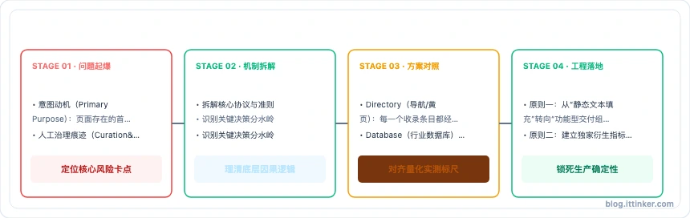
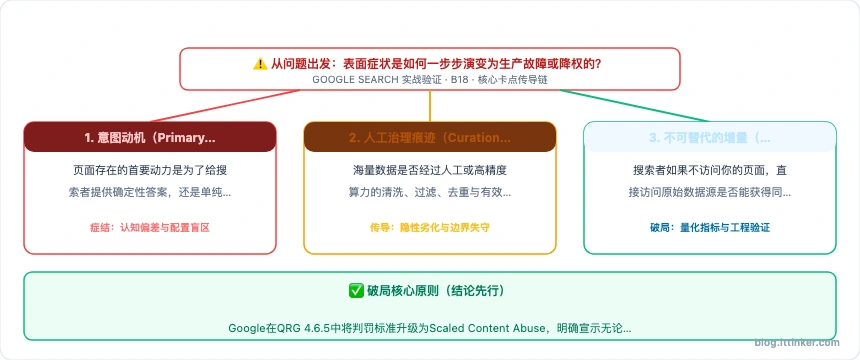
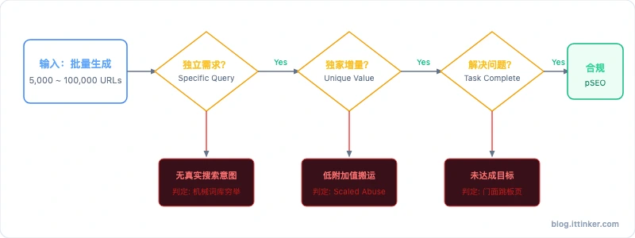
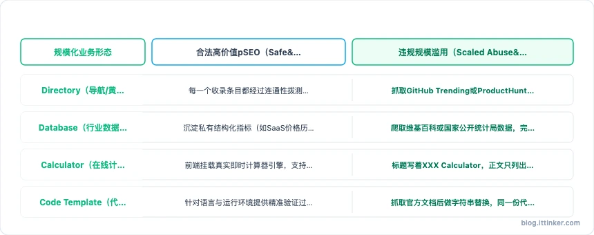
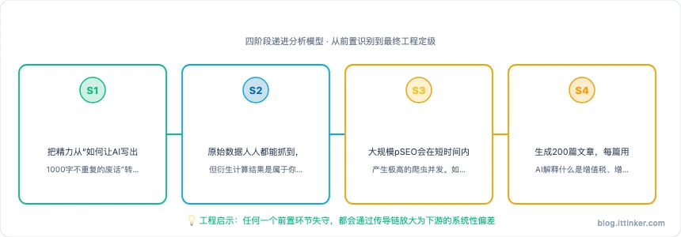

# “pSEO 与规模化内容滥用的边界在哪”？自动化建站合规指南 | 读懂 Google Search SEO 实战 系列 018

> 🌐 **在线阅读与互动版**：[“pSEO 与规模化内容滥用的边界在哪”？自动化建站合规指南 | 读懂 Google Search SEO 实战 系列 018](https://blog.ittinker.com/posts/programmatic-seo-和-scaled-content-abuse-的边界在哪里/)
> 📚 **所属专栏**：[《读懂 Google Search：110篇搜索质量与SEO实战指南》](../README.md)

---

### 📌 结论先行（TL;DR）
> **规模本身从来不是违规原因，缺乏独家价值的无用放量才是触碰红线的根源。**
> **2024 年 3 月，Google 官方对反垃圾政策进行了多年来最大力度的结构性改版：将原有的“自动化生成内容滥用（Automated Content Abuse）”更名为“规模化内容滥用（Scaled Content Abuse）”。**
> **这一字之差传递了清晰的算法治理导向：**
> **Google 不再关心页面是由大语言模型输出的、由 Python 模板拼接的，还是由数百位廉价自由职业者手工撰写的。**
> **审查机制穿透了一切技术表象，直指核心：**你是否在利用规模化手段生产无实质增量的页面来占领搜索结果？**
> **反观现实生态，Nomad List 拥有数十万个城市与生活成本组合页，G2 拥有海量竞品对比矩阵，Calculator.net 拥有成千上万个细分公式单页。它们不仅安然无恙，反而在历次算法洗牌中站稳了流量头部。**
> **为什么有的规模化项目成为常青资产，有的却在一夜之间被标记为 Spam？**
>
> - Google 在 QRG 4.6.5 中将判罚标准升级为 Scaled Content Abuse，明确宣示无论是自动化脚本渲染还是真人廉价填表，只要大规模产出无实质帮助的页面即属违规。
> - 判断合法 pSEO 工程与违规滥用的唯一标尺，在于你的页面是为独立 Query 提供了独家计算逻辑、私有结构化数据，还是仅仅用空洞文本包装了占位符。

---

### 🚨 2026 → 2024 官方最新风向预警：Google 对Google 针对 Scaled Content Abuse 政策与程序化增量价值的界定的策略演进

#### 🕒 2026 → 2024 Google 官方对Google 针对 Scaled Content Abuse 政策与程序化增量价值的界定的策略演进

- **2026 · 合法程序化与规模化滥用界限清晰化**
  Google 官方澄清：程序化建站本身并不违规，区分合规与垃圾的唯一标准是‘每一页是否为特定长尾用户创造了真实增量价值’，还是‘为了操纵搜索流量而制造数字垃圾’。

- **2025 · 模板与数据耦合度自动化审计**
  算法检测页面上的核心组件是否能与用户输入的具体参数深度联动，具备交互式计算与独家数据的合规 pSEO 站点被赋予持续高位曝光。

- **2024 · 2024 年 3 月核心更新对合法 pSEO 的保护与伪 pSEO 的斩首**
  更新精准肃清了全网千篇一律的伪程序化内容农场，为拥有专有数据和真实工具交付能力的高阶开发者腾出了广阔的商业蓝海。

---

## 1. QRG 4.6.5 深度解析：评估员眼中的 Abuse 判定基准

QRG 第 4.6.5 节对规模化内容滥用给出了极其直白的判别描述：

> *"Creating large volumes of unoriginal content that does not add substantial value for users is scaled content abuse. This often includes pages with large amounts of auto-generated text with little or no manual curation, or scraping content from other sources without adding value. The purpose of these pages is typically to rank for search queries and monetize through ads or affiliate links, rather than serving a legitimate user need."*
> —— QRG 4.6.5 Scaled Content Abuse

评估员在审查成批页面时，遵循三个核心定性维度：
1. **意图动机（Primary Purpose）**：页面存在的首要动力是为了给搜索者提供确定性答案，还是单纯为了捕获点击展示广告或分销联盟链接（Monetize through ads or affiliate links）？
2. **人工治理痕迹（Curation & Validation）**：海量数据是否经过人工或高精度算力的清洗、过滤、去重与有效性检验？如果抓取的原始数据中存在明显乱码、过时信息或逻辑错误，但页面仍照单全收并直接上线，评估员会将其判定为完全缺乏维护的无人监管页面。
3. **不可替代的增量（Substantial Value）**：搜索者如果不访问你的页面，直接访问原始数据源是否能获得同样甚至更好的体验？如果你的页面仅仅是把 Wikipedia 或公开政府接口的数据套进一个 Bootstrap 模板，这就是典型的零增量。

---

## 2. 规模化工程合法性判定流

以下决策图还原了 Google 评估体系审视批量页面时的价值过滤流程：

---

## 3. 五大常见规模化场景的“生死界碑”

为了让判断标准具备工程可执行性，我们逐一剖析独立开发者最常涉足的 5 个 pSEO 场景：

| 规模化业务形态 | 合法高价值 pSEO（Safe & Evergreen） | 违规规模滥用（Scaled Abuse & Penalized） |
| :--- | :--- | :--- |
| **Directory（导航/黄页）** | 每一个收录条目都经过连通性拨测、安全扫描与分类标签打标；提供独家体验点评与功能横向筛选。 | 抓取 GitHub Trending 或 ProductHunt 简介，用大模型扩写一段 300 字废话，全站只有一张截图和一个外链。 |
| **Database（行业数据库）** | 沉淀私有结构化指标（如 SaaS 价格历史变动追踪、API 真实延迟监控曲线、历史安全漏洞库）。 | 爬取维基百科或国家公开统计局数据，完全原样展示，没有计算、排序、衍生洞察。 |
| **Calculator（在线计算器）** | 前端挂载真实即时计算器引擎，支持输入自定义参数并动态输出图表、分期方案或配置代码。 | 标题写着 `XXX Calculator`，正文只列出一条写死的静态公式文本，逼迫用户自行心算。 |
| **Code Template（代码模板）** | 针对语言与运行环境提供精准验证过的配置文件（如特定架构下的 Dockerfile），附带已知报错解决方案。 | 抓取官方文档后做字符串替换，同一份代码换 50 个变量名生成 50 篇博文，代码语法甚至包含致命报错。 |
| **City Pages（同城服务聚合）** | 提供该城市真实的当地服务商名录、本地合规要求、区域均价参考及本地用户真实点评。 | 全文千篇一律，仅把正文和标题中的 `New York` 机械替换为 `Chicago`、`Houston`，本地内容为 0。 |

---

## 4. 工程师重构指南：如何跨越这道边界

如果你当前正在规划一个包含数万页面的 pSEO 项目，以下技术重构原则可以帮助你的代码远离 Scaled Abuse 的红线：

### 原则一：从“静态文本填充”转向“功能型交付组件”
把精力从“如何让 AI 写出 1000 字不重复的废话”转移到“如何用 50 行前端代码解决用户当下的实际问题”。
比如做一个出海税费计算目录：
- 错误的思路：生成 200 篇文章，每篇用 AI 解释什么是增值税、增值税的历史背景；
- 正确的思路：页面只保留核心计算器，用户选择国家、输入交易金额，即时给出跨境 VAT 预估明细与合规申报链接。这类功能型主内容（Functional MC）在 QRG 评估中属于高等级的 Utility 页面。

### 原则二：建立独家衍生指标（Derived Metric）
原始数据人人都能抓到，但**衍生计算结果**是属于你的独家资产。
假设你抓取了各大云厂商的 VPS 配置与价格：
- 不要只罗列 CPU / 内存 / 价格；
- 计算出 `单位核心算力单价`、`网络出站成本阶梯指数`、`稳定性评分`；
- 当你的页面呈现出其他任何单页都不具备的衍生指标时，Googlebot 便会将你的页面判定为包含实质性增量（Substantial Value）。

### 原则三：利用自动化基础设施保障抓取健康度
大规模 pSEO 会在短时间内产生极高的爬虫并发。如果你的 VPS 架构不稳，导致 Googlebot 抓取时频现 502 或超时，整个批次的页面收录都会被判死刑。
出海项目应借助成熟的运维工具搭建基线环境。例如通过 [docker-quick-deploy](https://github.com/ittinker-org/ittinker-scripts) 标准化部署无状态渲染节点，结合自动化探针监控边缘反代状态，确保所有 pSEO 终端节点的响应时间稳定在 200ms 以内。

---

## 5. 规模化工程防御自查 Checklist

在让爬虫抓取新生成的页面集群前，核对以下防御标准：

- [ ] **反向提炼测试**：随机抽取 5 个不同页面的主内容文本，隐去变量名称后，正文仍具备独特的具体信息，而非模板化空话。
- [ ] **数据源增量审查**：页面呈现的数据至少有一半以上属于经过加工清洗的衍生指标或独家测试产物。
- [ ] **用户终点核验**：用户进入该页面后，无需再跳回搜索结果点击其他链接，便能独立完成预期计算或查阅。
- [ ] **无意图批量剔除**：后台跑过滤脚本，将月搜索预估为 0 且没有任何语义相关长尾词的生成批次彻底剥离出 Sitemap。
- [ ] **质量监控报警**：设置自动化链路，当 Google Search Console 中出现超过 15% 的“Discovered - currently not indexed”时，立即触发邮件告警并暂停下一批次推送。

---

## 下一篇预告

在所有 pSEO 玩法中，最臭名昭著但也最容易让人抱有侥幸心理的，莫过于同城聚合页。把同一个模板换上 1000 个全球城市名字，到底还有没有生存空间？下一篇我们将从真实地理意图与本地数据切入，剖析 **[“城市名换一遍批量生成 1000 个落地页”？本地门面页的末日清算：现代地理意图下，城市分站怎么做才能不被判 Spam？（B19）](/posts/城市名换一遍生成-1000-个页面还能不能做/)**

---

## 读懂 Google Search 专栏导航

> 📚 **专栏收录**：本文为 [《读懂 Google Search：110篇搜索质量与SEO实战指南》](/posts/google-search-guide/) 第 **B18** 篇。

* **专栏主页**：[《读懂 Google Search：110篇搜索质量与SEO实战指南》全景地图与路线图](/posts/google-search-guide/)
