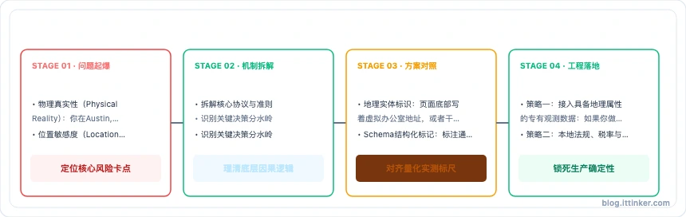
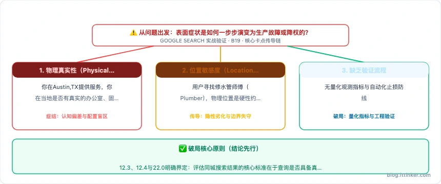
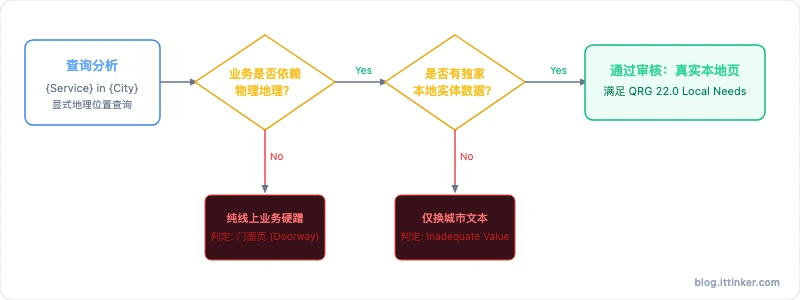
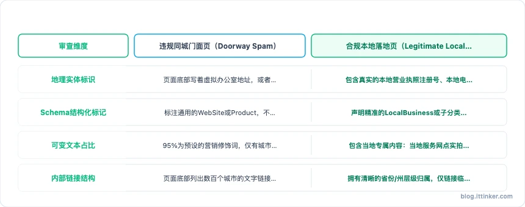
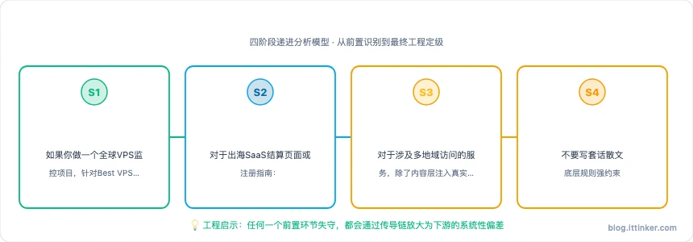
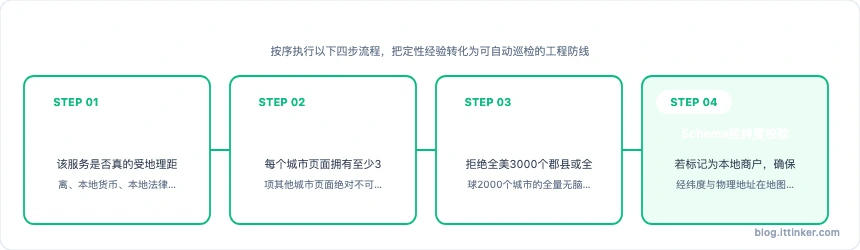

# “换个城市名做一千页还能做吗”？本地化长尾词批量化红线 | 读懂 Google Search SEO 实战 系列 019

> 🌐 **在线阅读与互动版**：[“换个城市名做一千页还能做吗”？本地化长尾词批量化红线 | 读懂 Google Search SEO 实战 系列 019](https://blog.ittinker.com/posts/城市名换一遍生成-1000-个页面还能不能做/)
> 📚 **所属专栏**：[《读懂 Google Search：110篇搜索质量与SEO实战指南》](../README.md)

---

### 📌 结论先行（TL;DR）
> **纯粹依靠替换城市名称的批量页面在当前算法环境下已走向终局。**
> **翻看许多出海技术交流群，总能看到这样的提问：**
> **“我做了一个在线 PDF 转换工具，把全球 1000 个城市的名字拼进去，做成 `PDF Editor in London`、`PDF Editor in Tokyo`，能收割本地长尾流量吗？”**
> **还有许多接单建站的团队，把同一个“企业网站建设”模板换上美国 500 个郡县的地名，批量发布后等待客户电话。**
> **十年前，这种做法确实能通过匹配冷门长尾词获得排名。**
> **如今，在 Google 的垃圾内容识别系统（SpamBrain）与 Helpful Content 体系联合审查下，这类同城页的收录周期通常只有几天，随后全站 URL 会被直接打入未编入索引的冷宫。**
> **为什么机械换城市名不再生效？QRG 中关于地理搜索意图的判断逻辑给出了清晰解释。**
>
> - Google QRG 12.3、12.4 与 22.0 明确界定：评估同城搜索结果的核心标准在于查询是否具备真正的物理空间依赖（Location-Sensitive Intent），以及主内容是否提供了无法在其他城市复用的实体信息。
> - 如果一个纯线上运行的 SaaS 软件把同一个产品描述套进 1000 个城市名称中，这种行为在反垃圾政策中属于标准的门面诱导页（Doorway Pages），一经判定将面临整站索引清洗。

---

### 🚨 2026 → 2024 官方最新风向预警：Google 对Google 对本地门面页（Local Doorway Pages）与虚假地理覆盖的清洗的策略演进

#### 🕒 2026 → 2024 Google 官方对Google 对本地门面页（Local Doorway Pages）与虚假地理覆盖的清洗的策略演进

- **2026 · 本地履约实体真实性核验（Physical Presence & Service Radius）**
  针对仅换城市名而无真实当地员工、无本地真实案例、无本地服务支持的‘虚拟城市分站’，Google 算法直接按 Doorway Spam 判定并批量降权。

- **2025 · 本地化真实资产注入规范**
  合规的城市页面必须包含真实的本地工程案例照片、当地客户真实评测、当地区域政策合规说明，真正建立起本土地理信任底盘。

- **2024 · Google Search Essentials 关于本地门面页清退的官方条款**
  政策重申：严禁任何试图通过换地名占坑、强迫用户最终都流向同一个中央客服的虚假本地化页面，违者面临整站搜索除名。

---

## 1. QRG 12.3、12.4 与 22.0：评估员如何审判同城意图

在 QRG 指南中，关于用户查询背后的地理位置约束有着极其详尽的评定指引：

> *"Some queries have explicit location names, but the underlying intent may or may not require local information. For queries with explicit locations, raters must consider whether the user expects results that are physically located in that place, or if the location is merely incidental."*
> —— QRG 12.3 User Intent and Location

> *"A result that does not satisfy the local search intent or fails to provide specific local information relevant to the location in the query should be rated Low or Fails to Meet (FailsM)."*
> —— QRG 22.0 Rating Local Results

评估员在看到带有地名的网页时，会执行两项定性检验：
1. **物理真实性（Physical Reality）**：你在 `Austin, TX` 提供服务，你在当地是否有真实的办公室、固定的本地座机电话、合规的营业执照或者至少派遣当地技术人员驻场？如果整个页面连一个真实的本地街道地址都拿不出来，页面真实性直接存疑。
2. **位置敏感度（Location Sensitivity）**：用户寻找修水管师傅（Plumber），物理位置是硬性约束；而当用户搜索云服务器时，物理机房节点确实与网络延迟挂钩，但如果用户搜索的是线上文本翻译工具，地理位置对工具功能没有任何实质影响，这种关键词组合在评估员眼中纯属“为了蹭搜索量制造的伪需求”。

---

## 2. 真实本地需求与门面欺骗的判别流

以下流程图清晰展示了 Google 算法与评估员过滤同城生成页时的技术判定链：

---

## 3. 合规本地落地页 vs 垃圾门面页比对表

通过技术解构，可以清晰看出两者在代码与数据架构上的差异：

| 审查维度 | 违规同城门面页（Doorway Spam） | 合规本地落地页（Legitimate Local Page） |
| :--- | :--- | :--- |
| **地理实体标识** | 页面底部写着虚拟办公室地址，或者干脆隐藏物理地址 | 包含真实的本地营业执照注册号、本地电话号与 Google Maps 嵌入卡片 |
| **Schema 结构化标记** | 标注通用的 WebSite 或 Product，不敢声明 LocalBusiness | 声明精准的 `LocalBusiness` 或子分类，带精确的 `geo` 经纬度坐标 |
| **可变文本占比** | 95% 为预设的营销修饰词，仅有城市名称与邮编发生变动 | 包含当地专属内容：当地服务网点实拍、当地团队名单、区域法规解读 |
| **内部链接结构** | 页面底部列出数百个城市的文字链接矩阵，互相交叉回链 | 拥有清晰的省份/州层级归属，仅链接临近地理区域的相关服务点 |
| **转化与执行动作** | 只有一个通用的注册表单或外链跳转按钮，各地完全相同 | 支持当地即时预约、支持当地法币支付选项、标明当地节假日服务时间 |

---

## 4. 独立开发者如何注入高韧性的“物理数据资产”

如果你所开发的出海项目确实具备多地域属性（例如跨境数字游民网络、全球服务器测速、区域法律与合规查询），必须用真实的物理数据填充每一个页面，才能抵御算法清算。

### 策略一：接入具备地理属性的专有观测数据
如果你做一个全球 VPS 监控项目，针对 `Best VPS in Frankfurt` 与 `Best VPS in Singapore`：
- 不要写套话散文；
- 放置一张**实时测速看板**：抓取法兰克福节点的平均延迟（Ping）、丢包率、本地主流运营商（如 Deutsche Telekom）直连路由情况；
- 这一刻，法兰克福页面的主内容就成为了不可被其他城市复用的独家测试资产。

### 策略二：本地法规、税率与支付差异化注入
对于出海 SaaS 结算页面或注册指南：
- 德国页面展示当地 VAT 申报细则与 SEPA 转账集成；
- 荷兰页面介绍 iDEAL 本地支付与当地反洗钱政策要点；
- 巴西页面展示 Pix 支付支持与 CPF 税号验证规则。
每个国家或城市的页面都在解决当事人在当地操作的现实麻烦，这种页面自然能够通过 QRG 4.6.6 的增量价值检验。

### 策略三：利用标准化域名基线提升多地域访问体验
对于涉及多地域访问的服务，除了内容层注入真实数据，基础设施层也必须提供稳健的访问保障。
开发者可以通过开源工程脚本（如 [cloudflare-domain-baseline](https://github.com/ittinker-org/ittinker-scripts)）一键配置 Cloudflare CDN 边缘路由、开启 GeoIP 头部透传、规范 DNSSEC 与 SSL/TLS 握手，确保各地域用户与当地搜索引擎爬虫均能在毫秒级获取内容。

---

## 5. 同城规模化页面上线自查 Checklist

在决定构建多城市批量页面之前，逐一核对以下指标：

- [ ] **物理必要性检验**：该服务是否真的受地理距离、本地货币、本地法律或物理网络节点影响？若完全无关，立刻终止生成。
- [ ] **唯一物理数据**：每个城市页面拥有至少 3 项其他城市页面绝对不可能存在的独家结构化数据（如当地测速数据、当地法规、当地网点）。
- [ ] **非笛卡尔积发布**：拒绝全美 3000 个郡县或全球 2000 个城市的全量无脑渲染，仅为确实有业务履约能力或真实观测数据的区域建页。
- [ ] **Schema 经纬度校验**：若标记为本地商户，确保经纬度与物理地址在地图上真实存在，杜绝虚假坐标。
- [ ] **拒绝全站交叉回链**：页面底部不得堆砌无意义的全国城市链接块，仅保留父级省份与周边真实行政区导航。

---

## 下一篇预告

除了同城页，独立开发者最热衷的另一种 pSEO 形态是“A vs B”竞品对比。用代码把行业内 100 个工具两两配对生成数千个对比页，算不算有价值的页面？下一篇我们将探讨 **[“两两对比批量生成几千个 Compare 页”？拼贴伪对比的死期：从无意义的参数搬运到真正能帮用户选型的决策利器（B20）](/posts/compare-页面批量生成-什么时候有价值/)**

---

## 读懂 Google Search 专栏导航

> 📚 **专栏收录**：本文为 [《读懂 Google Search：110篇搜索质量与SEO实战指南》](/posts/google-search-guide/) 第 **B19** 篇。

* **专栏主页**：[《读懂 Google Search：110篇搜索质量与SEO实战指南》全景地图与路线图](/posts/google-search-guide/)
