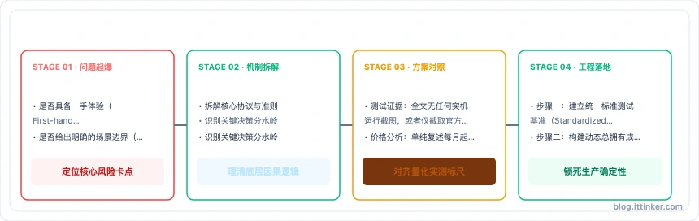
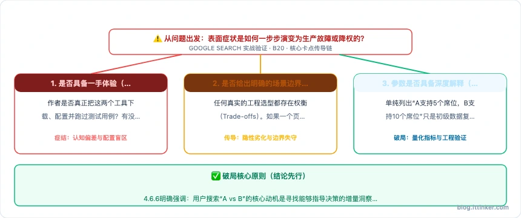
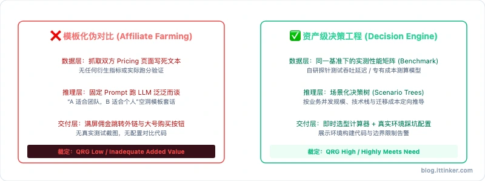
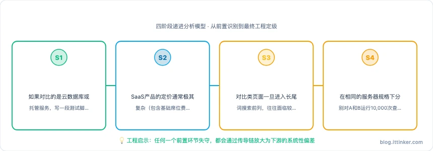
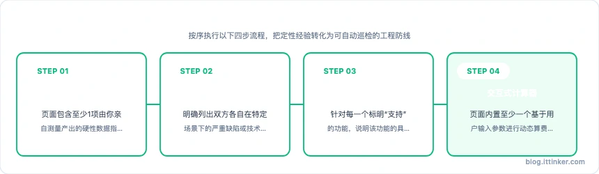

# “A vs B 批量对比页何时有价值”？软件选型对比页破局之道 | 读懂 Google Search SEO 实战 系列 020

> 🌐 **在线阅读与互动版**：[“A vs B 批量对比页何时有价值”？软件选型对比页破局之道 | 读懂 Google Search SEO 实战 系列 020](https://blog.ittinker.com/posts/compare-页面批量生成-什么时候有价值/)
> 📚 **所属专栏**：[《读懂 Google Search：110篇搜索质量与SEO实战指南》](../README.md)

---

### 📌 结论先行（TL;DR）
> **对比类页面的生命线在于**一手测试证据与场景化选型推演**。**
> **在出海开发者的流量字典里，“A vs B”从来都是最肥沃的关键词领地。**
> **相比于“What is…”这类纯信息查询，“Stripe vs Paddle”或“Supabase vs Firebase”的搜索者往往已经掏出了信用卡，处于付费决策的前一分钟。**
> **巨大的商业利益驱动下，许多开发者设计了自动抓取脚本：把 ProductHunt 上的 100 个开发者工具抓取下来，通过两两组合（$C_{100}^2 = 4950$）渲染出近五千个对比单页。**
> **然而，这类纯模板化对比页在近两年的算法洗礼中存活率几乎为零。**
> **在 Google 评估体系中，缺乏实质研究的对比页面正面临最严苛的审视。**
>
> - Google QRG 21.0 与 4.6.6 明确强调：用户搜索“A vs B”的核心动机是寻找能够指导决策的增量洞察（Decision Guidance）。
> - 如果批量生成的对比页仅仅是用脚本抓取双方官网的定价格式化陈列，或者用 AI 扩写两段虚假中立的套话，评估员会直接判定为缺乏实质增量（Inadequate Added Value）。
> - 只有注入真实基准测试参数、指出具体适用边界的对比页，才能形成稳固的排名与高转化。

---

### 🚨 2026 → 2024 官方最新风向预警：Google 对Google 对产品对比页（Compare Pages）真实测试与决策价值的考核的策略演进

#### 🕒 2026 → 2024 Google 官方对Google 对产品对比页（Compare Pages）真实测试与决策价值的考核的策略演进

- **2026 · 对比实测数据与真实环境参数审核**
  Google 核心产品评测算法对 Compare 页面进行深度扫描，凡是机械把两份官方宣传稿拼在一起做表格对比的页面被无情下架，唯有提供横向实测跑分、优缺点深度辩驳的内容享有顶级权重。

- **2025 · 商业中立性与决策引导公信力**
  针对对比结论毫无悬念地偏向自家产品或联盟佣金最高产品的‘伪评测’，系统直接识别为欺骗性商业导购并施加排名惩戒。

- **2024 · QRG 22.0 节对比较型内容（Comparison MC）质量的严苛要求**
  条款指出：优秀的对比页面必须站在绝对客观公正的第三方视角，清晰指出各个竞品的具体适用人群和硬伤缺陷，严禁拉踩造假。

---

## 1. QRG 21.0 与 4.6.6：评估员如何审视 Comparison Queries

QRG 在第 21 节针对对比类查询给出了明确的定级原则：

> *"When users search for comparison queries (e.g., 'Product A vs Product B'), they expect an objective, detailed, and trustworthy comparison that helps them make an informed choice. Pages that simply restate marketing claims, scrape basic specifications without context, or present biased affiliate recommendations without real evaluation fail to provide adequate added value and should receive Low or Lowest ratings."*
> —— QRG 21.0 Specific Types of Queries (Comparison Queries)

评估员在审查对比页面时，会迅速验证三个细节：
1. **是否具备一手体验（First-hand Experience）**：作者是否真正把这两个工具下载、配置并跑过测试用例？有没有出现作者本人的实机报错截图、真实的吞吐量（RPS）曲线或内存占用实测？
2. **是否给出明确的场景边界（Contextual Trade-offs）**：任何真实的工程选型都存在权衡（Trade-offs）。如果一个页面宣称“产品 A 在所有维度都完胜产品 B”，这种结论通常会被评估员定性为夹带私货的营销广告；真正的专业对比必然会指明：在场景 X 下 A 更好，而在场景 Y 下 B 拥有成本优势。
3. **参数是否具备深度解释（Contextual Metrics）**：单纯列出“A 支持 5 个席位，B 支持 10 个席位”只是初级数据复述；解释“B 额外赠送的席位是否包含审计日志功能”才构成了信息增量。

---

## 2. 对比类页面的技术架构分水岭

从工程角度看，垃圾对比页与资产对比页在数据管线与渲染逻辑上有着本质差别：

---

## 3. 对比类页面核心维度评测矩阵

下表拆解了在 Google 评估员眼中，两类对比页的具体表现形式：

| 评估要素 | 劣质拼贴型对比页（Spam Compare） | 资产级技术选型页（Engineered Compare） |
| :--- | :--- | :--- |
| **测试证据** | 全文无任何实机运行截图，或者仅截取官方宣传首屏 | 展示开发者本人在统一测试机上运行的跑分脚本与终端录像 |
| **价格分析** | 单纯复述每月起步价，例如 “A 是 20 美元，B 是 25 美元” | 建立**真实总拥有成本模型（TCO）**，分析调用量超标后的梯级溢价 |
| **优缺点中立性** | 为了推销佣金高的工具，通篇踩低另一方，给出虚假评价 | 客观指明各自死穴：例如指出 A 虽便宜但在并发超过 1000 时出现连接泄漏 |
| **适用人群界定** | “A 适合中小企业，B 适合大型机构”等毫无意义的宽泛定义 | 精确到场景与技术栈：“如果你是 Next.js 单体架构选 A；如果依赖微服务选 B” |
| **交互辅助工具** | 只有两个跳转注册的外链按钮 | 内置交互式选型计算器：用户输入自己的月活跃用户（MAU），即时算出账单差额 |

---

## 4. 独立开发者如何构建高质量的批量 Compare 工程

如果你打算在自己的技术利基领域（Niche）构建一套“A vs B”对比矩阵，推荐采用以下工程流水线：

### 步骤一：建立统一标准测试基准（Standardized Benchmark）
如果对比的是云数据库或托管服务，写一段测试脚本（例如针对读写延迟与冷启动时间）：
- 在相同的服务器规格下分别对 A 和 B 运行 10,000 次查询；
- 将测试产生的原始 CSV 数据导入工程管道；
- 让前端页面动态根据数据库记录渲染出延迟柱状图与 P99 分位线。
这种基于真实工程测量生成的页面，哪怕生成上千个，每一个页面都承载着不可替代的实验证据。

### 步骤二：构建动态总拥有成本（TCO）计算器
SaaS 产品的定价通常极其复杂（包含基础席位费、API 调用量阶梯、存储超出费等）。
与其手工抄写 Pricing，不如将双方的计费规则代码化：
- 在页面首屏提供一个轻量交互组件；
- 允许用户滑动滑块输入自己的预估用量；
- 即时计算并高亮显示：“在月请求低于 50 万次时选 A 每年省 300 美元；超过 100 万次后选 B 更便宜”。
这种工具型交互内容会极大地延长用户停留时长，并大幅降低跳出率。

### 步骤三：利用自动化基线脚本保障高并发访问
对比类页面一旦进入长尾词搜索前列，往往面临较多的抓取与突发流量。
在多节点部署时，推荐使用成熟的开源运维配置脚本。例如通过统一的系统监控探针监控服务器运行负载，配合自动化容器部署流水线（如 [docker-quick-deploy](https://github.com/ittinker-org/ittinker-scripts)），确保静态 HTML 与动态计算 API 在全球各地的加载时间不超过 300 毫秒。

---

## 5. 对比页面上线自查 Checklist

在把对比矩阵加入 Sitemap 之前，执行以下反虚假审核：

- [ ] **实测凭证**：页面包含至少 1 项由你亲自测量产出的硬性数据指标（延迟、吞吐、打包体积或配置差异），而非单纯抄录官网。
- [ ] **双向缺点披露**：明确列出双方各自在特定场景下的严重缺陷或技术限制，杜绝一边倒的带货吹捧。
- [ ] **细分参数穿透**：针对每一个标明“支持”的功能，说明该功能的具体技术实现差异（如是否支持本地离线运行）。
- [ ] **交互式计算器**：页面内置至少一个基于用户输入参数进行动态算费或选型推导的前端交互组件。
- [ ] **联盟链接披露**：如果页面包含带返利佣金的跳转外链，已明确标注 `rel="sponsored"` 与清晰的合规利益声明。

---

## 下一篇预告

在内容型与工具型站点中，还有一类极易被滥用的大规模页面：图库或设计素材站的单图详情页。一张图片配上一句标题，到底该不该放进 Sitemap 让 Google 索引？下一篇我们将探讨 **[“把网站所有孤岛页面都塞进 Sitemap”？贪多嚼不烂的收录陷阱：Gallery 单图详情页该不该进 Sitemap？建立你的 Index Gate（B21）](/posts/gallery-单图详情页应该进-sitemap-吗/)**。

---

## 读懂 Google Search 专栏导航

> 📚 **专栏收录**：本文为 [《读懂 Google Search：110篇搜索质量与SEO实战指南》](/posts/google-search-guide/) 第 **B20** 篇。

* **专栏主页**：[《读懂 Google Search：110篇搜索质量与SEO实战指南》全景地图与路线图](/posts/google-search-guide/)
