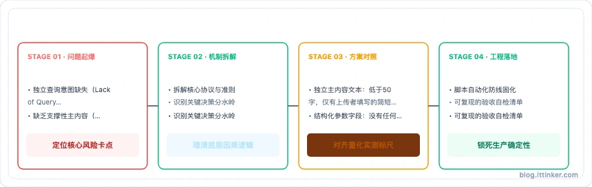
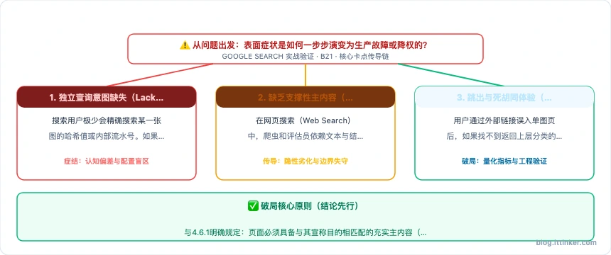
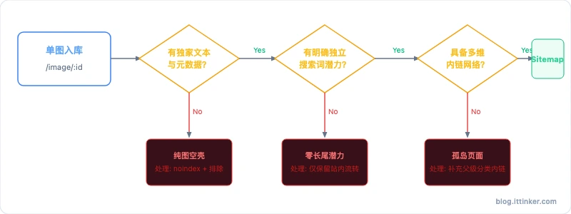
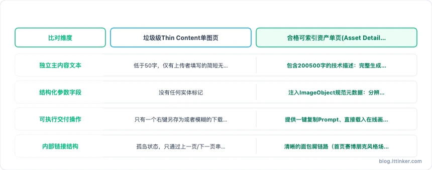
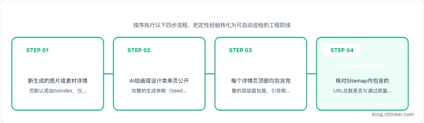

# “把网站所有孤岛页面都塞进 Sitemap”？贪多嚼不烂的收录陷阱：Gallery 单图详情页该不该进 Sitemap？建立你的 Index Gate | 读懂 Google Search SEO 实战 系列 021

> 🌐 **在线阅读与互动版**：[“把网站所有孤岛页面都塞进 Sitemap”？贪多嚼不烂的收录陷阱：Gallery 单图详情页该不该进 Sitemap？建立你的 Index Gate | 读懂 Google Search SEO 实战 系列 021](https://blog.ittinker.com/posts/gallery-单图详情页应该进-sitemap-吗/)
> 📚 **所属专栏**：[《读懂 Google Search：110篇搜索质量与SEO实战指南》](../README.md)

---

### 📌 结论先行（TL;DR）
> **绝大多数单图详情页（Detail Pages）根本不配进入 Sitemap。**
> **在 AI 绘画、设计素材、壁纸下载与 3D 模型站点的开发中，架构师常常做出一个下意识的工程决定：**
> **只要用户上传或生成了一张图片，后台数据库就创建一条记录，前端随即渲染一个 `/item/[id]` 详情页，并自动将其推送到动态 Sitemap 中。**
> **几周之内，站点的 URL 数量轻松破十万。**
> **但开发者很快会发现两个致命现象：**
> **在 Google 质量评估员眼中，这类没有任何辅助说明的单图页面，到底犯了什么禁忌？**
>
> - Google QRG 2.2 与 4.6.1 明确规定：页面必须具备与其宣称目的相匹配的充实主内容（Sufficient Main Content）。
> - 如果一个 URL 仅有一张静态图片加上几行机械抓取的标签，不仅在网页搜索中毫无独立长尾查询潜力，还会大量蚕食全站的抓取预算，最终让域名被标记为薄内容（Thin Content）聚集地。
> - 未通过多维 Index Gate 检验的孤立单图页，必须坚决执行 `noindex`。
> - Googlebot 在爬取了几千个单图页后，抓取频率断崖式下跌，新发布的真正优质技术博文或核心工具页甚至几个月都排不上抓取序列；
> - Search Console 中出现海量“已发现 - 尚未编入索引”与“已抓取 - 尚未编入索引”，域名级抓取评级被彻底拖垮。





---


### 🚨 2026 → 2024 官方最新风向预警：Google 对Google 爬虫预算（Crawl Budget）分配与高质量 Sitemap 准入机制的策略演进

#### 🕒 2026 → 2024 Google 官方对Google 爬虫预算（Crawl Budget）分配与高质量 Sitemap 准入机制的策略演进

- **2026 · 抓取预算精准分流与低质页面阻断（Index Gate Architecture）**
  将数以万计缺乏文字描述和交互价值的单图详情页全量推入 Sitemap，只会导致 Googlebot 判定整站质量稀薄，进而拖累核心产品页收录。设立准入门槛成为出海架构师必修课。

- **2025 · Sitemap 质量健康度评分模型**
  Google 降低对包含大量‘抓取但不收录’死沉页面的 Sitemap 抓取频率，奖励仅提交高转化、高完成度核心资产的精炼站点。

- **2024 · Google 官方抓取与索引管理指南（Crawling & Indexing Guide）更新**
  官方明确建议开发者：利用 `noindex` 和精细化 Sitemap 规范将低权重辅助页面隔离在外，把有限的爬虫带宽集中用在最具业务价值的核心资产上。


---


## 1. QRG 2.2 与 4.6.1：为什么单图页常被定为 Thin Content

在评估指南第 2.2 节《Understanding the Purpose of the Webpage》与第 4.6.1 节《Not Enough Main Content》中，评估员被要求严格审视页面的内容饱满度：

> *"The Main Content (MC) is any part of the page that directly helps the page achieve its purpose... A page with an extremely low amount of MC for its purpose should be rated Low or Lowest. If the page feels empty, lacking necessary detail, context, or explanation, it fails to satisfy user intent."*
> —— QRG 4.6.1 Not Enough Main Content

评估员在打开单图页时，会迅速做出以下逆向推理：
1. **独立查询意图缺失（Lack of Query Specificity）**：搜索用户极少会精确搜索某一张图的哈希值或内部流水号。如果用户搜索“Cyberpunk neon city wallpaper 4k”，用户期待的是一个**聚合图集（Collection/Gallery）**以便挑选，而不是直接跳进一张无法得知上下文、无法切换尺寸的孤立图片页面。
2. **缺乏支撑性主内容（Insufficient Contextual MC）**：在网页搜索（Web Search）中，爬虫和评估员依赖文本与结构化数据理解实体。一张没有提示词（Prompt）、没有 EXIF 拍摄参数、没有模型权重说明、没有应用场景分析的图片，等同于一张“信息白纸”。
3. **跳出与死胡同体验（Dead-end UX）**：用户通过外部链接误入单图页后，如果找不到返回上层分类的明确面包屑导航，也看不到相关联的相似推荐，这种体验在评估员看来就是典型的无用页面。





---

## 2. Index Gate 自动化决策流

为了防止低价值单图页稀释整站权重，必须在代码渲染层建立严格的准入门禁（Index Gate）：





---

## 3. 合格可索引单页 vs 薄内容垃圾单页对比

通过技术参数的横向比对，明确什么样的单图页才能经受住质量审查：

| 比对维度 | 垃圾级 Thin Content 单图页 | 合格可索引资产单页 (Asset Detail Page) |
| :--- | :--- | :--- |
| **独立主内容文本** | 低于 50 字，仅有上传者填写的简短无意义标题（如 `IMG_2024.jpg`） | 包含 200~500 字的技术描述：完整生成 Prompt、负向词、采样步数、风格解析 |
| **结构化参数字段** | 没有任何实体标记 | 注入 `ImageObject` 规范元数据：分辨率、色彩模式、授权许可协议、制作工具模型版本 |
| **可执行交付操作** | 只有一个右键另存为或者模糊的下载原图链接 | 提供一键复制 Prompt、直接载入在线画板重绘、多种比例裁剪与格式转换工具 |
| **内部链接结构** | 孤岛状态，只通过上一页/下一页串联，无父级目录归属 | 清晰的面包屑链路（首页 > 赛博朋克风格 > 场景插画 > 详情页），附带同类推荐 |
| **索引策略处理** | 默认全部进入主 Sitemap 并标记 `index,follow` | **动态门禁分流**：信息不全的标记 `noindex`，仅将高热度、高数据密度的 5% 加入 Sitemap |





---

## 4. 工程师实战：在 Next.js / Nuxt 渲染层配置 Index Gate

不要让人工去手动挑选哪些页面能索引。在构建或服务端渲染（SSR）流水线中，通过硬性逻辑自动判定：

```typescript
// app/gallery/[id]/page.tsx
export async function generateMetadata({ params }: { params: { id: string } }) {
  const item = await fetchImageDetails(params.id);

  // 质量门禁三项硬指标
  const hasSubstantialText = (item.prompt?.length ?? 0) > 80 || (item.description?.length ?? 0) > 150;
  const hasTechnicalMeta = item.model && item.seed && item.aspectRatio;
  const isHighEngagement = item.viewCount > 50 || item.copyCount > 5;

  // 任意硬指标不满足，坚决不编入索引
  const shouldIndex = hasSubstantialText && hasTechnicalMeta && isHighEngagement;

  return {
    title: `${item.title} - Prompt & Specifications | ITTinker Gallery`,
    robots: {
      index: shouldIndex,
      follow: true, // 仍然允许蜘蛛通过页面链接爬取其他内容
    },
  };
}
```

在生成 `sitemap.xml` 时，同样复用该过滤逻辑：
只查询满足 `shouldIndex === true` 的记录输出至 XML 节点中。这样，即使你的数据库有 50 万张素材图，最终呈现给 Googlebot 的也是 1 万个信息极其饱满的高质量单页。


---

## 5. 独立开发者图库站点自查 Checklist

在提交全站 Sitemap 前，执行以下清算动作：

- [ ] **默认 noindex 机制**：新生成的图片或素材详情页默认添加 `noindex`，仅在满足文本量与互动阈值后才放行索引。
- [ ] **Prompt 与参数全公开**：AI 绘画或设计类单页公开完整的生成参数（Seed、Sampler、CFG Scale），为专业用户提供真实的复现价值。
- [ ] **面包屑导航闭合**：每个详情页顶部均包含完整的层级面包屑，引导爬虫回溯上一级聚合目录（Category/Hub）。
- [ ] **Sitemap 熔断比对**：核对 Sitemap 内包含的 URL 总数是否与通过质量门禁的 URL 数目完全一致，杜绝将 `noindex` 页面混入地图。
- [ ] **交互动作就绪**：页面提供一键复制参数、下载预置格式或在线派生工具，确保访问者无需跳出即可完成下载或派生操作。





---

## 下一篇预告

既然人工审查几万个页面成本太高，而机械的硬编码规则又可能误伤，那么能不能在 CI/CD 流程中设计一个基于 AI Agent 的自动化评估流水线？下一篇我们将探讨 **[“等 Google 降权了才发现页面全是垃圾”？后知后觉的代价：让 AI 扮演 Quality Rater，构建全自动 Page Quality Gate 质检 Agent（B22）](/posts/pseo-页面上线之前-能不能让-ai-先做-quality-gate/)**


---

## 读懂 Google Search 专栏导航

> 📚 **专栏收录**：本文为 [《读懂 Google Search：110篇搜索质量与SEO实战指南》](/posts/google-search-guide/) 第 **B21** 篇。

* **专栏主页**：[《读懂 Google Search：110篇搜索质量与SEO实战指南》全景地图与路线图](/posts/google-search-guide/)
