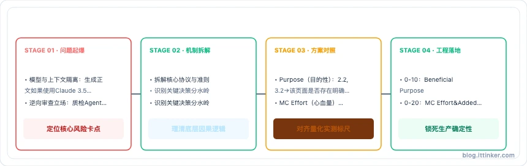
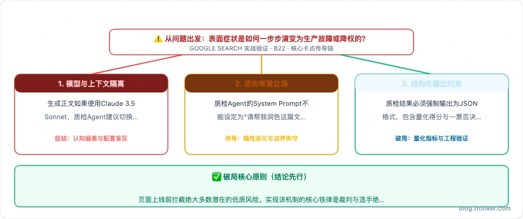
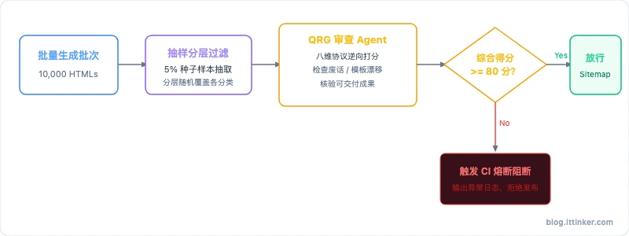
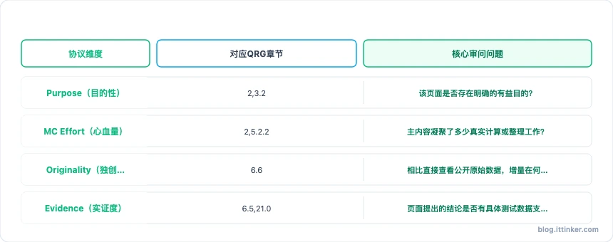
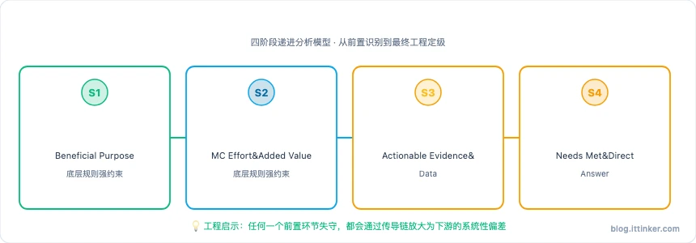
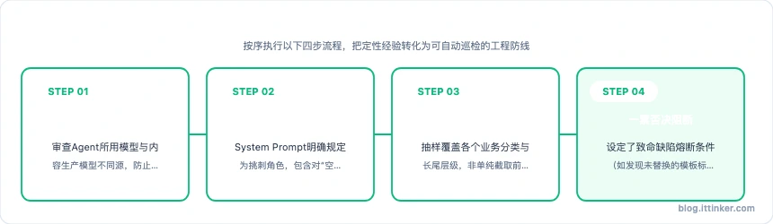

# “等 Google 降权了才发现页面全是垃圾”？后知后觉的代价：让 AI 扮演 Quality Rater，构建全自动 Page Quality Gate 质检 Agent | 读懂 Google Search SEO 实战 系列 022

> 🌐 **在线阅读与互动版**：[“等 Google 降权了才发现页面全是垃圾”？后知后觉的代价：让 AI 扮演 Quality Rater，构建全自动 Page Quality Gate 质检 Agent | 读懂 Google Search SEO 实战 系列 022](https://blog.ittinker.com/posts/pseo-页面上线之前-能不能让-ai-先做-quality-gate/)
> 📚 **所属专栏**：[《读懂 Google Search：110篇搜索质量与SEO实战指南》](../README.md)

---

### 📌 结论先行（TL;DR）
> **在代码部署流水线中接入模拟 Google 质量评估员的 AI Quality Gate，能在批量页面上线前拦截绝大多数潜在的低质风险。**
> **出海开发者在跑完 pSEO 数据生成脚本后，往往面临一个两难困境：**
> **全量上线 50,000 个页面，人工抽样 50 个根本看不出统计学意义上的内容缺陷；**
> **如果不加质检直接推向生产环境，一旦其中某个数据源字段存在空值、乱码或 AI 幻觉，整个集群就会变成 Googlebot 眼中的 Scaled Content 灾难现场。**
> **使用传统的脚本做质检（如检查 HTML 是否超过 1000 字节、是否包含 `<h1>` 标签），只能检查语法完整性，无法判断页面是否在“一本正经地说废话”。**
> **解法是将 Google 官方的 Quality Rater Guidelines 转化为具体的 Prompt 评测协议，让另一个独立的大语言模型充当冷酷的“线上质检员”。**
>
> - 实现该机制的核心铁律是**裁判与选手绝对隔离**：严禁使用生成正文的同一个模型与上下文去打分。
> - 必须引入基于 QRG 3.0~8.0 与 13.0~14.0 标准定制的独立 Agent，依照“八维协议”（目的性、劳动量、独创性、证据链、真实信任、意图对齐、需求满足度、模板漂移度）进行逆向审问，分数未达标的批次直接阻断部署。





---


### 🚨 2026 → 2024 官方最新风向预警：Google 对利用评估准则（QRG）指导自动化内容质量门禁与预审体系的策略演进

#### 🕒 2026 → 2024 Google 官方对利用评估准则（QRG）指导自动化内容质量门禁与预审体系的策略演进

- **2026 · CI/CD 自动化质检门禁流线普及（Automated PQ Gate in CI/CD）**
  顶级出海团队全面在部署管线中集成以 QRG 准则为提示词模板的 Audit Agent，在页面合并上生产线前自动化识别视距遮挡、字数注水和缺乏 Added Value，将降权扼杀在摇篮中。

- **2025 · 多维度风险阈值拦截机制**
  质检 Agent 对 Purpose 明确度、MC 交互占比、E-E-A-T 证据链和合规透明度执行打分，低于 85 分的页面自动熔断发布流程，彻底杜绝垃圾外溢。

- **2024 · QRG 规范在现代自动化质量工程中的落地实践**
  展示了如何将看似主观的人工评估手册转化为精确的 Prompt 质检逻辑与自动化测试断言，实现了 SEO 质量管理的工程化闭环。


---


## 1. 为什么“裁判与选手隔离”是唯一可行的前置条件

许多团队曾尝试让撰写内容的 AI 在生成时附带自我打分，结果毫无例外全都给出了 95 分以上的虚高评价。

这是因为 LLM 天生倾向于迎合自身的生成逻辑。要让 Quality Gate 真正具备防御力，架构设计上必须恪守三大隔离原则：
1. **模型与上下文隔离**：生成正文如果使用 Claude 3.5 Sonnet，质检 Agent 建议切换为 GPT-4o 或 DeepSeek-V3；并且质检输入仅包含最终渲染出的纯文本与元数据，抹除一切最初的生成 Prompt。
2. **逆向审查立场**：质检 Agent 的 System Prompt 不能设定为“请帮我润色这篇文章”，而必须设定为“你是一名受雇于搜索引擎的苛刻质量审查员，你的唯一职责是从这篇内容中挑出一切空洞废话、模板拼接与虚假宣传”。
3. **结构化输出约束**：质检结果必须强制输出为 JSON 格式，包含量化得分与一票否决项（Dealbreaker Flags），直接对接 CI/CD 的退出状态码（Exit Code）。





---

## 2. CI/CD 中 AI 质量门禁架构流

以下架构图展示了一个成熟的 pSEO 自动化流水线如何集成质检拦截机制：





---

## 3. 审查 Agent 的“八维裁决协议”

在配置质检 Agent 时，应当将 QRG 核心章节映射为具体的评测维度：

| 协议维度 | 对应 QRG 章节 | 核心审问问题 | 一票否决红线（Dealbreakers） |
| :--- | :--- | :--- | :--- |
| **1. Purpose（目的性）** | 2.2, 3.2 | 该页面是否存在明确的有益目的？ | 页面纯粹为导流或广告而生，无实际功能 |
| **2. MC Effort（心血量）** | 3.2, 5.2.2 | 主内容凝聚了多少真实计算或整理工作？ | 通篇由大段常识定义与模板垫话扩写组成 |
| **3. Originality（独创性）** | 4.6.6 | 相比直接查看公开原始数据，增量在何处？ | 纯粹将公开数据库原样转录，无衍生参数 |
| **4. Evidence（实证度）** | 4.6.5, 21.0 | 页面提出的结论是否有具体测试数据支撑？ | 声称某工具性能最优却给不出任何测量数值 |
| **5. Trust（信任底座）** | 4.0, 7.0 | 数据来源是否清晰？计算逻辑是否透明？ | 隐藏作者与统计方式，提供无法验证的虚假评价 |
| **6. Intent Specificity（意图对齐）** | 12.3, 13.0 | 内容是否直接回答了查询核心，拒绝兜圈子？ | 标题写着配置教程，首屏却从历史背景讲起 |
| **7. Needs Met（需求满足度）** | 13.0, 14.0 | 用户看完页面是否无需再去其他网站寻找？ | 仅给出不完整片段，强迫点击付费才能看全貌 |
| **8. Template Risk（模板漂移）** | 4.6.5 | 页面是否与其他 100 个同批次页面文字高度重合？ | 正文 80% 以上为固定套话，仅变量名称替换 |





---

## 4. 工程师实操：基于 Node.js 的质量审查门禁脚本

以下是一个可以直接放入 CI/CD 流程的自动化质检脚本示例：

```javascript
// tools/quality-gate-agent.mjs
import fs from 'node:fs';
import path from 'node:path';

const SYSTEM_PROMPT = `
You are a strict Search Quality Auditor adhering to Google's Quality Rater Guidelines (QRG).
Analyze the provided page content and evaluate it across:
1. Beneficial Purpose (0-10)
2. MC Effort & Added Value (0-20)
3. Actionable Evidence & Data (0-20)
4. Needs Met & Direct Answer (0-20)
5. Anti-Filler & Concision (0-15)
6. Anti-Template-Spam Check (0-15)

Output strictly valid JSON with keys:
{
  "totalScore": number (0-100),
  "isDealbreaker": boolean,
  "dealbreakerReason": string or null,
  "critique": string
}
`;

export async function auditPageBatch(sampleFilePaths) {
  let passedCount = 0;

  for (const filePath of sampleFilePaths) {
    const rawContent = fs.readFileSync(filePath, 'utf-8');
    
    // 调用独立审校大模型接口（如 GPT-4o 或 DeepSeek-V3）
    const response = await callEvaluatorLLM(SYSTEM_PROMPT, rawContent);
    const result = JSON.parse(response);

    if (result.isDealbreaker || result.totalScore < 80) {
      console.error(`❌ [Quality Gate 拦截] 文件: ${path.basename(filePath)}`);
      console.error(`   得分: ${result.totalScore} | 否决原因: ${result.dealbreakerReason ?? result.critique}`);
      return false; // 触发熔断
    }
    passedCount++;
  }

  console.log(`✅ 抽样 ${passedCount} 个页面全部通过 QRG 质量门禁！`);
  return true;
}
```

将该脚本作为 GitHub Actions 或 GitLab CI 构建前置步骤：
当开发者提交数据更新时，流水线随机抽取 50 个生成的静态文件执行 Agent 审计。
只要有一篇触发了一票否决或平均分低于 80，构建任务立刻失败，阻止有缺陷的内容流入生产服务器。





---

## 5. AI Quality Gate 部署自查 Checklist

在把质量门禁投入生产环境前，逐一核验以下工程细节：

- [ ] **模型异构保证**：审查 Agent 所用模型与内容生产模型不同源，防止算法盲区共振。
- [ ] **严苛逆向设定**：System Prompt 明确规定为挑刺角色，包含对“空泛过渡、八股开头、无数据断言”的扣分规则。
- [ ] **分层抽样算法**：抽样覆盖各个业务分类与长尾层级，非单纯截取前 50 条。
- [ ] **一票否决阻断**：设定了致命缺陷熔断条件（如发现未替换的模板标签 `{placeholder}` 或存在空值字段）。
- [ ] **自动化流水线挂载**：审查流程已写入 CI 配置文件，打通退出状态码，严禁跳过审查直接推送 Sitemap。





---

## 下一篇预告

即使每个页面都通过了单页审查，在规模化生产中还有一个挥之不去的难题：两个同模板页面之间，究竟需要有多大的差异度才值得独立存在？是不是重复率低于 30% 就算安全？下一篇我们将探讨 **[“只要文字重复率低于 20% 就安全”？数字迷信的自欺欺人：同模板页面之间到底需要多大差异才配独立存在？（B23）](/posts/同模板页面之间-到底需要多大差异才值得独立存在/)**


---

## 读懂 Google Search 专栏导航

> 📚 **专栏收录**：本文为 [《读懂 Google Search：110篇搜索质量与SEO实战指南》](/posts/google-search-guide/) 第 **B22** 篇。

* **专栏主页**：[《读懂 Google Search：110篇搜索质量与SEO实战指南》全景地图与路线图](/posts/google-search-guide/)
