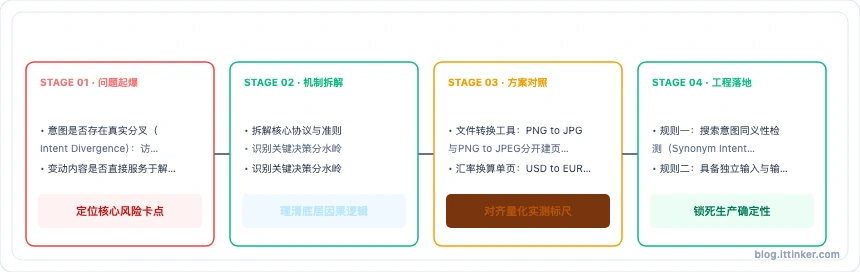
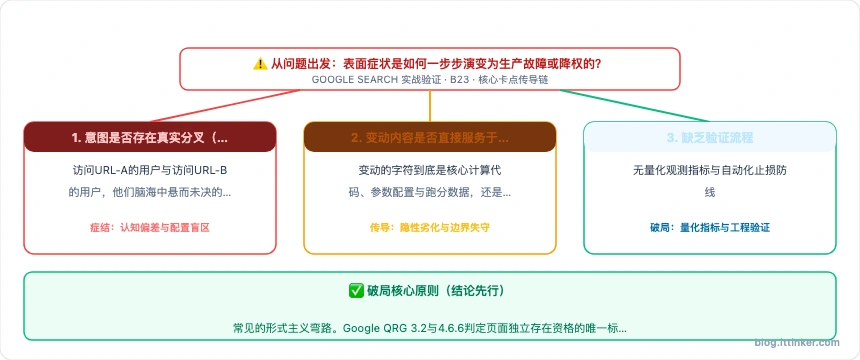
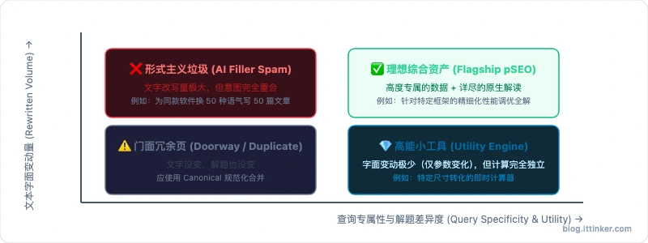
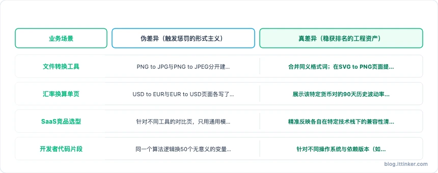
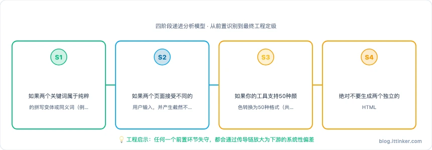
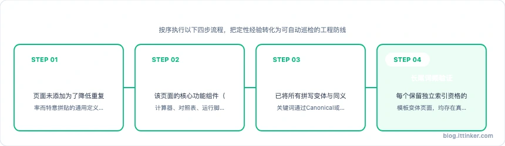

# “只要文字重复率低于 20% 就安全”？数字迷信的自欺欺人：同模板页面之间到底需要多大差异才配独立存在？ | 读懂 Google Search SEO 实战 系列 023

> 🌐 **在线阅读与互动版**：[“只要文字重复率低于 20% 就安全”？数字迷信的自欺欺人：同模板页面之间到底需要多大差异才配独立存在？ | 读懂 Google Search SEO 实战 系列 023](https://blog.ittinker.com/posts/同模板页面之间-到底需要多大差异才值得独立存在/)
> 📚 **所属专栏**：[《读懂 Google Search：110篇搜索质量与SEO实战指南》](../README.md)

---

### 📌 结论先行（TL;DR）
> **脱离具体搜索意图去纠结“文本相似度必须低于百分之多少”，是 pSEO 研发中最常见的形式主义弯路。**
> **在构建规模化页面的技术团队中，经常发生这样的讨论：**
> **“我们这个模板的公共部分占了 60%，如果只换中间的数据表格，重复率会不会太高？”**
> **“要不我们在每个页面底部加一段 500 字的 AI 自动生成背景介绍，把全局相似度稀释到 20% 以下？”**
> **这种思路催生了大量畸形的产品形态：**
> **一个简简单单的“Unix 时间戳转换器”，正文底部却被硬塞了三千字关于“格林威治天文台历史”、“时间系统的哲学定义”以及“计算机时钟晶振原理”的长篇大论。**
> **这种自欺欺人的“文本降重”不仅无法骗过现代搜索引擎，反而精准触发了 QRG 5.2.2 中的“填充废话降低体验（Filler as a Poor User Experience）”判定。**
> **判断两个同模板页面是否应该独立发布，标准到底是什么？**
>
> - Google QRG 3.2 与 4.6.6 判定页面独立存在资格的唯一标尺，是**查询专属性（Query Specificity）与不可替代的实质增量（Substantial Value）**。
> - 如果两个 URL 解决的是完全等价的用户诉求，哪怕你用大模型将两篇正文改写得面目全非，依然会被判为门面冗余；
> - **反之**：哪怕两个在线计算器 85% 的外框和样式完全同构，只要各自的计算逻辑与数据精确解决了两个不同的现实问题，它们就具备无可争议的独立索引价值。

---

### 🚨 2026 → 2024 官方最新风向预警：Google 对Google 对模板相似度（Template Overhead）与核心信息增量的判定演进的策略演进

#### 🕒 2026 → 2024 Google 官方对Google 对模板相似度（Template Overhead）与核心信息增量的判定演进的策略演进

- **2026 · 结构指纹与核心信息熵值双重测算**
  Google 核心抓取管线通过布局 DOM 树和核心信息增量比进行双重质检。哪怕通过同义词替换让表面重复率降至 10%，只要两者的有效信息增量没有本质不同，直接判定为同质换皮。

- **2025 · 独立存在资格（Justification for Existence）审计**
  算法严格审视：该长尾页面是否真正满足了一个其他兄弟页面无法满足的独特需求？如果不能，一律合并权重折叠展现。

- **2024 · QRG 2.4.1 节关于辅助框架与主内容有效比例的硬性指引**
  规范警示：当模板通用代码（头部导航、侧边栏、免责声明）在视觉和信息量上压倒了页面独占的 Main Content 时，该页面就不具备独立高阶评级的资格。

---

## 1. QRG 4.6.6 与 17.0 原文穿透：评估员如何审视“实质性变动”

QRG 第 4.6.6 节对缺乏增量的页面给出了极其明确的定性：

> *"A page that has unoriginal content combined with minor additions, such as superficial rewriting, synonym replacement, or automatically generated generic summaries, does not provide adequate added value. The evaluation must focus on whether the differences between pages reflect meaningful variation in user intent, rather than artificial variation in wording."*
> —— QRG 4.6.6 Inadequate Added Value

评估指南要求评估员跨越字符串字面差异，聚焦以下两项真实检验：
1. **意图是否存在真实分叉（Intent Divergence）**：访问 URL-A 的用户与访问 URL-B 的用户，他们脑海中悬而未决的问题是否不同？如果一个用户搜索 `Convert PNG to JPG`，另一个搜索 `Convert WEBP to JPG`，两者的底层文件格式规范、透明通道处理策略以及色彩容差是完全不同的，这种技术差异构成了真实的意图分叉。
2. **变动内容是否直接服务于解题（Task-oriented Variation）**：变动的字符到底是核心计算代码、参数配置与跑分数据，还是一堆无意义的修饰性形容词？如果变动的 200 字全部是硬核技术指令，其权重远胜过 2000 字的 AI 泛化背景故事。

---

## 2. 模板独立性判定决策矩阵

字符串相似度无法衡量价值。以下二维矩阵直观展现了决定页面生死的核心法则：

---

## 3. 典型场景：真差异 vs 伪差异对照表

以下表格剖析了不同工程场景中，表面改写与真实解题的截然区别：

| 业务场景 | 伪差异（触发惩罚的形式主义） | 真差异（稳获排名的工程资产） |
| :--- | :--- | :--- |
| **文件转换工具** | `PNG to JPG` 与 `PNG to JPEG` 分开建页，正文由大模型分别解释两遍什么是格式转换，两页转换引擎完全相同。 | 合并同义格式词；在 `SVG to PNG` 页面提供抗锯齿倍率与透明背景保留选项；在 `PDF to Word` 页面提供 OCR 多语言识别通道。 |
| **汇率换算单页** | `USD to EUR` 与 `EUR to USD` 页面各写了 800 字“欧洲央行货币政策”，表格仅倒置了汇率分子分母。 | 展示该特定货币对的 90 天历史波动率、跨境电汇点差对比、当地最便宜的结算换汇渠道排名。 |
| **SaaS 竞品选型** | 针对不同工具的对比页，只用通用模板套入双方 Logo，文本全是“两者都功能强大、深受好评”等套话。 | 精准反映各自在特定技术栈下的兼容性清单、实测 API 报错率、以及双方数据迁移的具体脚本。 |
| **开发者代码片段** | 同一个算法逻辑换 50 个无意义的变量命名，生成 50 篇博文，代码注释一字不差。 | 针对不同操作系统与依赖版本（如 Ubuntu 22.04 vs Alpine Linux），提供专门适配的依赖项与安全补丁。 |

---

## 4. 架构师决策：独立 URL 还是 Canonical 合并？

在构建规模化系统时，面对成千上万个参数组合，遵循以下决策树以决定 URL 的归宿：

### 规则一：搜索意图同义性检测（Synonym Intent Merge）
如果两个关键词属于纯粹的拼写变体或同义词（例如 `Dockerfile for Nodejs` 与 `Docker file for Node.js`）：
- 绝对不要生成两个独立的 HTML；
- 将次要变体通过 301 重定向或声明 `rel="canonical"` 指向规范主页面；
- 强行拆解只会分散外部链接权重并招致重复内容审查。

### 规则二：具备独立输入与输出参数（Unique I/O Boundary）
如果两个页面接受不同的用户输入，并产生截然不同的计算结果：
- 比如 `Base64 to Image` 与 `Image to Base64`；
- 两者的输入控件类型不同（文本域 vs 文件上传拖拽区），输出形态也完全不同；
- 这类页面即使公共 Header 与 Footer 占比高达 70%，其核心主内容也是绝对独立的，必须给予独立索引资格。

### 规则三：拒绝为无真实搜索量的参数分支建页（Zero-Volume Pruning）
如果你的工具支持 50 种颜色转换为 50 种格式（共 2500 种组合）：
- 检查 `Navy Blue Hex to Pantone` 是否有人搜？有，则建页；
- 检查 `Slightly Darker Light Slate Gray to CMYK` 是否有人搜？月搜索量绝对为 0；
- 对没有任何长尾搜索意图支撑的冷门组合，统一通过前端动态参数渲染，并在头部输出 `<meta name="robots" content="noindex" />`，将爬虫配额集中在具备商业价值的页面上。

---

## 5. 模板独立性设计自查 Checklist

在执行模板放量构建前，对照以下清单进行代码审查：

- [ ] **拒绝 AI 稀释废话**：页面未添加为了降低重复率而特意拼贴的通用定义或常识背景段落。
- [ ] **核心组件独立性**：该页面的核心功能组件（计算器、对照表、运行脚本）是否提供了其他页面无法得到的特定输出？
- [ ] **同义词规范化**：已将所有拼写变体与同义关键词通过 Canonical 或 301 归一化至单一权威 URL。
- [ ] **长尾词频验证**：每个保留独立索引资格的模板变体页面，均存在真实用户的查询记录或长尾索引需求。
- [ ] **动态渲染分流**：对于无独立搜索价值的低频长尾组合，保留页面功能但打上 `noindex` 标记，避免污染索引库。

---

## 下一篇预告

许多开发者常说：“不管那么多，先写脚本生成 20 万个 URL 扔进 Sitemap，等 Google 收录了再挑有流量的改”。这种本末倒置的做法在当前搜索算法下到底有多危险？下一篇我们将探讨 **[“先一口气生成 20 万 URL 赌 Google 收不收”？顺序搞反的自杀式建站：工业级 pSEO 现代发布管道与分批验证 SOP（B24）](/posts/先生成-20-万-url-再看-google-收不收-是不是搞反了/)**

---

## 读懂 Google Search 专栏导航

> 📚 **专栏收录**：本文为 [《读懂 Google Search：110篇搜索质量与SEO实战指南》](/posts/google-search-guide/) 第 **B23** 篇。

* **专栏主页**：[《读懂 Google Search：110篇搜索质量与SEO实战指南》全景地图与路线图](/posts/google-search-guide/)
