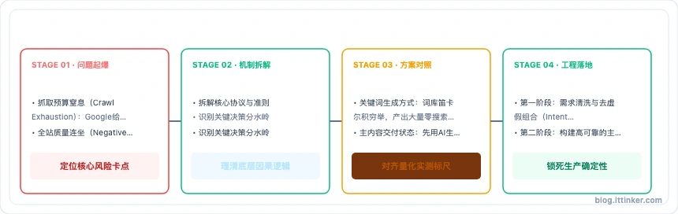
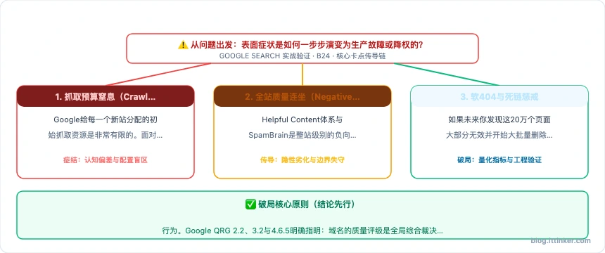
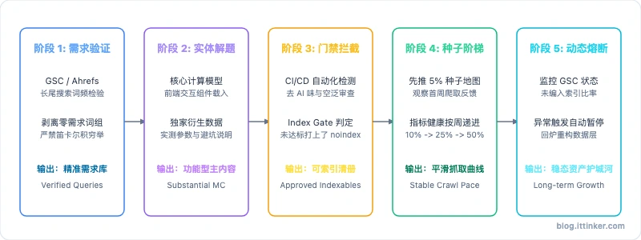
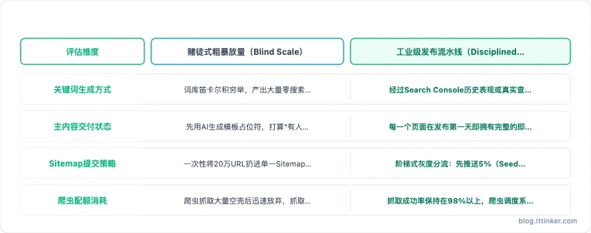
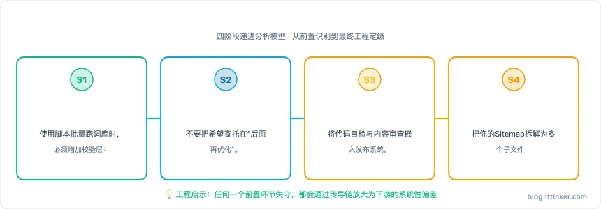
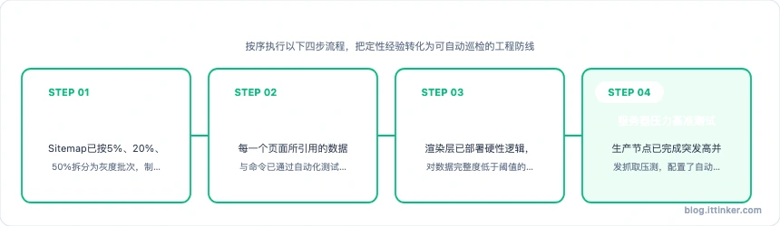

# “先一口气生成 20 万 URL 赌 Google 收不收”？顺序搞反的自杀式建站：工业级 pSEO 现代发布管道与分批验证 SOP | 读懂 Google Search SEO 实战 系列 024

> 🌐 **在线阅读与互动版**：[“先一口气生成 20 万 URL 赌 Google 收不收”？顺序搞反的自杀式建站：工业级 pSEO 现代发布管道与分批验证 SOP | 读懂 Google Search SEO 实战 系列 024](https://blog.ittinker.com/posts/先生成-20-万-url-再看-google-收不收-是不是搞反了/)
> 📚 **所属专栏**：[《读懂 Google Search：110篇搜索质量与SEO实战指南》](../README.md)

---

### 📌 结论先行（TL;DR）
> **把 20 万个半成品 URL 一股脑推给 Googlebot 测收录，是出海项目在算法层面的自杀行为。**
> **在出海开发圈，流传着一种被很多所谓“流量黑客”奉为圣经的敏捷玩法：**
> **“做 SEO 不要一开始花时间打磨页面。先写脚本生成 20 万个静态 HTML，打包一个巨大的 `sitemap.xml` 提交给 Google Search Console。三个月后看哪个 URL 有点击和展示，再回头挑那几个有流量的页面手动改好，其他的就放在那里别管它。”**
> **在 2018 年之前，由于搜索引擎算力有限、对冷门长尾词的语义理解粗糙，这种粗暴的广撒网策略确实偶有奇效。**
> **但在 2024 年以后的搜索世界里，这种“先撒网再挑鱼”的逻辑会直接将你的整个域名送入垃圾箱。**
> **现代 Googlebot 对批量新增 URL 的容忍度已降至冰点。**
>
> - Google QRG 2.2、3.2 与 4.6.5 明确指明：域名的质量评级是全局综合裁决（Site-level Quality Score）。
> - 当爬虫在你的新域名上连续抓取到数万个低质、薄内容或无搜索意图的模板页面时，整站的抓取预算（Crawl Budget）会在数日内被系统熔断，域名甚至会被永久打上 Scaled Abuse 标签。
> - **合规放量的唯一生路**：是建立**“需求验证 → 实体解题 → 门禁拦截 → 阶梯灰度 → 动态熔断”**的渐进式管道。





---


### 🚨 2026 → 2024 官方最新风向预警：Google 对Google 针对突发海量 URL 注入的沙盒冷冻与渐进放行机制的策略演进

#### 🕒 2026 → 2024 Google 官方对Google 针对突发海量 URL 注入的沙盒冷冻与渐进放行机制的策略演进

- **2026 · 突发大体量 URL 爬取断路器机制（Spike Ingestion Circuit Breaker）**
  新站若在短时间内向 Googlebot 抛出数十万个未经验证的 URL，会直接触发反垃圾系统的防洪水门，全站打入长达数月的沙盒冷冻期，导致正规内容一同陪葬。

- **2025 · 渐进式批次发布与留存验证 SOP（Batch-testing Release Pipeline）**
  成熟的工业级发布必须遵循‘首批 100 页测收录 → 500 页测排名 → 2000 页测跳出留存 → 全面放量’的科学验证闭环，用真实用户信号护航放量节奏。

- **2024 · Google 官方对站点增长节奏与抓取调度的政策指引**
  文档明确警告：健康的收录增长应当与站点的历史声誉、用户自然需求相匹配，暴风骤雨式的机械放量是识别作弊站点的首要特征之一。


---


## 1. QRG 视角：为什么“批量测试”会直接毁掉域名信用

Google 质量评估指南在第 2.2 节、3.2 节与 4.6.5 节中揭示了搜索系统对新网站的审视逻辑：

> *"The reputation and overall quality score of a website are determined by the cumulative evaluation of its pages. When a site consists overwhelmingly of low-effort, low-value, or mechanically generated pages, the entire website is deemed low quality, even if a few individual pages have reasonable content."*
> —— QRG 3.2 Low Quality Main Content & Site-level Impact

当你一口气推送 20 万个 URL 时，搜索引擎后台会触发一系列连锁防御反应：
1. **抓取预算窒息（Crawl Exhaustion）**：Google 给每一个新站分配的初始抓取资源是非常有限的。面对 20 万个并发请求，爬虫会快速抽样前 1000 个页面。如果发现抽样页面的跳出率极高、停留时间趋近于零、且正文高度相似，抓取调度引擎会判定该站点生产效率远超其价值密度，进而主动将抓取频次降至每天个位数。
2. **全站质量连坐（Negative Site-level Multiplier）**：Helpful Content 体系与 SpamBrain 是整站级别的负向调节器（Site-wide Demotion）。即便你后来在其中精心手写了 10 篇极具深度的原创大作，它们也会被埋在 20 万个垃圾 URL 的废墟之下，永远无法获得应有的排名。
3. **软 404 与死链惩戒**：如果未来你发现这 20 万个页面大部分无效并开始大批量删除，又会瞬间制造出海量的 404 错误或软 404，进一步引发搜寻引擎对该站点维护状态（Maintenance State）的信誉降级。





---

## 2. 赌徒式放量 vs 现代工业级发布管道

把放量顺序倒过来，是规避算法绞杀的根本：





---

## 3. 两种生产理念的工程技术对比

下表展现了赌徒式粗暴放量与工业级发布流水线之间的硬核差距：

| 评估维度 | 赌徒式粗暴放量（Blind Scale） | 工业级发布流水线（Disciplined Pipeline） |
| :--- | :--- | :--- |
| **关键词生成方式** | 词库笛卡尔积穷举，产出大量零搜索量的虚假组合 | 经过 Search Console 历史表现或真实查询词频校验，仅留存具备明确意图的词簇 |
| **主内容交付状态** | 先用 AI 生成模板占位符，打算“有人看再精修” | 每一个页面在发布第一天即拥有完整的即时计算器、跑分数据或可用代码 |
| **Sitemap 提交策略** | 一次性将 20 万 URL 扔进单一 Sitemap 全量推送 | **阶梯式灰度分流**：先推送 5%（Seed Batch），监控两周后再以周为单位阶梯放量 |
| **爬虫配额消耗** | 爬虫抓取大量空壳后迅速放弃，抓取预算迅速萎缩 | 抓取成功率保持在 98% 以上，爬虫调度系统主动提高全站抓取频次与深度 |
| **抗惩罚与自愈力** | 遭遇核心算法更新直接整站归零，无法精确定位坏死部位 | 拥有细分批次标签与自动化熔断脚本，可快速回滚问题批次，保护核心业务 |





---

## 4. 工程师落地：五阶段工业级流水线实施准则

要将你的 pSEO 系统升级为正规工业级流程，在工程开发中建议落实以下五步作业规范：

### 第一阶段：需求清洗与去虚假组合（Intent Pruning）
使用脚本批量跑词库时，必须增加校验层：
- 剔除同义词复用；
- 剔除任何包含两个以上地理限定词的病态长尾（如 `Austin Texas in New York`）；
- 确保留存在入库表中的每一行记录，都能在现实世界中找到对应的一个具体目标用户。

### 第二阶段：构建高可靠的主内容组件（Rock-solid Utility）
不要把希望寄托在“后面再优化”。
如果做的是命令行生成器（CLI Generator），必须在测试环境运行 `docker run` 对每一个生成的配置脚本进行自动化语法测试；
确保用户复制指令后粘贴到终端里能 100% 跑通。高完成率会形成极低的回退率（Back-to-SERP Rate），这是搜索引擎算法最看重的积极信号。

### 第三阶段：部署全自动质量门禁（Automated CI Gate）
将代码自检与内容审查嵌入发布系统。
在静态渲染或构建时，直接集成文本质量检测工具，例如在发布前调用检测工具扫描所有输出的 Markdown，确保没有任何空泛套话或被禁止的修饰词；同时运行单页 Index Gate，对字段不齐备的条目打上 `noindex`。

### 第四阶段：阶梯式金丝雀发布（Canary Sitemaps）
把你的 Sitemap 拆解为多个子文件：
```
sitemap-seed.xml (500 URLs, 5%)
sitemap-tier1.xml (2,000 URLs, 20%)
sitemap-tier2.xml (5,000 URLs, 50%)
```
第一周只向 Search Console 提交 `sitemap-seed.xml`。
通过两周的观察，确认种子批次的收录率超过 50%，且搜索展现量呈上升态势，再递进提交下一级。

### 第五阶段：接入自动化运维监控与健康探针
大规模页面的爬虫突发抓取是对服务器稳定性的极大考验。
出海项目应结合成熟的运维工具搭建健康基线。例如在生产服务器上部署 [vps-health-monitor](https://github.com/ittinker-org/ittinker-scripts) 等轻量化探针，监控放量期间的 CPU 占用率与 Nginx 5xx 错误率；当爬虫并发过高导致响应延迟超过 500ms 时，自动开启边缘 CDN 静态缓存，确保爬虫访问平滑顺畅。





---

## 5. 规模化放量工业流水线自查 Checklist

在执行任何超过 1,000 个页面的放量构建前，严格逐项核验：

- [ ] **拒绝全量一次性提交**：Sitemap 已按 5%、20%、50% 拆分为灰度批次，制定了分级提交排期表。
- [ ] **自动化语法与数据核验**：每一个页面所引用的数据与命令已通过自动化测试套件（Test Suite）验证，无断链与空字段。
- [ ] **Index Gate 已就绪**：渲染层已部署硬性逻辑，对数据完整度低于阈值的页面强制输出 `noindex`。
- [ ] **服务器压力基准测试**：生产节点已完成突发高并发抓取压测，配置了自动化健康监控与报警链路。
- [ ] **GSC 监控熔断策略明确**：制定了明确的熔断红线：若已抓取未索引比例在 14 天内突破 25%，立刻暂停下一批次推送。





---

## 下一篇预告

至此，我们完整厘清了 pSEO 与规模化页面的生存边界。在整个 SEO 工程中，另一个被无数开发者简化、甚至误解的核心概念，便是“搜索意图”。许多人以为搜索意图不过是 Information、Navigational、Commercial、Transactional 四个干瘪标签。下一模块我们将进入 **B4. 搜索意图与关键词决策**，首篇探讨 **[“把搜索意图当成四个死板的标签”？机械套用的认知错位：做 SEO 真正最难的，是精准捕捉 Dominant Intent！（B25）](/posts/搜索意图不是四个标签-真正难的是判断-dominant-intent/)**。


---

## 读懂 Google Search 专栏导航

> 📚 **专栏收录**：本文为 [《读懂 Google Search：110篇搜索质量与SEO实战指南》](/posts/google-search-guide/) 第 **B24** 篇。

* **专栏主页**：[《读懂 Google Search：110篇搜索质量与SEO实战指南》全景地图与路线图](/posts/google-search-guide/)
