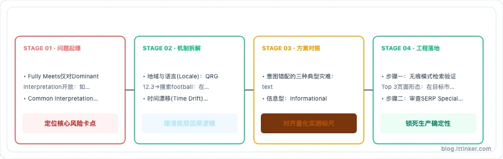
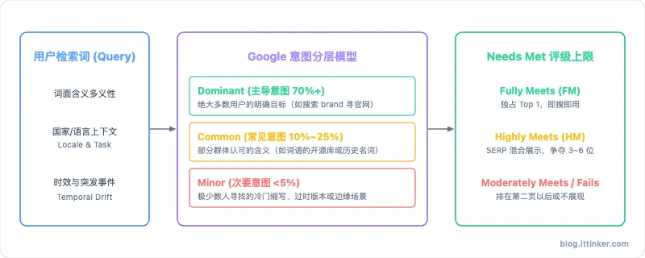
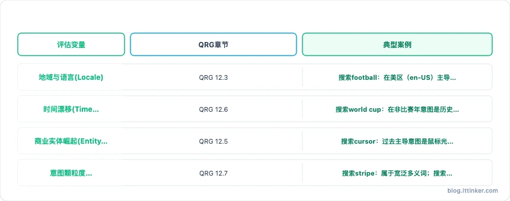
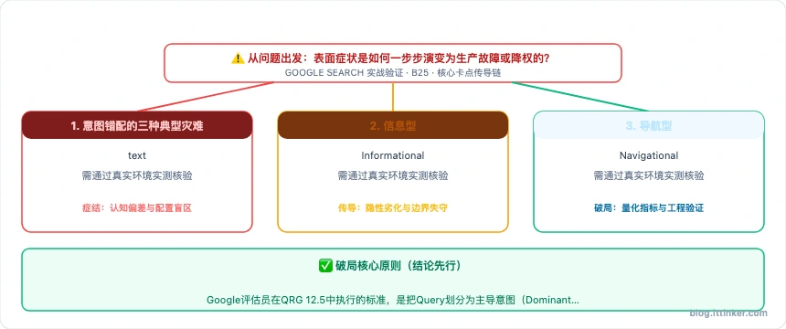
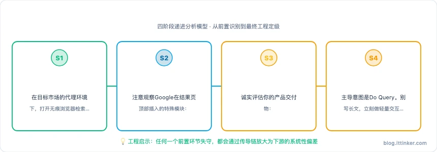
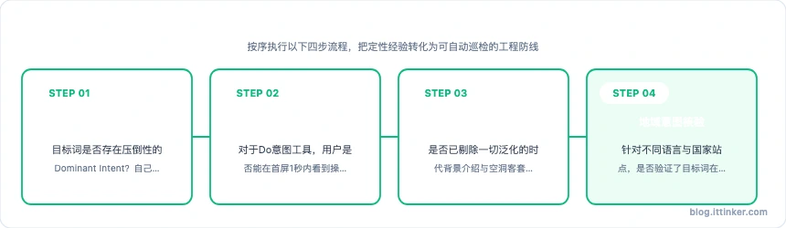

# 搜索意图不是四个标签，真正难的是判断 Dominant Intent | 读懂 Google Search SEO 实战 系列 025

> 🌐 **在线阅读与互动版**：[搜索意图不是四个标签，真正难的是判断 Dominant Intent | 读懂 Google Search SEO 实战 系列 025](https://blog.ittinker.com/posts/搜索意图不是四个标签-真正难的是判断-dominant-intent/)
> 📚 **所属专栏**：[《读懂 Google Search：110篇搜索质量与SEO实战指南》](../README.md)

---

### 📌 结论先行（TL;DR）
**SEO 教学中常见的“信息/导航/商业/交易”四分类法只是粗糙的学术标签。**

1. Google 评估员在 QRG 12.5 中执行的标准，是把 Query 划分为**主导意图（Dominant Interpretation）**、**常见意图（Common Interpretation）**与**次要意图（Minor Interpretation）**。
2. 只要关键词存在 Dominant Intent，只有满足该意图的页面才可能拿到 Fully Meets（FM）最高评级。
3. 如果开发者的产品只对应 Minor Intent，即使页面质量打到 Highest，也无法在核心通用词上排进前三。

做海外工具站的独立开发者，经常陷入一个数据悖论：

你在 Ahrefs 选定了一个月搜量 50,000 的词，花了两周打磨交互界面、补齐 E-E-A-T 证据，最终上线了一个干净好用的在线工具。几个月过去，排名卡在第 8 页纹丝不动。

排查页面结构，代码规范、加载速度都在 90 分以上。问题出在起点：你把一个属于**信息型主导意图**的搜索词，硬生生做成了一个**交互工具页**；或者该词的 Dominant Intent 早已被官方品牌站完全垄断，你的产品只能覆盖 3% 用户的 Minor Intent。

在 Google 算法眼里，无法命中 Dominant Intent 的页面，从第一天起就失去了冲刺第一梯队的资格。





---

## 1. 拆解 QRG 12.5：意图的三层真实分级

QRG 12.5《Understanding Query Interpretations》明确指出了评估员审视关键词的基础逻辑：

> *"A query may have more than one interpretation. For example, the query [apple] may refer to the computer brand or the fruit."*
> 
> *"• Dominant Interpretation: The dominant interpretation of a query is what most users mean when they search the query."*
> 
> *"• Common Interpretation: A common interpretation of a query is what many or several users mean when they search the query."*
> 
> *"• Minor Interpretation: A minor interpretation is what few or very few users mean."*

QRG 将这三层意图定义为结果评级的硬性天花板：





从评级机制可以看到分层的决定性影响：
1. **Fully Meets 仅对 Dominant Interpretation 开放**：如果一个词存在压倒性意图（比如搜索 `github` 用户找的就是官方首页），任何第三方指南即使写得再详尽，最高也只能拿到 Moderately Meets。
2. **Common Interpretation 共享 SERP 席位**：如果词语没有唯一的绝对意图（如 `mercury` 兼指化学水银、行星与水星汽车），Google 会在第一页按比例混合展现百科卡片、科学定义与商业实体。
3. **Minor Interpretation 无法支撑独立通用词竞争**：面对只有少数极客搜索的用法，算法不会在核心 SERP 上倾斜高权重展示位。

---

## 2. 意图判定的四大变量：Locale、时间、实体与场景

判断一个搜索词的意图，不能仅看字面拼写。QRG 12.2 到 12.7 详细梳理了四个扭转意图重心的变量：

| 评估变量 | QRG 章节 | 典型案例 | 对独立开发者的意图误判警示 |
|---|---|---|---|
| **地域与语言 (Locale)** | QRG 12.3 | 搜索 `football`：在美区（`en-US`）主导意图是美式橄榄球（NFL）；在英区（`en-GB`）主导意图是英超足球。 | 做跨国站若直接把美区关键词库复制给欧洲用户，意图对齐从一开始就会发生偏航。 |
| **时间漂移 (Time Drift)** | QRG 12.6 | 搜索 `world cup`：在非比赛年意图是历史纪录与赛事规则；在开赛当周主导意图瞬间变为实时比分与转播赛程。 | 工具如果依赖静态数据，遇到突发时效意图变化就会迅速流失流量。 |
| **商业实体崛起 (Entity Shift)** | QRG 12.5 | 搜索 `cursor`：过去主导意图是鼠标光标、CSS 样式属性；现在技术圈的主导意图已变成 AI 代码编辑器。 | 词义会被新软件或爆款重塑，开发者需持续监控实体更替。 |
| **意图颗粒度 (Specificity)** | QRG 12.7 | 搜索 `stripe`：属于宽泛多义词；搜索 `stripe fee calculator`：意图收敛为极度清晰的动作执行（Do Query）。 | 独立产品切忌盲目硬打宽泛词，必须抓取具体行动意图。 |





---

## 3. 为什么“四标签分类法”会让开发者的产品架构走弯路？

传统 SEO 教程通常把意图拆成四个盒子：
- Informational（信息型）
- Navigational（导航型）
- Commercial（商业调研型）
- Transactional（交易型）

这套标签最大的缺陷，在于把**用户行为模式**误当成了**结果交付形态**。

以开发者常做的工具词 `cron expression generator` 为例：
- 用传统标签来看，它既像 Informational（想知道 cron 语法规则），又像 Transactional（想得到一段生成的语法）。
- 按 QRG 标准审视，它的主导意图是极度纯粹的 **Do Query**——用户坐在终端前等待一段可以直接复制运行的字符串。任何在首屏铺排 2000 字“什么是 Cron、Cron 的历史渊源”的页面，都会在 Needs Met 评分中被直接扣分。因为用户必须滑过大量干扰内容才能找到配置框。

### 意图错配的三种典型灾难

```text
[灾难 1：工具词做成了学术论文]
Query: "json to typescript" (Do Query - Dominant Intent)
错误做法：写 3000 字长文详解 TypeScript 接口语法，转换表单折叠在文章最底部。
评估后果：Needs Met 判定为 Fails to Meet 或 Slightly Meets（操作成本过高）。

[灾难 2：品牌词做成了山寨截流页]
Query: "postman online" (Website Query - Dominant Intent 指向 Postman Web 客户端)
错误做法：自建轻量 API 测试工具，把 H1 设为 "Free Postman Online Alternative"。
评估后果：主导意图属于 Postman 官方。非官方工具无法获得 FM，被降权到副词结果。

[灾难 3：冷门含义硬抢通用大词]
Query: "go" (Dominant Intent: 围棋 / 常见动词 / 旅游品牌)
错误做法：作为 Go 语言辅助工具，把产品标题直接命名并锚定到 "Go Online"。
评估后果：在通用词下被海量大众意图稀释，完全得不到有效曝光。
```





---

## 4. 独立开发者判定 Dominant Intent 的四步推演法

在为新功能或新页面立项前，通过以下推演链条确认意图定位：

### 步骤一：无痕模式检索验证 Top 3 页面形态
在目标市场的代理环境下，打开无痕浏览器检索目标词：
- 如果前三名全部是**交互式在线表单**：主导意图是 Do Query。别写长文，立刻做轻量交互界面。
- 如果前三名全部是**官方权威文档 / Wiki**：主导意图是 Know Query。重点是语法参数、边界错误与速查代码块。
- 如果前三名全部是**单一品牌主域**：主导意图是 Website Query。不要硬碰该词，在词尾追加修饰词（如 `vs`, `alternative`, `extension`）。

### 步骤二：审查 SERP Special Blocks 的分发信号
注意观察 Google 在结果页顶部插入的特殊模块：
- 出现 **Interactive Snippet（计算器、单位换算小部件）**：Google 认为主导意图是即时解决型任务，点击率会被侵蚀，需要评估做此词的边际收益。
- 出现 **People Also Ask（PAA）密集下拉框**：说明该词意图存在多角度延展，单页内容必须覆盖核心派生问题。
- 出现 **Video Carousel（视频轮播）**：说明文字教程不如动态操作直观，需要准备动图或视频演示。

### 步骤三：界定自己的交付物对应哪一层 Interpretation
诚实评估你的产品交付物：
- 如果你覆盖的是 **Dominant Intent**：全力优化核心主流程，减少跳转层级，力争冲击 High Needs Met。
- 如果你覆盖的只是 **Common / Minor Intent**：果断在 URL 和 Title 中明确长尾限定词，将战线收缩到细分场景，避开无意义的正面消耗。





---

## 5. 意图对齐上线自查清单

- [ ] **意图层级定性**：目标词是否存在压倒性的 Dominant Intent？自己的页面类型是否与之完全吻合？
- [ ] **首屏视距对齐**：对于 Do 意图工具，用户是否能在首屏 1 秒内看到操作框并直接键入数据？
- [ ] **无用铺垫清除**：是否已剔除一切泛化的时代背景介绍与空洞客套话？
- [ ] **地域意图核验**：针对不同语言与国家站点，是否验证了目标词在当地市场的实际搜索意图偏向？
- [ ] **意图颗粒度修正**：如果目标通用词意图过于模糊，是否已及时将核心词调整为带明确动作指令的长尾短语？





---

## 下一篇预告

认清了 Dominant Intent 的层级机制后，接下来的工程落地挑战就变得非常现实：

**面对一个具体技术关键词，到底应该花时间写一篇深度博客，还是开发一个交互式小工具，亦或是做一个聚合画廊（Gallery）？**

下一篇，我们将从产品与工程视角建立精准映射模型：**[一个关键词到底应该做工具页、博客页还是 Gallery？（B26）](/posts/一个关键词到底应该做工具页-博客页还是-gallery/)**。

---

_这是「读懂 Google Search」系列第 25 篇，系统拆解 Google 官方质量指南，帮你建立长期抗算法波动的出海 SEO 护城河。_


---

## 读懂 Google Search 专栏导航

> 📚 **专栏收录**：本文为 [《读懂 Google Search：110篇搜索质量与SEO实战指南》](/posts/google-search-guide/) 第 **B25** 篇。

* **专栏主页**：[《读懂 Google Search：110篇搜索质量与SEO实战指南》全景地图与路线图](/posts/google-search-guide/)
