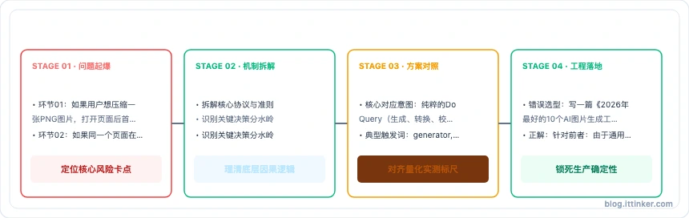
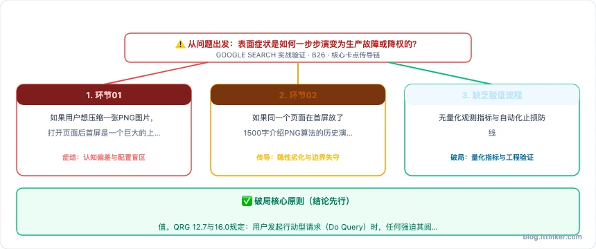
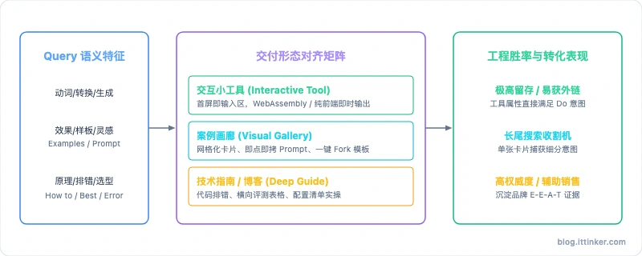
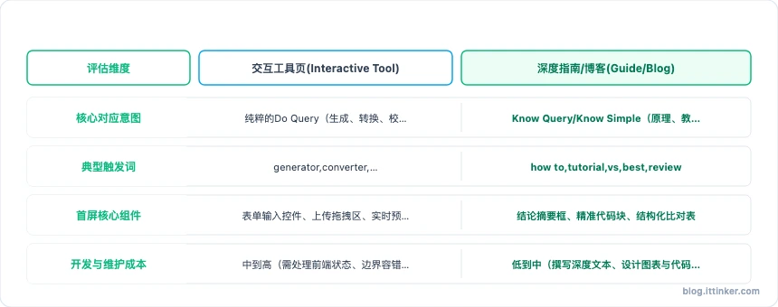
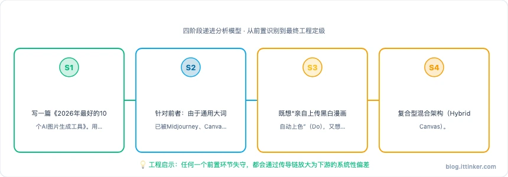
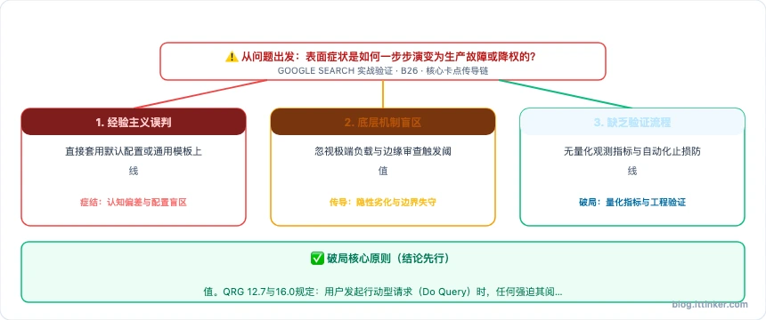
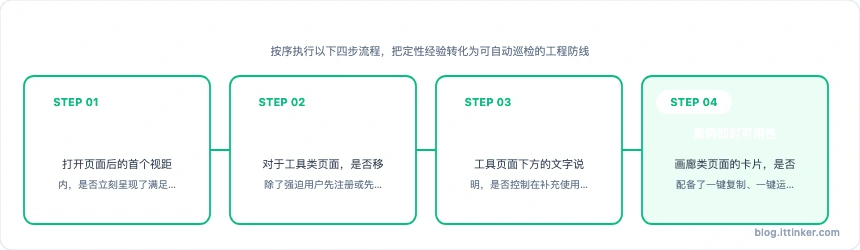

# 一个关键词到底应该做工具页、博客页还是 Gallery？ | 读懂 Google Search SEO 实战 系列 026

> 🌐 **在线阅读与互动版**：[一个关键词到底应该做工具页、博客页还是 Gallery？ | 读懂 Google Search SEO 实战 系列 026](https://blog.ittinker.com/posts/一个关键词到底应该做工具页-博客页还是-gallery/)
> 📚 **所属专栏**：[《读懂 Google Search：110篇搜索质量与SEO实战指南》](../README.md)

---

### 📌 结论先行（TL;DR）
**页面类型的选择绝非审美偏好，本质是匹配用户在特定场景下的**交互阻力承受阈值**。**

1. QRG 12.7 与 16.0 规定：用户发起行动型请求（Do Query）时，任何强迫其阅读数百字背景文本的页面都会被判定为低效交付；
2. 而在面对比较或概念型请求（Know Query）时，缺乏上下文证据的单薄工具同样无法提供有效参考。
3. 构建产品前，必须依据 SERP 前五名的交付形态，在**交互工具页**、**深度技术博客**与**案例画廊（Gallery）**之间建立精准映射。

做独立开发最昂贵的学费，是用错误的工程架构承接正确的搜索需求。

很多团队习惯将所有关键词统一处理为博客文章，试图通过 3000 字 SEO 长文抢占流量；另一些开发者则偏好把所有需求做成单页小工具，哪怕用户只是想看一眼横向选型对比。

两种极端做法的结果往往一致：跳出率高企，Google 评分停留在 Moderately Meets。





---

## 1. 拆解 QRG 12.7 与 16.0：任务完成路径与阻力模型

QRG 12.7 明确区分了用户查询的三种原子意图：

> *"• Do Queries: Users want to act, perform a task, or accomplish a goal on their phone or computer."*
> 
> *"• Know Queries: Users want to learn about something or find information."*
> 
> *"• Website Queries: Users want to locate a specific website or webpage."*

而在第 16 节《Rating Needs Met》中，Google 确立了一条关于“效率”的核心准则：

> *"The Needs Met rating is based on how well the result meets the need of the searcher, taking into account query intent, the user's task, and how easily and quickly the user can satisfy their need."*

评估员衡量页面的核心尺度，是**用户达成目标所付出的无谓消耗（Friction Cost）**：
- 如果用户想压缩一张 PNG 图片，打开页面后首屏是一个巨大的上传拖拽区，免注册即拖即转，该结果即可获得 High 甚至 Fully Meets；
- 如果同一个页面在首屏放了 1500 字介绍 PNG 算法的历史演进、色彩深度原理，把上传按钮压在两屏之外，评估员会直接将其定级为 Slightly Meets 或 Moderately Meets，因为主内容没有直接服务核心意图。





---

## 2. 意图驱动的页面架构决策模型

以下架构图展示了从 Query 信号解析到页面工程选型的全流程决策路径：





---

## 3. 三大主流页面形态实战对照表

针对出海独立产品常见的场景，不同形态的研发投入、排名胜率与商业转化呈现出鲜明的差异：

| 评估维度 | 交互工具页 (Interactive Tool) | 深度指南/博客 (Guide / Blog) | 案例画廊 (Visual Gallery) |
|---|---|---|---|
| **核心对应意图** | 纯粹的 Do Query（生成、转换、校验、计算） | Know Query / Know Simple（原理、教程、评测） | 启发型 Do / Browse（模板、灵感、预设） |
| **典型触发词** | `generator`, `converter`, `calculator`, `formatter` | `how to`, `tutorial`, `vs`, `best`, `review` | `ideas`, `examples`, `templates`, `prompts` |
| **首屏核心组件** | 表单输入控件、上传拖拽区、实时预览面板 | 结论摘要框、精准代码块、结构化比对表 | 响应式网格卡片、快捷筛选 Tag、复制动作按钮 |
| **开发与维护成本** | 中到高（需处理前端状态、边界容错与计算负载） | 低到中（撰写深度文本、设计图表与代码实测） | 中等（需持续入库结构化数据与缩略图 CDN） |
| **用户流失主因** | 强迫登录、前置收费、生成速度慢超过 3 秒 | 废话开场、缺少可运行代码、结构散乱 | 无法复制、样本量少于 15 个、无搜索过滤 |
| **变现转化路径** | 增值用量订阅、高级功能解锁、API 调用售卖 | 导流到核心工具、SaaS 试用注册、咨询服务 | 模板打包售卖、付费社区准入、Pro 画廊权限 |





---

## 4. 真实案例复盘：从具体关键词看架构决策

### 案例一：`ai image generator` 与 `midjourney prompt generator`
- **错误选型**：写一篇《2026 年最好的 10 个 AI 图片生成工具》。用户输入 `generator` 是想立刻在当前界面输入文字并获得结果，给他们看测评文章属于意图降级。
- **正解**：
  - 针对前者：由于通用大词已被 Midjourney、Canva 等头部平台垄断，独立产品胜率极低；
  - 针对后者（Prompt 辅助器）：主导意图是辅助构建参数。搭建一个交互式表单（支持勾选镜头景深、光影渲染器、艺术风格预设并实时组合出 Prompt 字符串），首屏即可直接操作。此类轻量工具在 QRG 评分中更容易拿下 High Needs Met。

### 案例二：`manga colorizer`
- **用户真实需求链**：既想“亲自上传黑白漫画自动上色”（Do），又想“先看别人上色的真实对比效果以确认质量”（Browse）。
- **最佳页面架构**：**复合型混合架构（Hybrid Canvas）**。
  - 首屏左侧提供上传与调试滑块，右侧为即时渲染区域；
  - 首屏下方紧跟一组高清晰度的 Before / After 滑块画廊（Showcase Gallery），展示不同漫画风格下的上色效果，并在每张卡片下方附带“使用同款预设”的快捷按钮。
  - 这种结构同时封死了 Do Query 与 Inspiration 两个次级意图，使跳出率降至最低。

### 案例三：`rss reader` 与 `rss feed validator`
- `rss reader`：主导意图是寻找客户端或 Web 阅读服务，用户需要横向比较功能、多平台支持与同步协议。做成单一输入框毫无意义，核心交付物必须是**评测维度的对比指南页（Blog/Comparison Table）**。
- `rss feed validator`：主导意图是诊断 XML 语法错误。核心交付物必须是**输入 URL 即刻返回 RFC 规范错误行数的极简校验器（Tool）**。如果在校验器上方铺垫长篇 RSS 历史，就会严重伤害体验。





---

## 5. 独立开发者架构选型实操决策树

在写第一行前端代码前，按照以下逻辑锁定页面载体：

```text
[第一步：分析 SERP 前 5 名形态]
├── 5 个结果全部为交互工具？
│   └── 结论：强制做工具页。首屏必须提供免登录基础体验。
├── 5 个结果全部为长文教程或 Wiki？
│   └── 结论：做博客/文档页。聚焦于更清晰的代码片段与异常处理实测。
└── 出现工具与画廊混合展现？
    └── 结论：做混合页（上半部核心交互，下半部卡片案例）。

[第二步：评估核心交互的工程成本]
├── 逻辑能否在纯前端（Wasm / Web Worker）解决？
│   ├── 能：立即开发，边际算力成本为零。
│   └── 不能（依赖高成本 GPU 或后端大模型）：
│       └── 增加轻量级预置结果画廊（Gallery），先用静态静态数据截流长尾词。
```





---

## 6. 页面类型对齐上线自查清单

- [ ] **首屏阻力测试**：打开页面后的首个视距内，是否立刻呈现了满足主导意图的核心组件？
- [ ] **交互前置性核验**：对于工具类页面，是否移除了强迫用户先注册或先验证邮箱的门槛？
- [ ] **图文配比合理性**：工具页面下方的文字说明，是否控制在补充使用说明和常见排错的范围内？
- [ ] **案例即时可用性**：画廊类页面的卡片，是否配备了一键复制、一键运行或下载源文件的快捷按钮？
- [ ] **次级意图承接**：若页面兼顾工具与案例展示，两者之间的层级过渡是否清晰自然，没有割裂感？





---

## 下一篇预告

选对了页面类型，并不意味着所有关键词都值得开发。很多出海开发者经常掉进另一个陷阱：

**“这个词在 Ahrefs 显示月搜量 10 万，为什么做出来后不仅没赚到钱，反而带来了沉重的带宽与算力负担？”**

下一篇，我们将建立关键词的多维筛选模型：**[Search Volume 很大，为什么仍然可能不值得做？（B27）](/posts/search-volume-很大-为什么仍然可能不值得做/)**。

---

_这是「读懂 Google Search」系列第 26 篇，系统拆解 Google 官方质量指南，帮你建立长期抗算法波动的出海 SEO 护城河。_


---

## 读懂 Google Search 专栏导航

> 📚 **专栏收录**：本文为 [《读懂 Google Search：110篇搜索质量与SEO实战指南》](/posts/google-search-guide/) 第 **B26** 篇。

* **专栏主页**：[《读懂 Google Search：110篇搜索质量与SEO实战指南》全景地图与路线图](/posts/google-search-guide/)
