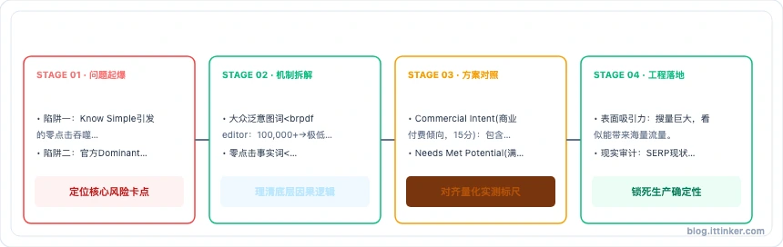
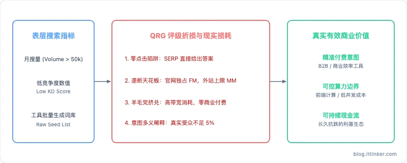
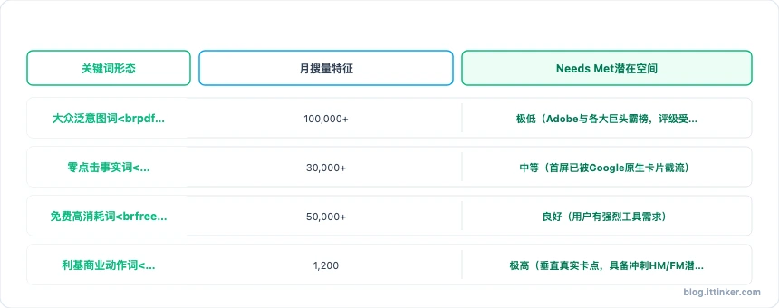
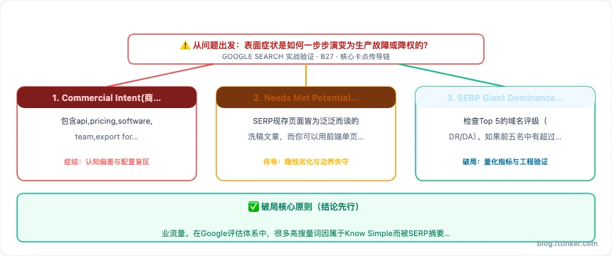
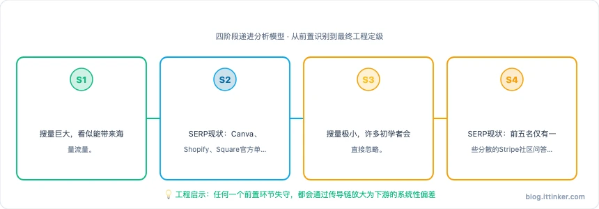
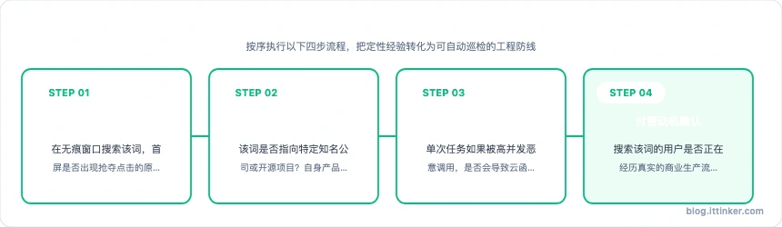

# Search Volume 很大，为什么仍然可能不值得做？ | 读懂 Google Search SEO 实战 系列 027

> 🌐 **在线阅读与互动版**：[Search Volume 很大，为什么仍然可能不值得做？ | 读懂 Google Search SEO 实战 系列 027](https://blog.ittinker.com/posts/search-volume-很大-为什么仍然可能不值得做/)
> 📚 **所属专栏**：[《读懂 Google Search：110篇搜索质量与SEO实战指南》](../README.md)

---

### 📌 结论先行（TL;DR）
**搜索量（Search Volume）只是需求的粗粒度计数，从来不代表实际可获取的商业流量。**

1. 在 Google 评估体系中，很多高搜量词因属于 Know Simple 而被 SERP 摘要直接终结（Zero-Click），或因官方实体具备不可动摇的 Dominant Intent 而将第三方页面锁定在 Moderately Meets 评级上限。
2. 独立产品立项前，必须用**意图契合度**、**SERP 垄断格局**、**算力消耗成本**与**付费转化率**四道筛子层层穿透，坚决剔除“高并发、零转化、高维护”的虚胖词。

在很多出海独立开发社区里，经常能看到这样的复盘贴：

“我用 Next.js 做了一个免登录的格式转换工具，抓取了月搜量 12 万的大词。好不容易冲进前五名，每天迎来上万独立访客，服务器 CPU 被跑满，账单花了几百美金，却连一个付费订阅都没产生。”

这类项目看似在 SEO 上取得了胜利，在商业模型上却陷入了泥潭。





---

## 1. 拆解 QRG 13.0 与 17.0：高搜量背后的四重陷阱

QRG 13.0《Needs Met Rating Guideline》把结果满意度分为五个等级：Fully Meets (FM)、Highly Meets (HM)、Moderately Meets (MM)、Slightly Meets (SM)、Fails to Meet (FailsM)。

结合第 17 节的评测案例，高搜量关键词往往暗藏四种让开发者徒劳无功的机制：





### 陷阱一：Know Simple 引发的零点击吞噬 (Zero-Click)
QRG 13.1 专门定义了 **Know Simple Query**（简明知识型检索）：
> *"Know Simple queries seek a very specific answer, like a fact, diagram, etc. This answer has to be correct and comprehensive, and can be stated in a short amount of space: a single word, sentence, or short list."*

像 `current time in london`、`md5 online`、`hex to rgb` 这类词，Google 已经内置了原生交互组件或精选摘要。用户在搜索结果页无需点击任何外链即可达成目标。如果第三方网站为此投入工程力量，最终能捕获的点击率往往不足 15%。

### 陷阱二：官方 Dominant Intent 带来的评级天花板
当用户搜索 `figma`、`notion templates`、`slack webhook` 时，主导意图被官方产品死死卡住。根据 QRG 13.2 规定：
- 官方落地页自动锁定 **Fully Meets**；
- 任何第三方的补充文档或辅助工具，评级直接被限制在 **Moderately Meets** 或更低。
在有限的 SERP 首屏视距里，Google 会将大部分空间留给官方主域，第三方工具只能在次级折叠位互相搏杀。

### 陷阱三：羊毛党高并发（The Free-Rider Drain）
许多词汇（如 `free video watermark remover`、`unlimited text to speech`）天然吸引的是对价格极度敏感的白嫖用户。他们对工具的使用时长极短，屏蔽一切广告，并在遇到哪怕 1 美元的付费墙时立即关闭网页。承接这类词，服务器带宽与 GPU 推理费用会随着排名的上升而成倍爆发，直接摧毁项目的财务模型。

---

## 2. 关键词类型特征与战略动作比对

在决定是否为一个关键词编写代码前，将候选词放入以下四维象限进行定性：

| 关键词形态 | 月搜量特征 | Needs Met 潜在空间 | 转化率与商业回报 | 独立开发者应采取的战略动作 |
|---|---|---|---|---|
| **大众泛意图词**<br>`pdf editor` | 100,000+ | 极低（Adobe 与各大巨头霸榜，评级受限） | 极低（大量休闲用户，功能诉求分散） | **果断放弃**。不要在通用红海浪费研发精力。 |
| **零点击事实词**<br>`timestamp to date` | 30,000+ | 中等（首屏已被 Google 原生卡片截流） | 微弱（用户瞄一眼即走，无停留深度） | **纯前端低成本承接**，仅作为内部链接入口。 |
| **免费高消耗词**<br>`free voice cloner` | 50,000+ | 良好（用户有强烈工具需求） | 负收益（算力账单高昂，用户无付费意愿） | **设置严格额度门槛**，无免费无限制方案。 |
| **利基商业动作词**<br>`stripe tax report generator` | 1,200 | 极高（垂直真实卡点，具备冲刺 HM/FM 潜力） | 极高（出海商家急需合规，付费意愿强烈） | **主力重仓开发**。打磨全套交互与导出体验。 |





---

## 3. 独立开发者的五维关键词优选模型

为了摆脱对单一 Search Volume 的依赖，我们设计了一套专门面向独立开发者的量化筛选公式：

```text
               (Search Volume × Commercial Intent × Needs Met Potential)
Priority Score = ──────────────────────────────────────────────────────────
                       (SERP Giant Dominance × Server Resource Cost)
```

### 五项指标的量化评估方法

1. **Commercial Intent (商业付费倾向，1~5 分)**
   - 包含 `api`, `pricing`, `software`, `team`, `export for enterprise` 等词根记 5 分；
   - 包含 `free`, `crack`, `hack`, `unlimited` 等词根直接判定为 1 分。
2. **Needs Met Potential (满意度突破潜力，1~5 分)**
   - SERP 现存页面皆为泛泛而谈的洗稿文章，而你可以用前端单页工具彻底秒杀需求，记 5 分；
   - 现存页面已被官方 GitHub、官方文档完整覆盖，记 1 分。
3. **SERP Giant Dominance (巨头垄断阻力，1~5 分)**
   - 检查 Top 5 的域名评级（DR/DA）。如果前五名中有超过 3 个是 AWS、Microsoft、MDN、Wikipedia 等不可逾越的权威域名，该项打 5 分（作为分母将极大压低优先级）。
4. **Server Resource Cost (单次交互资源消耗，1~5 分)**
   - 纯浏览器端 JS 计算（如 Base64 转换、JSON 校验），成本记 1 分；
   - 涉及后端长连接、大内存图像处理或调用商业大模型接口，成本记 4~5 分。





---

## 4. 实操推演：两个词背后的命运分野

假设你正在研发一款出海税务与账单辅助应用，手头有两个候选词：

### 候选词 A：`free invoice generator`（月搜量 110,000）
- **表面吸引力**：搜量巨大，看似能带来海量流量。
- **现实审计**：
  - SERP 现状：Canva、Shopify、Square 官方单页牢牢占据前三名，并提供免费 PDF 下载。
  - 用户画像：个体散户、学生、偶尔开发票者，没有持续记账需求。
  - 转化结果：99% 用户导出一张 PDF 后终身不再复访，难以转化为持续订阅。

### 候选词 B：`vat compliance checker for stripe`（月搜量 800）
- **表面吸引力**：搜量极小，许多初学者会直接忽略。
- **现实审计**：
  - SERP 现状：前五名仅有一些分散的 Stripe 社区问答与过期的法律博客，没有现成的交互式核查器。
  - 用户画像：正在向欧洲销售数字产品的独立创始人与微型 SaaS 团队，面临真实的税务合规罚款风险。
  - 转化结果：一个简洁的 API 密钥只读检查器，就能在 10 秒内为用户列出漏报风险，顺理成章承接每月 29 美元的自动化申报服务。

**结论**：800 搜量的词 B，其真实的商业价值是 110,000 搜量词 A 的数十倍。





---

## 5. 关键词筛选自查清单

- [ ] **零点击风险排查**：在无痕窗口搜索该词，首屏是否出现抢夺点击的原生交互组件或摘要卡片？
- [ ] **Dominant Intent 实体检验**：该词是否指向特定知名公司或开源项目？自身产品是否有资格撼动其主导地位？
- [ ] **算力成本测算**：单次任务如果被高并发恶意调用，是否会导致云函数或 API 账单击穿预算？
- [ ] **付费动机确认**：搜索该词的用户是否正在经历真实的商业生产流程，还是仅仅在寻找娱乐消遣？
- [ ] **Needs Met 升级空间**：自己准备上线的页面，相较于当前第一名的结果，在操作效率上是否有代际级别的提升？





---

## 下一篇预告

既然不能盲目相信关键词工具给出的冰冷数字，我们究竟应该从哪里寻找最权威、最真实的用户需求依据？

答案就在眼前：**Google 的搜索结果页本身。**

下一篇，我们将探讨如何把搜索结果当成现成的商业情报库：**[SERP Top 10 本身就是一份用户需求研究报告（B28）](/posts/serp-top-10-本身就是一份用户需求研究报告/)**。

---

_这是「读懂 Google Search」系列第 27 篇，系统拆解 Google 官方质量指南，帮你建立长期抗算法波动的出海 SEO 护城河。_


---

## 读懂 Google Search 专栏导航

> 📚 **专栏收录**：本文为 [《读懂 Google Search：110篇搜索质量与SEO实战指南》](/posts/google-search-guide/) 第 **B27** 篇。

* **专栏主页**：[《读懂 Google Search：110篇搜索质量与SEO实战指南》全景地图与路线图](/posts/google-search-guide/)
