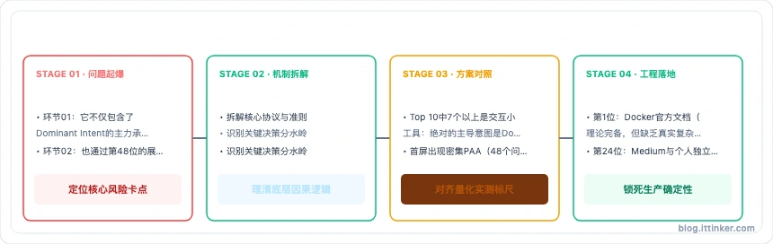
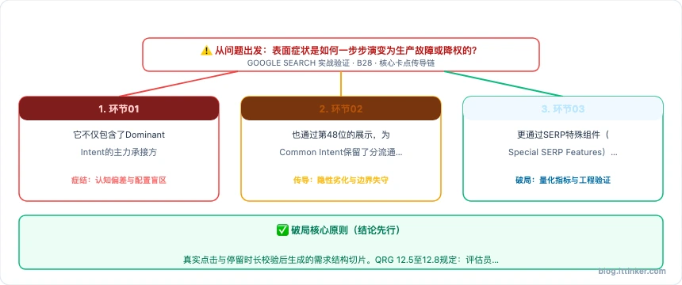
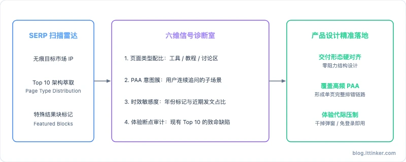
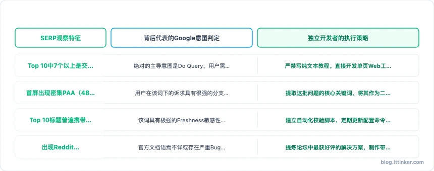
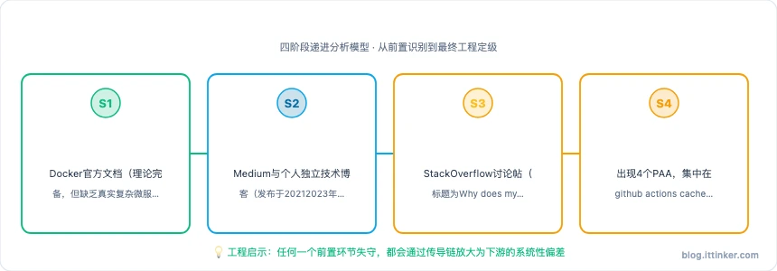
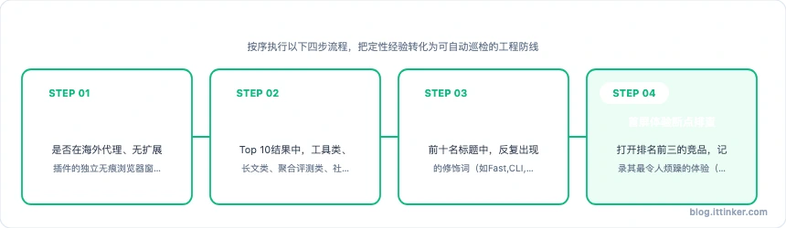

# SERP Top 10 本身就是一份用户需求研究报告 | 读懂 Google Search SEO 实战 系列 028

> 🌐 **在线阅读与互动版**：[SERP Top 10 本身就是一份用户需求研究报告 | 读懂 Google Search SEO 实战 系列 028](https://blog.ittinker.com/posts/serp-top-10-本身就是一份用户需求研究报告/)
> 📚 **所属专栏**：[《读懂 Google Search：110篇搜索质量与SEO实战指南》](../README.md)

---

### 📌 结论先行（TL;DR）
**搜索引擎的搜索结果页（SERP）不是静态的链接列表，而是 Google 算法经过海量真实点击与停留时长校验后生成的**需求结构切片**。**

1. QRG 12.5 至 12.8 规定：评估员必须依据用户所处的真实上下文研判需求满足度。
2. 排在目标词前十名的结果形态、更新频率、富文本摘要（Featured Snippets）以及“其他人还在问”（PAA），已经明确告知了你用户最渴望的交付形式。
3. 任何脱离当前 SERP 真实格局的主观产品设计，都是在盲目博弈算法。

很多出海团队在立项新产品或规划技术内容时，习惯在会议室里脑暴用户画像：

“用户搜这个词，一定想看最全面的配置教程。”
“用户肯定希望能直接在线运行，我们做个复杂的 WebIDE 吧。”

这种闭门造车往往会导致工程投入与真实搜索意图严重错位。

事实上，世界上最高效、最客观的用户需求报告完全免费：打开目标关键词的 Google SERP，前十名展示的结构已经将用户想要什么、讨厌什么、愿意为什么停留写得一清二楚。

---

## 1. 拆解 QRG 12.8 与 16.0：结果页背后的算法博弈机制

QRG 12.8《Understanding User Intent from the Query and SERP》与第 16 节对评估员给出了明确指引：

> *"The SERP often reflects what users are looking for because search engines use complex algorithms and user interaction signals to determine the most helpful results."*
> 
> *"A result that requires excessive effort from the searcher to find the answer or complete the task cannot receive a High Needs Met rating."*

Google 搜索团队每天执行数十亿次 A/B 测试。如果把长文排在第一名，用户进来 3 秒就按返回键继续点击第二名，该长文的排名在几天内就会发生滑落。

因此，能够长期稳定在 Top 10 的页面组合，代表着当前算法在该词下达成的**意图纳什均衡**：
- 它不仅包含了 **Dominant Intent** 的主力承接方；
- 也通过第 4~8 位的展示，为 **Common Intent** 保留了分流通道；
- 更通过 SERP 特殊组件（Special SERP Features），展示了算法试图在结果页内直接满足的即时诉求。

---

## 2. SERP 需求逆向工程流水线

以下架构图完整呈现了从 SERP 信号扫描到产品需求规格（PRD）反推的分析链路：

---

## 3. SERP 信号解码对照表

在分析目标词的前十名时，按照以下信号矩阵进行意图推导：

| SERP 观察特征 | 背后代表的 Google 意图判定 | 独立开发者的执行策略 |
|---|---|---|
| **Top 10 中 7 个以上是交互小工具** | 绝对的主导意图是 **Do Query**。用户需要立即获得计算、生成或转换结果。 | **严禁写纯文本教程**。直接开发单页 Web 工具，将交互面板置于首屏最上方。 |
| **首屏出现密集 PAA（4~8 个问题下拉框）** | 用户在该词下的诉求具有很强的**分支拓展性**，单一定义无法完全解惑。 | 提取这批问题的核心关键词，将其作为二级小标题（H2/H3）内置在页面下方答疑区。 |
| **Top 10 标题普遍携带当年年份（如 `2026`）** | 该词具有极强的 **Freshness 敏感性**，用户对过期过时方案零容忍。 | 建立自动化校验脚本，定期更新配置命令与版本依赖，保持页面更新元数据新鲜。 |
| **出现 Reddit / StackOverflow / GitHub 讨论帖** | 官方文档语焉不详或存在严重 Bug，用户急需**一手排错实录与同行踩坑经验**。 | 提炼论坛中最获好评的解决方案，制作带有错误堆栈重现与修复命令的实证文章。 |
| **首屏出现代码块精选摘要 (Code Snippet)** | 意图属于 **Know Simple** 中的技术速查。用户只想要 3 行以内的标准写法。 | 将标准命令或核心代码置于文章第一屏，并提供一键 Copy 按钮，争夺精选摘要席位。 |

---

## 4. 实战推演：逆向拆解 `docker multi-stage build cache`

以出海运维领域的一个典型技术词为例，推演一次完整的 SERP 逆向审计：

### 现场勘测
1. **第 1 位**：Docker 官方文档（理论完备，但缺乏真实复杂微服务的配置案例）；
2. **第 2~4 位**：Medium 与个人独立技术博客（发布于 2021~2023 年，部分语法在 BuildKit 最新版中已被弃用）；
3. **第 5 位**：StackOverflow 讨论帖（标题为 `Why does my Docker layer cache miss in GitHub Actions?`）；
4. **SERP 特殊块**：出现 4 个 PAA，集中在 `github actions cache backend`、`buildx inline cache` 与缓存失效排查。

### 意图反推与机会挖掘
- **用户核心画像**：正在配置 CI/CD 流水线的后端或 DevOps 工程师。他们遇到的真实卡点，不是不懂 multi-stage 的基本概念，而是**在自动化构建时缓存频频失效导致打包耗时过长**。
- **现有结果的缺陷（Needs Met 短板）**：
  - 官方文档过于教条，没有针对 GitHub Actions / GitLab CI 的完整 workflow 范式；
  - 排名靠前的博客代码陈旧，未适配 `--cache-to=type=gha` 等最新生产实践；
  - 论坛回答分散凌乱，需要翻阅大量回复才能拼凑出完整脚本。

### 降维打击方案
开发一个专门面向现代 CI/CD 的单页指南：
- 首屏开门见山给出基于 Buildx 与 GitHub Actions 的生产级 Dockerfile 完整范本；
- 用流程图对比分析三种主流缓存后端（Inline vs Registry vs GHA）的性能损耗；
- 将 PAA 关注的 4 个缓存击穿场景整理成排错对照表；
- 该页面在 Effort（真实代码验证）与 Needs Met 上均形成了明显优势，能迅速冲进前三。

---

## 5. SERP 逆向审计执行清单

在为任何关键词立项前，完成以下六步实操审查：

- [ ] **纯净环境检索**：是否在海外代理、无扩展插件的独立无痕浏览器窗口中执行检索？
- [ ] **页面形态分类统计**：Top 10 结果中，工具类、长文类、聚合评测类、社区问答类的具体数量占比是多少？
- [ ] **高频标题模式聚类**：前十名标题中，反复出现的修饰词（如 `Fast`, `CLI`, `React`, `Free`, `Open-Source`）有哪些？
- [ ] **首屏体验断点排查**：打开排名前三的竞品，记录其最令人烦躁的体验（强制弹窗、需要注册、广告遮挡、代码报错）？
- [ ] **PAA 关联词提取**：是否已将 Google 结果页展现的下拉问答完整收录并纳入内容规划？

---

## 6. 与开源生态联动：用脚本固化基础设施审计

在进行技术内容创作与工具落地时，如果涉及到服务器环境或网络调优，推荐结合 ITTinker 开源的标准化脚本工具，确保部署基线的一致性。例如使用 [vps-health-monitor](https://github.com/ittinker/ittinker-scripts/tree/main/vps-health-monitor) 一键巡检服务器性能，为页面提供最可信的一手硬件与网络测试数据。

---

## 下一篇预告

通过 SERP 调研，我们经常会发现一种复杂的局面：

**有的搜索词，前十名既有工具页，又有教程页，还有官方文档。当一个 Query 同时承载多个强烈意图时，我们到底应该做一个包罗万象的超级大单页，还是拆分成多个细分 URL 逐个击破？**

下一篇，我们将从 URL 结构与意图稀释的角度给出工程决策：**[一个 Query 有多个 Intent 时，应该建一个页面还是多个页面？（B29）](/posts/一个-query-有多个-intent-时-应该建一个页面还是多个页面/)**。

---

_这是「读懂 Google Search」系列第 28 篇，系统拆解 Google 官方质量指南，帮你建立长期抗算法波动的出海 SEO 护城河。_

---

## 读懂 Google Search 专栏导航

> 📚 **专栏收录**：本文为 [《读懂 Google Search：110篇搜索质量与SEO实战指南》](/posts/google-search-guide/) 第 **B28** 篇。

* **专栏主页**：[《读懂 Google Search：110篇搜索质量与SEO实战指南》全景地图与路线图](/posts/google-search-guide/)
