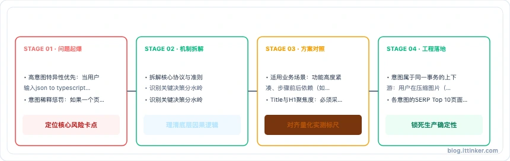
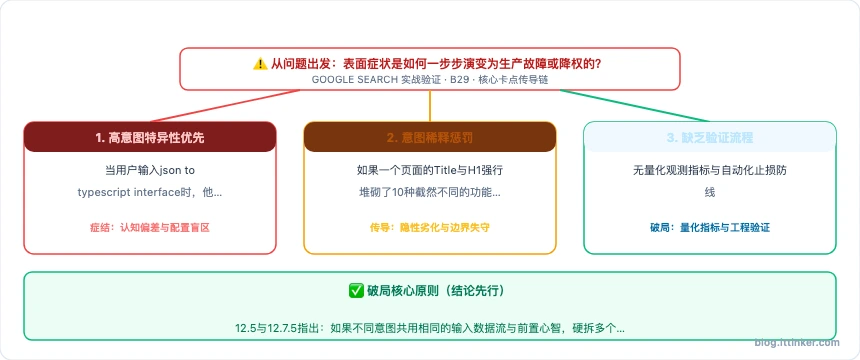
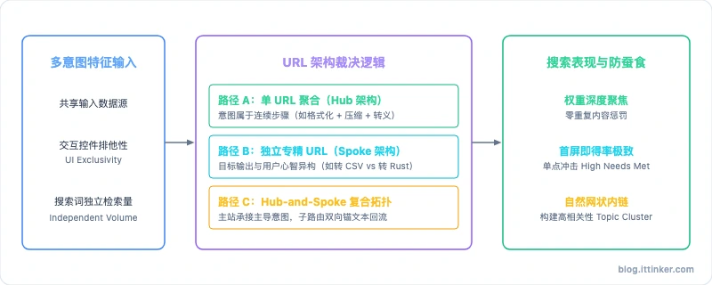
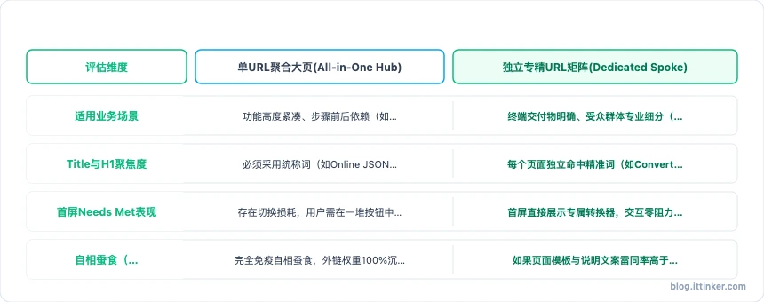
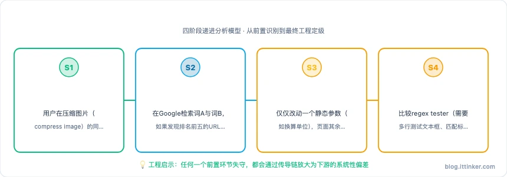
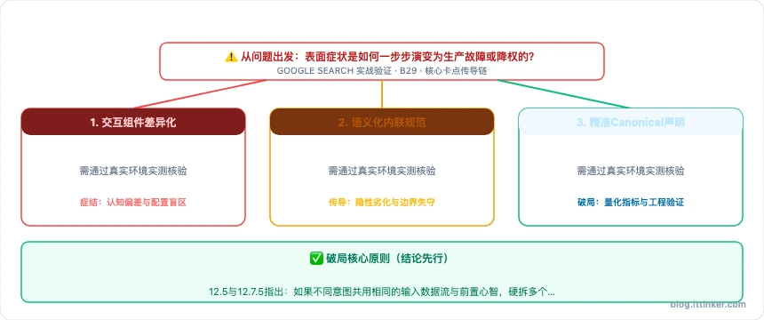
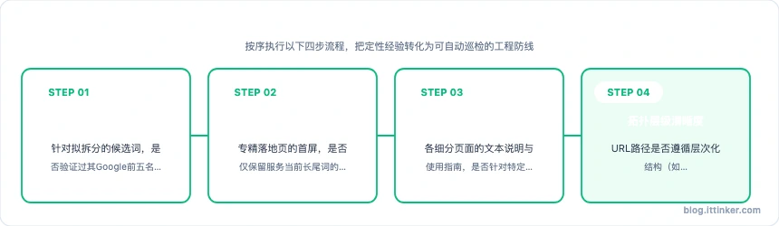

# 一个 Query 有多个 Intent 时，应该建一个页面还是多个页面？ | 读懂 Google Search SEO 实战 系列 029

> 🌐 **在线阅读与互动版**：[一个 Query 有多个 Intent 时，应该建一个页面还是多个页面？ | 读懂 Google Search SEO 实战 系列 029](https://blog.ittinker.com/posts/一个-query-有多个-intent-时-应该建一个页面还是多个页面/)
> 📚 **所属专栏**：[《读懂 Google Search：110篇搜索质量与SEO实战指南》](../README.md)

---

### 📌 结论先行（TL;DR）
**URL 结构的聚散决策，取决于各意图之间的**工作流连贯性**与**交互界面排他性**。**

1. QRG 12.5 与 12.7.5 指出：如果不同意图共用相同的输入数据流与前置心智，硬拆多个页面会诱发严重的关键词自相蚕食（Keyword Cannibalization）；
2. 反之，如果各意图的交付物与操作控件完全异构，试图用一个“万能大单页”承接所有诉求，则会稀释主导意图，导致页面在任何一个细分词下都无法达到 High Needs Met。

在规划出海工具或 SaaS 官网时，技术团队经常爆发这样的架构争议：

“我们应该把 JSON 校验、格式化、转 CSV、转 TypeScript 全部塞进 `/json-tool`，做成功能最强大的全能聚合页；还是给每个子需求独立分配一个 URL，如 `/json-to-csv`、`/json-to-typescript`，打造数十个落地页矩阵？”

前者追求权重集中，但容易因首屏交互臃肿而伤害即时体验；后者追求意图绝对精准，却极易陷入内容雷同与站内互相争抢权重的泥潭。





---

## 1. 拆解 QRG 12.5 与 12.7.5：意图特异性与评级边界

QRG 12.7.5 在探讨落地页满意度时，确立了一条关于“特异性（Specificity）”的原则：

> *"A result that is very specific to the user's intent is usually more satisfying than a general or broad result, provided the specific result fully addresses what the user wants."*
> 
> *"However, if a query has multiple interpretations or intents, a broad page may serve as a useful starting point, while specific subpages best serve individual tasks."*

这一评估逻辑揭示了 Google 对 URL 架构的核心预期：
1. **高意图特异性优先**：当用户输入 `json to typescript interface` 时，他们需要的是立刻呈现 TypeScript 类型定义输出的专属界面。如果访问的页面默认输出的是 CSV，需要手动下拉切换 Tab 才能找到目标模式，该页面的满意度评级就会遭到降级。
2. **意图稀释惩罚**：如果一个页面的 Title 与 H1 强行堆砌了 10 种截然不同的功能，Google 算法在为特定长尾词选拔最强落地页时，往往会优先推荐同行那些“单一功能做到极致”的轻量专精单页。





---

## 2. 意图聚散工程决策树

针对多意图关键词，开发团队应按照以下逻辑拓扑确定 URL 结构：





---

## 3. 单页架构与多页矩阵优劣势全景比对

在权衡系统研发成本与长期 SEO 表现时，参考以下工程对照：

| 评估维度 | 单 URL 聚合大页 (All-in-One Hub) | 独立专精 URL 矩阵 (Dedicated Spoke) |
|---|---|---|
| **适用业务场景** | 功能高度紧凑、步骤前后依赖（如：Markdown 编辑器 + 实时预览 + 表格生成） | 终端交付物明确、受众群体专业细分（如：代码生成、多格式独立导出） |
| **Title 与 H1 聚焦度** | 必须采用统称词（如 `Online JSON Tool`），难以同时覆盖几十个长尾词 | 每个页面独立命中精准词（如 `Convert JSON to Rust Structs Online`） |
| **首屏 Needs Met 表现** | 存在切换损耗，用户需在一堆按钮中寻找所需功能 | 首屏直接展示专属转换器，交互零阻力，极易斩获 High NM |
| **自相蚕食（Cannibalization）** | 完全免疫自相蚕食，外链权重 100% 沉淀在根页面 | 如果页面模板与说明文案雷同率高于 60%，极易引发权重内耗 |
| **维护与版本迭代成本** | 极低。只需维护一套交互组件与一套状态管理器 | 中等偏高。需保持几十个 URL 的依赖更新与端到端测试 |
| **长尾流量捕获上限** | 较低。通常只能在 1~3 个核心主词上获得较好名次 | 极高。每个 URL 都是一把锋利的手术刀，能捕获海量小搜量高转化词 |





---

## 4. 落地实操准则：何时合，何时分？

### 必须合并为单一 URL 的三种情形
1. **意图属于同一事务的上下游**：
   - 用户在压缩图片（`compress image`）的同时，天然伴随着尺寸裁剪（`resize image`）与格式转换（`convert to webp`）。将它们整合在同一个画布内，操作体验远优于拆分成三个跳来跳去的独立网页。
2. **各意图的 SERP Top 10 页面高度重合**：
   - 在 Google 检索词 A 与词 B，如果发现排名前五的 URL 有 4 个完全一致，说明 Google 算法已经将两者判定为同质意图。此时强行拆分两个页面，必定导致两个 URL 互相打架，排名双双跌出首页。
3. **衍生页面缺乏独占的交互逻辑或数据**：
   - 仅仅改动一个静态参数（如换算单位），页面其余 90% 内容毫无变化，应直接采用纯前端组件动态切换，避免制造薄内容页面（Thin Content）。

### 必须独立拆分 URL 的三种情形
1. **用户所需的操作面板完全不同**：
   - 比较 `regex tester`（需要多行测试文本框、匹配标志勾选与捕获组高亮树）与 `regex cheat sheet`（需要清晰的速查分类表格与搜索过滤框）。两者的交付形态完全不同，强行合并只会让工具界面臃肿不堪。
2. **受众技术栈与专业语境互斥**：
   - 针对 `json to java pojo` 与 `json to golang struct`，访问者的技术栈完全不同。Java 开发者不需要看到 Go 的 Tag 注解配置，Go 开发者同样不需要 Lombok 支持。各自独立的 URL 能够提供针对特定语言生态的极致细节（如 Jackson 序列化注解选项），从而在 Effort 与 Expertise 上全面胜出。
3. **两个关键词的独立月搜量均超过 1,000**：
   - 且 SERP 前三名全部是独立的专属落地页。这表明算法已经为该细分词分配了独立的意图席位，专精单页更容易登顶。





---

## 5. 防止矩阵页面“自相蚕食”的工程规范

当你选择构建多落地页矩阵时，必须在代码层面建立防蚕食机制：

```text
[防蚕食三大工程纪律]
1. 交互组件差异化：
   每个 Spoke 页面必须具备专属的配置参数与输出解析逻辑，坚决杜绝只换 H1 标题的换皮行为。
2. 语义化内联规范：
   所有 Spoke 页面必须在顶部面包屑或说明区提供回跳 Hub 主页的明确链接，
   并在正文底部通过 "Related Converters" 形成健康的网状拓扑。
3. 精准 Canonical 声明：
   每个独立 URL 必须声明指向自身的 self-referencing rel="canonical"，
   向搜索引擎明确传达独立索引信号。
```





---

## 6. URL 架构上线自查清单

- [ ] **SERP 重合度核验**：针对拟拆分的候选词，是否验证过其 Google 前五名结果的重合率低于 40%？
- [ ] **首屏交互纯粹性**：专精落地页的首屏，是否仅保留服务当前长尾词的核心组件，无多余干扰？
- [ ] **代码与模板去重**：各细分页面的文本说明与使用指南，是否针对特定技术场景手写，无批量模板化文本？
- [ ] **拓扑层级清晰度**：URL 路径是否遵循层次化结构（如 `/tools/json-to-csv`），便于搜索引擎理解目录层级？
- [ ] **反向锚文本链条**：细分页面是否自然链接回功能总览页，避免产生无父级引用的孤岛网页（Orphan Pages）？





---

## 下一篇预告

确立了页面架构后，我们还需要防范一种潜藏的时间陷阱：

**“为什么一个原本排名第一的优质页面，在没有任何改动的情况下，排名突然在一夜之间暴跌？”**

这背后往往不是算法惩罚，而是关键词的真实含义随着时间发生了漂移。

下一篇，我们将探讨如何对抗时效侵蚀：**[为什么关键词会随着时间“换一种意思”？（B30）](/posts/为什么关键词会随着时间-换一种意思/)**。

---

_这是「读懂 Google Search」系列第 29 篇，系统拆解 Google 官方质量指南，帮你建立长期抗算法波动的出海 SEO 护城河。_


---

## 读懂 Google Search 专栏导航

> 📚 **专栏收录**：本文为 [《读懂 Google Search：110篇搜索质量与SEO实战指南》](/posts/google-search-guide/) 第 **B29** 篇。

* **专栏主页**：[《读懂 Google Search：110篇搜索质量与SEO实战指南》全景地图与路线图](/posts/google-search-guide/)
