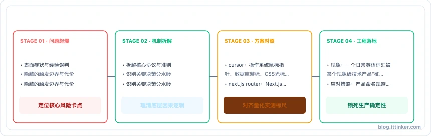
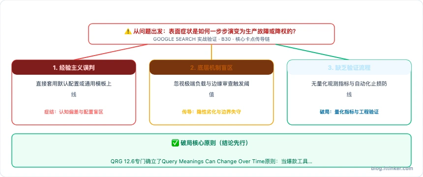
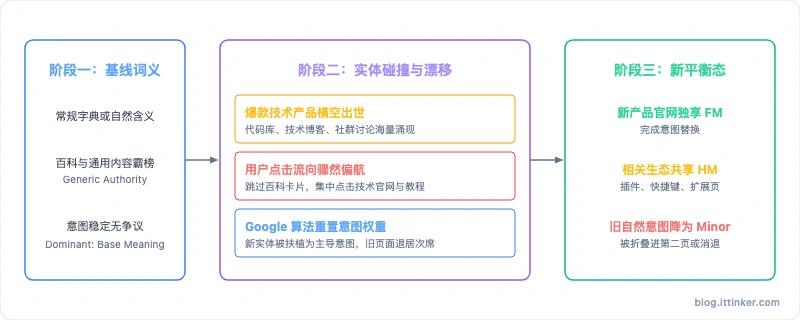
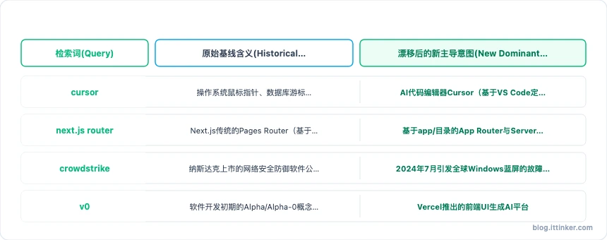
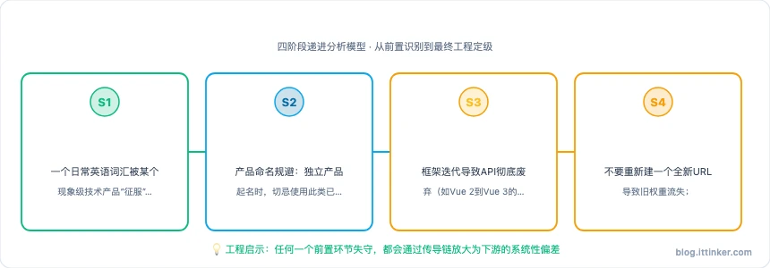
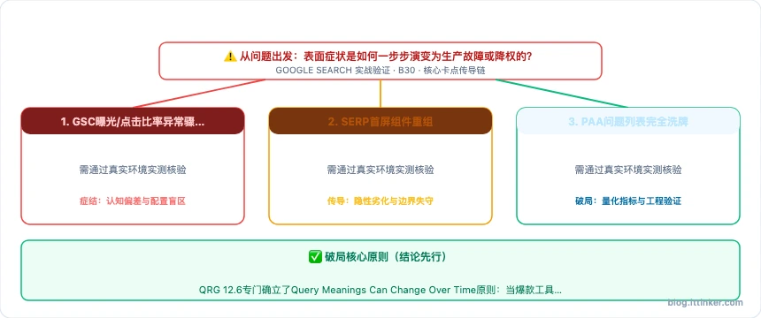
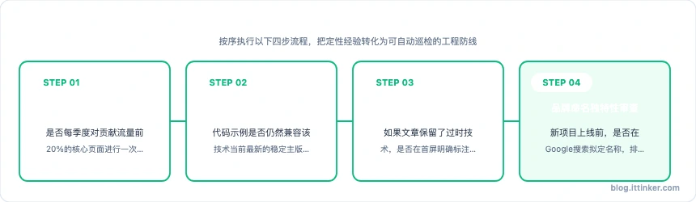

# “关键词意思变了怎么办”？意图漂移（Intent Drift）应对模型 | 读懂 Google Search SEO 实战 系列 030

> 🌐 **在线阅读与互动版**：[“关键词意思变了怎么办”？意图漂移（Intent Drift）应对模型 | 读懂 Google Search SEO 实战 系列 030](https://blog.ittinker.com/posts/为什么关键词会随着时间-换一种意思/)
> 📚 **所属专栏**：[《读懂 Google Search：110篇搜索质量与SEO实战指南》](../README.md)

---

### 📌 结论先行（TL;DR）
> **搜索词的含义并非固化的字典词条，而是社会共识与商业实体动态重构的产物。**
> **在软件工程领域，词义颠覆的节奏远超传统行业。**
> **如果你在五年前搜索 `tailwind`，Google 结果页展现的几乎全是关于风向、气象学以及航空飞行的百科解释；而今天在任何一台开发者的电脑上搜索同一个词，第一页已被 Tailwind CSS 这一前端框架彻底统治。**
> **同样的故事发生在 `cursor`、`prisma`、`next` 等常见单词上。**
> **许多开发者困惑于自己两年前精心编写的技术教程为何流量断崖式下跌。排查外链与代码均无异常，根本原因在于：你所锚定的那个词，在 Google 评估体系中已经“换了一种意思”。**
>
> - QRG 12.6 专门确立了 **Query Meanings Can Change Over Time** 原则：当爆款工具崛起或发生重大行业事件时，旧的主导意图会迅速退化为次要意图（Minor Interpretation）。
> - 过去能拿 High Needs Met 的页面，若未及时适配新语境，评级会瞬间跌落为 Stale（过期无用）。
> - **开发者在命名产品或维护技术内容时**：必须建立定期复审机制，防范词义漂移带来的被动降权。





---


### 🚨 2026 → 2024 官方最新风向预警：Google 对Google 关键词意图时变模型（Query Meaning Drift）的动态演进的策略演进

#### 🕒 2026 → 2024 Google 官方对Google 关键词意图时变模型（Query Meaning Drift）的动态演进的策略演进

- **2026 · 意图演变与搜索语义代际漂移（Semantic Drift Tracking）**
  技术演进和行业更迭导致大量搜索词的含义彻底转变（如‘LLM’从几年前的法学硕士完全漂移为大语言模型）。未能感知并重构内容的静态古董页面被算法自动清退。

- **2025 · 动态内容资产维护与生命周期管理（Asset Lifecycle Refresh）**
  建立对核心关键词 SERP 结果形态的定期监控体系，每季度审视意图是否发生迁移，及时注入当下最新的工程语境，防止高位资产滑向死寂。

- **2024 · QRG 12.6 节关于查询词随时间发生语义迁移的官方判例**
  指引列举了大量随社会发展意图彻底改变的典型词条，告诫评估员必须以当下当刻的真实用户语境为准，击碎站长‘一次优化终身躺赢’的幼稚幻想。


---


## 1. 拆解 QRG 12.6 与 18.0：官方指南中的词义漂移法则

QRG 12.6 明确要求评估员具备对时效与新兴实体的敏锐度：

> *"Query meanings can change over time. Many queries have meanings that are not obvious without knowledge of current events, pop culture, or new products."*
> 
> *"A query that had a dominant interpretation in the past may now have a different dominant interpretation, or it may now have multiple interpretations."*

而在第 18 节中，Google 对**过期内容（Stale / Expired Content）**作出了严厉判定：

> *"Results that provide outdated information for queries that require fresh, up-to-date information should receive low Needs Met ratings (Slightly Meets or Fails to Meet)."*

Google 算法不会等待网站主动更新。一旦机器学习模型检测到全网对某一词汇的实体共现关系（Entity Co-occurrence）发生突变，评估员与算法就会在数周内完成对该词 Dominant Interpretation 的重新定级。





---

## 2. 词义漂移生命周期与评级演化模型

以下矢量流程图展示了一个词从自然词义演变为技术实体，并最终引发搜索评级重构的完整生命周期：





---

## 3. 典型技术关键词漂移案例深度剖析

通过以下真实发生的技术案例，理解词义漂移对开发者的直接影响：

| 检索词 (Query) | 原始基线含义 (Historical Meaning) | 漂移后的新主导意图 (New Dominant Intent) | 意图演化动力 | 独立开发者的战略启示 |
|---|---|---|---|---|
| `cursor` | 操作系统鼠标指针、数据库游标、CSS 光标样式 | AI 代码编辑器 Cursor（基于 VS Code 定制） | 爆款生产力工具爆发，全网技术人员高频安装使用 | 涉及 CSS cursor 样式的教程必须在标题补充 `css cursor styling`，否则被新产品词流彻底淹没。 |
| `next.js router` | Next.js 传统的 Pages Router（基于 `pages/` 目录） | 基于 `app/` 目录的 App Router 与 Server Components | 框架重大主版本迭代，架构理念发生范式级改变 | 依然停留在 `getStaticProps`、`getServerSideProps` 的文章直接被判为 Stale，需全面重构示例。 |
| `crowdstrike` | 纳斯达克上市的网络安全防御软件公司 | 2024 年 7 月引发全球 Windows 蓝屏的故障事件与修复方案 | 突发全球性系统崩溃事故，时效性突发意图压倒一切 | 突发事件期间，商业产品介绍页面降级，救灾恢复脚本页抢占 SERP 顶部。 |
| `v0` | 软件开发初期的 Alpha/Alpha-0 概念测试版本 | Vercel 推出的前端 UI 生成 AI 平台 | 新科技企业打造出具有行业辨识度的单命名实体 | 起名时切忌单用通用字母加数字，极易被大厂新推出的 SaaS 碾压。 |





---

## 4. 词义漂移的三大形态与开发者应对机制

针对不同类型的漂移，工程与内容维护策略各有侧重：

### 形态一：技术实体碾压通用词（Entity Eclipse）
- **现象**：一个日常英语词汇被某个现象级技术产品“征服”（如 `flutter`, `docker`, `rust`）。
- **应对策略**：
  - **产品命名规避**：独立产品起名时，切忌使用此类已有通用含义或容易被后续巨头征服的单词。如果你的小工具叫 `Spark` 或 `Bolt`，一旦行业巨头推出同名产品，你的搜索品牌词会遭遇毁灭性打击。
  - **长尾加固**：如果你正在写关于词面原始含义的内容，主动在标题中嵌入限定词（如将 `Prompt Tips` 明确为 `Midjourney Prompt Engineering Guide`）。

### 形态二：软件大版本重构（Major Version Shift）
- **现象**：框架迭代导致 API 彻底废弃（如 Vue 2 到 Vue 3 的 Composition API，React 类组件到 Hooks）。
- **应对策略**：
  - 不要重新建一个全新 URL 导致旧权重流失；
  - 在原 URL 顶部增加醒目的版本适配提示框（Callout），首屏展示最新版推荐写法；
  - 将旧版语法折叠至文章底部作为“兼容排错备忘”，使页面同时承接新主导意图与旧长尾需求。

### 形态三：短期热点事件爆发（Acute Event Spike）
- **现象**：CVE 严重安全漏洞暴雷（如 `log4j vulnerability`）。
- **应对策略**：
  - 速度决定胜负。在事件爆发后 6 小时内上线可落地的检测命令与修复清单；
  - 随着时间推移，该词的意图会在数月后由“即时排险”平稳漂移为“系统性防护与合规总结”，内容重心需同步调整。





---

## 5. 监测词义漂移的实操信号

不必每天人工搜索所有词汇。在日常运营中，通过以下自动化信号捕获漂移预警：

```text
[词义漂移预警信号]
1. GSC 曝光/点击比率异常骤降：
   某页面在 Google Search Console 的展示量（Impressions）暴涨 5 倍，但点击率（CTR）从 8% 跌破 0.5%。
   原因：该词出现了同名爆款新产品，你的页面被作为次要意图混合展示，但用户找的已经不是你。
2. SERP 首屏组件重组：
   目标词突然出现了巨大的 Knowledge Graph 知识面板或新闻轮播（Top Stories）。
3. PAA 问题列表完全洗牌：
   “其他人还在问”中的子问题从概念咨询全部变成了特定新软件的报错与安装问询。
```





---

## 6. 词义抗漂移维护清单

- [ ] **高价值页面定期巡检**：是否每季度对贡献流量前 20% 的核心页面进行一次 SERP 真实形态复审？
- [ ] **框架语法最新性核验**：代码示例是否仍然兼容该技术当前最新的稳定主版本（LTS）？
- [ ] **废弃 API 警告置顶**：如果文章保留了过时技术，是否在首屏明确标注适用版本并给出最新演进指引？
- [ ] **品牌命名独特性审查**：新项目上线前，是否在 Google 搜索拟定名称，排查潜在重名实体与法律商标风险？
- [ ] **GSC 异常流量追踪**：对于 CTR 突然断崖式下滑的高排名词，是否已排查词义漂移引起的意图错配？





---

## 下一篇预告

理解了时效与词义漂移后，我们将注意力转向用户心理维度的另一层分水岭：

**为什么面对官方品牌词，用户对第三方结果的容忍度几乎为零；而在面对排错或概念词时，用户却愿意逐字阅读甚至容忍不完美的排版？**

下一篇，我们将探讨不同意图下的用户容忍度曲线：**[“把品牌词当通用词来优化”？用户耐受度的巨大鸿沟：品牌词、功能词、问题词背后的容忍度完全不同！（B31）](/posts/品牌词-功能词-问题词-用户对结果的容忍度完全不同/)**。

---

_这是「读懂 Google Search」系列第 30 篇，系统拆解 Google 官方质量指南，帮你建立长期抗算法波动的出海 SEO 护城河。_


---

## 读懂 Google Search 专栏导航

> 📚 **专栏收录**：本文为 [《读懂 Google Search：110篇搜索质量与SEO实战指南》](/posts/google-search-guide/) 第 **B30** 篇。

* **专栏主页**：[《读懂 Google Search：110篇搜索质量与SEO实战指南》全景地图与路线图](/posts/google-search-guide/)
