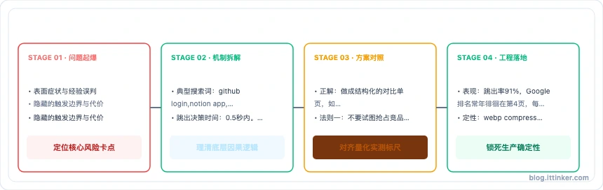
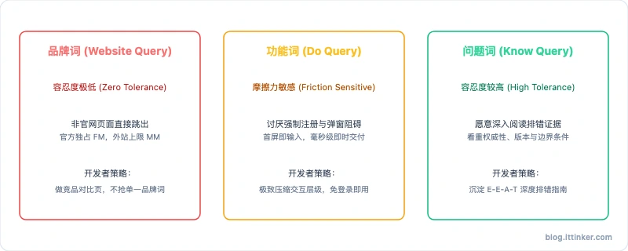
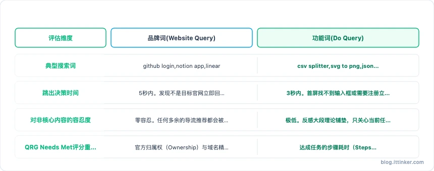
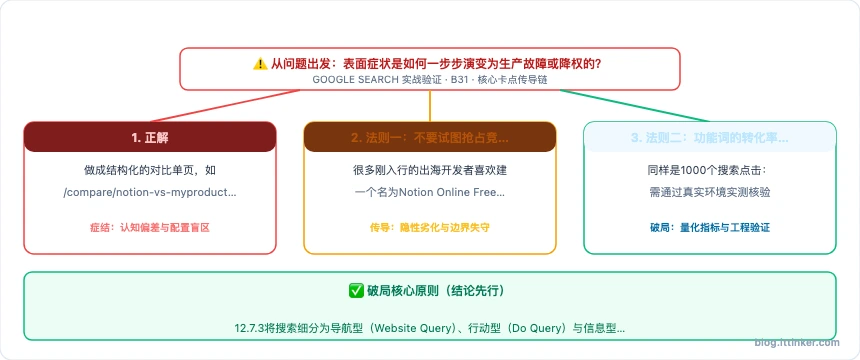
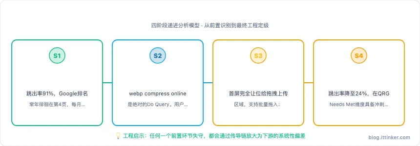
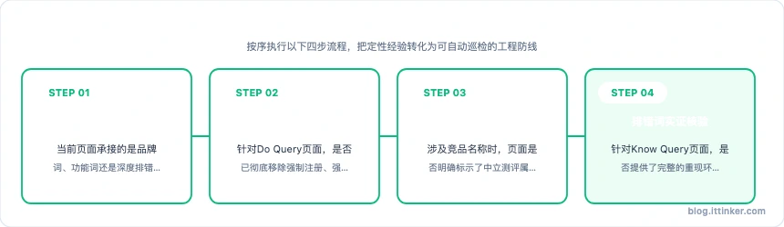

# 品牌词、功能词、问题词，用户对结果的容忍度完全不同 | 读懂 Google Search SEO 实战 系列 031

> 🌐 **在线阅读与互动版**：[品牌词、功能词、问题词，用户对结果的容忍度完全不同 | 读懂 Google Search SEO 实战 系列 031](https://blog.ittinker.com/posts/品牌词-功能词-问题词-用户对结果的容忍度完全不同/)
> 📚 **所属专栏**：[《读懂 Google Search：110篇搜索质量与SEO实战指南》](../README.md)

---

### 📌 结论先行（TL;DR）
**用户在不同查询意图下的**耐心消耗曲线**具有强烈的非对称性。**

1. QRG 12.7.1 至 12.7.3 将搜索细分为导航型（Website Query）、行动型（Do Query）与信息型（Know Query）。
2. 对于品牌词，用户的容忍度为零，任何非官方页面都会引发秒退；
3. 对于功能词，用户对注册门槛与交互卡顿零容忍；
4. 面对复杂问题词，用户却愿意沉浸阅读数千字。

很多工程师在打磨网站时容易犯“一刀切”的错误：

给一个查询报错日志的问题页加上了免注册在线交互执行器，耗费了两周算力开发，结果用户只想看一眼解决方案并复制配置文件；
而给一个文件拆分的功能页写了 3000 字格式说明，把上传控件藏在页面深处，导致跳出率突破 85%。

用户对搜索结果的期望并不是恒定的。当意图类型切换时，他们对弹窗、广告、文字冗余度以及加载速度的容忍阈值会发生剧烈震荡。

---

## 1. 拆解 QRG 12.7 与 13.2：三类核心 Query 的评级标准

QRG 12.7 详细定义了三类典型查询的判定边界，并在第 13.2 节给出了清晰的评级尺度：

> *"• Website Queries: The user wants to go to a specific website or webpage. If the user query is [ibm], only the official IBM homepage can receive a Fully Meets rating. All other pages, including IBM social profiles or Wikipedia pages about IBM, can receive no higher than High."*
> 
> *"• Do Queries: The user wants to perform an action. A result that allows the user to immediately accomplish the task with minimal interaction receives High or Fully Meets."*
> 
> *"• Know Queries: The user wants to learn or understand. Comprehensiveness, clarity, and authority dictate the Needs Met rating."*

这三类意图对用户心理摩擦力的耐受程度截然不同：

---

## 2. 意图类型特征与用户交互行为对照表

下表梳理了三类核心词在用户行为特征与产品策略上的根本区别：

| 评估维度 | 品牌词 (Website Query) | 功能词 (Do Query) | 问题/排错词 (Know Query) |
|---|---|---|---|
| **典型搜索词** | `github login`, `notion app`, `linear` | `csv splitter`, `svg to png`, `json validator` | `how to fix cors error`, `docker build cache missing` |
| **跳出决策时间** | **0.5 秒内**。发现不是目标官网立即回退。 | **3 秒内**。首屏找不到输入框或需要注册立即关闭。 | **10~30 秒**。会快速滚动通览代码块与方案概述。 |
| **对非核心内容的容忍度** | 零容忍。任何多余的导流推荐都会被视作误导。 | 极低。反感大段理论铺垫，只关心当前任务能否执行。 | 较高。愿意阅读故障机理、复现步骤与防御建议。 |
| **QRG Needs Met 评分重心** | 官方归属权（Ownership）与域名精确性。 | 达成任务的步骤耗时（Steps Required）与可用性。 | 信息的准确性、权威度（E-E-A-T）与方案完备度。 |
| **商业转化方式** | 难以转化直接购买，适合做中立竞品对比。 | 免费额度体验后，通过批处理或高级功能实现升级。 | 通过专业深度建立信任，自然导流至核心 SaaS 产品。 |

---

## 3. 独立开发者的实战落地法则

### 法则一：不要试图抢占竞品的主品牌词
很多刚入行的出海开发者喜欢建一个名为 `Notion Online Free Alternative` 的页面，Title 直接设置为 `Notion - Free Notion Web App`。
- 在 QRG 体系中，这类行为属于典型的 **Deceptive Intent（欺骗性意图）**；
- 哪怕你把产品做得再好，由于 Dominant Intent 归属于 Notion 官方，你的页面最高只能拿到 Moderately Meets，并在用户极低停留时长的负反馈下迅速滑落。
- **正解**：做成结构化的对比单页，如 `/compare/notion-vs-myproduct`，承接用户的 **Commercial Research Intent（商业调研意图）**，满足度反而能冲到 High。

### 法则二：功能词的转化率通常是问题词的 10 倍
- 同样是 1000 个搜索点击：
  - 搜索 `how to parse json in bash` 的用户往往只是为了在终端完成一次临时调试，任务完成后立即关闭标签，极难转化为商业购买；
  - 搜索 `bash json formatter cli tool` 的用户，正在寻找可以长期集成进工作流的生产力工具。
- 独立团队应将核心工程力量倾斜在**功能动作词（Do Queries）**上。只要在交互上彻底干掉注册门槛、保证高频稳定运行，这批用户的付费意愿远超泛信息流访客。

### 法则三：问题词是建立 E-E-A-T 护城河的最佳阵地
- 尽管问题词直接转化率较低，但它能以极低的成本获取外链与同行口碑；
- 当一个开发者因为你的排错文章成功解决了困扰三天的生产环境 Bug，他对你个人及旗下 SaaS 的信任度（Trust）会达到顶峰；
- 在排错文章底部适度植入与该场景高度相关的自动化脚本工具（如通过开源脚本一键排查网络瓶颈），不仅不会被读者反感，反而会被视作极具诚意的专业交付。

---

## 4. 真实工程复盘：一个图片压缩工具的重构启示

某出海独立团队曾上线了一个名为 `WebP Shrinker` 的小工具：

### 初始版本（典型工程师思维）
- 首屏：大号 H1 标题《What is WebP and Why You Should Use It in 2026》，附带 1200 字图片编码原理解析；
- 第二屏：上传控件；
- 用户点击上传后：弹出模态框提示“Please enter your email to receive compressed files”。
- **表现**：跳出率 91%，Google 排名常年徘徊在第 4 页，每月只带来不足 5 个注册。

### 重构版本（QRG 意图重塑）
- **定性**：`webp compress online` 是绝对的 **Do Query**。用户对阻力的容忍度为零。
- **改动**：
  1. 首屏完全让位给拖拽上传区域，支持批量拖入；
  2. 采用纯前端 WebAssembly 实时压缩，无需上传后端服务器，直接在浏览器内完成；
  3. 压缩完毕后，单张图片旁直接展示对比滑块与“一键下载”按钮，无任何邮箱阻门；
  4. 将技术原理解析全部折叠收纳在交互界面下方作为拓展参考。
- **表现**：跳出率降至 24%，在 QRG Needs Met 维度具备冲刺 Fully Meets 的硬件指标，两个月内自然排至 SERP 前三位，高级批量导出功能的付费转化率提升了 6 倍。

---

## 5. 用户容忍度与交互对齐自查清单

- [ ] **意图类型精准定性**：当前页面承接的是品牌词、功能词还是深度排错词？
- [ ] **功能词阻门清零**：针对 Do Query 页面，是否已彻底移除强制注册、强行索要邮箱等交互阻碍？
- [ ] **品牌词合法性核验**：涉及竞品名称时，页面是否明确标示了中立测评属性，杜绝假冒官网误导？
- [ ] **排错词实证核验**：针对 Know Query 页面，是否提供了完整的重现环境、错误日志截图与验证命令？
- [ ] **转化路径匹配度**：商业引导按钮是否与当前意图的心理预期深度契合，避免在低信任阶段强行索要信用卡？

---

## 下一篇预告

完成了单语言环境下的意图理解与架构规划后，许多开发者开始将目光投向更广阔的全球市场：

**“把现有的英文页面用大模型翻译成德语、西班牙语、日语，批量生成上千个子目录，这算不算出海国际化的捷径？”**

下一篇，我们将拆解跨语言站点的本土化真相：**[国际站为什么不能只把英文页面机器翻译一遍？（B32）](/posts/国际站为什么不能只把英文页面机器翻译一遍/)**。

---

_这是「读懂 Google Search」系列第 31 篇，系统拆解 Google 官方质量指南，帮你建立长期抗算法波动的出海 SEO 护城河。_

---

## 读懂 Google Search 专栏导航

> 📚 **专栏收录**：本文为 [《读懂 Google Search：110篇搜索质量与SEO实战指南》](/posts/google-search-guide/) 第 **B31** 篇。

* **专栏主页**：[《读懂 Google Search：110篇搜索质量与SEO实战指南》全景地图与路线图](/posts/google-search-guide/)
