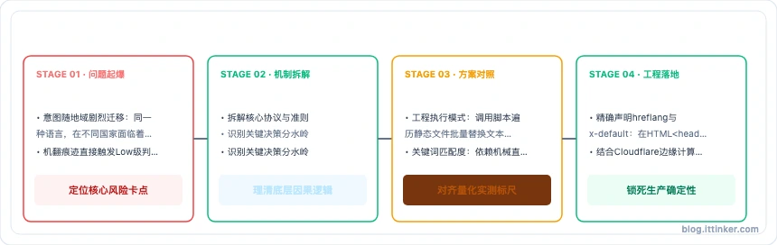
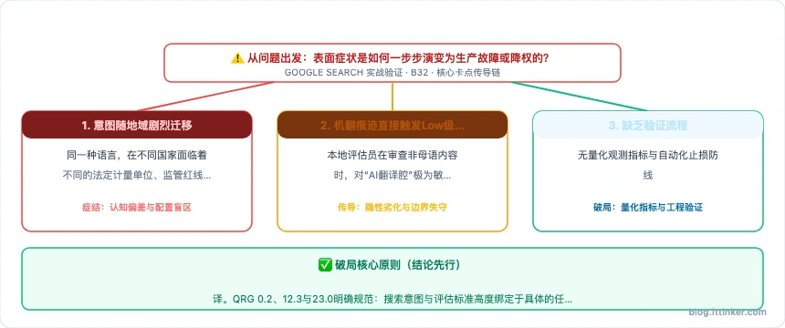
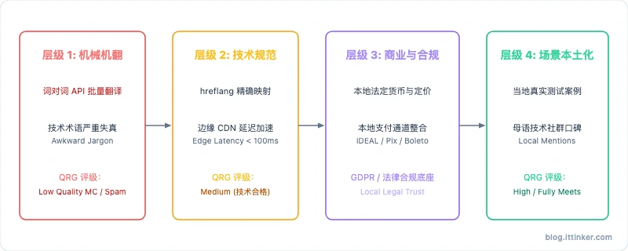
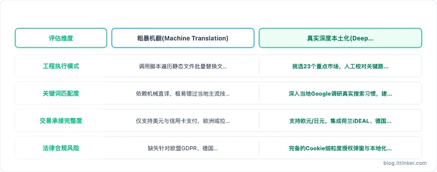
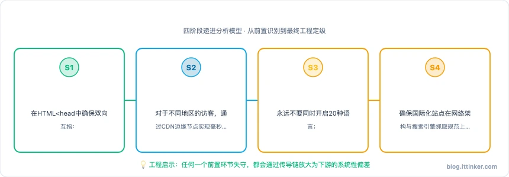
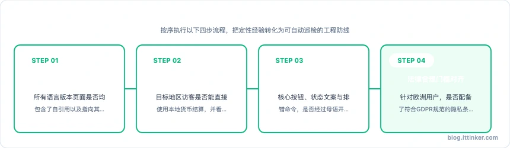

# “把英文页面机翻 30 种语言就能做全球出海”？机器生硬翻译的降权惨剧：国际化站点的文化隔阂与本土化死线 | 读懂 Google Search SEO 实战 系列 032

> 🌐 **在线阅读与互动版**：[“把英文页面机翻 30 种语言就能做全球出海”？机器生硬翻译的降权惨剧：国际化站点的文化隔阂与本土化死线 | 读懂 Google Search SEO 实战 系列 032](https://blog.ittinker.com/posts/国际站为什么不能只把英文页面机器翻译一遍/)
> 📚 **所属专栏**：[《读懂 Google Search：110篇搜索质量与SEO实战指南》](../README.md)

---

### 📌 结论先行（TL;DR）
> **全球化 SEO 的本质是**本地化需求满足（Locale Needs Met）**，绝非机械的文字转译。**
> **很多出海开发者在上线英文站点后，第一反应通常是利用脚本或翻译插件：**
> **写一个 Python 脚本调用 DeepL 或 GPT 接口，把现有网站的数百个英文 Markdown 页面，批量翻译成西班牙语、德语、法语、日语，通过子目录生成上万个多语言 URL，并打上 `hreflang` 标签。**
> **随后几个月，等待中的全球流量并没有到来。相反，GSC 报告里充斥着“已抓取但未编入索引（Crawled - currently not indexed）”，甚至整个站点的收录配额遭到降级。**
>
> - QRG 0.2、12.3 与 23.0 明确规范：搜索意图与评估标准高度绑定于具体的**任务地域（Task Locale）**。
> - 生硬机翻不仅会因语法别扭被本地评估员直接定级为 Low Quality MC，更会因缺少当地法定货币、税率计算与合规条款，彻底丧失满足用户真实任务的能力。
> - 独立开发者应放弃“机翻 50 种语言狂铺几万页”的粗放幻觉，集中火力做深 2~3 个核心高价值市场的全链路本地化。





---


### 🚨 2026 → 2024 官方最新风向预警：Google 对Google 对未经本地化审校的机器翻译内容（Unedited Machine Translation）的打击的策略演进

#### 🕒 2026 → 2024 Google 官方对Google 对未经本地化审校的机器翻译内容（Unedited Machine Translation）的打击的策略演进

- **2026 · 机翻指纹与低质多语言站群算法清洗**
  Googlebot 大幅强化了对未经人工校对、直接套用翻译 API 生成的多语言页面的识别能力。语病丛生、术语错位的小语种页面被直接归入 Thin Content 批量剔除。

- **2025 · 真正的本土化架构标准（Localization Beyond Translation）**
  合规出海必须具备本地真实货币结算、本地化法定节假日活动适配、本地法律合规声明以及地道的开发者技术用语，建立起令当地用户信赖的本土质感。

- **2024 · Google Search Essentials 关于自动生成机器翻译内容的违规定义**
  官方反垃圾准则明确将‘未经过人工实质审校、直接发布的自动化翻译内容’列为垃圾滥用（Spam）行为，彻底封死了粗暴机翻套利的后路。


---


## 1. 拆解 QRG 0.2、12.3 与 23.0：Language 绝不等于 Locale

QRG 在引言部分（0.2）与第 12.3 节中，对“语言与地域”的关系作出了极其严谨的界定：

> *"The task locale is the specific language and country where the user is searching. For example, English in the US (en-US) is different from English in the UK (en-GB) or English in India (en-IN)."*
> 
> *"A query can have very different meanings depending on the user's location, local culture, and local laws."*

而在第 23 节《Rating in Non-English Locales》中，Google 对本地评估员的打分要求更是直指机翻软肋：

> *"Pages that are poorly translated, filled with awkward phrasing, or display unformatted foreign currency and address formats should be assigned Low or Lowest Page Quality ratings due to lack of care and trustworthiness."*

评估机制明确传递出两个硬性事实：
1. **意图随地域剧烈迁移**：同一种语言，在不同国家面临着不同的法定计量单位、监管红线与文化偏向。在英国搜索 `vat threshold` 与在南非搜索同一词，需要的内容完全属于不同知识体系。
2. **机翻痕迹直接触发 Low 级判定**：本地评估员在审查非母语内容时，对“AI 翻译腔”极为敏感。机械的词对词替换不仅无法传达专业技术语境，反而会被判定为粗制滥造的内容农场。





---

## 2. 国际化本地化层级演化模型

要真正攻克海外各区域市场，必须跨越从“表层文字翻译”到“底层完整方案承接”的四道阶梯：





---

## 3. 机械机翻与深度本土化实战对照表

在规划国际化资源时，参考以下全景比对：

| 评估维度 | 粗暴机翻 (Machine Translation) | 真实深度本土化 (Deep Localization) |
|---|---|---|
| **工程执行模式** | 调用脚本遍历静态文件批量替换文本，全自动生成上万 URL | 挑选 2~3 个重点市场，人工校对关键路径，适配本土地理常识 |
| **关键词匹配度** | 依赖机械直译，极易错过当地主流技术俚语（如将 `Framework` 直译生造词） | 深入当地 Google 调研真实搜索习惯，建立本地化 Seed Keyword 库 |
| **交易承接完整度** | 仅支持美元与信用卡支付，欧洲或拉美用户在结算页流失 | 支持欧元/日元，集成荷兰 iDEAL、德国 Sofort、巴西 Pix 等本地支付 |
| **法律合规风险** | 缺失针对欧盟 GDPR、德国 Impressum、加州 CCPA 的定制声明 | 完备的 Cookie 细粒度授权弹窗与本地化法律实体注册备案 |
| **搜索引擎态度** | 容易触发“规模化垃圾内容（Scaled Content Abuse）”算法惩罚 | 享有当地独立索引权重，与本土权威竞品享有平等竞争门槛 |





---

## 4. 独立开发者的国际化实战工程战术

独立开发者资源有限，不可能雇佣几十名专业母语翻译。建议采取以下三项务实策略：

### 战术一：精选高回报利基市场，拒绝“撒胡椒面”
- 永远不要同时开启 20 种语言；
- 查看现有英文产品的访问日志或 Stripe 订单来源。如果发现除了美国外，德国（`de-DE`）和日本（`ja-JP`）有持续自发的试用或付费，集中精力打透这两个高客单价市场；
- 德国开发者极度看重数据隐私与严谨排错，日本开发者极度看重文档排版的一丝不苟与界面无 Bug。针对性打磨后的回报，远超粗制滥造的 20 国矩阵。

### 战术二：在技术层做好严谨的基础设施支持
确保国际化站点在网络架构与搜索引擎抓取规范上没有低级硬伤：
1. **精确声明 `hreflang` 与 `x-default`**：
   在 HTML `<head>` 中确保双向互指：
   ```html
   <link rel="alternate" hreflang="en-US" href="https://example.com/" />
   <link rel="alternate" hreflang="de-DE" href="https://example.com/de/" />
   <link rel="alternate" hreflang="ja-JP" href="https://example.com/ja/" />
   <link rel="alternate" hreflang="x-default" href="https://example.com/" />
   ```
2. **结合 Cloudflare 边缘计算压降延迟**：
   对于不同地区的访客，通过 CDN 边缘节点实现毫秒级响应。推荐参考 ITTinker 开源的 [cloudflare-domain-baseline](https://github.com/ittinker/ittinker-scripts/tree/main/cloudflare-domain-baseline) 工具，一键完成安全策略、TLS 1.3 与全球缓存基线的标准化配置。

### 战术三：用“本地真实示例”替代“抽象文字描述”
- 如果写一篇关于欧洲增值税（VAT）计算的文章，示例中的公司不要用虚构的 `Acme Inc in California`，而是使用真实的 `GmbH in Berlin`，并使用真实有效的 19% 税率与标准发票格式；
- 这种微小却真实的本土化细节，不仅能瞬间打动当地读者，更能在评估员眼皮底下拿到高分的 Effort 与 Expertise 证据。





---

## 5. 国际化出海自查清单

- [ ] **hreflang 双向对称校验**：所有语言版本页面是否均包含了自引用以及指向其它语言版本的双向链接？
- [ ] **货币与支付本地化**：目标地区访客是否能直接使用本地货币结算，并看到熟悉的本地付款方式？
- [ ] **技术术语人工校准**：核心按钮、状态文案与排错命令，是否经过母语开发者的通读，排除了违和生硬直译？
- [ ] **法律合规门槛对齐**：针对欧洲用户，是否配备了符合 GDPR 规范的隐私条款与清晰的撤回授权入口？
- [ ] **本地边缘速度测速**：在目标市场的实际代理网络下，首屏首字节时间（TTFB）是否稳定在 200ms 以内？





---

## 下一篇预告

到此为止，我们完成了「读懂 Google Search」第四大核心模块 **B4. 搜索意图与关键词决策**（B25 ~ B32）的全部实战推演。

我们从意图分级、页面选型、关键词漏斗、SERP 逆向工程一直探索到了跨国本地化的深水区。

然而，哪怕意图对齐得再完美，如果你的网站对于用户而言是一个毫无声誉、没有背书的“三无新域名”，Google 依然不敢轻易把顶级流量托付给你。

从下一篇开始，我们将步入全系列最具分量、也最让新站焦虑的核心阵地：**B5. Trust、品牌与 E-E-A-T**。

下一篇，我们将直面出海新项目的终极卡点：**[“新产品没有大品牌没有权威外链就活不下去”？零基础起步的自救指南：出海 SaaS 冷启动建立 Trust 的最低可信底盘（B33）](/posts/一个新-saas-没有品牌-没有外链-怎么建立-trust/)**。

---

_这是「读懂 Google Search」系列第 32 篇，系统拆解 Google 官方质量指南，帮你建立长期抗算法波动的出海 SEO 护城河。_


---

## 读懂 Google Search 专栏导航

> 📚 **专栏收录**：本文为 [《读懂 Google Search：110篇搜索质量与SEO实战指南》](/posts/google-search-guide/) 第 **B32** 篇。

* **专栏主页**：[《读懂 Google Search：110篇搜索质量与SEO实战指南》全景地图与路线图](/posts/google-search-guide/)
