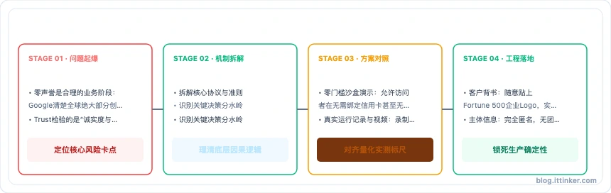
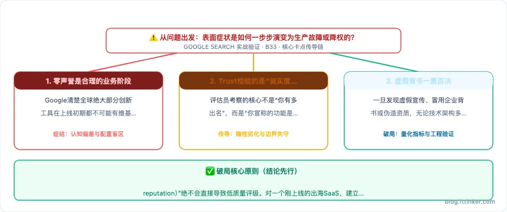
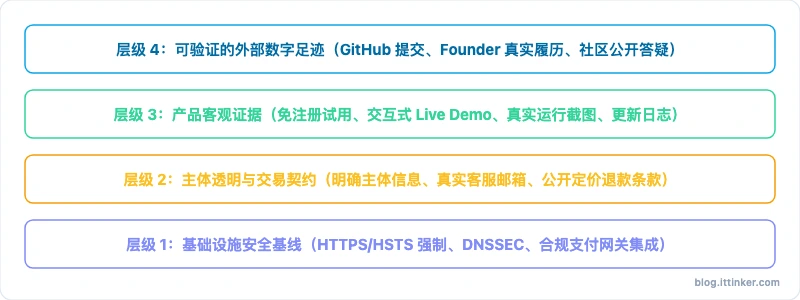
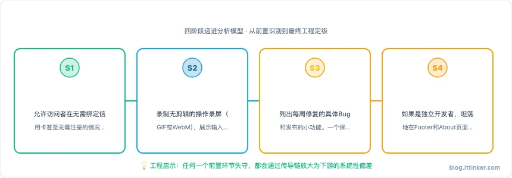
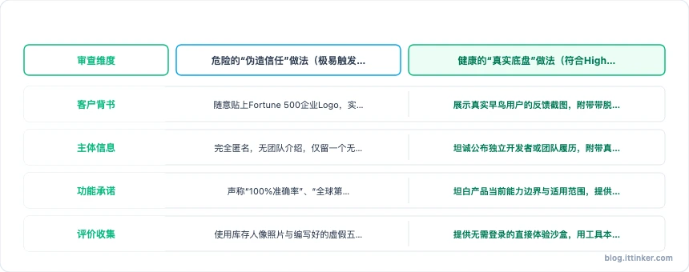
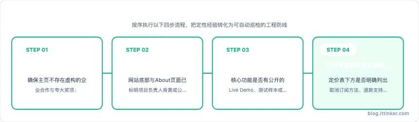

# “新产品没有大品牌没有权威外链就活不下去”？零基础起步的自救指南：出海 SaaS 冷启动建立 Trust 的最低可信底盘 | 读懂 Google Search SEO 实战 系列 033

> 🌐 **在线阅读与互动版**：[“新产品没有大品牌没有权威外链就活不下去”？零基础起步的自救指南：出海 SaaS 冷启动建立 Trust 的最低可信底盘 | 读懂 Google Search SEO 实战 系列 033](https://blog.ittinker.com/posts/一个新-saas-没有品牌-没有外链-怎么建立-trust/)
> 📚 **所属专栏**：[《读懂 Google Search：110篇搜索质量与SEO实战指南》](../README.md)

---

### 📌 结论先行（TL;DR）
> **在 Google 质量评估指南（QRG 3.3.4 与 3.4）中，**“缺乏声誉与外链（Lack of reputation）”绝不会直接导致低质量评级**。**
> **对于刚把代码推向生产环境的独立开发者或小型团队，最让人焦虑的往往是冷启动阶段的“信用真空”：**
> **域名注册不到三个月，全网没有一篇主流科技媒体报道；Ahrefs 或 SEMrush 里的 Domain Rating（DR）是个位数；Google 搜品牌词除了自己的首页什么都没有。**
> **面对这种现状，很多开发者容易走入两个极端：**
> **这两种做法在 Google 评估体系中都会带来灾难。前者触碰 QRG 4.5 的“虚假与欺诈”红线，直接打入 Lowest；后者不仅浪费预算，还极易触发非自然链接惩罚。**
> **官方评估体系如何看待一个零声誉的新产品？我们来看 QRG 的准则。**
>
> - **对一个刚上线的出海 SaaS**：建立 Trust 的核心切入点是提供“高信噪比的产品客观证据”与“无欺诈隐患的责任透明度”。
> - 只要页面具备无缝的真实功能演示、明确的法人或个人主体、公开透明的定价退款条款，并通过自动化基础设施验证安全基线，新站就能直接达到 Medium 乃至 High 的质量门槛。
> - **虚构背书**：在首页贴上一排未经授权的 Google、Microsoft、Amazon 客户 Logo 墙，或者用 AI 生成几个假头像写满溢美之词；
> - **消极放弃**：认为没有海量外链和高权重品牌，做任何 SEO 都是徒劳，只能花钱买劣质外链。





---


### 🚨 2026 → 2024 官方最新风向预警：Google 对Google 对新创品牌初始信任（Entity Seeding & Transparency）的考核机制的策略演进

#### 🕒 2026 → 2024 Google 官方对Google 对新创品牌初始信任（Entity Seeding & Transparency）的考核机制的策略演进

- **2026 · 初始信任底盘六大要素标准（Minimum Viable Trust for SaaS）**
  针对缺乏知名度的新创 SaaS，Google 核心系统通过完备的退款条款（Refund Policy）、明确的合规主体（Legal Entity）、真实团队介绍、无死链技术文档以及透明的价格方案构筑起初始信任防火墙。

- **2025 · 开源代码与公信力第三方平台冷启动背书**
  新产品通过接入 GitHub 开源仓库、提交 Product Hunt 认证、以及在知名开发者社区沉淀第一批技术分享，能够快速完成从‘不可信陌生站’到‘合法创新项目’的评级跨越。

- **2024 · QRG 3.3.4 节关于新站点冷启动评估的宽容条款实践**
  指南鼓励评估员发掘有潜力的新兴高质量站点，指明了只要做到极致的透明与真诚，零外链新站完全能在细分垂直领域击败傲慢的行业老兵。


---


## 1. 拆解 QRG 2.5、3.3.4 与 3.4：Google 如何评判一个全新实体

在 QRG 第 3.3.4 节《When Available Information is Inconclusive or Absent》中，Google 给出了针对新站与小型站点的指导意见：

> *"Many small or local websites have little or no reputation information available. This does not mean they have a poor reputation... A website with no reputation information should not automatically be rated Low or Lowest. Lack of reputation information is acceptable for a High rating for some types of websites... if the page has High quality MC and is otherwise trustworthy."*

同时，在 QRG 第 3.4 节《Experience, Expertise, Authoritativeness, and Trust (E-E-A-T)》中，Google 确立了 Trust 作为核心轴心的地位：

> *"Trust is the most important member of the E-E-A-T family because untrustworthy pages have low E-E-A-T no matter how Experienced, Expert, or Authoritative they may seem."*

这两段规则构成了新 SaaS 建立信用的逻辑基石：

- **零声誉是合理的业务阶段**：Google 清楚全球绝大部分创新工具在上线初期都不可能有维基百科词条。没有声誉不等于坏声誉。
- **Trust 检验的是“诚实度与可靠性”**：评估员考察的核心不是“你有多出名”，而是“你宣称的功能是否真实、你的收费是否透明、你是否对用户承担责任”。
- **虚假背书一票否决**：一旦发现虚假宣传、冒用企业背书或伪造资质，无论技术架构多先进，直接落入 Lowest 评级。





---

## 2. 新 SaaS 冷启动可信底盘架构

新产品建立信任并非依靠单一要素，而是一个自底向上的分层体系。以下架构图展示了从基础设施到外部验证的四层信任支撑：





---

## 3. 破除信用冷启动的四大实操支柱

### 支柱一：用“产品自证”替代“营销口号”
很多新 SaaS 喜欢在首页写满“The World's Leading AI Platform”。在评估员眼里，这种空洞口号不仅没有参考价值，反而增加审查戒心。

高信任度的新 SaaS 采用**产品自证（Product-Led Evidence）**：
1. **零门槛沙盒演示**：允许访问者在无需绑定信用卡甚至无需注册的情况下，直接试用核心功能的一个切片（例如在线转换一个 50KB 的文件、在线预览一次代码分析）；
2. **真实运行记录与视频**：录制无剪辑的操作录屏（GIF 或 WebM），展示输入到输出的真实耗时与结果形态；
3. **公开公开的更新日志（Changelog）**：列出每周修复的具体 Bug 和发布的小功能。一个保持高频更新的提交记录，是证明项目具备真实人类劳动的有力证据。

### 支柱二：透明公布责任主体与联系渠道
根据 QRG 2.5.2 与 2.5.3，评估商业性质的网站时，评估员必须核查“网站背后是谁”。

匿名不仅无法带来神秘感，反而会在涉及金钱交易（YMYL）时触发警报。你需要明确配置：
- **公司或个人身份**：如果是独立开发者，坦荡地在 Footer 和 About 页面写明真实姓名、所在国家与背景；如果已注册实体，标明公司注册地与商业编号；
- **真实可达的支持渠道**：提供一个专属域名的客服邮箱（如 `support@ittinker.com`），并标明响应时效（例如：“通常在工作日 24 小时内回复”），避免只放一个无回落的匿名 Web 表单；
- **清晰的退款与取消政策**：在定价页面明确告知“是否支持随时取消”、“退款周期如何计算”。消除消费者的顾虑，同样是在消除评估员对财务欺诈的疑虑。

### 支柱三：筑牢基础设施安全底盘
评估员在审查涉及账号注册与信用卡支付的网站时，对网络安全保持高度敏感。如果一个站点连基本的现代安全标头都未配置，其技术信誉便大打折扣。

出海项目在上线初期，建议使用脚本对线上域名执行安全基线排查。你可以利用 `ittinker-scripts` 开源库中的配置检测工具快速验证：

```bash
# 获取基线核验脚本
git clone https://github.com/ittinker-org/ittinker-scripts.git
cd ittinker-scripts/cloudflare-domain-baseline

# 对新部署域名进行自动化安全与证书扫描
./domain-baseline-check.sh your-saas-domain.com
```

该工具会核查你的域名是否已开启强制 HTTPS、DNSSEC 解析防篡改、HSTS 响应头以及正确的 CSP 规则，确保没有混合内容或未加密传输缺陷。

### 支柱四：沉淀跨平台数字足迹
声誉并非只能靠外部权威媒体报道来证明。对于新 SaaS 创作者，可以在专业平台沉淀相互印证的数字足迹：
- 在产品内嵌入真实的 GitHub 项目或个人主页链接；
- 在 Product Hunt、Hacker News 或 X（Twitter）上发布公开的 Build in Public 复盘；
- 当评估员使用 `["产品名称" -site:域名]` 进行搜索时，只要能检索到开发者在开源社区或技术论坛中的真实互动，就能形成互为印证的可信证据链。





---

## 4. 虚假信任包装 vs 真实信任构建对比

| 审查维度 | 危险的“伪造信任”做法（极易触发 Low/Lowest） | 健康的“真实底盘”做法（符合 High 评估标准） |
| :--- | :--- | :--- |
| **客户背书** | 随意贴上 Fortune 500 企业 Logo，实则对方从未使用 | 展示真实早鸟用户的反馈截图，附带带脱敏的使用场景 |
| **主体信息** | 完全匿名，无团队介绍，仅留一个无法追溯的留言框 | 坦诚公布独立开发者或团队履历，附带真实外部社交主页 |
| **功能承诺** | 声称“100% 准确率”、“全球第一”，缺少技术佐证 | 坦白产品当前能力边界与适用范围，提供实际限制说明 |
| **评价收集** | 使用库存人像照片与编写好的虚假五星评价 | 提供无需登录的直接体验沙盒，用工具本身说话 |
| **交易安全** | 隐藏自动续费规则，退款条款含糊其辞 | 接入 Stripe/Lemon Squeezy 规范结账，醒目标注退款机制 |





---

## 5. 新 SaaS 冷启动信任自查清单

在将新产品推向海外市场前，建议开发者对照以下清单完成信任核验：

- [ ] **移除任何未经授权的 Logo**：确保主页不存在虚构的企业合作与夸大奖项；
- [ ] **配置公开透明的主体介绍**：网站底部与 About 页面已标明项目负责人背景或公司注册信息；
- [ ] **提供免注册的体验切片**：核心功能是否有公开的 Live Demo、测试样本或操作实录？
- [ ] **公开清晰的定价与退款政策**：定价表下方是否明确列出取消订阅方法、退款支持时限与计费周期？
- [ ] **搭建可通达的客服通道**：客服邮箱是否使用域名后缀，并提供明确的服务响应时间预估？
- [ ] **完成域名安全基线审查**：全站启用 HTTPS，无混合内容警告，通过基础安全扫描；
- [ ] **关联外部真实开发者足迹**：作者履历是否链接至活跃的 GitHub、LinkedIn 或长期维护的技术博客？





---

## 下一篇预告

既然责任主体对于建立 Trust 具有决定性作用，那么绝大多数独立开发者随手应付的 **About 页面**，到底应该怎么写？

是堆砌“我们是一家充满激情的创新团队”之类的废话，还是有标准的信息组织结构？

下一篇，我们将解析 QRG 2.5.2 与 2.5.3：**[“About 页面抄个模版写几句我们很专业”？形同虚设的主体信用：跳出 SEO 八股八股文，写出让评估员和用户都信服的实锤页面（B34）](/posts/about-页面到底应该写什么/)**。

---

_这是「读懂 Google Search」系列第 33 篇，系统拆解 Google 官方质量指南，帮你建立长期抗算法波动的出海 SEO 护城河。_


---

## 读懂 Google Search 专栏导航

> 📚 **专栏收录**：本文为 [《读懂 Google Search：110篇搜索质量与SEO实战指南》](/posts/google-search-guide/) 第 **B33** 篇。

* **专栏主页**：[《读懂 Google Search：110篇搜索质量与SEO实战指南》全景地图与路线图](/posts/google-search-guide/)
