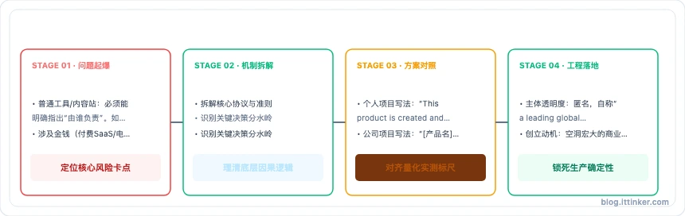
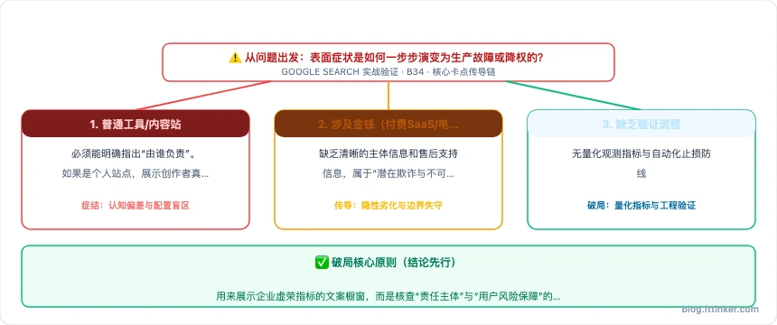
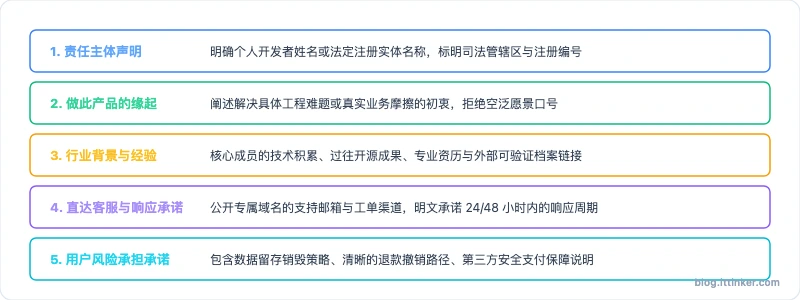
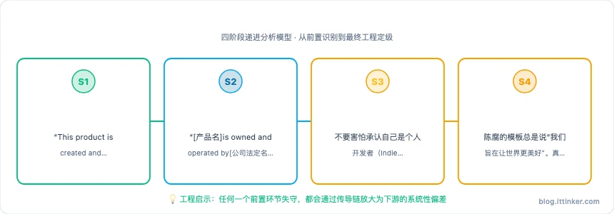
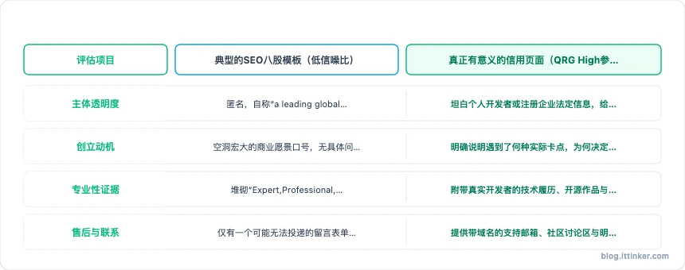
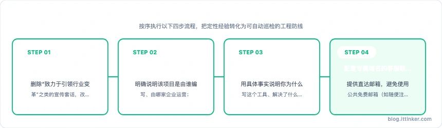

# About 页面到底应该写什么？跳出 SEO 八股模板，建立真正的责任主体信用 | 读懂 Google Search SEO 实战 系列 034

> 🌐 **在线阅读与互动版**：[About 页面到底应该写什么？跳出 SEO 八股模板，建立真正的责任主体信用 | 读懂 Google Search SEO 实战 系列 034](https://blog.ittinker.com/posts/about-页面到底应该写什么/)
> 📚 **所属专栏**：[《读懂 Google Search：110篇搜索质量与SEO实战指南》](../README.md)

---

### 📌 结论先行（TL;DR）
**在 Google 质量评估指南（QRG 2.5.2 与 2.5.3）的审查逻辑中，**About 页面并不是用来展示企业虚荣指标的文案橱窗，而是核查“责任主体”与“用户风险保障”的信用底账**。**

1. 评估员打开 About 页面只寻找两个答案：第一，出了法律争议、扣费错误或数据事故时，找谁承担法律与赔付责任；
2. 第二，幕后团队具备何种一手的行业背景，为什么有资格做这个工具。
3. 抛弃空泛的 AI 激情套话，补全实体法人/创始人、物理地域、真实联络邮箱与退款风控条款，才是页面摆脱 Low 级评级的硬指标。

在许多出海网站和独立工具的导航栏里，`About` 或 `About Us` 页面往往沦为最应付差事的摆设。

打开这些页面，扑面而来的往往是一段千篇一律的通用辞藻：“We are a group of passionate developers dedicated to revolutionizing productivity through AI...”（我们是一群充满热情的开发者，致力于通过 AI 变革生产力……）。

配图要么是 Unsplash 上的欧美白领握手图，要么干脆空空如也，连一个具体的个人名字或公司名称都没有。

很多独立开发者以为：“用户是来用工具的，没人看 About 页面，随便放个模板应付一下 SEO 就够了。”

但在 Google 质量评估员的标准作业程序中，**About 页面是每次质量定级必查的关键支点**。





---

## 1. 拆解 QRG 2.5.2 与 2.5.3：评估员在 About 页面找什么？

QRG 第 2.5 节《Finding Who is Responsible for the Website and Who Created the Content on the Page》对评估员做出了严格规范：

> *"Every website has an individual, company, or organization who is responsible for the website... You can usually find out who is responsible for the website by looking at the homepage, an 'About Us' page, or a 'Contact Us' page."*
>
> *"For YMYL pages and other types of pages where trust is critical (such as pages with financial transactions), it is important that the website provide information about who is responsible for the site and who created the content. A website that is not transparent about who is responsible may be untrustworthy."*

紧接着在 2.5.3 节《Finding Customer Service Information》，Google 进一步强化了交易保障要求：

> *"Websites that sell products, process financial transactions, or handle sensitive user data must have satisfying customer service information. If a store or financial transaction website has very little contact or customer service information, it should be rated Lowest."*

官方规则清晰界定了 About 页面的审查权重：
- **普通工具/内容站**：必须能明确指出“由谁负责”。如果是个人站点，展示创作者真实身份与技术经历；
- **涉及金钱（付费 SaaS/电商）或个人隐私（文件转换/数据存储）**：缺乏清晰的主体信息和售后支持信息，属于“潜在欺诈与不可信”，评估员会被指引直接定级为 Low 甚至 Lowest。





---

## 2. 真正有意义的 About 页面信息架构

一个能赢得评估员信任与海外付费用户认可的 About 页面，应该由以下五个互为支撑的模块构成：





---

## 3. 落地重构：把假大空文案转为信用实体

独立开发者在重写 About 页面时，可以按照以下五步进行结构化填充：

### 第一步：明确法律主体与现实坐标
不要害怕承认自己是个人开发者（Indie Maker）。在海外技术社区，一个有担当的独立黑客，信誉度往往远超一家皮包假公司。
- **个人项目写法**：“This product is created and maintained by [你的真实姓名], an independent software engineer based in [所在城市/国家].”
- **公司项目写法**：“[产品名] is owned and operated by [公司法定名称], registered in [注册地]，Company No. [商业登记号].”

### 第二步：解释产品产生的工程或业务事实
陈腐的模板总是说“我们旨在让世界更美好”。真正打动人的是具体的解决场景：
- “在搭建 Docker 集群时，我们发现配置反向代理和 SSL 证书往往要耗费新手开发者数小时排错，还经常出现配置泄露。于是我们构建了这个一键化配置检验器。”
这种描述展示了**一手的实战经验（First-hand Experience）**，与 QRG 要求的“Effort & Experience”高度契合。

### 第三步：挂载外部可验证的作者网络
在团队介绍或创作者简介后，附上真实的第三方凭证。评估员进行背调时会顺藤摸瓜：
- 个人 GitHub 主页（包含真实开源贡献记录）；
- 个人 LinkedIn 或 Twitter/X 长期账号；
- 技术刊物或社区知名讨论帖链接。

### 第四步：明示用户支持与服务级别（SLA）
在页面明显位置写明获得技术支持的有效方式：
- 拒绝使用没有回执的无名留言框；
- 给出格式为 `support@yourdomain.com` 的直连邮箱；
- 明确标注工单响应时间窗口（如“Mon-Fri within 24 hours”）。

### 第五步：注入 Schema.org 结构化元数据
在 About 页面的 HTML 中嵌入规范的 JSON-LD 数据，让 Google 爬虫与评估系统能程序化解析责任主体：

```html
<script type="application/ld+json">
{
  "@context": "https://schema.org",
  "@type": "AboutPage",
  "mainEntity": {
    "@type": "Organization",
    "name": "ITTinker",
    "url": "https://blog.ittinker.com",
    "founder": {
      "@type": "Person",
      "name": "Richardson",
      "jobTitle": "Independent Developer",
      "sameAs": [
        "https://github.com/ittinker-org",
        "https://x.com/ittinker"
      ]
    },
    "contactPoint": {
      "@type": "ContactPoint",
      "email": "support@ittinker.com",
      "contactType": "customer service"
    }
  }
}
</script>
```





---

## 4. 八股 About 模板 vs 真正有意义的信用页面对比

| 评估项目 | 典型的 SEO 八股模板（低信噪比） | 真正有意义的信用页面（QRG High 参照） |
| :--- | :--- | :--- |
| **主体透明度** | 匿名，自称“a leading global team”，无真实人名 | 坦白个人开发者或注册企业法定信息，给出所在地 |
| **创立动机** | 空洞宏大的商业愿景口号，无具体问题指向 | 明确说明遇到了何种实际卡点，为何决定编写此软件 |
| **专业性证据** | 堆砌“Expert, Professional, Trusted”等自封形容词 | 附带真实开发者的技术履历、开源作品与历史技术文章 |
| **售后与联系** | 仅有一个可能无法投递的留言表单，无任何承诺 | 提供带域名的支持邮箱、社区讨论区与明确的响应时效 |
| **风险规避** | 缺失退款与隐私解释，用户付款前充满疑虑 | 明文交代数据隐私范围、不上传凭据承诺与退款流程 |





---

## 5. 独立开发者 About 页面改造实操清单

请打开你当前站点的 About 页面，逐条核对以下整改项：

- [ ] **剔除所有虚无的假话**：删除“致力于引领行业变革”之类的宣传套话，改为具体的项目介绍；
- [ ] **公布确切的责任人姓名或主体**：明确说明该项目是由谁编写、由哪家企业运营；
- [ ] **写清研发背景与真实卡点**：用具体事实说明你为什么写这个工具、解决了什么特定难题；
- [ ] **配置专属域名的客服联络点**：提供直达邮箱，避免使用公共免费邮箱（如随便注册的 Gmail）；
- [ ] **明确给出支持时效承诺**：标明客服与技术支持的回复周期与支持语言；
- [ ] **提供退款政策与数据安全入口**：在页面底部或明显位置清晰链接 Terms、Privacy 与 Refund 政策；
- [ ] **部署 Schema 结构化数据**：已添加 `Organization` 或 `Person` 类型的 JSON-LD 代码并完成校验。





---

## 下一篇预告

在优化 About 页面时，大家最常加入的元素就是**作者简介（Author Bio）**。

在文章结尾放一个头像、写一段“资深架构师”的头衔，就等于拿到了 E-E-A-T 护身符吗？

许多网站花了大量力气做作者模块，却依然被 Google 判定为缺乏专业度。

下一篇，我们将解析 QRG 3.3.4 与 3.4：**[作者简介到底是不是 E-E-A-T？破除作者框迷信与可验证专业履历构建（B35）](/posts/作者简介到底是不是-e-e-a-t/)**。

---

_这是「读懂 Google Search」系列第 34 篇，系统拆解 Google 官方质量指南，帮你建立长期抗算法波动的出海 SEO 护城河。_


---

## 读懂 Google Search 专栏导航

> 📚 **专栏收录**：本文为 [《读懂 Google Search：110篇搜索质量与SEO实战指南》](/posts/google-search-guide/) 第 **B34** 篇。

* **专栏主页**：[《读懂 Google Search：110篇搜索质量与SEO实战指南》全景地图与路线图](/posts/google-search-guide/)
