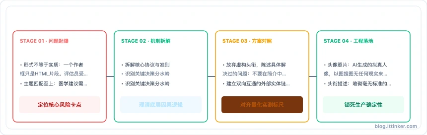
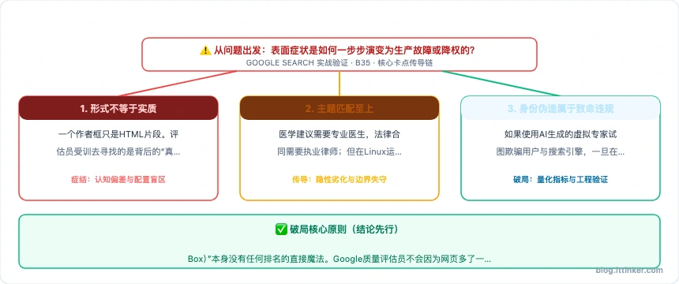
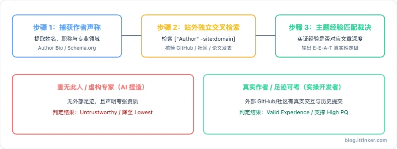
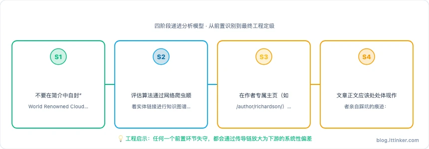
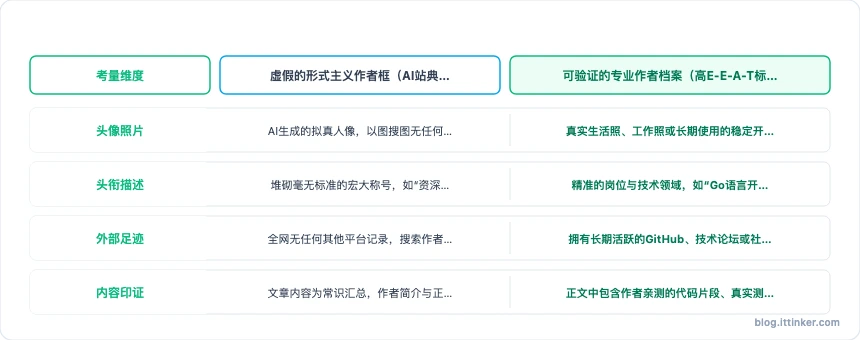
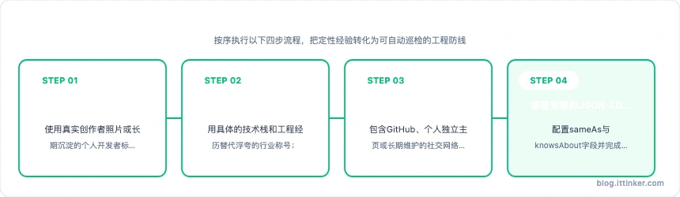

# “在文章底部挂个头像就是 E-E-A-T”？作者框装饰品的大清算：虚假作者盒正在害死你，如何构建真实可验证的专业履历？ | 读懂 Google Search SEO 实战 系列 035

> 🌐 **在线阅读与互动版**：[“在文章底部挂个头像就是 E-E-A-T”？作者框装饰品的大清算：虚假作者盒正在害死你，如何构建真实可验证的专业履历？ | 读懂 Google Search SEO 实战 系列 035](https://blog.ittinker.com/posts/作者简介到底是不是-e-e-a-t/)
> 📚 **所属专栏**：[《读懂 Google Search：110篇搜索质量与SEO实战指南》](../README.md)

---

### 📌 结论先行（TL;DR）
> **在 Google 官方评审指南（QRG 3.4）中，**页面上的“作者简介框（Author Box）”本身没有任何排名的直接魔法**。**
> **很多出海站长在听到“Google 重视 E-E-A-T”之后，立刻指挥前端工程师在所有文章页面底部加上一个作者简介卡片。**
> **这些卡片通常长得一模一样：**
> **做完之后，站长们自信满满地认为自己的网站已经完成了 E-E-A-T 改造。**
> **然而，随后的核心算法更新中，这类站点的流量依然发生断崖式下跌。评估员与算法究竟是如何识破这种“形式主义 E-E-A-T”的？**
>
> - Google 质量评估员不会因为网页多了一段 CSS 样式的作者简介就认定其具备高 E-E-A-T。
> - 评估员执行的是“主题需求匹配”与“站外证据核查”：对于日常动手工具与实战教程，核心是考察作者是否具备真实可复现的操作经验（Experience）；
> - **对于高危 YMYL 话题**：则要求无可辩驳的专业资质（Expertise）。
> - **如果作者框填写的身份在全网查无此人**：它不过是一段无效的 HTML 标记。
> - 一张 Midjourney 生成的无瑕疵人脸；
> - **一个听起来很厉害的头衔**：“Senior AI Researcher”或“Tech Strategist”；
> - 一段由 ChatGPT 编写的泛化介绍：“John has over 10 years of experience in cloud computing and software architecture...”





---


### 🚨 2026 → 2024 官方最新风向预警：Google 对Google 针对虚假作者框（Fake Author Bios）与实体知识库核验的演进的策略演进

#### 🕒 2026 → 2024 Google 官方对Google 针对虚假作者框（Fake Author Bios）与实体知识库核验的演进的策略演进

- **2026 · 虚构作者特征与 AI 肖像大面积拔除（Author Persona Scraping）**
  算法深度学习识别利用 Midjourney 批量生成的假作者头像、以及编造的所谓‘资深架构师’头衔。挂载虚假作者信息的网站被系统判定为欺骗性设计并遭受整站降权。

- **2025 · 可验证的跨站专业履历沉淀（Author Entity Footprint）**
  真正的 E-E-A-T 要求作者在 LinkedIn、X/Twitter、GitHub 或权威技术论坛拥有真实活跃的足迹，并能通过 SameAs 结构化数据形成互信知识网络。

- **2024 · QRG 3.4 节对内容创作者真实背景审查的指导准则**
  指引严厉警告评估员不要被精美的前端作者框所蒙蔽，必须通过外部独立搜索验证作者是否真的具备在该专业领域发声的合法资格。


---


## 1. 拆解 QRG 3.3.4 与 3.4：作者框不是 E-E-A-T，经验与匹配才是

在 QRG 第 3.4 节《Experience, Expertise, Authoritativeness, and Trust (E-E-A-T)》中，Google 对内容创作者的考察标准有着清晰的界定：

> *"Consider the extent to which the content creator has first-hand or life experience for the topic... Does the content creator have the necessary knowledge or skill for the topic? Different topics require different levels and types of E-E-A-T to be considered High quality."*
>
> *"Trust is the most important member of the E-E-A-T family... A website or content creator with a conflict of interest, or who misrepresents their identity, is not trustworthy."*

紧接着在第 3.3.4 节中，关于创作者的外部核查逻辑更是直截了当：

> *"Try to find what independent sources say about the content creator. Looking for independent reviews, references, news articles, and other credible information written about the individual."*

从官方准则中，我们可以提取出三条裁决逻辑：

1. **形式不等于实质**：一个作者框只是 HTML 片段。评估员受训去寻找的是背后的“真实创造者（Who created the content）”，而不是看前端页面设计有多精美。
2. **主题匹配至上**：医学建议需要专业医生，法律合同需要执业律师；但在 Linux 运维、Docker 容器编排或独立开发领域，一个有 5 年提交记录的开源作者，其信任度远高于挂着所谓“数字营销顾问”头衔的写手。
3. **身份伪造属于致命违规**：如果使用 AI 生成的虚拟专家试图欺骗用户与搜索引擎，一旦在站外声誉调查中露出马脚，直接触发 QRG 4.5 不可信判定，全站质量评级降至 Lowest。





---

## 2. Google 评估员核查作者信用的决策流程

当评估员看到文章中的作者署名时，其审查链路可以用以下决策矢量图直观体现：





---

## 3. 怎样构建一个具备可信效力的作者档案？

针对出海技术站与独立 SaaS 博客，构建作者信用体系需要遵循“实证驱动”原则。

### 1. 放弃虚构头衔，陈述具体解决过的问题
不要在简介中自封“World Renowned Cloud Architect”。改用精确的事实描述：
- “负责维护开源项目 `ittinker-scripts`，持续跟踪 Linux 内核安全补丁与 Docker 容器隔离技术；”
- “过去 3 年在生产环境中管理了超过 50 个高并发 VPS 节点，专注于出海服务基础设施调优。”
具体的工程数字与场景，远比空洞的宏大词汇更有说服力。

### 2. 建立双向互通的外部实体链接（SameAs）
评估算法通过网络爬虫顺着实体链接进行知识图谱对齐。在作者简介中必须包含真实的第三方档案：
- 真实的 GitHub Profile 链接（展现活跃的 Commit 绿格子与提交历史）；
- 个人专栏或 Stack Overflow / Reddit 答疑主页；
- 个人 X (Twitter) 账号。

### 3. 配置标准的 JSON-LD Person 结构化数据
在作者专属主页（如 `/author/richardson/`）与文章页嵌入结构化标记，确保搜索引擎精准识别主体属性：

```json
{
  "@context": "https://schema.org",
  "@type": "Person",
  "name": "Richardson",
  "url": "https://blog.ittinker.com/author/richardson",
  "jobTitle": "Independent Software Engineer & DevOps Lead",
  "worksFor": {
    "@type": "Organization",
    "name": "ITTinker"
  },
  "sameAs": [
    "https://github.com/ittinker-org",
    "https://x.com/ittinker_dev"
  ],
  "knowsAbout": [
    "Docker Containerization",
    "Linux Server Hardening",
    "Cloudflare Edge Infrastructure",
    "Google Quality Rater Guidelines"
  ]
}
```

### 4. 正文内容与作者经历产生共振
文章正文应该处处体现作者亲自踩坑的痕迹：
- 贴出带有时间戳的终端报错信息；
- 记录排查内存泄漏的具体工具与命令；
- 说明为什么某个常用方案在特定生产环境下会失效。
这些无法被大语言模型凭空捏造的一手细节，才是证明作者真才实学的最硬核证据。





---

## 4. 虚假作者框 vs 可验证专业履历对比

| 考量维度 | 虚假的形式主义作者框（AI 站典型） | 可验证的专业作者档案（高 E-E-A-T 标杆） |
| :--- | :--- | :--- |
| **头像照片** | AI 生成的拟真人像，以图搜图无任何现实来源 | 真实生活照、工作照或长期使用的稳定开发者 Avatar |
| **头衔描述** | 堆砌毫无标准的宏大称号，如“资深国际战略家” | 精准的岗位与技术领域，如“Go 语言开发者 / 基础设施运维” |
| **外部足迹** | 全网无任何其他平台记录，搜索作者名结果为空 | 拥有长期活跃的 GitHub、技术论坛或社交媒体公开记录 |
| **内容印证** | 文章内容为常识汇总，作者简介与正文无深度联系 | 正文中包含作者亲测的代码片段、真实测试用例与错误复盘 |
| **欺诈风险** | 涉及捏造虚假专业人士，极易触发 QRG 4.5 降权 | 诚实陈述个人能力边界，不虚构权威资质，合规安全 |





---

## 5. 作者档案与专业度落地检查清单

请对照以下清单，审查你站点当前的所有作者页面：

- [ ] **坚决不使用虚假 AI 头像欺骗读者**：使用真实创作者照片或长期沉淀的个人开发者标识；
- [ ] **精简并坐实技术头衔**：用具体的技术栈和工程经历替代浮夸的行业称号；
- [ ] **挂载 2 个以上的外部高权重真实链接**：包含 GitHub、个人独立主页或长期维护的社交网络账号；
- [ ] **部署完整的 JSON-LD Person 标记**：配置 `sameAs` 与 `knowsAbout` 字段并完成结构体验证；
- [ ] **建立作者专属归档主页**：点击作者名字可进入专属 Profile 页面，汇总其所有原创技术产出；
- [ ] **核验正文内容的一手经验属性**：确保作者在文章中分享的是真实跑通的代码和排错心路，而非机械洗稿。





---

## 下一篇预告

澄清了作者简介与真实履历的判定逻辑后，我们必须面对网站文案中的另一个顽疾：**到处宣称自己“最强、最好、最可信”**。

“Best Tool for Exporting SVG”、“Trusted by 10,000+ teams”、“Ultra Fast & 100% Secure”……

这些随处可见的营销文案，在 Google 评估员眼里到底属于亮点还是风险？

下一篇，我们将拆解 QRG 3.2 与 4.5：**[“自称业内领先、性能最好却拿不出证据”？自说自话的信任崩塌：Claim → Evidence 实战模型彻底终结空口吹嘘（B36）](/posts/claim-evidence-实战模型/)**。

---

_这是「读懂 Google Search」系列第 35 篇，系统拆解 Google 官方质量指南，帮你建立长期抗算法波动的出海 SEO 护城河。_


---

## 读懂 Google Search 专栏导航

> 📚 **专栏收录**：本文为 [《读懂 Google Search：110篇搜索质量与SEO实战指南》](/posts/google-search-guide/) 第 **B35** 篇。

* **专栏主页**：[《读懂 Google Search：110篇搜索质量与SEO实战指南》全景地图与路线图](/posts/google-search-guide/)
