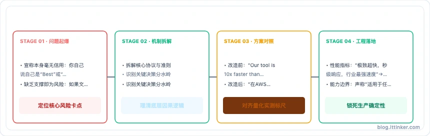
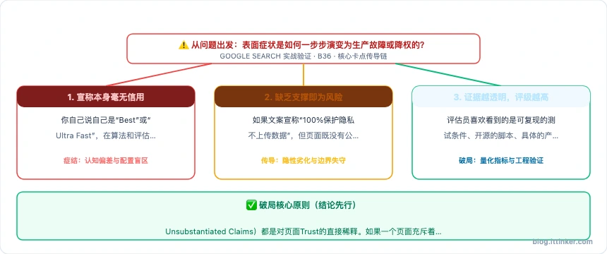
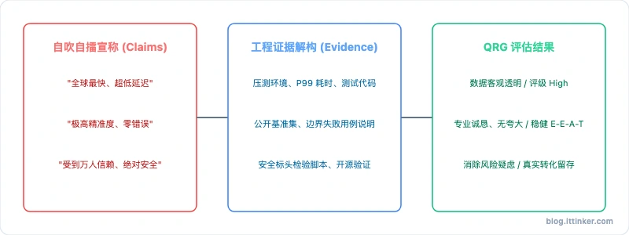
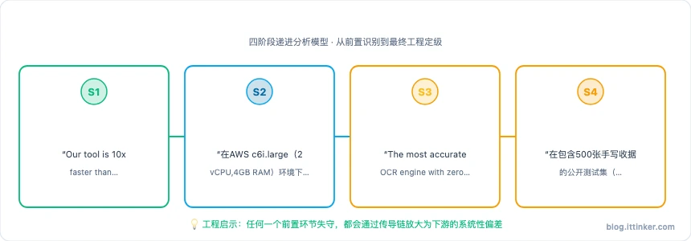
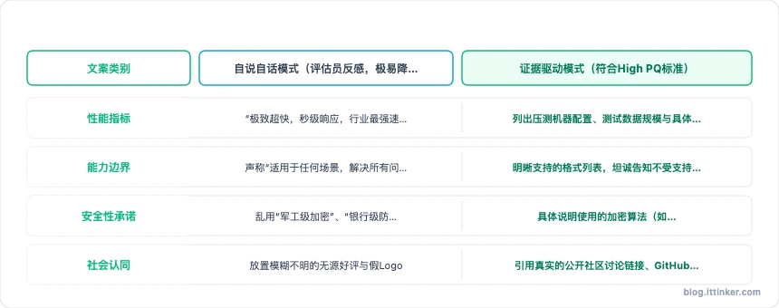
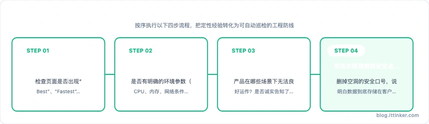

# “空口无凭谁会相信”？Claim-Evidence 实战证明模型 | 读懂 Google Search SEO 实战 系列 036

> 🌐 **在线阅读与互动版**：[“空口无凭谁会相信”？Claim-Evidence 实战证明模型 | 读懂 Google Search SEO 实战 系列 036](https://blog.ittinker.com/posts/claim-evidence-实战模型/)
> 📚 **所属专栏**：[《读懂 Google Search：110篇搜索质量与SEO实战指南》](../README.md)

---

### 📌 结论先行（TL;DR）
> **在 Google 质量评估指南（QRG 3.2 与 4.5）中，**任何未经证实的空泛宣称（Unsubstantiated Claims）都是对页面 Trust 的直接稀释**。**
> **随便打开十个海外独立开发者的 Landing Page 或技术博客，你几乎总能读到这类文案：**
> **文案写得激情澎湃，但往下翻看内容，全站连一个基准测试环境说明都没有，也没有公开的压测数据脚本，更没有这 50,000 个用户的任何真实来源说明。**
> **很多站长误以为：把文案吹得越宏大，转化率越高，搜索引擎越会认为产品实力雄厚。**
> **然而在 Google 评估体系中，这种行为被称为“自吹自擂（Self-Serving Promotional Fluff）”，甚至可能直接触发欺诈降级。**
>
> - 如果一个页面充斥着“最快、最强、绝对安全、行业第一”等自说自话的形容词，却没有提供可复现的基准测试、公开的代码示例或第三方可验证依据，评估员会将其判定为主观夸大的低质甚至不可信页面。
> - 建立高等级 E-E-A-T 的核心法则就是“断言即举证（Every claim requires an artifact）”：把每一个主观推销词，转化为用户和审查员可亲眼复核的客观工程证据。
> - “The fastest image compressor in the world.”（全球最快的图片压缩器）
> - “Trusted by over 50,000 satisfied developers.”（受到 50,000+ 满意开发者的信赖）
> - **“100% secure**：bulletproof server optimization.”（百分之百安全、防弹级的服务器调优）
> - “Enterprise-ready architecture with ultra-high accuracy.”（具备超高准确度的企业级架构）





---


### 🚨 2026 → 2024 官方最新风向预警：Google 对Google 对主张必须有实证（Claim-Evidence Verification）的判定演进的策略演进

#### 🕒 2026 → 2024 Google 官方对Google 对主张必须有实证（Claim-Evidence Verification）的判定演进的策略演进

- **2026 · 主张与实证语义对齐分析（Claim-to-Evidence Verification Engine）**
  Google 算法深度解构商业文案中的‘最佳、最快、零延迟’等定性主张。若正文未能提供可复现的基准测试命令、公开测试集跑分或开源测试代码，系统自动将其标记为空口吹嘘并降档处理。

- **2025 · 虚标与过度营销反噬（Anti-Puffery Enforcement）**
  算法强化对广告法违禁极限词与虚假宣传的识别，优先展示用客观图表、错误率曲线与硬核参数说话的克制技术文档。

- **2024 · QRG 3.2 节关于主张必须具备实质性证据支撑的评级法则**
  指引指导评估员：对于任何技术或商业主张，必须严格核实其论据链条是否完整，缺乏佐证的自嗨文案一律定为 Low Effort。


---


## 1. 拆解 QRG 3.2、3.4 与 4.5：Google 对“无证据宣称”的判定准则

在 QRG 第 3.2 节《Quality of the Main Content》中，Google 强调了主内容可信度对于质量等级的决定性作用：

> *"High quality MC should demonstrate effort, originality, talent, or skill... For informational pages, high quality MC should be accurate, clearly written, and comprehensive. Pages with unsubstantiated claims or misleading information cannot be considered High quality."*

在 QRG 第 4.5 节《Untrustworthy Webpages or Websites》中，指引更为严厉：

> *"A website or webpage may be untrustworthy if it makes claims that are widely known to be false, makes claims without evidence that are important for users to understand, or presents itself in a misleading way. Pages with exaggerated or unsubstantiated claims may be rated Lowest if they have the potential to mislead or harm users."*

官方文本揭示了一个清晰的技术界限：
1. **宣称本身毫无信用**：你自己说自己是“Best”或“Ultra Fast”，在算法和评估员眼里权重为零。任何有商业动机的网站都会夸赞自己；
2. **缺乏支撑即为风险**：如果文案宣称“100% 保护隐私不上传数据”，但页面既没有公开代码开源地址，网络控制台（Network Tab）里又显示了频繁的远程数据上报，该行为就会被直接定性为欺诈；
3. **证据越透明，评级越高**：评估员喜欢看到的是可复现的测试条件、开源的脚本、具体的产品指标界限，这些是真正凝聚了“Effort（心血投入）”的黄金证据。





---

## 2. Claim → Evidence 转化实战模型

为了消除页面上的“自说自话”，我们需要建立一套严格的文案转化流水线。每个核心宣称都必须通过证据层进行解构：





---

## 3. 四大典型文案的工程化改造示范

### 场景一：性能断言（Speed & Performance）
- **改造前**：“Our tool is 10x faster than traditional software.”（我们的工具比传统软件快 10 倍）
- **改造后**：“在 AWS c6i.large（2 vCPU, 4GB RAM）环境下，对 10,000 行格式不规范的 JSON 文本进行校验解析，处理耗时为 14.2ms，而标准 Python `json.loads` 耗时为 128.6ms。测试脚本已开源于 GitHub。”

如果你在介绍自己的服务器性能或运维监控方案，直接把测试脚本与输出贴给读者。例如在 `ittinker-scripts` 中，我们通过开源监控脚本提供公开验证能力：

```bash
# 获取基准监控测试脚本
git clone https://github.com/ittinker-org/ittinker-scripts.git
cd ittinker-scripts/vps-health-monitor

# 运行自动化资源负载与 I/O 吞吐测试并生成报告
./vps-health-monitor.sh --benchmark
```

当评估员或专业读者看到你给出了完全透明的复现命令，你根本不需要说自己“快”，数字已经替你给出了答案。

### 场景二：准确度断言（Accuracy & Precision）
- **改造前**：“The most accurate OCR engine with zero errors.”（零误差的最准 OCR 引擎）
- **改造后**：“在包含 500 张手写收据的公开测试集（Receipt-Bench-v1）上测试，字元识别准确度（Character Accuracy）达到 96.8%。对于倾斜角度大于 45 度或油墨褪色的图片，识别准确度会下降至 82%，建议在预处理环节进行对比度矫正。”

敢于公开产品的边界条件与缺陷，不仅不会吓跑用户，反而会在评估员心目中树立极高的技术可信度（Authentic Technical Experience）。

### 场景三：安全性断言（Security & Privacy）
- **改造前**：“Your files are 100% private and military-grade secured.”（你的文件绝对私密，军工级安全）
- **改造后**：“所有图片转码均在浏览器本地借助 WebAssembly（WASM）完成，无任何网络字节回传至云端服务器；你可以随时打开 Chrome 开发者工具的 Network 选项卡核验，处理过程完全离线运行。”

### 场景四：规模与用户群体断言（Scale & Popularity）
- **改造前**：“Loved by thousands of top enterprises worldwide.”（受到全球数千家顶级企业的喜爱）
- **改造后**：“自 2026 年 8 月开源上线以来，GitHub 仓库累积获得 450+ 颗星标，被 12 个公开 Docker 项目作为基础镜像依赖。每周处理超过 3,000 次 CLI 调度请求。”





---

## 4. 自说自话文案 vs 证据驱动文案全面对比

| 文案类别 | 自说自话模式（评估员反感，极易降级） | 证据驱动模式（符合 High PQ 标准） |
| :--- | :--- | :--- |
| **性能指标** | “极致超快，秒级响应，行业最强速度” | 列出压测机器配置、测试数据规模与具体百分位响应耗时（P95/P99） |
| **能力边界** | 声称“适用于任何场景，解决所有问题” | 明晰支持的格式列表，坦诚告知不受支持的边缘情况与失败处理逻辑 |
| **安全性承诺** | 乱用“军工级加密”、“银行级防护”等玄学名词 | 具体说明使用的加密算法（如 AES-GCM-256）、密钥轮换机制或离线沙箱机制 |
| **社会认同** | 放置模糊不明的无源好评与假 Logo | 引用真实的公开社区讨论链接、GitHub Issue 解决记录或客户案例复盘 |
| **工程心血** | 纯文字概括，无任何可执行产出物 | 附带完整的测试代码库、可运行的 Docker Compose 配置或 CLI 诊断命令 |





---

## 5. 网页文案去水自检清单

在每次发布落地页或技术文章前，请执行以下“去水排查”：

- [ ] **全局搜寻形容词最高级**：检查页面是否出现“Best”、“Fastest”、“Most Advanced”，每一个都必须替换为带单位的度量指标；
- [ ] **核验性能承诺复现性**：是否有明确的环境参数（CPU、内存、网络条件、样本规模）以供读者复现？
- [ ] **主动标明技术局限性**：产品在哪些场景下无法良好运作？是否诚实告知了降级策略？
- [ ] **用技术原理解释安全承诺**：删掉空洞的安全口号，说明白数据到底存储在客户端还是服务端、数据何时被自动抹除；
- [ ] **开源可验证的代码或脚本**：关键核心流程是否提供了终端命令或 GitHub 开源代码仓库作为实证？





---

## 下一篇预告

既然自吹自擂的文案一文不值，很多站长就会想到借用他人的嘴：“那我放用户的 **Reviews（用户评价）** 总可以了吧？”

把客户好评截个图贴在页面上，或者花钱刷一堆 5 星评价，能在 Google 评估员那里通过审核吗？

下一篇，我们将拆解 QRG 3.3.2：**[“产品刚上线自己刷十条好评冲门面”？搬起石头砸自己的脚：分清转化诱饵、虚假背书与真实声誉的界限（B37）](/posts/用户-reviews-对新产品到底有多大价值/)**。

---

_这是「读懂 Google Search」系列第 36 篇，系统拆解 Google 官方质量指南，帮你建立长期抗算法波动的出海 SEO 护城河。_


---

## 读懂 Google Search 专栏导航

> 📚 **专栏收录**：本文为 [《读懂 Google Search：110篇搜索质量与SEO实战指南》](/posts/google-search-guide/) 第 **B36** 篇。

* **专栏主页**：[《读懂 Google Search：110篇搜索质量与SEO实战指南》全景地图与路线图](/posts/google-search-guide/)
