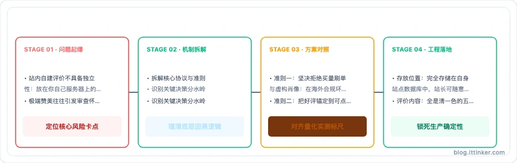
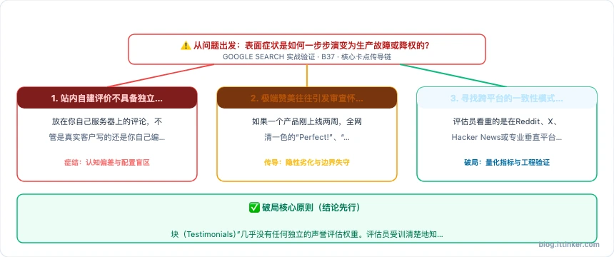
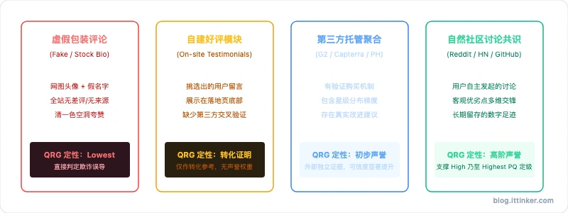
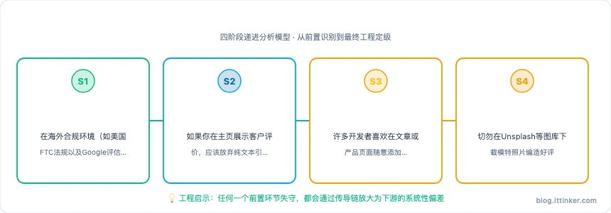
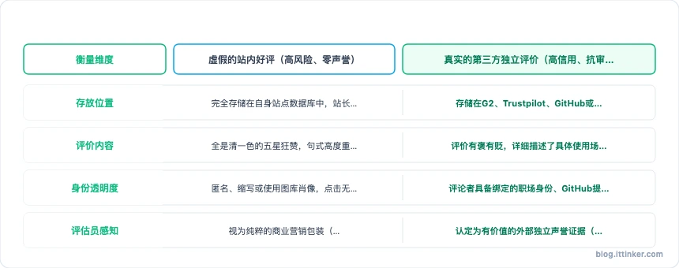
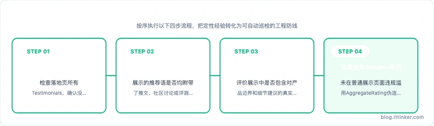

# 用户 Reviews 对新产品到底有多大价值？分清转化诱饵、虚假背书与声誉证据 | 读懂 Google Search SEO 实战 系列 037

> 🌐 **在线阅读与互动版**：[用户 Reviews 对新产品到底有多大价值？分清转化诱饵、虚假背书与声誉证据 | 读懂 Google Search SEO 实战 系列 037](https://blog.ittinker.com/posts/用户-reviews-对新产品到底有多大价值/)
> 📚 **所属专栏**：[《读懂 Google Search：110篇搜索质量与SEO实战指南》](../README.md)

---

### 📌 结论先行（TL;DR）
**在 Google 质量评估指南（QRG 3.3.2）的定义中，**网站自己展示的“客户好评模块（Testimonials）”几乎没有任何独立的声誉评估权重**。**

1. 评估员受训清楚地知道：任何站长都可以挑选有利好评、甚至凭空捏造带虚假头像的 5 星赞美。
2. 真正能被 Google 采纳为 Reputation 证据的，只能是托管在受控权限之外的第三方独立平台评价（如 G2、Capterra、Trustpilot、GitHub 真实 Issue 与论坛讨论）。
3. 伪造虚假评论不仅无法提升评级，更会因为违反 QRG 4.5 的诚实准则而导致整站被定级为 Lowest。

在很多 SaaS 独立开发者的起步清单里，“弄几个好看的 Testimonials（用户推荐语）”常常被列为高优先级任务。

大家习惯去买现成的 UI 组件，把 3 到 4 个精美的卡片横排在首页：
- 头像是一名金发碧眼的外国小哥或职场精英；
- 名字是“Alex M., Senior Product Manager”；
- 内容是“This tool completely changed my daily workflow! 10/10 recommended!”。

做完这些，大家便觉得“社会认同（Social Proof）”已经有了，Google 评估员来看了一定会觉得这个产品备受赞誉。

这是对搜索引擎评审机制的巨大误解。在评估员眼里，这种“自产自销”的好评到底值多少分？

---

## 1. 拆解 QRG 3.3.2：Google 评估员如何看待 Customer Reviews？

在 QRG 第 3.3.2 节《Customer Reviews of Businesses》中，Google 对用户评价的效力与局限性给出了极为冷静的分析：

> *"Customer reviews can be helpful for assessing the reputation of a store or business. However, you should consider the following:*
>
> *- Try to find as many reviews as possible. A large number of detailed, trustworthy reviews is better than a few reviews.*
>
> *- Look for independent reviews written by real people. Be skeptical of reviews written by the website itself, as they are not independent.*
>
> *- Be skeptical of very positive or very negative reviews. Look for patterns in the reviews rather than focusing on one or two individual comments."*

在这段指南中，Google 划定了三个核心界限：

1. **站内自建评价不具备独立性**：放在你自己服务器上的评论，不管是真实客户写的还是你自己编的，在评估员的判定天平上都只属于“网站自己声称的内容（Self-claims）”，不计入外部声誉加分。
2. **极端赞美往往引发审查怀疑**：如果一个产品刚上线两周，全网清一色的“Perfect!”、“Best ever!”，没有任何关于功能边界、使用限制或改进建议的讨论，评估员会被引导提高警惕，排查是否存在买量刷单。
3. **寻找跨平台的一致性模式（Patterns）**：评估员看重的是在 Reddit、X、Hacker News 或专业垂直平台上，真实用户在不同时间节点自发形成的口碑共识。

---

## 2. 用户评价的可信度光谱

不同形态的评价在评估员和潜在客户眼中的价值天差地别。以下矢量图展现了从虚假自嗨到高价值声誉的信任层级演进：

---

## 3. 正确构建有效 Social Proof 的三条落地准则

在新产品冷启动阶段，出海团队应该如何处理用户反馈，才能既利于转化，又经受得住 Google 评估员的推敲？

### 准则一：坚决拒绝买量刷单与虚构肖像
在海外合规环境（如美国 FTC 法规以及 Google 评估指南），购买虚假评论或伪造背书均属严重欺诈。
- 切勿在 Unsplash 等图库下载模特照片编造好评；
- 哪怕早期只有 2 条真实评价，也胜过 100 条由 AI 批量生成的赞美辞；
- 真实客户的批评（例如“界面有点卡，但解决了我批量处理的难题”）反而能强化评价体系的可信度。

### 准则二：把好评锚定到可点击的外部实体
如果你在主页展示客户评价，应该放弃纯文本引用，改用“可溯源嵌入”：
- 嵌入来自 X（Twitter）的真实公开发推（附带作者原推文直达链接）；
- 嵌入 GitHub Issue 或 Pull Request 中贡献者的公开赞赏与代码合并记录；
- 嵌入 Product Hunt 或 G2 经过企业邮箱验证的 Review 徽章。
当读者或评估员点击链接能跳转至第三方权威平台并核实该作者的真实性时，原本的主观宣称就跃升为了硬核的外部证据。

### 准则三：正确配置 Review 结构化数据（Schema.org）
许多开发者喜欢在文章或产品页面随意添加 `AggregateRating` 结构化数据，试图在 Google 搜索结果中骗取富文本金色星标（Rich Snippets）。

必须遵循 Google Search Central 的明确技术规范：
- 自托管的自我评价页面**不得标记自己**（Self-serving reviews are not allowed）；
- 只有真正的第三方独立聚合内容，或具备清晰交易流程的独立电商商品，才能合法配置星级 Schema；
- 滥用结构化数据会导致网站收到“结构化数据人工处置惩罚（Manual Action）”，直接丧失富媒体搜索结果资格。

---

## 4. 虚假营销评价 vs 真实第三方声誉对比

| 衡量维度 | 虚假的站内好评（高风险、零声誉） | 真实的第三方独立评价（高信用、抗审查） |
| :--- | :--- | :--- |
| **存放位置** | 完全存储在自身站点数据库中，站长可随意增删改 | 存储在 G2、Trustpilot、GitHub 或 Reddit 等独立第三方平台 |
| **评价内容** | 全是清一色的五星狂赞，句式高度重复，无任何负面 | 评价有褒有贬，详细描述了具体使用场景、优点与尚存瑕疵 |
| **身份透明度** | 匿名、缩写或使用图库肖像，点击无任何外部跳转 | 评论者具备绑定的职场身份、GitHub 提交历史或真实社区等级 |
| **评估员感知** | 视为纯粹的商业营销包装（Self-promotional text） | 认定为有价值的外部独立声誉证据（Independent Reputation） |
| **对排名影响** | 对搜索排名与 E-E-A-T 评级无任何促进作用 | 形成稳定的品牌搜索实体，为 High 级质量评定奠定根基 |

---

## 5. 用户评价与社交证明自查清单

在整理你产品的用户反馈模块时，对照以下清单逐项校对：

- [ ] **彻底清退假肖像**：检查落地页所有 Testimonials，确认没有使用图库下载的无版权职场人像；
- [ ] **提供外部原贴链接**：展示的推荐语是否均附带了推文、社区讨论或评测原文的直达外链？
- [ ] **坦然保留合理瑕疵**：评价展示中是否包含对产品边界和细节建议的真实陈述？
- [ ] **合规使用 Schema 标记**：未在普通展示页面违规滥用 `AggregateRating` 伪造星标；
- [ ] **拓展第三方评测沉淀**：是否已在 Product Hunt、G2 或垂直开源社区建立官方档案，引导真实用户前往独立阵地留言？

---

## 下一篇预告

既然站内的自我标榜和自编好评价值有限，那么 Google 评估员到底是如何在浩瀚的互联网中，**精准调查一个品牌的第三方真实口碑**的？

为什么业内常说“外部媒体的一句话，顶得上自己写十页 About”？

下一篇，我们将拆解 QRG 3.3.1 至 3.3.5：**[第三方评价为什么碾压自吹自擂？QRG 独立声誉调查法与外部讨论沉淀（B38）](/posts/第三方评价为什么碾压自吹自擂/)**。

---

_这是「读懂 Google Search」系列第 37 篇，系统拆解 Google 官方质量指南，帮你建立长期抗算法波动的出海 SEO 护城河。_

---

## 读懂 Google Search 专栏导航

> 📚 **专栏收录**：本文为 [《读懂 Google Search：110篇搜索质量与SEO实战指南》](/posts/google-search-guide/) 第 **B37** 篇。

* **专栏主页**：[《读懂 Google Search：110篇搜索质量与SEO实战指南》全景地图与路线图](/posts/google-search-guide/)
