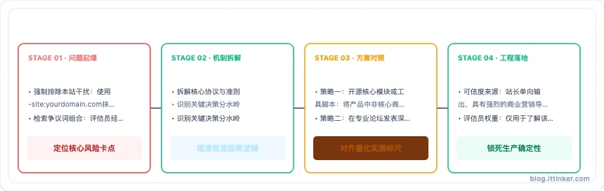
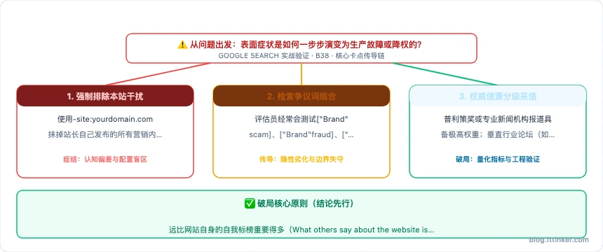
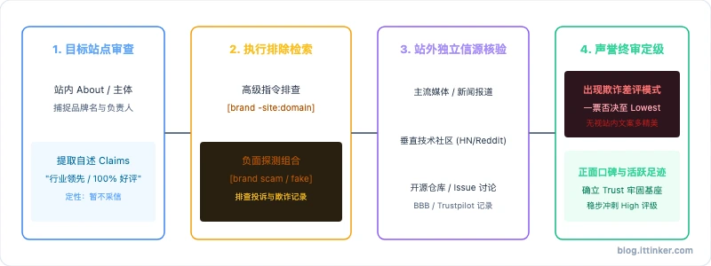
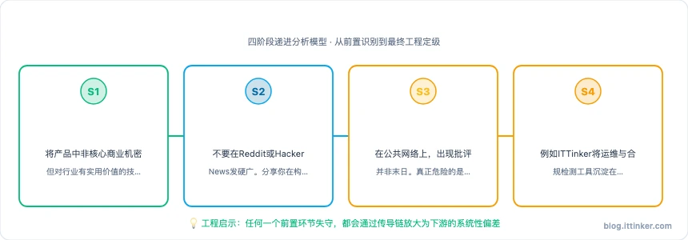
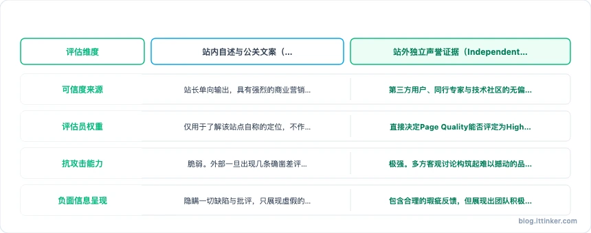
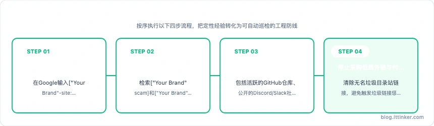

# “在自己网站写一万句好话抵不过 Reddit 一条真实吐槽”？外部讨论的绝对权重：第三方独立声誉如何决定你的生死？ | 读懂 Google Search SEO 实战 系列 038

> 🌐 **在线阅读与互动版**：[“在自己网站写一万句好话抵不过 Reddit 一条真实吐槽”？外部讨论的绝对权重：第三方独立声誉如何决定你的生死？ | 读懂 Google Search SEO 实战 系列 038](https://blog.ittinker.com/posts/第三方评价为什么碾压自吹自擂/)
> 📚 **所属专栏**：[《读懂 Google Search：110篇搜索质量与SEO实战指南》](../README.md)

---

### 📌 结论先行（TL;DR）
> **Google 在 QRG 3.3.1 中确立了一条核心准则：**“外部独立人士对网站的评价，永远比网站自身的自我标榜重要得多（What others say about the website is much more important than what the website says about itself）”**。**
> **在出海开发过程中，很多技术人员习惯把精力倾注在站内的细节打磨上：**
> **然而，当这些站点遭遇 Google 核心算法更新时，常常困惑于流量的持续低迷：“我的网站内容这么充实，排版这么高级，为什么 Google 始终不给我头部排名？”**
> **答案就藏在评估员的操作规范中：**当评估员要给一个网站的 Trust 打分时，他们会毫不犹豫地跳出你的网站**。**
> **在官方评估机制中，站内的文字写得再华丽，终究属于“自证（Self-claims）”。真正决定评级上限的，是外部公共互联网上沉淀的真实声音。**
>
> - 评估员被明确要求使用 `[品牌名 -site:域名]` 等排除语法，绕开站内的公关文案，直奔新闻报道、行业维基、垂直技术论坛以及争议投诉库。
> - 哪怕站内写了十页无可挑剔的 About 文档，一旦站外出现一致性的欺诈差评或虚假宣传丑闻，页面评级将被一票否决至 Lowest。
> - **重新设计精美的 Pricing 表格**：
> - 给 About 页面补充了详尽的公司使命愿景；
> - **在每个落地页写满专业术语**：

---

### 🚨 2026 → 2024 官方最新风向预警：Google 对Google 引入 Reddit、Quora 与独立论坛真实讨论权重的算法演进的策略演进

#### 🕒 2026 → 2024 Google 官方对Google 引入 Reddit、Quora 与独立论坛真实讨论权重的算法演进的策略演进

- **2026 · 外部社群真实口碑共识模型（Third-party Community Consensus）**
  Google 在搜索结果中大幅提升了 Reddit、Hacker News、V2EX 等独立论坛中的真实讨论权重。如果全网独立社群对某产品充斥着‘退款困难、骗局、功能虚标’的负面反馈，该站核心词排名遭遇断崖式封杀。

- **2025 · 公关水军在独立社区的渗透清退**
  算法结合社区账号活跃度、发帖历史与社区声誉积分，过滤收买账号发布的虚假种草贴，只采信长期真实用户的真实踩坑与推荐。

- **2024 · QRG 3.3 节关于独立声誉调查（Reputation Research）的权威标准**
  指引严正告诫站长：信誉不是你自己说了算的，全网同行的真实议论才是决定你的网站能否跨入顶级可信梯队的唯一法庭。

---

## 1. 拆解 QRG 3.3.1 至 3.3.3：评估员的站外搜索指令与证据分级

在 QRG 第 3.3.1 节《Researching Reputation Information》中，Google 明确了外部调查的必要性：

> *"Reputation information is important for Page Quality rating. A website's reputation is based on the experience of real users, as well as the opinion of people who are experts in the topic. What independent sources say about the website or creator is much more important than what they say about themselves."*

在第 3.3.3 节《How to Search for Reputation Information》中，Google 甚至手把手教评估员如何执行搜索：

> *"To find reputation information about a website or company, try searching for the company name, website name, or URL. You can exclude results from the website itself using search operators like: [ibm -site:ibm.com]."*
>
> *"Look for articles, reviews, forum discussions, and other credible information written by individuals or organizations independent of the website."*

根据这些官方指导，评估员执行的是一套标准的“穿透式排查”：
1. **强制排除本站干扰**：使用 `-site:yourdomain.com` 抹掉站长自己发布的所有营销内容，只看第三方视角的真实讨论；
2. **检索争议词组合**：评估员经常会测试 `["Brand" scam]`、`["Brand" fraud]`、`["Brand" refund review]` 等负面探测词组；
3. **权威信源分级采信**：普利策奖或专业新闻机构报道具备极高权重；垂直行业论坛（如 Hacker News、Reddit、Stack Overflow）的资深用户讨论具备中高权重；无名目录站（Web Directories）或付费公关通稿直接被视作无效噪音。

---

## 2. 独立声誉调查与评估员穿透作业流

以下矢量图完整展示了评估员跳出目标站点、执行独立声誉调查并做出质量裁定的完整回路：

---

## 3. 独立开发者如何播种真实的第三方独立讨论？

许多小型团队会问：“我们既没有几十万美元的公关预算去买顶级商业媒体报道，也没有庞大的市场部门，我们怎么在站外形成独立声誉？”

真实声誉的沉淀从来不是靠公关稿堆出来的，而是源自扎实的技术输出与公开互动。

### 策略一：开源核心模块或工具脚本
将产品中非核心商业机密但对行业有实用价值的技术模块开源到 GitHub。
- 例如 ITTinker 将运维与合规检测工具沉淀在 `ittinker-scripts` 仓库中，向整个社区开放使用；
- 开源项目带来的 Star、Fork、外部开发者的 Issue 互动以及技术博客的自然引用，全部都是公网可见、具备强时间戳验证的外部独立证据；
- 当评估员搜索你的品牌时，看到的是一个真实的工程师在持续为技术社区做贡献，这种权威度的权重远超买来的通稿。

### 策略二：在专业论坛发表深度的“复盘分析（Post-Mortem）”
不要在 Reddit 或 Hacker News 发硬广。分享你在构建系统时遇到的真实惨痛教训：
- “我们在优化数据库连接池时，遇到了怎样的突发连接风暴，最终通过哪些配置解决了它；”
- “某次跨地域 CDN 配置故障的完整重现步骤与架构修正方案。”
提供硬核实战经验的文章，自然会引发海外同行的转发和深度讨论。这种高信噪比的讨论串，就是 Google 算法最看重的“专家社群共识（Topic Community Consensus）”。

### 策略三：公开响应负面反馈，建立公开透明的修复追踪记录
在公共网络上，出现批评并非末日。真正危险的是置之不理或删帖掩盖。
- 如果用户在 Reddit 或 Twitter 上抱怨你的工具存在 Bug，公开在原帖诚恳回复，并在修复后再次回帖告知修复细节；
- 这种公开互动不仅能挽回单个用户，更向未来的潜在客户和评估员证明：**这家产品背后有负责任的专业人员在提供长期维护**。

---

## 4. 站内自吹自擂 vs 站外独立声誉全景对比

| 评估维度 | 站内自述与公关文案（Self-serving Content） | 站外独立声誉证据（Independent Reputation） |
| :--- | :--- | :--- |
| **可信度来源** | 站长单向输出，具有强烈的商业营销导向 | 第三方用户、同行专家与技术社区的无偏见讨论 |
| **评估员权重** | 仅用于了解该站点自称的定位，不作为加分项 | 直接决定 Page Quality 能否评定为 High 的核心支撑 |
| **抗攻击能力** | 脆弱。外部一旦出现几条确凿差评，站内文案立刻失效 | 极强。多方客观讨论构筑起难以撼动的品牌护城河 |
| **负面信息呈现** | 隐瞒一切缺陷与批评，只展现虚假的完美 | 包含合理的瑕疵反馈，但展现出团队积极解决的行动力 |
| **获取难度** | 极低。花两小时写几篇漂亮的 About 页面即可上线 | 需持续投入真实技术劳动与社区服务，逐步积累沉淀 |

---

## 5. 独立声誉健康度自检清单

定期执行以下自查，确保你的品牌在公网上保持健康的声誉档案：

- [ ] **执行排除语法全局搜索**：在 Google 输入 `["Your Brand" -site:yourdomain.com]`，检查前 3 页搜索结果的内容属性；
- [ ] **运行负面敏感词排查**：检索 `["Your Brand" scam]` 和 `["Your Brand" refund]`，排查是否存在未察觉的恶性用户投诉；
- [ ] **建立至少 1 处独立开发者阵地**：包括活跃的 GitHub 仓库、公开的 Discord/Slack 社区或文档讨论区；
- [ ] **停止采购低质外链与付费伪新闻**：清除无名垃圾目录站链接，避免触发垃圾链接惩罚；
- [ ] **规范处理外部公开批评**：对公开发布在外部社区的产品 Bug 报告，保持公开、透明的答复与修复记录。

---

## 下一篇预告

既然外部声誉和可信底盘对所有站点都适用，那么是不是所有类型的网页，其审查严格程度都是一模一样的？

一个纯前端运行的“免费 JSON 格式化小工具”，和一个向用户按月扣费 99 美元的“付费 SaaS 平台”，Google 评估员在审查它们的 Trust 时，采用的标准真的相同吗？

下一篇，我们将拆解 QRG 2.3 与 2.5.3：**[“免费小工具谁在乎有没有退款条款”？风险层级的误判：免费工具与付费 SaaS 的 Trust 门槛到底有什么实质差异？（B39）](/posts/免费小工具与付费-saas-的-trust-门槛一样吗/)**。

---

_这是「读懂 Google Search」系列第 38 篇，系统拆解 Google 官方质量指南，帮你建立长期抗算法波动的出海 SEO 护城河。_

---

## 读懂 Google Search 专栏导航

> 📚 **专栏收录**：本文为 [《读懂 Google Search：110篇搜索质量与SEO实战指南》](/posts/google-search-guide/) 第 **B38** 篇。

* **专栏主页**：[《读懂 Google Search：110篇搜索质量与SEO实战指南》全景地图与路线图](/posts/google-search-guide/)
