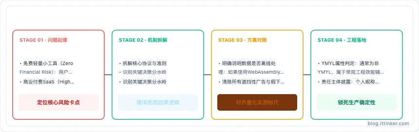
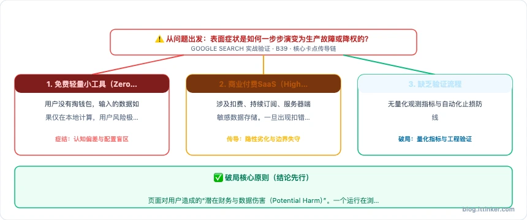
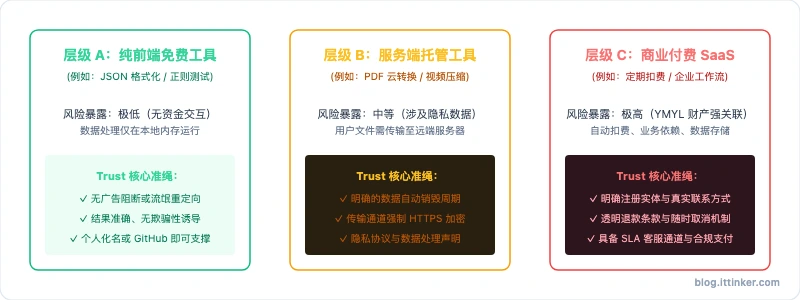
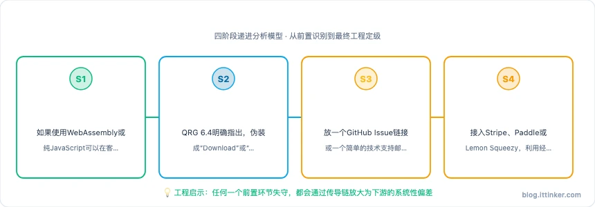
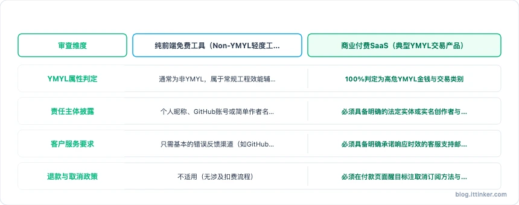
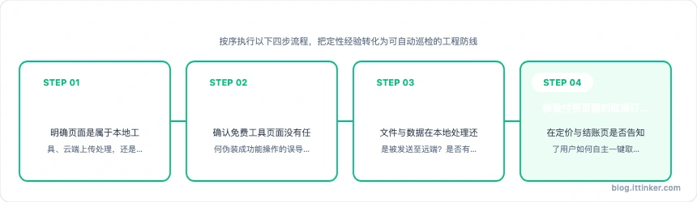

# 免费小工具与付费 SaaS 的 Trust 门槛一样吗？按风险层级拆解评估标准 | 读懂 Google Search SEO 实战 系列 039

> 🌐 **在线阅读与互动版**：[免费小工具与付费 SaaS 的 Trust 门槛一样吗？按风险层级拆解评估标准 | 读懂 Google Search SEO 实战 系列 039](https://blog.ittinker.com/posts/免费小工具与付费-saas-的-trust-门槛一样吗/)
> 📚 **所属专栏**：[《读懂 Google Search：110篇搜索质量与SEO实战指南》](../README.md)

---

### 📌 结论先行（TL;DR）
**在 Google 质量评估指南（QRG 2.3 与 3.4）中，**Trust 的审查严格程度完全取决于页面对用户造成的“潜在财务与数据伤害（Potential Harm）”**。**

1. 一个运行在浏览器沙箱内、不上传任何数据、不收费的免费格式化工具，并不属于高危 YMYL 范畴，只要功能好用、没有恶意弹窗和重定向，即使仅署名个人化名也能获得 High 评级；
2. 但一旦产品涉及信用卡支付、敏感业务数据上传或按月自动扣费，页面立刻被划入高危 YMYL 交易类别，若缺少清晰的法人主体、退款政策与 SLA 客服通道，评估员会被指示直接定级为 Low 甚至 Lowest。

在出海开发实践中，很多独立开发者容易对 Trust 产生一种刻板印象：
要么觉得任何小页面都要写一套冗长的法律免责声明和企业主体认证；
要么觉得既然别的大站可以简单放个表单，自己的商业 SaaS 也可以匿名收费。

这两种认知都忽略了 Google 评审准则中一个极为底层的指导思想：**风险对等原则（Proportionality of Trust）**。

Google 从来没有要求全网每一个网页都满足跨国金融机构的安全披露标准。评估员手里的尺子，是根据用户可能承担的风险来动态伸缩的。

---

## 1. 拆解 QRG 2.3、2.5.3 与 3.4：风险层级与责任披露标准

在 QRG 第 2.3 节《Your Money or Your Life (YMYL) Topics》中，Google 界定了高风险场景的边界：

> *"YMYL topics are those that could directly impact the health, financial stability, or safety of people, or the welfare or well-being of society... Pages that accept credit card numbers or other sensitive financial information, or allow people to make purchases or transfer money online, are inherently YMYL."*

在第 2.5.3 节中，Google 对财务与商业交易类别的站点提出了极其严苛的主体要求：

> *"For websites that process financial transactions, users need a way to ask questions or get help if something goes wrong... If a store or financial transaction website has very little contact or customer service information, it should be rated Lowest."*

结合第 3.4 节关于 Trust 的论述，我们可以提炼出评估员对两类产品的评级标准差：

1. **免费轻量小工具（Zero Financial Risk）**：用户没有掏钱包，输入的数据如果仅在本地计算，用户风险极低。评估员考察的核心是**主内容功能性（MC Functionality）**与**体验安全性（No Malicious Ads/Popups）**。没有繁重的法律信息也可以评为 High。
2. **商业付费 SaaS（High Financial & Data Risk）**：涉及扣费、持续订阅、服务器端敏感数据存储。一旦出现扣错费、数据泄漏或服务宕机，会对用户造成实质性的财产与业务损失。评估员在此类页面启动最高等级的 Trust 穿透审查。

---

## 2. 风险与信任门槛阶梯演化模型

从一个纯前端代码工具到一个多租户企业级 SaaS，用户面临的风险逐步升级，对应的 Trust 审核门槛也随之水涨船高：

---

## 3. 两类产品的差异化落地策略

### 对于免费工具：把 Trust 的精力聚焦在“零干扰”与“功能确定性”
如果你做的是免费小工具，不要把时间浪费在编造假大空的公司介绍上。评估员和用户对你的信任建立在以下几个极简细节上：
1. **明确说明数据是否离线处理**：如果使用 WebAssembly 或纯 JavaScript 可以在客户端完成计算，用醒目的小标识告知用户：“All processing happens locally in your browser. No files are uploaded to any server.”；
2. **清除所有遮挡性广告与假下载按钮**：QRG 6.4 明确指出，伪装成“Download”或“Start”按钮的欺诈性广告属于恶意破坏 MC 体验，会导致直接降为 Low；
3. **保留一个轻量反馈途径**：放一个 GitHub Issue 链接或一个简单的技术支持邮箱，足以证明你对维护这个工具保持投入。

### 对于付费 SaaS：把 Trust 的精力聚焦在“交易透明度”与“可追责性”
一旦你的页面出现了“Upgrade to Pro”、“$29/Month”、“Enter Credit Card”，你就必须全面按照 YMYL 商业站点的规范来武装自己：
1. **合规支付网关与托管结账**：接入 Stripe、Paddle 或 Lemon Squeezy，利用经过 PCI-DSS 认证的成熟托管页面，打消用户和评估员对支付凭证被窃取的顾虑；
2. **毫无保留的退款与计费说明**：在结账按钮正下方用正常字号（拒绝微小灰色小字）标明：“Cancel anytime in your dashboard with 1 click. Full refund within 14 days if unsatisfied.”；
3. **披露法定主体与商业实体信息**：在 Footer 与 Terms 页面列出你的企业法人名称、注册号或可验证的创作者全名；
4. **健全的客服响应标准**：提供 `support@yourdomain.com`，并建立工单处理流程，确保真实发生扣费纠纷时能有人工及时响应。

---

## 4. 免费工具站 vs 付费商业 SaaS 评估标准对照

| 审查维度 | 纯前端免费工具（Non-YMYL 轻度工具） | 商业付费 SaaS（典型 YMYL 交易产品） |
| :--- | :--- | :--- |
| **YMYL 属性判定** | 通常为非 YMYL，属于常规工程效能辅助 | 100% 判定为高危 YMYL 金钱与交易类别 |
| **责任主体披露** | 个人昵称、GitHub 账号或简单作者名即可接受 | 必须具备明确的法定实体或实名创作者与所在地 |
| **客户服务要求** | 只需基本的错误反馈渠道（如 GitHub Issue） | 必须具备明确承诺响应时效的客服支持邮箱或工单系统 |
| **退款与取消政策** | 不适用（无涉及扣费流程） | 必须在付款页面醒目标注取消订阅方法与退款保障政策 |
| **数据安全声明** | 告知本地处理还是云端中转，保障用户知情权 | 需提供完整的隐私条款（Privacy Policy）与安全加密说明 |
| **降级常见触发点** | 诱导性点击欺诈广告、功能失效、强制重定向 | 隐藏自动续费规则、退费无门、主体匿名、支付环境存疑 |

---

## 5. 出海产品风险等级与信任合规自查表

无论你运营的是免费小工具还是付费 SaaS，请对照以下阶梯清单完成自检：

- [ ] **界定当前页面的风险等级**：明确页面是属于本地工具、云端上传处理，还是涉及真金白银的交易；
- [ ] **排查广告与交互干扰**：确认免费工具页面没有任何伪装成功能操作的误导性广告；
- [ ] **标明数据流转路径**：文件与数据在本地处理还是被发送至远端？是否有自动清理机制？
- [ ] **核验付费页面的取消订阅通道**：在定价与结账页是否告知了用户如何自主一键取消？
- [ ] **审查法律主体信息的完整性**：涉及收费的页面是否在底部清晰标注了公司注册名或实名负责人？
- [ ] **验证客服邮箱真实投递能力**：发送一封测试邮件到你的公开客服邮箱，确认能收到并能在承诺时限内回复。

---

## 下一篇预告

理清了不同类型产品的 Trust 门槛差异后，我们终于要触碰到最本质的技术真相：

为什么许多团队把 SEO 技巧用尽了，排名上去了，却依然无法转化为留存和收入？

**Trust 真的只是一串为了应付 Google 爬虫的 SEO 指标吗？**

下一篇，也是 B 模块的收官之作，我们将深入拆解 QRG 3.4 与 4.5：**[为什么 Trust 往往是产品问题，而不只是 SEO 问题？贯穿转化与留存的底层信任链（B40）](/posts/为什么-trust-往往是产品问题-而不只是-seo-问题/)**。

---

_这是「读懂 Google Search」系列第 39 篇，系统拆解 Google 官方质量指南，帮你建立长期抗算法波动的出海 SEO 护城河。_

---

## 读懂 Google Search 专栏导航

> 📚 **专栏收录**：本文为 [《读懂 Google Search：110篇搜索质量与SEO实战指南》](/posts/google-search-guide/) 第 **B39** 篇。

* **专栏主页**：[《读懂 Google Search：110篇搜索质量与SEO实战指南》全景地图与路线图](/posts/google-search-guide/)
