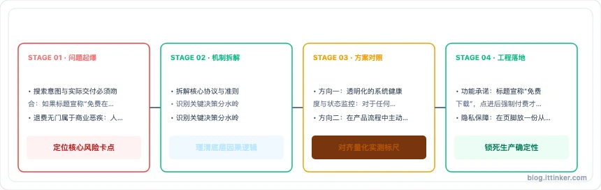
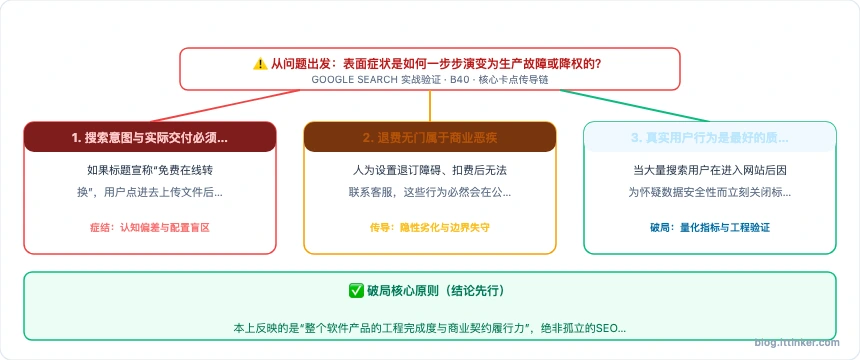
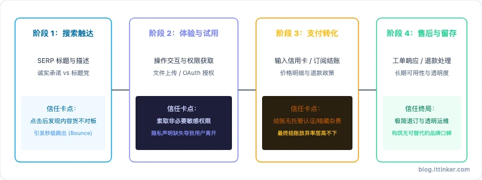
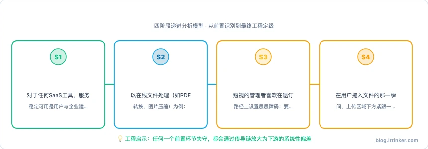
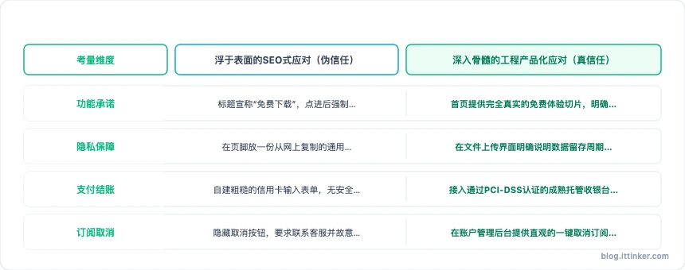
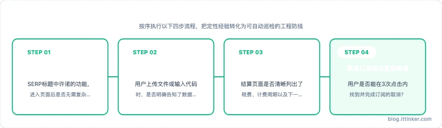

# “流量进来了转化和留存全为零”？本末倒置的 SEO 困局：为什么 Trust 根本不是 SEO 问题，而是你的产品核心生命线？ | 读懂 Google Search SEO 实战 系列 040

> 🌐 **在线阅读与互动版**：[“流量进来了转化和留存全为零”？本末倒置的 SEO 困局：为什么 Trust 根本不是 SEO 问题，而是你的产品核心生命线？ | 读懂 Google Search SEO 实战 系列 040](https://blog.ittinker.com/posts/为什么-trust-往往是产品问题-而不只是-seo-问题/)
> 📚 **所属专栏**：[《读懂 Google Search：110篇搜索质量与SEO实战指南》](../README.md)

---

### 📌 结论先行（TL;DR）
> **在 Google 质量评估指南（QRG 3.4）与现代搜索排名逻辑中，**Trust（信任）从根本上反映的是“整个软件产品的工程完成度与商业契约履行力”，绝非孤立的 SEO 优化技巧**。**
> **不少出海团队的日常存在这样一种割裂：**
> **这种脱节导致了极其讽刺的局面：**
> **哪怕 SEO 团队通过各种技巧把一个关键词做到了 Google 搜索前三名，每日涌入数千次真实点击，但最终的付费转化率（CVR）依然低至 0.1%，随后在下一次 Google 核心算法更新中，页面的排名迅速发生滑坡。**
> **团队往往会抱怨：“Google 算法变了，SEO 越来越难做了。”**
> **其实，问题从来都不出在 SEO 本身，而出在产品底层的信任链已经全线崩溃。**
>
> - 搜索算法能够捕捉到真实用户进入页面后的深层行为信号：在支付环节因疑虑导致的弃购回跳（Pogosticking）、在公网上因退费受阻引发的恶性差评、以及上传敏感文件时的秒退行为。
> - 如果你把 Trust 当作刷分的文案游戏，产品依然会因转化断崖而失去一切。
> - **唯有将信任内置到每一个产品交互细节中**：才能真正构筑抗算法震荡的增长底座。
> - **SEO 负责人**：拼命研究 Google QRG 指南，在页面上疯狂添加各种 Schema.org 结构化数据、补充作者简介、撰写长篇大论的 Privacy Policy，试图向算法“证明”自己的 E-E-A-T 很高；
> - **产品与工程团队**：把注意力全放在功能迭代上，对结账弹窗中缺失的 SSL 锁图标毫不在意，对用户上传文件后的删除机制含糊其辞，退款流程故意隐藏在三级菜单之后以减少退费。





---


### 🚨 2026 → 2024 官方最新风向预警：Google 对Google NavBoost 用户行为闭环与产品留存信号的联动演进的策略演进

#### 🕒 2026 → 2024 Google 官方对Google NavBoost 用户行为闭环与产品留存信号的联动演进的策略演进

- **2026 · 用户留存与复访率成为长效排名基石（Retention as Ranking Signal）**
  Google 算法通过全链路用户会话追踪，精准捕捉用户在页面上的实际留存与后续回访。纯靠 SEO 噱头引流但产品体验极差、毫无二次回访的空心项目，其搜索流量在 90 天内必然归零。

- **2025 · 信任链条对商业转化的决定性支配**
  站长终于意识到：E-E-A-T 和 Trust 绝非应付爬虫的八股文，而是决定一个海外潜在付费客户敢不敢掏出信用卡购买产品的唯一生命线。

- **2024 · QRG 总体思想对数字产品生命力的终极启示**
  指南反复重申的核心哲学：Google 搜索存在的唯一价值是把用户引向真正卓越且值得信赖的产品，做不好产品的人，永远不可能在现代搜索中长治久安。


---


## 1. 拆解 QRG 3.4 与 4.5：Google 如何将产品失信映射为质量降级

在 QRG 第 3.4 节《Experience, Expertise, Authoritativeness, and Trust (E-E-A-T)》中，Google 再次重申了 Trust 的终审裁定权：

> *"Trust is the most important member of the E-E-A-T family... Consider the extent to which the page is trustworthy. For online stores, this includes having a secure payment system, reliable customer service, and accurate product information. For all pages, untrustworthy content leads to low E-E-A-T."*

在 QRG 第 4.5 节《Untrustworthy Webpages or Websites》中，Google 进一步点出了产品层面的硬伤：

> *"Websites that fail to deliver what they promise, websites with deceptive functionality, or websites that make it unnecessarily difficult to cancel services or get refunds should be considered untrustworthy and rated Lowest."*

从指南的深层逻辑中，我们可以看出 Google 评估模型的进化方向：
1. **搜索意图与实际交付必须吻合**：如果标题宣称“免费在线转换”，用户点进去上传文件后，在最后一步突然强制要求绑定信用卡才允许下载，这就是典型的欺骗性交互（Deceptive Functionality），在评估员眼中直接划归 Lowest；
2. **退费无门属于商业恶疾**：人为设置退订障碍、扣费后无法联系客服，这些行为必然会在公网沉淀为投诉，从而通过外部声誉调查彻底摧毁网站的信任评分；
3. **真实用户行为是最好的质检员**：当大量搜索用户在进入网站后因为怀疑数据安全性而立刻关闭标签页、返回搜索结果页点击竞争对手时，搜索系统的点击流模型就会迅速判定该结果未能满足需求。





---

## 2. 贯穿用户生命周期的产品信任链条

从用户在 SERP 搜索结果页看到标题的第一眼，到最终成为付费订阅用户，每一个交互节点都存在着信任漏斗：





---

## 3. 把 Trust 转变为工程规范的三大实操方向

如何把虚无缥缈的“信任”落到具体的产品研发与运维代码中？

### 方向一：透明化的系统健康度与状态监控
对于任何 SaaS 工具，服务稳定可用是用户与企业建立信任的基础。频繁的 502 报错或不可预期的维护中断，会迅速引发客户在社交网络上的恐慌与声誉受损。

在基础设施层面，应该为项目搭建公开的状态页（Status Page）。我们可以利用 `ittinker-scripts` 开源套件中的系统监控脚本，为 VPS 节点自动化收集可用性状态：

```bash
# 获取健康检测脚本
git clone https://github.com/ittinker-org/ittinker-scripts.git
cd ittinker-scripts/vps-health-monitor

# 周期性采集运行指标并生成 JSON 格式状态报告
./vps-health-monitor.sh --json-output /var/www/status/health.json
```

通过公开可访问的系统健康面板展示系统正常的 Uptime（如 99.9%），向潜在客户证明你的服务处于受控且持续维护的状态。

### 方向二：在产品流程中主动打消隐私疑虑
以在线文件处理（如 PDF 转换、图片压缩）为例：
- 在用户拖入文件的那一瞬间，上传区域下方紧跟一行清晰提示：“文件将在处理完成后 60 分钟内自动从服务器物理删除，我们绝不用作任何模型训练”；
- 提供一个显眼的“立即删除文件（Delete Now）”红色按钮，赋予用户完全的数据自主控制权；
- 这种在交互流程中主动考虑用户顾虑的产品设计，其建立信任的效力，百倍于在页脚放十页无人问津的隐私协议。

### 方向三：反人性的“极简退订与退费流程”
短视的管理者喜欢在退订路径上设置层层障碍：要求用户拨打电话、故意隐藏取消按钮、强制填写超长问卷。

这种做法短期内看似保住了几笔扣费，但在现代海外互联网环境下无异于自杀：
- 用户会直接向信用卡发卡行发起拒付（Chargeback）；
- Stripe 或 PayPal 积累过高拒付率会直接封停收款账号；
- 愤怒的用户会在 Trustpilot、Reddit 和 X 上持续发帖控诉，留下永久无法抹除的欺诈记录，最终反噬整个站点的搜索评级。

高信誉的 SaaS 会在用户设置中心提供一键取消订阅按钮，并在收到退款申请时按照约定无条件履约。退走的是一份短期收入，沉淀下来的却是长期的商誉资产。





---

## 4. 浮于表面的 SEO 信任 vs 深入骨髓的产品信任对照

| 考量维度 | 浮于表面的 SEO 式应对（伪信任） | 深入骨髓的工程产品化应对（真信任） |
| :--- | :--- | :--- |
| **功能承诺** | 标题宣称“免费下载”，点进后强制付费才能导出 | 首页提供完全真实的免费体验切片，明确说明付费功能边界 |
| **隐私保障** | 在页脚放一份从网上复制的通用 Privacy Policy | 在文件上传界面明确说明数据留存周期，提供手动销毁按键 |
| **支付结账** | 自建粗糙的信用卡输入表单，无安全审计认证 | 接入通过 PCI-DSS 认证的成熟托管收银台（如 Stripe） |
| **订阅取消** | 隐藏取消按钮，要求联系客服并故意延误扣费 | 在账户管理后台提供直观的一键取消订阅与收据导出 |
| **基础设施** | 经常出现 502 宕机，无任何维护公告与状态页 | 部署自动化监控脚本，提供公开透明的健康状态与更新日志 |
| **算法与商业回报** | 流量虽大但转化奇低，核心更新一来直接滑落 | 转化率与留存稳步上升，外部讨论健康，搜索流量持续攀升 |





---

## 5. 端到端产品信任健康度自查清单

请站在一个挑剔用户的视角，完整走一遍你产品的体验链路，并逐项排查：

- [ ] **搜索承诺与落地页一致**：SERP 标题中许诺的功能，进入页面后是否无需复杂弯弯绕绕即可直接体验？
- [ ] **数据处理边界清晰告知**：用户上传文件或输入代码时，是否明确告知了数据如何存储、何时抹除？
- [ ] **结账流程透明无隐瞒**：结算页面是否清晰列出了税费、计费周期以及下一次续费时间？
- [ ] **取消订阅路径直观畅通**：用户是否能在 3 次点击内找到并完成订阅的取消？
- [ ] **公开展示系统运行状态**：是否配置了自动化健康检测与状态通知渠道？
- [ ] **建立通畅的客诉处理渠道**：是否存在能及时响应工单和邮件的人工支持团队？





---

## 下一篇预告

至此，我们已经完整梳理了 B 模块关于 **Trust、品牌与 E-E-A-T** 的核心逻辑体系。

从新站冷启动的最低底盘，到 About 页面的责任主体；从作者可验证履历，到 Claim → Evidence 框架；再到第三方声誉与产品底层信任链。

随着信任底座的筑牢，我们即将迈入整套 QRG 体系最扣人心弦的实战领域：**SERP、Needs Met 与产品完成度**。

评估员在衡量一个搜索结果是否满足用户需求时，用的是什么标尺？怎样设计一个让用户“不再需要继续 Google”的终极页面？

下一篇，我们将正式开启系列第 6 模块，解析 QRG 13.0 至 13.6：**[“用户看完你的网页为什么还要回 Google 继续搜”？没能解决问题的耻辱记录：如何设计一个让用户‘不需要继续 Google’的终极页面？（B41）](/posts/怎样设计一个让用户-不需要继续-google-的页面/)**。

---

_这是「读懂 Google Search」系列第 40 篇，系统拆解 Google 官方质量指南，帮你建立长期抗算法波动的出海 SEO 护城河。_


---

## 读懂 Google Search 专栏导航

> 📚 **专栏收录**：本文为 [《读懂 Google Search：110篇搜索质量与SEO实战指南》](/posts/google-search-guide/) 第 **B40** 篇。

* **专栏主页**：[《读懂 Google Search：110篇搜索质量与SEO实战指南》全景地图与路线图](/posts/google-search-guide/)
