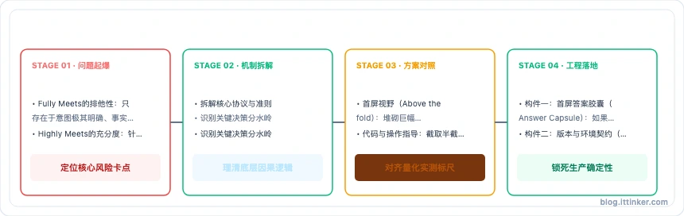
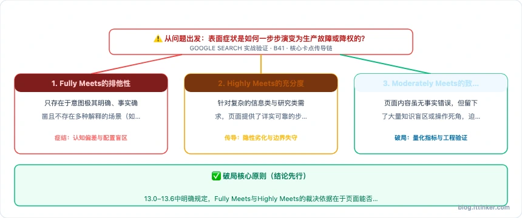
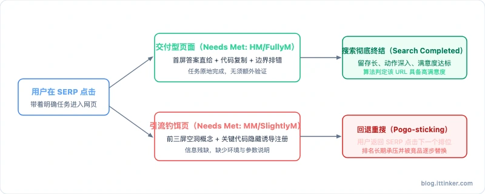
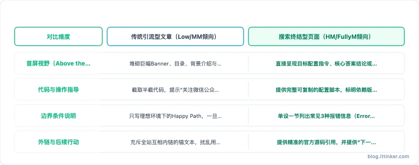
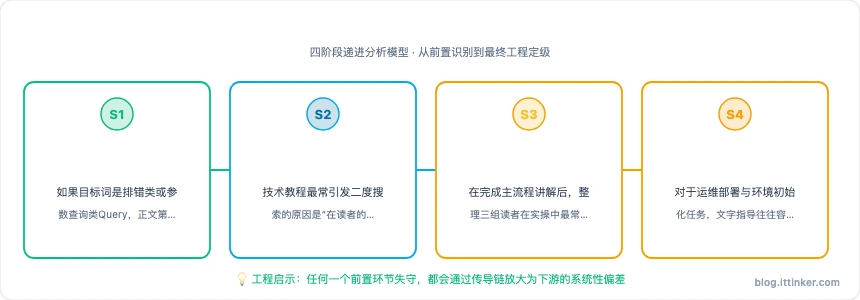
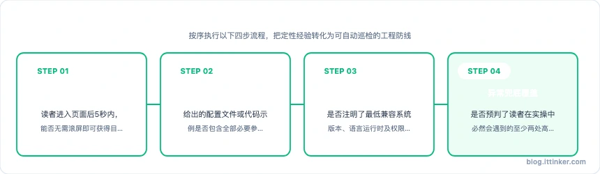

# 怎样设计一个让用户“不需要继续 Google”的页面？Needs Met 的产品转化思维 | 读懂 Google Search SEO 实战 系列 041

> 🌐 **在线阅读与互动版**：[怎样设计一个让用户“不需要继续 Google”的页面？Needs Met 的产品转化思维 | 读懂 Google Search SEO 实战 系列 041](https://blog.ittinker.com/posts/怎样设计一个让用户-不需要继续-google-的页面/)
> 📚 **所属专栏**：[《读懂 Google Search：110篇搜索质量与SEO实战指南》](../README.md)

---

### 📌 结论先行（TL;DR）
**一个高分 Needs Met 页面的本质是一套完整的任务交付系统。**

1. Google 评估员在 QRG 13.0–13.6 中明确规定，Fully Meets 与 Highly Meets 的裁决依据在于页面能否彻底平息用户的查询动机。
2. 如果用户必须返回搜索结果页寻找第二篇补充文档，该页面的等级最高只能拿到 Moderately Meets。
3. 独立开发者必须放弃“长篇大论做铺垫”的旧习惯，首屏给出确定性命令或答案，第二屏提供异常排错矩阵，末尾附带完整运行脚本，直接拦截后续搜索行为。

出海开发者常遇到一个令人困惑的数据现象：Google Search Console 中某个关键词展现量极高，点击率也不低，但页面平均停留时间只有十几秒，跳出率高企，且关键词排名在两周内从前三位一路滑落到第二页。

这种流量衰退通常源于用户的“重返搜索行为”（Pogo-sticking）。访客带着具体的技术问题或购买意图而来，扫了前两屏发现全是行业背景概括与废话介绍，只得立即按浏览器后退键，在搜索结果列表中点击下一个排位。

在 Google 的质量评估员指南（QRG）中，这套裁决逻辑被称为 **Needs Met（需求满足度）**。





---

## 1. QRG 13.0–13.6 原文解析：从 Fails 到 Fully Meets 的梯度

QRG 第 13.0 节《Rating Needs Met with the Needs Met Scale》给出了评估员判定搜索结果有效性的五级标尺：

> *"Needs Met ratings are based on both the query and the result. You must rate the result in the context of the query... Fully Meets (FullyM): A rating of Fully Meets can be given if all or almost all users would be completely satisfied by the result—users would not need additional results to fully satisfy their user intent."*
> —— QRG 13.2.1 Fully Meets

> *"Highly Meets (HM): Highly helpful, often high quality, authoritative, entertaining, or timely. A result page will typically have a good degree of specific details or clear direction for the query."*
> —— QRG 13.3 Highly Meets

> *"Moderately Meets (MM): A result that is helpful for many users, or somewhat helpful for some users. The result is fitting and average quality, but it does not completely answer the query or requires the user to look at other results for clarification."*
> —— QRG 13.4 Moderately Meets

从官方指南的定义中，我们可以梳理出一条清晰的判定红线：

1. **Fully Meets 的排他性**：只存在于意图极其明确、事实确凿且不存在多种解释的场景（如查询官方文档域名、特定错误代码含义、单位汇率计算）。用户浏览该结果后，搜索任务立刻终止。
2. **Highly Meets 的充分度**：针对复杂的信息类与研究类需求，页面提供了详实可靠的步骤、清晰的技术脉络和可验证的输出，大多数用户已经获得满意答案。
3. **Moderately Meets 的致命缺陷**：页面内容虽无事实错误，但留下了大量知识盲区或操作死角，迫使读者重返 Google 发起下一次查询。





---

## 2. 搜索行为分流模型：终结搜索与重返 SERP

用户进入落地页后，其交互行为将直接决定页面的意图满足度表现。以下架构图展示了两种截然不同的交付路径：





---

## 3. 传统引流型文章与搜索终结型页面的设计对比

许多站长误以为字数越多、排版越华丽，排名就越稳固。下表对比了两种截然相反的设计理念：

| 对比维度 | 传统引流型文章（Low / MM 倾向） | 搜索终结型页面（HM / FullyM 倾向） |
|---|---|---|
| **首屏视野（Above the fold）** | 堆砌巨幅 Banner、目录、背景介绍与概念定义 | 直接呈现目标配置指令、核心答案结论或在线预览计算器 |
| **代码与操作指导** | 截取半截代码，提示“关注微信公众号或注册查看完整代码” | 提供完整可复制的配置脚本，标明依赖版本与生效命令 |
| **边界条件说明** | 只写理想环境下的 Happy Path，一旦系统版本不同即报错 | 单设一节列出常见 3 种报错信息（Error Logs）与对应的修复命令 |
| **外链与后续行动** | 充斥全站互相内链的锚文本，扰乱用户视线 | 提供精准的官方源码引用，并提供“下一步调试指令”直接收口 |
| **商业引导节奏** | 在正文中央插入 3 处弹窗打断阅读 | 在解决技术问题之后自然植入开源脚本与高阶托管服务方案 |





---

## 4. 落地打造“搜索终结型页面”的四个工程构件

独立开发者要让页面具备截断搜索的能力，可以在模板中固化以下四个功能区：

### 构件一：首屏答案胶囊（Answer Capsule）
如果目标词是排错类或参数查询类 Query，正文第一屏必须放置带有复制按钮的完整命令块。用户不需要滚动鼠标滚轮就能直接执行排错。

### 构件二：版本与环境契约（Environment Contract）
技术教程最常引发二度搜索的原因是“在读者的 Linux 发行版上跑不通”。在代码块上方务必标明测试通过的运行环境（例如 Ubuntu 24.04 LTS、Node.js 22.x、Docker v27.0），消除读者的版本疑虑。

### 构件三：异常报错矩阵（Failure Mode Matrix）
在完成主流程讲解后，整理三组读者在实操中最常遭遇的控制台报错日志与针对性排查手段。这一步能直接掐断读者去 Google 搜索第二条报错信息的冲动。

### 构件四：可复现的自动化脚本引用
对于运维部署与环境初始化任务，文字指导往往容易遗漏参数。在文中嵌入开源运维工具库（如 ITTinker 维护的 [ittinker-scripts](https://github.com/ittinker/ittinker-scripts)），给出一行一键执行命令，让复杂的排错直接转化为标准化的部署流程：

```bash
# 示例：通过标准化健康监测脚本直接验证节点可用性
curl -fsSL https://raw.githubusercontent.com/ittinker/ittinker-scripts/main/vps-health-monitor/vps-health-monitor.sh | bash
```

读者在终端中看到明确的绿色通过标识时，搜索行为即告完整收尾。





---

## 5. 独立开发者 Needs Met 交付自查清单

在发布任何一篇面向技术搜索意图的文章或工具落地页前，建议逐一核对以下项目：

- [ ] **首屏速答检查**：读者进入页面后 5 秒内，能否无需滚屏即可获得目标配置或核心结论？
- [ ] **执行闭合性检查**：给出的配置文件或代码示例是否包含全部必要参数，能否直接复制并执行成功？
- [ ] **依赖环境明确**：是否注明了最低兼容系统版本、语言运行时及权限要求？
- [ ] **异常兜底覆盖**：是否预判了读者在实操中必然会遇到的至少两处高频报错？
- [ ] **无障碍行动路径**：正文核心技术解法是否向所有访客公开，避免强制弹窗登录等打断行为？





---

## 下一篇预告

既然高分 Needs Met 要求精准契合搜索意图，那么互联网上最权威的百科全书是否就是所有搜索词的最佳答案？

下一篇，我们将探讨知名站点的典型意图错位案例：**[为什么 Wikipedia 很优秀，却不一定是最好的搜索结果？PQ 与 Needs Met 的双轴错位（B42）](/posts/为什么-wikipedia-很优秀-却不一定是最好的搜索结果/)**。

---

_这是「读懂 Google Search」系列第 41 篇，系统拆解 Google 官方质量指南，帮你建立长期抗算法波动的出海 SEO 护城河。_


---

## 读懂 Google Search 专栏导航

> 📚 **专栏收录**：本文为 [《读懂 Google Search：110篇搜索质量与SEO实战指南》](/posts/google-search-guide/) 第 **B41** 篇。

* **专栏主页**：[《读懂 Google Search：110篇搜索质量与SEO实战指南》全景地图与路线图](/posts/google-search-guide/)
