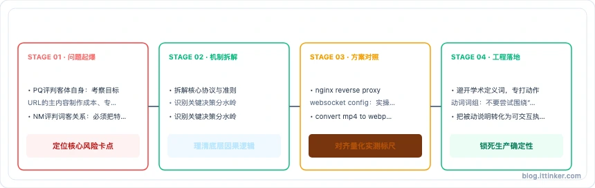
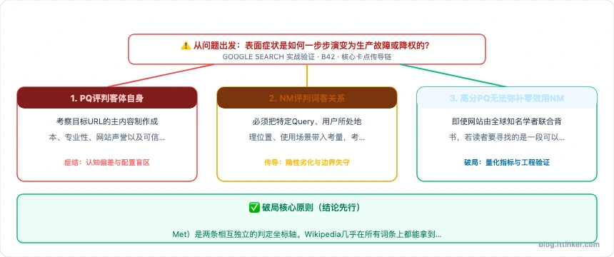
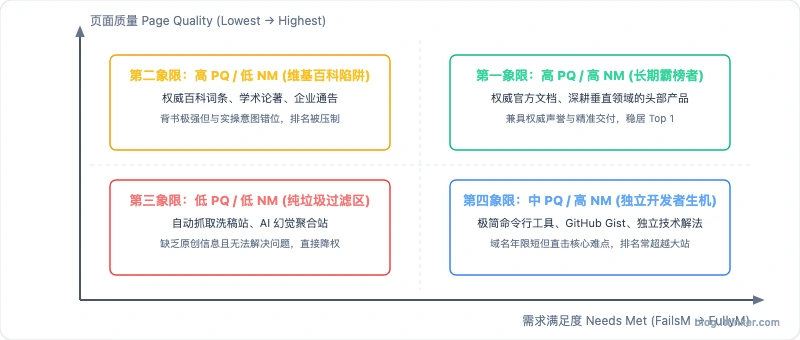
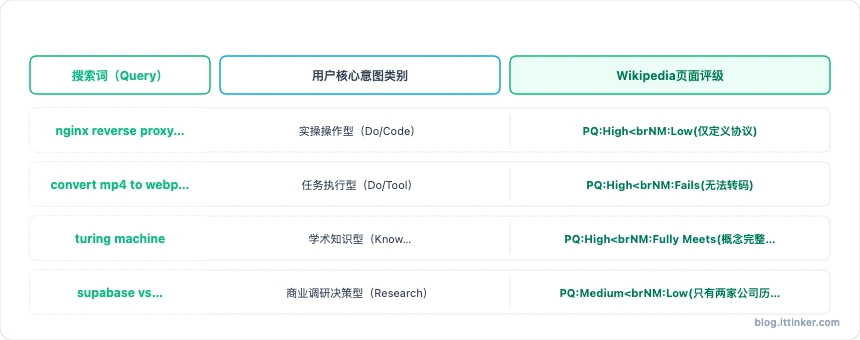
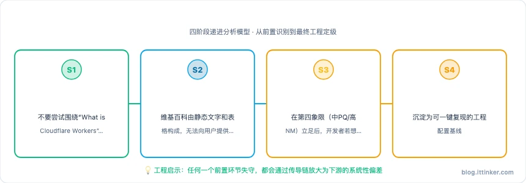
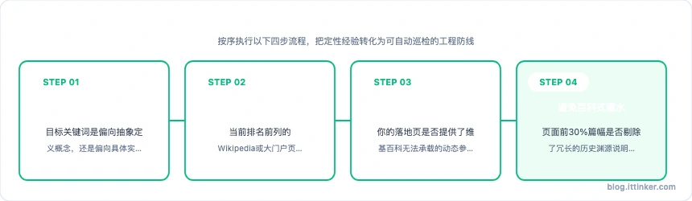

# 为什么 Wikipedia 很优秀，却不一定是最好的搜索结果？PQ 与 Needs Met 的双轴错位 | 读懂 Google Search SEO 实战 系列 042

> 🌐 **在线阅读与互动版**：[为什么 Wikipedia 很优秀，却不一定是最好的搜索结果？PQ 与 Needs Met 的双轴错位 | 读懂 Google Search SEO 实战 系列 042](https://blog.ittinker.com/posts/为什么-wikipedia-很优秀-却不一定是最好的搜索结果/)
> 📚 **所属专栏**：[《读懂 Google Search：110篇搜索质量与SEO实战指南》](../README.md)

---

### 📌 结论先行（TL;DR）
**在 Google 质量评估标准中，页面质量（Page Quality）与需求满足度（Needs Met）是两条相互独立的判定坐标轴。**

1. Wikipedia 几乎在所有词条上都能拿到 Highest 级别的 PQ 得分，但如果用户的搜索动机属于操作型（Do）、交易型（Website/Transaction）或即时排错场景，百科全书式的学术陈述在 Needs Met 维度只能得到 Low 或 Medium 评级。
2. 权威度无法抵消意图错位。
3. 独立开发者的突围机会，正在于利用精准的 NM 交付击穿综合大站的权威壁垒。

许多独立开发者在做关键词调研时，一看到搜索前列出现 Wikipedia、Amazon 或 Stack Overflow 等老牌大站，就会本能地认为竞争难度过大而选择放弃。

然而真实搜索结果中频繁上演“大鱼翻车”的现象：搜索特定技术排错命令、云服务价格计算、或自动化运维配置时，排名第一的常常是一个域名年限只有一两年的独立技术博客或极简工具站，维基百科的词条反而被挤到了底部甚至第二页。

这种现象正是 Google QRG 体系中最为核心的双轴分离机制：**高质量不等于高满足度**。

---

## 1. QRG 9.1 与 14.0 原文穿透：PQ 与 NM 的双轴独立性

QRG 第 9.1 节与第 14.0 节明确规定了评估员在审查搜索结果时的打分规范：

> *"The Page Quality rating and the Needs Met rating are completely separate... You must first understand the query and user intent to assign a Needs Met rating, whereas the Page Quality rating is assigned by evaluating the page itself regardless of the query."*
> —— QRG 9.1 Dual-Scale Evaluation

> *"A high Page Quality rating cannot make up for a low Needs Met rating. Even if a page has a Very High Page Quality rating, it should receive a Fails to Meet or Low Needs Met rating if it does not satisfy the query intent. Wikipedia pages almost always have high Page Quality, but for specific practical tasks, they are often useless to the user."*
> —— QRG 14.0 Relationship Between Page Quality and Needs Met

评估指南在此阐明了三个不可动摇的技术裁决规则：

1. **PQ 评判客体自身**：考察目标 URL 的主内容制作成本、专业性、网站声誉以及可信度，完全脱离搜索词单独成立。
2. **NM 评判词客关系**：必须把特定 Query、用户所处地理位置、使用场景带入考量，考察页面是否交付了用户当下想要的成果。
3. **高分 PQ 无法弥补零效用 NM**：即使网站由全球知名学者联合背书，若读者要寻找的是一段可以运行的 Docker 启动命令，而页面通篇在讲述容器虚拟化自 1970 年代以来的演进历史，评估员必须给出低分。

---

## 2. PQ-NM 双轴坐标矩阵

理解了双轴机制，我们可以把 SERP 上的所有网页映射到一个四象限评估模型中：

---

## 3. 典型查询场景下 Wikipedia 与垂直页面的评级对照

为了直观展现意图契合度对排名的决定性作用，下表整理了四类典型 Query 在评估员视角的打分对比：

| 搜索词（Query） | 用户核心意图类别 | Wikipedia 页面评级 | 垂直技术/工具落地页评级 | 实际排名结果倾向 |
|---|---|---|---|---|
| **`nginx reverse proxy websocket config`** | 实操操作型（Do / Code） | PQ: High NM: **Low** (仅定义协议) | PQ: Medium NM: **Highly Meets** (给出完整配置) | 独立技术博客或 Stack Overflow 占据前列，维基百科无排名 |
| **`convert mp4 to webp command line`** | 任务执行型（Do / Tool） | PQ: High NM: **Fails** (无法转码) | PQ: Medium NM: **Highly Meets** (直给 ffmpeg 命令) | 极简脚本站稳居首位，维基百科未被收录于 Top 20 |
| **`turing machine`** | 学术知识型（Know Simple/In-depth） | PQ: High NM: **Fully Meets** (概念完整定义) | PQ: Medium NM: **Moderately Meets** (私人见解浅显) | 维基百科稳居第一，独立站点极难撼动 |
| **`supabase vs firebase pricing calculator`** | 商业调研决策型（Research） | PQ: Medium NM: **Low** (只有两家公司历史) | PQ: High NM: **Highly Meets** (动态费用计算工具) | 独立对比站占据首屏，维基百科无相关对比词条 |

---

## 4. 独立开发者突围大站的三项战略

在明确了双轴逻辑之后，个人创作者与小型研发团队不需要对 Wikipedia 这类巨无霸心存畏惧，而应采取针对性的意图穿透策略：

### 避开学术定义词，专打动作动词词组
不要尝试围绕“What is Cloudflare Workers”这类纯百科词项建站，维基百科和 Cloudflare 官方文档占据了该生态位。把目标转向包含动作动词的具体技术场景，例如“deploy rust wasm on cloudflare workers without cargo-generate”，这类意图直接排除了百科全书的竞争空间。

### 把被动说明转化为可交互执行单元
维基百科由静态文字和表格构成，无法向用户提供实时交互能力。如果一个概念可以通过动态计算器、参数生成器或验证脚本交付，独立站就可以凭借更高的交互完成度拿到 Highly Meets 评级。

### 建立轻量级但无可挑剔的技术信誉证据
在第四象限（中 PQ / 高 NM）立足后，开发者若想进一步锁定胜局，只需补齐基础的信誉拼图：在页脚明确署名独立开发者身份、附带 GitHub 开源项目链接、提供最后验证日期，即可让页面质量从 Medium 跃迁至 High，完成对老牌站点的全面超越。

---

## 5. 意图定位与权威抗衡自查清单

在评估新词切入可行性时，建议对照以下维度进行研判：

- [ ] **意图属性排查**：目标关键词是偏向抽象定义概念，还是偏向具体实操排错与选型决策？
- [ ] **大站内容深度**：当前排名前列的 Wikipedia 或大门户页面，是否能帮读者在 3 分钟内跑通命令？
- [ ] **交互增量设计**：你的落地页是否提供了维基百科无法承载的动态参数选择或一键脚本？
- [ ] **避免百科式灌水**：页面前 30% 篇幅是否剔除了冗长的历史渊源说明，直接进入执行环节？
- [ ] **交付证据链完整**：是否给出了测试终端截图、运行环境版本与代码验证结果？

---

## 下一篇预告

既然高权威度未必能在每个搜索词中夺冠，那么日常在 Google 搜出来的排名前三位结果，真的代表当前互联网上的最高水准吗？

下一篇，我们将通过真实案例展开深度解构：**[Google 排名前三的页面，真的都是最高质量吗？实测拆解 SERP Top 10 的 PQ 与 NM 评分（B43）](/posts/google-排名前三的页面-真的都是最高质量吗/)**。

---

_这是「读懂 Google Search」系列第 42 篇，系统拆解 Google 官方质量指南，帮你建立长期抗算法波动的出海 SEO 护城河。_

---

## 读懂 Google Search 专栏导航

> 📚 **专栏收录**：本文为 [《读懂 Google Search：110篇搜索质量与SEO实战指南》](/posts/google-search-guide/) 第 **B42** 篇。

* **专栏主页**：[《读懂 Google Search：110篇搜索质量与SEO实战指南》全景地图与路线图](/posts/google-search-guide/)
