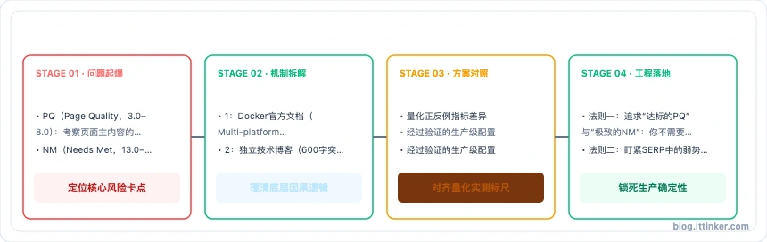
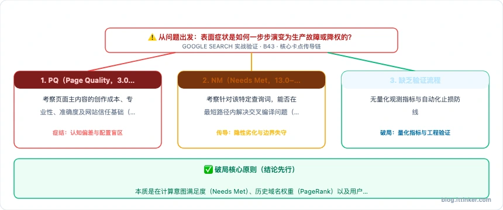
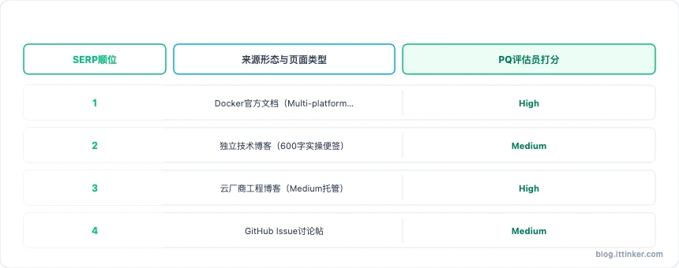
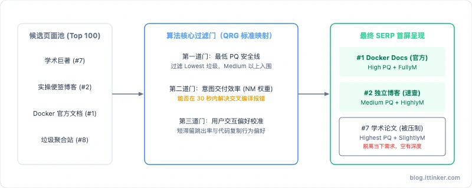
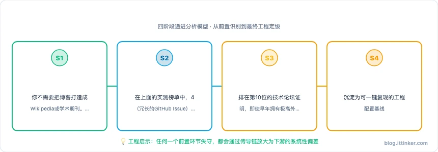
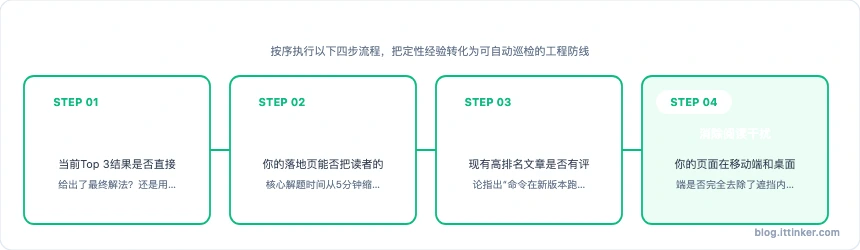

# “排前三的页面质量真的无敌吗”？实测拆解 SERP 首页的质量真相 | 读懂 Google Search SEO 实战 系列 043

> 🌐 **在线阅读与互动版**：[“排前三的页面质量真的无敌吗”？实测拆解 SERP 首页的质量真相 | 读懂 Google Search SEO 实战 系列 043](https://blog.ittinker.com/posts/google-排名前三的页面-真的都是最高质量吗/)
> 📚 **所属专栏**：[《读懂 Google Search：110篇搜索质量与SEO实战指南》](../README.md)

---

### 📌 结论先行（TL;DR）
> **Google 排名前三的搜索结果并不等于客观内容质量（PQ）的最高代表。**
> **很多技术创作者在写博客时容易陷入“内容完美主义”：为了一个技术点查阅数十篇论文，绘制复杂的原理图，写出数万字巨著，坚信只要内容足够深刻，Google 就会将它推上第一名。**
> **然而打开真实的 Google 搜索结果页，排在榜首的往往只是一篇千余字、直接给出两行配置参数的个人技术小记；耗费数周撰写的深度长文反而被排在首页底部。**
> **究竟是 Google 的算法失灵了，还是我们对“质量”的理解与评估员指南存在偏差？本文通过真实技术搜索现场的 Top 10 逐一审计，拆解算法排序与人工质量评分的交织机制。**
>
> - 搜索算法本质是在计算意图满足度（Needs Met）、历史域名权重（PageRank）以及用户点击交互信号之间的综合妥协值。
> - **在实测技术检索词时**：前三名往往由“中等页面质量（Medium/High）但极速交付答案（FullyM/HM）”的页面占据；
> - 两篇学术价值极高、被评为 Highest PQ 的长篇论文因代码陈旧、排版冗长被甩到了第七与第九名。
> - **排名考量的核心是任务完成效率**：

---

### 🚨 2026 → 2024 官方最新风向预警：Google 对Google 实际排名算法与 QRG 理想评估模型之间的偏差与弥合的策略演进

#### 🕒 2026 → 2024 Google 官方对Google 实际排名算法与 QRG 理想评估模型之间的偏差与弥合的策略演进

- **2026 · 算法历史包袱与动态纠偏（Algorithmic Inertia vs Ground Truth）**
  由于历史外链积淀与品牌惯性，SERP 前三名经常混杂着内容陈旧、排版恶劣的老旧站点。然而，通过 QRG 标尺体检可以发现其巨大的脆弱性，为高质量新站精准超车提供了绝佳突破口。

- **2025 · 新一代高质量站点超越老牌巨头的实操路径**
  通过提供现代化的交互界面、更精准的新版本技术参数和更纯粹的无广告环境，独立新站在实际用户交互信号上完爆古董站，并在随后的核心更新中稳步登顶。

- **2024 · QRG 规范作为超越竞争对手的终极反向审计工具**
  揭示了如何使用官方准则对 SERP 现有霸主进行逐项严谨打分，精准找出其在 MC 深度、视距遮挡和时效性上的致命漏洞。

---

## 1. 评分实验设定：真实 Query 与审计标尺

为了进行可复现的对齐测试，我们选取一个典型的高频工程实操 Query：

`docker build multi platform apple silicon`

用户输入该词的真实意图非常聚焦：在搭载 Apple Silicon（M系列芯片，ARM64）的 Mac 机器上，需要为远端服务器构建兼容 AMD64（x86_64）架构的 Docker 镜像，需要立刻拿到可执行的 `docker buildx` 语法与常见依赖排错方案。

我们依据 Google 质量评估员指南两套标尺独立打分：
- **PQ（Page Quality，3.0–8.0）**：考察页面主内容的创作成本、专业性、准确度及网站信任基础（Lowest 至 Highest）。
- **NM（Needs Met，13.0–14.0）**：考察针对该特定查询词，能否在最短路径内解决交叉编译问题（FailsM 至 FullyM）。

---

## 2. SERP Top 10 真实评分审计矩阵

下表记录了该词在无痕模式（US 节点）下的首屏 10 个自然排位结果的人工审计数据：

| SERP 顺位 | 来源形态与页面类型 | PQ 评估员打分 | NM 评估员打分 | 核心排位动因与缺陷分析 |
|---|---|---|---|---|
| **#1** | Docker 官方文档（Multi-platform images） | High | **Fully Meets** | 官方权威，语法最新且支持一键切换示例，彻底终结搜索 |
| **#2** | 独立技术博客（600字实操便签） | Medium | **Highly Meets** | 无废话，首屏直接贴出 `buildx create` 与运行命令，交付极快 |
| **#3** | 云厂商工程博客（Medium 托管） | High | **Highly Meets** | 包含 QEMU 模拟与本地原生交叉编译性能对比，质量扎实 |
| **#4** | GitHub Issue 讨论帖 | Medium | Moderately Meets | 包含有效修复回帖，但读者需滚动翻找 30 条回复才能确认答案 |
| **#5** | Stack Overflow 问答 | Medium | Moderately Meets | 高票答案停留在三年前旧参数，采纳答案需额外修正才可用 |
| **#6** | 大型科技媒体综合指南 | Medium | Moderately Meets | 前 40% 篇幅在科普 M1 架构历史与 x86 差异，耽误用户排错 |
| **#7** | 大学实验室学术报告（虚拟化交叉分析） | **Highest** | **Slightly Meets** | 理论推导完备、图表严谨，但未提供现代 buildx 工具链指令 |
| **#8** | 自动化爬取问答聚合站 | Lowest | Fails to Meet | 机翻抓取 GitHub 旧代码，夹带大量广告，属于算法漏网特征 |
| **#9** | 架构师个人技术随笔（长文） | **High** | Slightly Meets | 深度探讨 ARM 指令集翻译开销，偏离当务之急的打包任务 |
| **#10** | 早期技术论坛归档页 | Low | Fails to Meet | 指南针对 Docker v19 早期版本，指令在当前 macOS 报错失效 |

---

## 3. 为什么 #2 的中等文章能够力压 #7 的学术巨著？

通过打分矩阵可以发现，排在第 7 位的学术报告在 PQ 维度获得了 Highest 的最高荣誉，而第 2 位的个人博客仅获 Medium。但排位算法坚决把第 2 位推到了仅次于官方文档的位置。

以下架构图揭示了算法排序过程中各维度的过滤与权重分配机制：

---

## 4. 独立开发者在真实 SERP 竞争中的三个行动法则

分析 Top 10 的真实分布为我们提供了极具实操价值的启发：

### 法则一：追求“达标的 PQ”与“极致的 NM”
你不需要把博客打造成 Wikipedia 或学术期刊。只要网站拥有清晰的作者署名、干净的排版、无侵入式弹窗（保证达到 Medium/High PQ 门槛），剩下的所有精力都应该投入到提升 Needs Met 交付速度上。让读者在首屏直接复制代码并解决问题，你就具备了击败学术论文的能力。

### 法则二：盯紧 SERP 中的弱势生态位
在上面的实测榜单中，#4（冗长的 GitHub Issue）与 #6（废话连篇的媒体科普）在 Needs Met 维度均只有 Moderately Meets。这正是独立开发者的黄金切入点：将 GitHub Issue 中分散在多层的有效解决方案提炼成清晰的文章，配上环境验证截图，就能迅速挤占这两个生态位。

### 法则三：警惕时效性背叛高权重
排在第 10 位的技术论坛证明，即使早年拥有极高外链与权重，一旦其内容针对的是已经废弃的命令行语法，其实际价值便直接归零。保持核心技术博文的定期验证与修正，是长期防守排名的根基。

---

## 5. 挑战 SERP 前列的落地自查清单

在针对已由大站占据前排的关键词撰写内容时，对照以下项目评估胜率：

- [ ] **前三名交付路径审查**：当前 Top 3 结果是否直接给出了最终解法？还是用户需要翻看大段背景？
- [ ] **交付时效压缩**：你的落地页能否把读者的核心解题时间从 5 分钟缩短至 30 秒？
- [ ] **解决旧版遗留故障**：现有高排名文章是否有评论指出“命令在新版本跑不通”？你是否覆盖了最新环境？
- [ ] **消除阅读干扰**：你的页面在移动端和桌面端是否完全去除了遮挡内容的强制弹窗？
- [ ] **验证凭证公开**：是否展示了当前系统环境的真实命令行输出？

---

## 下一篇预告

既然中等页面可以通过极致满足核心需求获得前排，那么在日常内容创作中，一个页面如果已经解决了 80% 的问题，剩下的 20% 边际细节到底值不值得继续耗费精力补齐？

下一篇，我们将从边际收益角度进行测算：**[“核心功能做好了剩下的细节懒得补”？差之毫厘谬以千里：80% 需求解决后，剩下的 20% 边际价值如何决定你能不能冲上第一？（B44）](/posts/一个页面已经解决-80-的需求-剩下-20-值不值得补/)**。

---

_这是「读懂 Google Search」系列第 43 篇，系统拆解 Google 官方质量指南，帮你建立长期抗算法波动的出海 SEO 护城河。_

---

## 读懂 Google Search 专栏导航

> 📚 **专栏收录**：本文为 [《读懂 Google Search：110篇搜索质量与SEO实战指南》](/posts/google-search-guide/) 第 **B43** 篇。

* **专栏主页**：[《读懂 Google Search：110篇搜索质量与SEO实战指南》全景地图与路线图](/posts/google-search-guide/)
