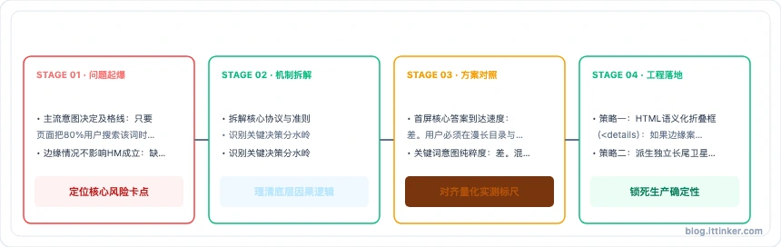
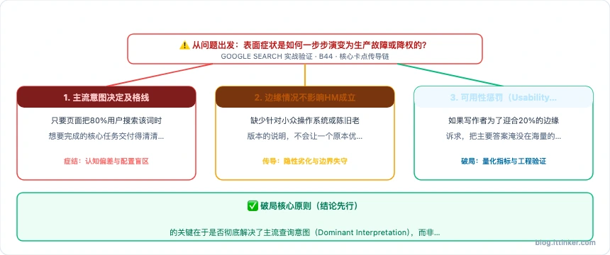
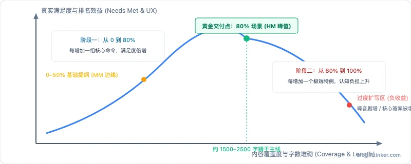
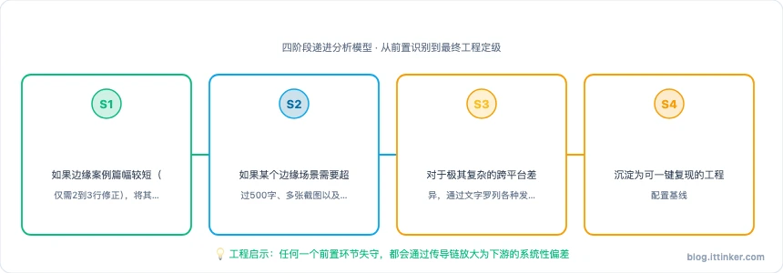
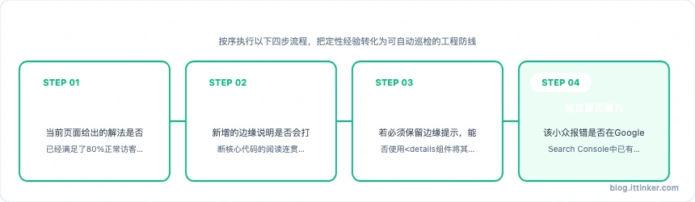

# “搞定八成剩下两成值不值得做”？覆盖边际价值与顶级排位之争 | 读懂 Google Search SEO 实战 系列 044

> 🌐 **在线阅读与互动版**：[“搞定八成剩下两成值不值得做”？覆盖边际价值与顶级排位之争 | 读懂 Google Search SEO 实战 系列 044](https://blog.ittinker.com/posts/一个页面已经解决-80-的需求-剩下-20-值不值得补/)
> 📚 **所属专栏**：[《读懂 Google Search：110篇搜索质量与SEO实战指南》](../README.md)

---

### 📌 结论先行（TL;DR）
> **在 Google 评估标准中，从 Moderately Meets（MM）跨越到 Highly Meets（HM）的关键在于是否彻底解决了主流查询意图（Dominant Interpretation），而非盲目穷尽 100% 的生僻边缘案例。**
> **在技术内容创作中，我们经常面临扩写诱惑：写完一篇关于 Redis 主从复制搭建的实战指南后，会不由自主地想继续补充：Windows 下怎么编译？FreeBSD 怎么启动？CentOS 6 缺少 glibc 怎么手动打补丁？遇到极小众的网络分区偶发 bug 怎么抓包？**
> **原本两千字的高清实操手册，被无限扩写成一万五千字的“终极百科全书”。**
> **写作者往往认为内容越全面，就越容易获得 Google 的青睐。然而上线后的数据却往往事与愿违：页面平均阅读进度仅停留在 20%，用户在首屏寻找命令受阻，关键词排名甚至被一篇两千字的精悍指南反超。**
>
> - 强行在一个页面中塞入老旧内核补丁、小众发行版适配或极端报错，往往会稀释页面关键词焦点，增加 80% 主流读者的信息检索成本。
> - 正确的工程解法是将核心落地页锁定在 80% 主流场景的高效交付上，把剩余 20% 的长尾边界拆分为独立卫星页或折叠组件。





---


### 🚨 2026 → 2024 官方最新风向预警：Google 对Google 对高阶满足度（Highly Meets vs Moderately Meets）边际价值的裁决的策略演进

#### 🕒 2026 → 2024 Google 官方对Google 对高阶满足度（Highly Meets vs Moderately Meets）边际价值的裁决的策略演进

- **2026 · 高阶边际价值与顶级排名门槛（Marginal Value Threshold for Top 3）**
  解决 80% 基础需求只能保送你进入前十名；而决定你究竟排在第 8 名还是第 1 名的，正是那看似不起眼的 20% 边际价值——包括一键复制、异常提示、极端输入容错和键盘快捷键支持。

- **2025 · 平庸工具与卓越工匠精神的算法分水岭**
  Google 核心交互信号极度敏感于这些微小的体验细节，用户停留时间的细微差异在算法模型中被放大为数倍的排名红利。

- **2024 · QRG 14.2 节关于从 Moderately 跃升至 Highly Meets 的关键边际动作**
  指引指明：优秀的内容绝非仅仅满足及格线，唯有在用户未曾预料之处提供超预期的关怀与严密性，才配问鼎榜首。


---


## 1. QRG 13.3–13.5 原文透视：HM 与 MM 的划分门槛

Google 在 QRG 第 13.3 节与第 13.4 节中，对结果页面满足意图的边界做出了非常精确的限定：

> *"Highly Meets (HM): A rating of Highly Meets can be given if the result meets the dominant interpretation and is highly helpful for many or most users... The page does not need to cover every conceivable edge case, provided it satisfies the primary need with high quality, clarity, and authority."*
> —— QRG 13.3 Highly Meets

> *"Moderately Meets (MM): The result is helpful for many users, but it is not comprehensive enough for the dominant interpretation, or it requires the user to look at additional results for basic clarification... A page that tries to do everything at once and buries the primary answer under irrelevant details may be demoted to MM because of poor usability."*
> —— QRG 13.4 Moderately Meets

这两段准则揭示了内容创作的三个裁决基准：

1. **主流意图决定及格线**：只要页面把 80% 用户搜索该词时想要完成的核心任务交付得清清楚楚，评估员就会给出 Highly Meets 评级。
2. **边缘情况不影响 HM 成立**：缺少针对小众操作系统或陈旧老版本的说明，不会让一个原本优秀的实操页面被降级为 MM。
3. **可用性惩罚（Usability Penalty）**：如果写作者为了迎合 20% 的边缘诉求，把主要答案淹没在海量的次要细节里，迫使主流用户费力翻找，该页面反而会因为信息噪音过重被判定为 MM。





---

## 2. 内容扩写的边际收益倒 U 型曲线

在工程实践中，内容篇幅与满足度评分并非线性正相关。以下图表直观展示了内容扩充过程中的边际效益演变规律：





---

## 3. 巨石单页与模块化集群架构的收益对比

下表对比了把所有边缘情况塞进单个长页面，与采用模块化集群组织内容的实际收益：

| 衡量维度 | 巨石大长篇（强行覆盖 100%） | 模块化内容集群（80% 主站 + 20% 卫星页） |
|---|---|---|
| **首屏核心答案到达速度** | 差。用户必须在漫长目录与引言中艰难寻找 | 极佳。首屏直接给出 80% 读者适用的解法 |
| **关键词意图纯粹度** | 差。混合了过时环境、冷门报错，稀释主词权重 | 极高。主页面锁定核心关键词，卫星页精准捕获长尾词 |
| **维护与验证成本** | 极高。任何依赖更新都要通篇逐行重新测试 | 低。核心命令长期稳定，边缘变更只修正单篇小页 |
| **Needs Met 评估评级** | 容易滑落至 MM（信息冗杂且结构失焦） | 稳居 HM（主需求彻底解决，辅需求清晰导流） |
| **全站长尾流量总和** | 仅单条 URL 参与排名，长尾覆盖受限 | 1 篇主篇带 4 篇卫星页，可捕获 3 到 5 倍长尾搜索流量 |


---

## 4. 落地处理“剩余 20% 边缘需求”的三种工程策略

面对那 20% 确实存在却属于小众范围的技术细节，独立开发者应当如何落地处理？推荐以下三套工程实践方案：

### 策略一：HTML 语义化折叠框（`<details>`）
如果边缘案例篇幅较短（仅需 2 到 3 行修正），将其收纳在折叠卡片中。80% 的主流读者完全不会受到视线干扰，遇到该特殊环境的读者可以主动点击展开：

```html
<details>
  <summary><b>如果是 Alpine Linux 环境（点击展开）</b></summary>
  <p>Alpine 基于 musl libc，需预先安装编译依赖：</p>
  <pre><code>apk add --no-cache build-base linux-headers</code></pre>
</details>
```

### 策略二：派生独立长尾卫星文章
如果某个边缘场景需要超过 500 字、多张截图以及独立编译步骤才能说明白，坚决不要塞进主文。应单独创建一篇标题精准的文章（如《Alpine Linux 下编译 Redis 源码的缺失符号排错》），并在主文章中通过单向锚文本内链引导。

这种做法既保证了主页面获得干净的 HM 评级，又为冷门长尾词建立了一个专属的 Fully Meets 落地页。

### 策略三：自动化部署脚本统一抹平环境差异
对于极其复杂的跨平台差异，通过文字罗列各种发行版的不同命令往往吃力不讨好。更为高效的方式是编写自适应判断的 Shell 脚本（如 [ittinker-scripts](https://github.com/ittinker/ittinker-scripts) 中提供的工具套件），在脚本内部执行 `uname -m` 与发行版探测，读者只需执行单行指令即可静默抹平 20% 的环境边界：

```bash
# 自动探测系统架构与包管理器，抹平底层差异
curl -fsSL https://raw.githubusercontent.com/ittinker/ittinker-scripts/main/docker-quick-deploy/deploy.sh | bash
```





---

## 5. 边际内容价值决策自查清单

在犹豫是否要在当前文章中继续补充边缘细节时，对照以下清单做出工程决断：

- [ ] **主流意图核验**：当前页面给出的解法是否已经满足了 80% 正常访客的环境诉求？
- [ ] **噪音侵入评估**：新增的边缘说明是否会打断核心代码的阅读连贯性？
- [ ] **折叠隔离可行性**：若必须保留边缘提示，能否使用 `<details>` 组件将其收纳？
- [ ] **独立建页潜力**：该小众报错是否在 Google Search Console 中已有独立查询词展现？
- [ ] **认知负荷控制**：读者能否在不翻看补充章节的前提下，独立把主流程顺利跑通？





---

## 下一篇预告

既然主流需求可以用一个页面拿到 HM，那是否存在某种搜索词，无论页面做得多优秀，也无法获得最高的 Fully Meets 评级？

下一篇，我们将探讨搜索生态中的固有物理限制：**[“为什么有些词怎么做都拿不到 Fully Meets”？认清现实的释怀：宽泛词与多意图搜索天然不存在单一完美解！（B45）](/posts/什么时候一个-query-根本不存在-fully-meets/)**。

---

_这是「读懂 Google Search」系列第 44 篇，系统拆解 Google 官方质量指南，帮你建立长期抗算法波动的出海 SEO 护城河。_


---

## 读懂 Google Search 专栏导航

> 📚 **专栏收录**：本文为 [《读懂 Google Search：110篇搜索质量与SEO实战指南》](/posts/google-search-guide/) 第 **B44** 篇。

* **专栏主页**：[《读懂 Google Search：110篇搜索质量与SEO实战指南》全景地图与路线图](/posts/google-search-guide/)
