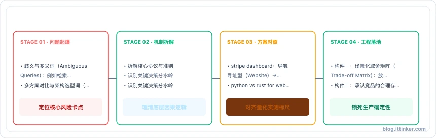
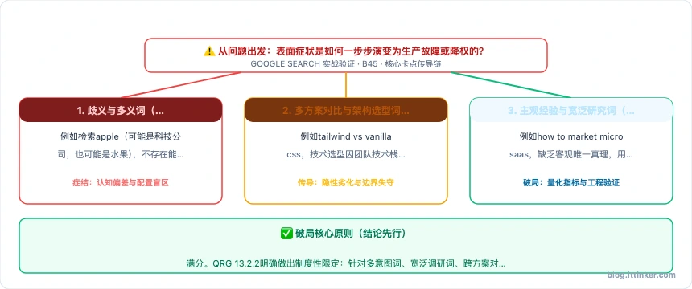
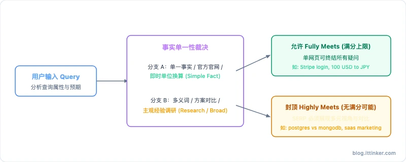
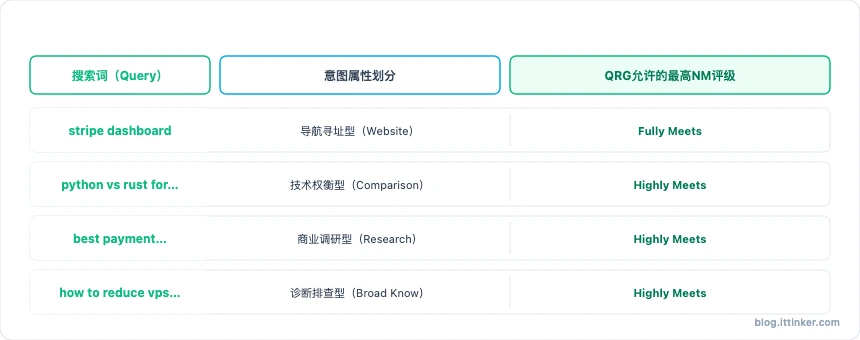
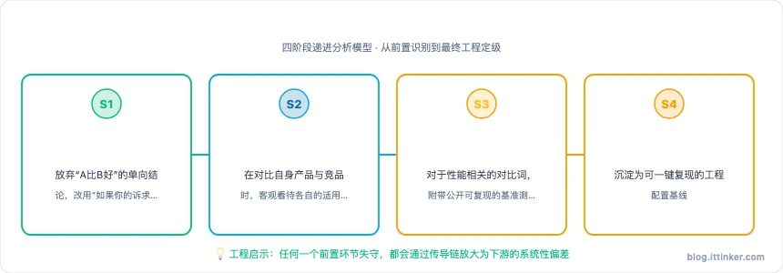
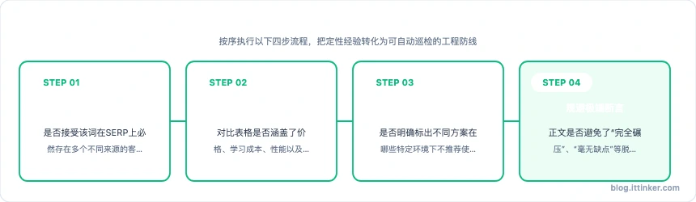

# “为什么有些词怎么做都拿不到满分”？宽泛多意图词的现实定位 | 读懂 Google Search SEO 实战 系列 045

> 🌐 **在线阅读与互动版**：[“为什么有些词怎么做都拿不到满分”？宽泛多意图词的现实定位 | 读懂 Google Search SEO 实战 系列 045](https://blog.ittinker.com/posts/什么时候一个-query-根本不存在-fully-meets/)
> 📚 **所属专栏**：[《读懂 Google Search：110篇搜索质量与SEO实战指南》](../README.md)

---

### 📌 结论先行（TL;DR）
> **在 Google 质量评估体系中，并非所有搜索词都能被打出 Fully Meets（FullyM）满分。**
> **许多刚涉足 SEO 领域的独立开发者常有一个宏伟设想：找到一个搜索量巨大的行业核心词（比如 `best web framework` 或 `nextjs vs remix`），写出一篇涵盖所有特性的万字长文，期望 Google 把它作为终极答案永久锁定在第 1 名，独占所有点击。**
> **然而持续观察 SERP 就会发现：即便某篇文章无论深度还是外链都极其强大，Google 依然会固执地在首屏保留 4 到 5 个不同视角的页面，包括官方对比表、第三方开发者吐槽帖、以及 Reddit 社区讨论。**
> **这不是算法的漏洞，而是 Google 刻意维持的规则设计。**
>
> - QRG 13.2.2 明确做出制度性限定：针对多意图词、宽泛调研词、跨方案对比词以及主观经验类检索（如 `best database for saas`、`postgres vs mongodb`），任何单一结果最高只能获得 Highly Meets（HM）评级。
> - 用户在这类场景下天然需要对照多个维度的论据与权衡。
> - 试图写一篇“定于一尊”的文章去垄断搜索结果既不现实，也不符合搜索算法对结果多样性（SERP Diversity）的底层要求。





---


### 🚨 2026 → 2024 官方最新风向预警：Google 对Google 对宽泛词 SERP 混排与无法单一满足特性的官方界定的策略演进

#### 🕒 2026 → 2024 Google 官方对Google 对宽泛词 SERP 混排与无法单一满足特性的官方界定的策略演进

- **2026 · 宽泛探索词天然无单一解定律（No Universal Solution for Broad Queries）**
  面对‘Web 开发’、‘出海营销’等高度宽泛词，用户的背景千差万别。Google 算法早已放弃寻找所谓的‘完美单页’，转而分配多元化混排矩阵，任何妄图单页垄断此类词的行为都是徒劳的。

- **2025 · 从单页执念转向主题集群（Topic Cluster）覆盖**
  聪明的站长不再死磕宽泛大词的单一落地页，而是通过构建覆盖初学指南、架构选型、踩坑实录的主题集群，从侧翼收割海量高意向流量。

- **2024 · QRG 14.1 节关于宽泛与多义查询绝不给予 Fully Meets 的硬性规定**
  指南用严密的逻辑告诉评估员和从业者：认清搜索生态的多样性现实，放弃不切实际的单页霸榜幻想，才能走向真正健康的内容架构。


---


## 1. QRG 13.2.2 原文透视：绝不存在 Fully Meets 的法定场景

QRG 第 13.2.2 节以极具确定性的措辞给评估员下达了判定禁令：

> *"Queries with No Fully Meets Rating: Broad, ambiguous, or information-seeking queries about non-factual topics do not have a Fully Meets rating... If a query represents a broad topic where users need to explore, browse, or form their own opinions, no single result can completely satisfy all or almost all users. The maximum rating for any result for such queries is Highly Meets."*
> —— QRG 13.2.2 Queries with No Fully Meets Rating

> *"Product comparison and open-ended research queries naturally require diverse viewpoints. Users want to see multiple perspectives, tradeoffs, and independent experiences. Forcing a single 'winner' ignores the reality of varied user constraints."*
> —— QRG 21.0 Product Queries and Research Needs

评估员在执行指南时，严禁为以下三类检索词打出 Fully Meets：

1. **歧义与多义词（Ambiguous Queries）**：例如检索 `apple`（可能是科技公司，也可能是水果），不存在能同时完全满足这两种意图的单一 URL。
2. **多方案对比与架构选型词（Comparison Queries）**：例如 `tailwind vs vanilla css`，技术选型因团队技术栈、打包体积、维护周期不同而千差万别，没有任何单一结论能适用于所有研发团队。
3. **主观经验与宽泛研究词（Open Research Queries）**：例如 `how to market micro saas`，缺乏客观唯一真理，用户需要对比不同的增长路径与实操案例。





---

## 2. 意图类型与最高 NM 评级判定决策树

理解了搜索意图的物理上限，我们可以通过以下决策流程判断某个目标关键词的 NM 天花板：





---

## 3. 典型查询词的上限天花板与意图诉求对照

下表梳理了各类技术与商业词汇的真实满足度上限，帮助开发者合理设定排名预期：

| 搜索词（Query） | 意图属性划分 | QRG 允许的最高 NM 评级 | 为什么无法达到 Fully Meets？ | 独立开发者的正确应对形态 |
|---|---|---|---|---|
| **`stripe dashboard`** | 导航寻址型（Website） | **Fully Meets** | 目标明确唯一，官方登录页即可彻底完成任务 | 属于官方自留地，非官方站应避开 |
| **`python vs rust for web backend`** | 技术权衡型（Comparison） | **Highly Meets** | 性能、开发速度、并发需求因项目而异，无标准解 | 提供多场景取舍矩阵，不强推单一选项 |
| **`best payment gateway for indie hackers`** | 商业调研型（Research） | **Highly Meets** | 受注册地、出海币种、佣金费率影响，各人需求不同 | 制作交互式筛选计算器，按国家与体量推荐 |
| **`how to reduce vps latency`** | 诊断排查型（Broad Know） | **Highly Meets** | 涉及网络链路、DNS、CDN、内核调优等多层原因 | 给出排查思维导图并推荐诊断脚本测试 |
| **`json parse error unexpected token`** | 报错诊断型（Fact/Fix） | **Fully Meets** | 属于固定语法报错，给出合规 JSON 格式即可解决 | 首屏直接指出引号或逗号缺失的典型位置 |





---

## 4. 面对“无 Fully Meets 词”的内容架构工程

既然无法通过单向结论打发用户，针对这类宽泛研究词，独立开发者应当如何设计页面架构以稳稳夺取 Highly Meets 评级？

### 构件一：场景化取舍矩阵（Trade-off Matrix）
放弃“A 比 B 好”的单向结论，改用“如果你的诉求是 X，选 A；如果是 Y，选 B”的二维决策矩阵。为读者呈现真实的工程取舍，例如吞吐量 vs 研发人月、学习曲线 vs 长期运维成本。

### 构件二：承认竞品的合理存在空间
在对比自身产品与竞品时，客观看待各自的适用客群。QRG 对商业评测非常反感“全维度吹嘘自己、恶意贬低对手”的单方面宣传。明确指出“本工具适合 10 人以下敏捷团队，若企业需要复杂的审计合规请选用传统方案”，反而能让评估员认定该页面具备极高的信誉。

### 构件三：提供客观可量化的压测证据
对于性能相关的对比词，附带公开可复现的基准测试代码。例如在讨论 VPS 网络延迟调优时，嵌入开源诊断工具库中的脚本测试命令（如 [ittinker-scripts](https://github.com/ittinker/ittinker-scripts) 中的网络与系统检测套件），读者可以在自己的机器上跑出确定性数据：

```bash
# 执行开源 VPS 综合基准测试，获取客观量化数据
curl -fsSL https://raw.githubusercontent.com/ittinker/ittinker-scripts/main/vps-bench/vps-bench.sh | bash
```

真实的量化工具输入，使你的对比分析从主观清谈跃升为扎实的工程证据。





---

## 5. 宽泛与对比型词位自查清单

在策划研究型或对比型文章时，建议核对以下标准以符合 QRG 规范：

- [ ] **放弃垄断幻想**：是否接受该词在 SERP 上必然存在多个不同来源的客观规律？
- [ ] **决策维度完整**：对比表格是否涵盖了价格、学习成本、性能以及局限性等多项指标？
- [ ] **客观情境划分**：是否明确标出不同方案在哪些特定环境下不推荐使用？
- [ ] **规避极端断言**：正文是否避免了“完全碾压”、“毫无缺点”等脱离工程实际的绝对化辞藻？
- [ ] **辅助决策指引**：读者阅读完毕后，是否拥有了足够的信息去独立作出符合自身情况的判断？





---

## 下一篇预告

理解了不同词性的意图天花板之后，我们还需要面对另一个影响排名的关键参数：时效性。是不是所有技术博文都需要像新闻一样“每月刷一次更新日期”？

下一篇，我们将建立科学的内容维护模型：**[“所有文章必须每个月翻新一遍”？疲于奔命的错误坚持：Query 时效敏感度模型与内容维护的科学分级（B46）](/posts/freshness-不是所有文章都要-每月更新/)**。

---

_这是「读懂 Google Search」系列第 45 篇，系统拆解 Google 官方质量指南，帮你建立长期抗算法波动的出海 SEO 护城河。_


---

## 读懂 Google Search 专栏导航

> 📚 **专栏收录**：本文为 [《读懂 Google Search：110篇搜索质量与SEO实战指南》](/posts/google-search-guide/) 第 **B45** 篇。

* **专栏主页**：[《读懂 Google Search：110篇搜索质量与SEO实战指南》全景地图与路线图](/posts/google-search-guide/)
