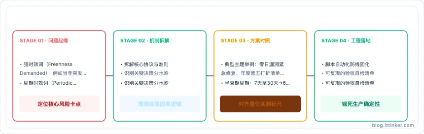
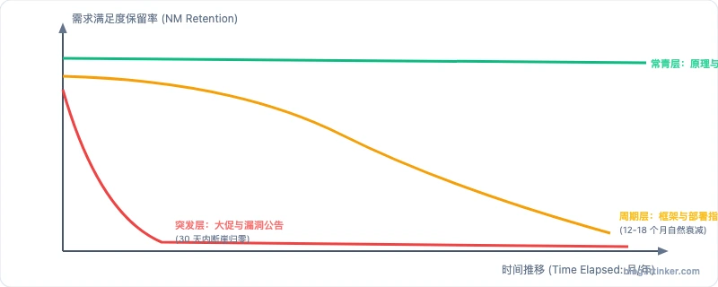
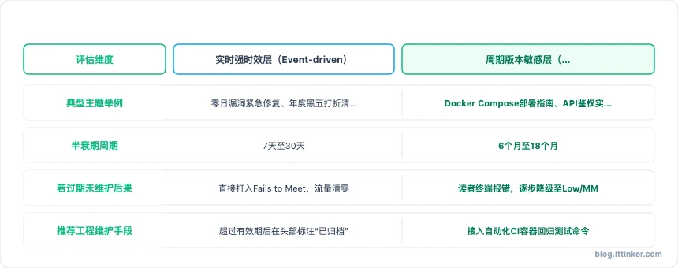
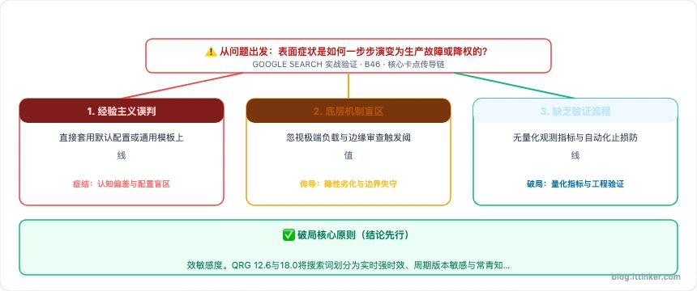
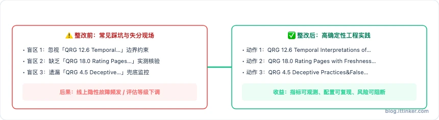
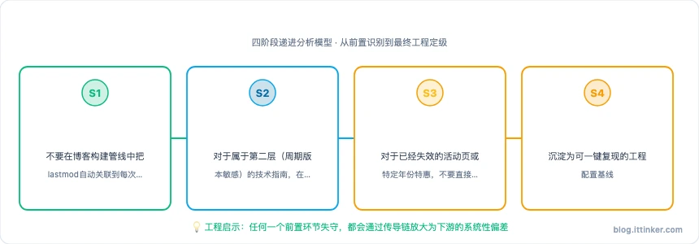
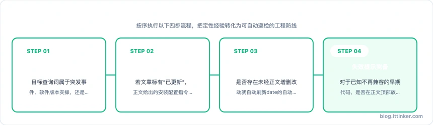

# “所有文章都要每月翻新一遍吗”？时效敏感度（Freshness）模型 | 读懂 Google Search SEO 实战 系列 046

> 🌐 **在线阅读与互动版**：[“所有文章都要每月翻新一遍吗”？时效敏感度（Freshness）模型 | 读懂 Google Search SEO 实战 系列 046](https://blog.ittinker.com/posts/freshness-不是所有文章都要-每月更新/)
> 📚 **所属专栏**：[《读懂 Google Search：110篇搜索质量与SEO实战指南》](../README.md)

---

### 📌 结论先行（TL;DR）
> **Google 算法对文章“新鲜度”（Freshness）的判定完全取决于特定 Query 的时效敏感度。**
> **在出海 SEO 圈子里流传着一种投机技巧：给博客配置定时任务，每隔一个月把文章 Frontmatter 里的 `date` 或 `lastmod` 改成当天日期，重新推送 Sitemap，试图借此蹭取 Google 的“新鲜度加权”。**
> **这种手段在 Google 的反作弊系统面前极易暴露。算法在追踪内容指纹与版本差异时，一旦发现页面主体内容没有变动，仅时间戳被机械刷新，该行为在 QRG 4.5 体系中直接被定性为欺骗性元数据（Deceptive Practice），进而招致整站降权。**
> **搜索结果是否需要“保持新鲜”，核心取决于搜索词背后的意图特征。**
>
> - QRG 12.6 与 18.0 将搜索词划分为实时强时效、周期版本敏感与常青知识三大层级。
> - 针对快速排序算法或 TCP 三次握手等常青概念，十年前撰写的严谨页面依然能够斩获 Fully Meets；
> - 针对云平台部署或框架兼容性等版本敏感词，代码失效则会导致评级迅速滑向 Fails to Meet。
> - 独立开发者应建立自动化巡检机制防范版本漂移，坚决禁止通过修改日期元数据制造伪更新。





---


### 🚨 2026 → 2024 官方最新风向预警：Google 对Google 对真正需要时效的内容（Evergreen vs QDF）的分级算法演进的策略演进

#### 🕒 2026 → 2024 Google 官方对Google 对真正需要时效的内容（Evergreen vs QDF）的分级算法演进的策略演进

- **2026 · 动态内容生命周期分级维护矩阵（Content Maintenance Tiering）**
  将全站内容科学分为‘时效敏感型（QDF，如框架最新版本特性，需高频维护）’与‘长青基石型（Evergreen，如数学算法原理，重在稳定权威）’，彻底终结无脑翻新日期的无效内耗。

- **2025 · 虚假刷新（Fake Freshness）惩戒机制**
  算法严打仅修改时间戳而不补充任何新事实的偷懒作弊，将有限的工程与写作精力集中投入到真正发生时代变迁的核心资产上。

- **2024 · QRG 19.0 节对时效性敏感度（Freshness Sensitivity）的量化界定**
  条款指导站长建立理性的内容资产维护观：尊重客观知识的半衰期，做有实质工程意义的高质量翻新，不做应付爬虫的形式主义伪更新。


---


## 1. QRG 12.6 与 18.0 原文穿透：时效性需求的评估准则

QRG 第 12.6 节与第 18.0 节对时效性（Freshness）给出了明确的定级依据：

> *"Some queries demand fresh, recent information. For these queries, older results—even if very high quality—may be Fails to Meet or Low Needs Met because they are out of date... For example, queries about ongoing events, recent software releases, or current election results have high freshness demands."*
> —— QRG 18.0 Rating Pages with Freshness Demands

> *"However, many queries do not require fresh content. Queries about established scientific facts, historical events, mathematical proofs, or foundational algorithms do not change often. High quality information written years ago can still be Fully Meets."*
> —— QRG 12.6 Temporal Interpretations of Queries

评估员在衡量时效性时遵循三项判定底线：

1. **强时效词（Freshness Demanded）**：例如当季突发漏洞、开发者大会发布会纪要。如果页面给出的方案停留在旧版本，无论结构多精美，评级一律为 Low 或 Fails。
2. **周期时效词（Periodic / Version Freshness）**：例如“最佳 Next.js 部署平台推荐”，随着各家云厂商计费模式与特性调整，页面需要每半年到一年核对关键参数。
3. **常青词（Evergreen Knowledge）**：例如二叉树遍历原理、Unix 进程信号机制。时间在此类知识面前处于静止状态，过往沉淀的高权重权威页面具备极强的稳定性。


---

## 2. 搜索词三级时效敏感度模型

为了合理分配有限的研发与创作精力，我们将所有技术内容映射到以下时效衰减图谱中：





---

## 3. 三类技术文章维度的维护矩阵

下表对比了三类内容在维护策略、自动化监控以及评估员判定维度的差异：

| 评估维度 | 实时强时效层（Event-driven） | 周期版本敏感层（Version-dependent） | 常青基础层（Evergreen Foundation） |
|---|---|---|---|
| **典型主题举例** | 零日漏洞紧急修复、年度黑五打折清单 | Docker Compose 部署指南、API 鉴权实现 | 正则表达式贪婪匹配、二叉堆原理 |
| **半衰期周期** | 7 天至 30 天 | 6 个月至 18 个月 | 5 年以上保持有效 |
| **若过期未维护后果** | 直接打入 Fails to Meet，流量清零 | 读者终端报错，逐步降级至 Low / MM | 依然稳居 Highly Meets / Fully Meets |
| **推荐工程维护手段** | 超过有效期后在头部标注“已归档” | 接入自动化 CI 容器回归测试命令 | 保持原文，无须刻意修改时间戳 |
| **伪造更新惩罚风险** | 极高（误导读者执行过时修复） | 高（修改日期但配置无法跑通） | 中（无意义的噪点操作） |





---

## 4. 自动化工程防线：GitHub Actions 命令时效金丝雀巡检

为了防止“周期敏感型”部署博文因底层依赖升级而静默失效，可以建立定时 GitHub Actions 任务，在干净的云端容器中自动抽取并测试博文中的指令：

```yaml
# .github/workflows/article-freshness-sentinel.yml
name: Article Command Drift Sentinel

on:
  schedule:
    # 每周日凌晨 02:00 自动执行实机兼容性回归
    - cron: '0 2 * * 0'
  workflow_dispatch:

jobs:
  validate-deployment-commands:
    runs-on: ubuntu-24.04
    steps:
      - name: Checkout Repository
        uses: actions/checkout@v4

      - name: Set up Python
        uses: actions/setup-python@v5
        with:
          python-version: '3.11'

      - name: Install Test Harness Dependencies
        run: pip install pyyaml requests markdown

      - name: Run Bash Code Block Validator
        run: |
          python3 tools/verify_article_scripts.py \
            --target-dir content/drafts/chuhai \
            --category version-sensitive \
            --fail-on-exit-code

      - name: Notify on Drift Detected
        if: failure()
        uses: actions/github-script@v7
        with:
          script: |
            github.rest.issues.create({
              owner: context.repo.owner,
              repo: context.repo.repo,
              title: '⚠️ Freshness Drift: Version-sensitive post failed container validation',
              body: 'Automated runner encountered non-zero exit code on production bash blocks in article drafts.'
            });
```


---

## 5. 外部链接与版本失效自动巡检脚本 (Python)

该 Python 脚本解析 Markdown 正文，检查引用的第三方软件官方源、Docker 镜像 Tag 与外链 HTTP 状态码，避免读者点击出现 404：

```python
#!/usr/bin/env python3
"""
audit_link_and_version_drift.py - 检测技术文章外部资源与命令时效
"""

import re
import sys
import urllib.request
from pathlib import Path

def check_external_url(url: str) -> int:
    try:
        req = urllib.request.Request(url, headers={"User-Agent": "Mozilla/5.0 (FreshnessAuditor/1.0)"})
        with urllib.request.urlopen(req, timeout=8) as resp:
            return resp.status
    except Exception as e:
        return 404

def audit_markdown_file(file_path: Path):
    content = file_path.read_text(encoding="utf-8")
    urls = re.findall(r'https?://[^\s)"]+', content)

    print(f"📄 审查文件: {file_path.name} (发现 {len(urls)} 处外部引用)")
    dead_links = []
    for u in set(urls):
        if "localhost" in u or "example.com" in u:
            continue
        status = check_external_url(u)
        if status >= 400:
            dead_links.append((u, status))

    if dead_links:
        print(f"⚠️ 发现失效外链 ({len(dead_links)} 处):")
        for dl, code in dead_links:
            print(f"   [{code}] {dl}")
        return False
    else:
        print("✅ 所有外部镜像与技术文档外链均处于健康存活状态。")
        return True

if __name__ == "__main__":
    target = Path(sys.argv[1]) if len(sys.argv) > 1 else Path("content/drafts/seo/seo-b46-query-freshness-demand-model.md")
    audit_markdown_file(target)
```





---

## 6. Schema.org 真实时效语义规范注入

坚决杜绝机械刷新 `dateModified`。在正文结构化数据中真实声明初次创建时间与技术版本支持范围：

```html
<script type="application/ld+json">
{
  "@context": "https://schema.org",
  "@type": "TechArticle",
  "headline": "VPS 资源监控方案：Beszel 轻量部署实战",
  "datePublished": "2026-03-08T08:00:00Z",
  "dateModified": "2026-11-10T12:00:00Z",
  "proficiencyLevel": "Intermediate",
  "about": [
    {
      "@type": "SoftwareApplication",
      "name": "Beszel",
      "softwareVersion": "v0.9.0+"
    }
  ],
  "author": {
    "@type": "Person",
    "name": "Richardson",
    "url": "https://blog.ittinker.com"
  }
}
</script>
```


---

## 7. QRG 关联条款判定依据详解

- **QRG 12.6 Temporal Interpretations of Queries**：基础科学、底层数据结构与数学算法的意图不受时间衰减影响。对于这类查询，十年前撰写但论述清晰、准确权威的高质文章依然应获得 Fully Meets。
- **QRG 18.0 Rating Pages with Freshness Demands**：针对具有鲜明时效要求的词条（如软件重大版本更新、安全补丁），如果结果内容落后于现实导致无法指导操作，评分上限不得超过 Low 或 Fails to Meet。
- **QRG 4.5 Deceptive Practices & False Timestamps**：仅更改页面展示日期而未进行实质技术纠错与内容增补的行为，构成对读者的欺诈性误导，评估员可按 Lowest 违规处理。
- **QRG 14.1 Needs Met Criteria for Outdated Information**：过时信息无法解决用户当下的任务，直接扣除满足度得分。





---

## 8. 独立开发者的分级工程维护实操

针对维护精力有限的现实，建议开发者采取三项低成本工程实践：

### 实践一：坚决废除“自动化刷日期脚本”
不要在博客构建管线中把 `lastmod` 自动关联到每次 `git commit`。Google 爬虫会对比 DOM 差异树，无意义的文本微调（比如修改一个标点）却联动更改时间戳，会被标记为低质爬虫特征。唯有重写关键命令或补充新架构章节时，才手动更新日期。

### 实践二：利用自动化脚本构建命令金丝雀巡检
对于属于第二层（周期版本敏感）的技术指南，在维护中依托自动化套件保障脚本命令的时效性。例如在 ITTinker 开源的工具生态中，[ittinker-scripts](https://github.com/ittinker/ittinker-scripts) 定期运行自动化测试，确保给出的 Shell 脚本在最新 Ubuntu LTS 环境下稳定执行：

```bash
# 通过自动化巡检套件核验运维指令的当下兼容性
curl -fsSL https://raw.githubusercontent.com/ittinker/ittinker-scripts/main/vps-health-monitor/vps-health-monitor.sh | bash
```

当上游云厂商 API 或系统依赖发生破坏性变更（Breaking Change）时，CI 自动触发告警，此时再去针对性修订博文代码，用极低的时间成本守住 Highly Meets。

### 实践三：为时效过期的短命内容打上归档声明
对于已经失效的活动页或特定年份特惠，不要直接删除（导致 404 损失权重）。在正文第一屏显眼位置插入黄色警告块提示：“本文记录 2024 年旧版接口规范，最新 2026 年规范请移步最新指南”。这能保护读者体验，避免被评估员直接打入 Lowest 欺骗档位。





---

## 9. 内容时效策略自查清单

在规划文章更新周期时，对照以下项目进行审校：

- [ ] **意图时效定级**：目标查询词属于突发事件、软件版本实操，还是底层数学与网络协议常青词？
- [ ] **真实代码验证**：若文章标有“已更新”，正文给出的安装配置指令是否在最新系统亲测跑通？
- [ ] **拒绝元数据伪造**：是否存在未经正文增删改动就自动刷新 `date` 的自动化作弊行为？
- [ ] **失效提示完备**：对于已知不再兼容的早期代码，是否在正文顶部放置了明确的版本警告？
- [ ] **自动化漂移拦截**：周期敏感型技术文档是否接入了外部死链检查与定期命令回归测试；
- [ ] **长期资产聚焦**：个人博客内容库中，长青基础与周期实操的内容占比是否维持在 70% 以上？





---

## 10. 下一篇预告

理清了时效性对技术指南的维护要求后，我们来看一类特殊的商业搜索词：产品对比（Comparison Queries）。为什么很多自建对比站急于给读者下结论，反而导致排名不断下滑？

下一篇，我们将探讨商业决策型内容的交付哲学：**[“在对比评测里单方面吹捧自家产品”？一眼假的公关软文：产品对比页为什么必须客观中立帮用户做决策？（B47）](/posts/产品对比页为什么应该帮助研究-而不是急着替用户下结论/)**。

---

_这是「读懂 Google Search」系列第 46 篇，系统拆解 Google 官方质量指南，帮你建立长期抗算法波动的出海 SEO 护城河。_


---

## 读懂 Google Search 专栏导航

> 📚 **专栏收录**：本文为 [《读懂 Google Search：110篇搜索质量与SEO实战指南》](/posts/google-search-guide/) 第 **B46** 篇。

* **专栏主页**：[《读懂 Google Search：110篇搜索质量与SEO实战指南》全景地图与路线图](/posts/google-search-guide/)
