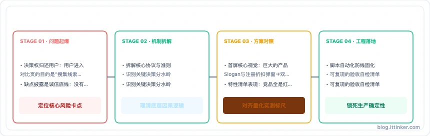
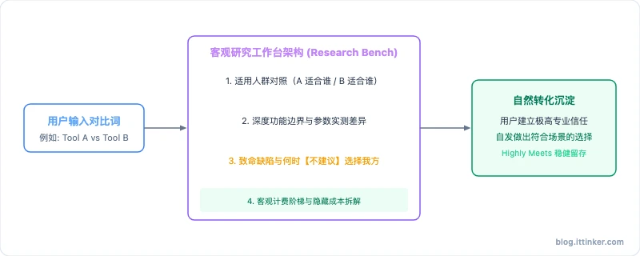
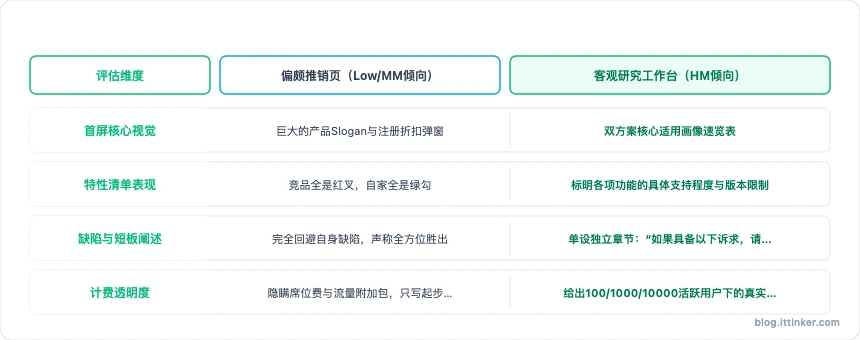
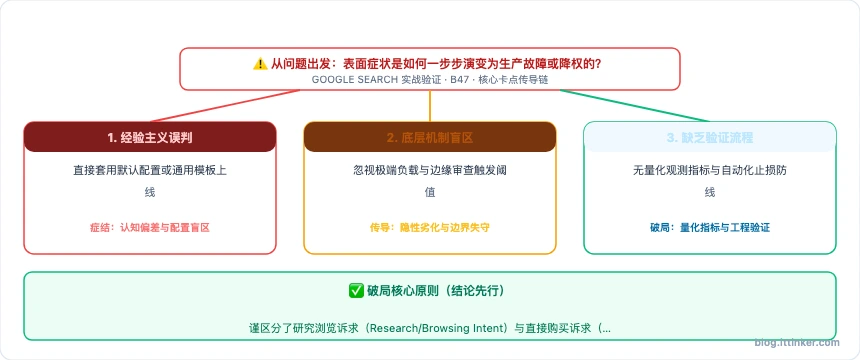
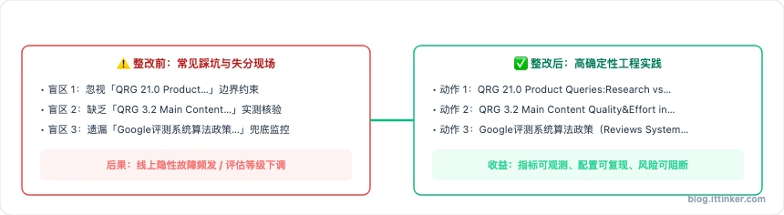
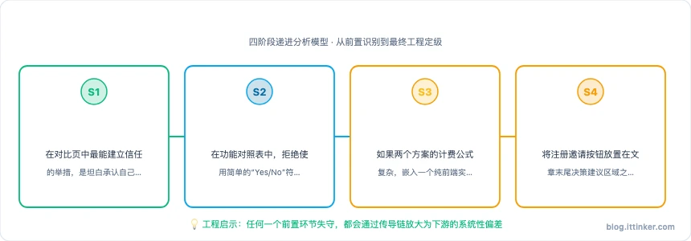
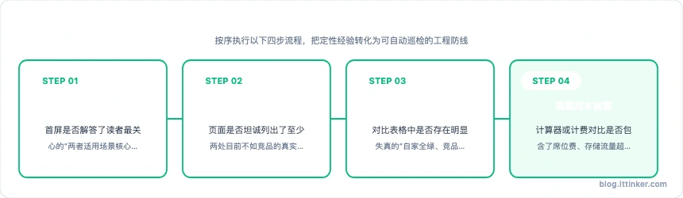

# “对比评测全在吹自家人谁信”？客观中立评测页的设计原则 | 读懂 Google Search SEO 实战 系列 047

> 🌐 **在线阅读与互动版**：[“对比评测全在吹自家人谁信”？客观中立评测页的设计原则 | 读懂 Google Search SEO 实战 系列 047](https://blog.ittinker.com/posts/产品对比页为什么应该帮助研究-而不是急着替用户下结论/)
> 📚 **所属专栏**：[《读懂 Google Search：110篇搜索质量与SEO实战指南》](../README.md)

---

### 📌 结论先行（TL;DR）
> **在 Google 针对商品与软件查询（Product Queries）的评估体系中，QRG 21.0 严谨区分了研究浏览诉求（Research / Browsing Intent）与直接购买诉求（Purchase Intent）。**
> **独立开发者在商业化出海过程中，通常都会制作“自身产品 vs 行业龙头”的对比着陆页（如 `YourApp vs Notion`）。**
> **但在实际落地中，许多站长极易犯下一个致命错误：把对比页做成一封毫无掩饰的“攻击信”。在首屏用大红叉把竞品贬得一无是处，把自身产品的所有指标标成绿色对勾，并在前两屏密集塞入 4 个巨大的“立即注册”按钮。**
> **这类页面上线后，不仅跳出率高企，更往往在 Google 近年的 Reviews Update（评测更新）与核心算法迭代中遭遇沉重打击。**
> **为什么急于促成转化的对比内容，反而两头落空？**
>
> - 当用户检索 `stripe vs paddle` 或 `supabase vs firebase` 时，其心理处于多维度权衡阶段，期望获得中立的边界限制、计费隐形门槛及架构适用条件。
> - **偏颇拉踩并急躁插入购买按钮的页面**：在 Needs Met 维度会被评估员判定为 Low 或 Moderately Meets。
> - **真正具备持久排名的对比页**：应当充当客观透明的研究工作台。





---


### 🚨 2026 → 2024 官方最新风向预警：Google 对Google 对产品对比评测（Product Reviews System）客观中立性的严惩与奖励的策略演进

#### 🕒 2026 → 2024 Google 官方对Google 对产品对比评测（Product Reviews System）客观中立性的严惩与奖励的策略演进

- **2026 · 中立客观决策树算法赋权（Objective Comparison Superiority）**
  Google 核心评测算法专门识别通篇打满自家全绿对勾、把竞品全打红叉的弱智对比表。唯有诚恳列出自家产品的硬伤、明确指出竞品在特定高并发场景下的不可替代性，才能赢得算法信任。

- **2025 · 软文伪装评测批量清退**
  充斥全网的‘公关稿式假对比’被系统精准定性为欺诈性商业内容，直接从比较类意图的高位排名中剔除。

- **2024 · QRG 22.0 节对商业比较页面必须展现崇高诚实度的官方要求**
  规范指出：一个真正优秀的评测者，必须敢于讲出真相。帮助用户做出最适合他的选择，而不是强迫用户买你的东西，这才是长期商业信任的唯一起点。


---


## 1. QRG 21.0 原文穿透：研究型搜索与购买型搜索的界限

Google 评估指南第 21.0 节《Product Queries: Research vs Purchase Intent》揭示了用户在比较阶段的行为特征：

> *"Users searching for product comparison queries are typically in the research or browsing phase. They are trying to understand the differences between options, identify tradeoffs, and determine which product best fits their specific constraints... Pages that are overtly biased, fail to disclose significant limitations, or push a hard sell before providing comparative details do not satisfy research needs well and should receive lower Needs Met ratings."*
> —— QRG 21.0 Product Queries

指南中确立了评估员审查对比页的三项核心红线：

1. **决策权归还用户**：用户进入对比页的目的是“搜集线索做决策”，绝非寻找一个推销员替自己拍板。
2. **缺点披露是诚信底线**：没有任何一款软件在所有维度完全胜出。如果一个对比方案声称自己价格更低、功能更多、性能更好、毫无缺点，评估员会直接将其视为虚假宣传（Untrustworthy Content）。
3. **参数验证先于行动转化**：必须先详尽列出技术规格、网络延迟、计费梯度与迁移成本，再适度放置产品试用链接。


---

## 2. 客观研究工作台的信息架构模型

为了让对比页真正满足用户的调研意图，页面应当遵循由浅入深的研究推进路径，而非单一的推销导向：





---

## 3. 偏颇推销页与客观研究型对比页的特征差异

下表详尽对比了两种截然不同的对比页面构建思路：

| 评估维度 | 偏颇推销页（Low / MM 倾向） | 客观研究工作台（HM 倾向） |
|---|---|---|
| **首屏核心视觉** | 巨大的产品 Slogan 与注册折扣弹窗 | 双方案核心适用画像速览表 |
| **特性清单表现** | 竞品全是红叉，自家全是绿勾 | 标明各项功能的具体支持程度与版本限制 |
| **缺陷与短板阐述** | 完全回避自身缺陷，声称全方位胜出 | 单设独立章节：“如果具备以下诉求，请选择竞品” |
| **计费透明度** | 隐瞒席位费与流量附加包，只写起步价 | 给出 100/1000/10000 活跃用户下的真实账单预估 |
| **评估员判定结果** | 商业误导倾向，打入 Low 或 MM | 辅助调研典范，稳拿 Highly Meets |
| **长期真实留存率** | 读者心存疑虑，退回 Google 查看 Reddit | 读者被诚恳态度打动，留存转化率显著提升 |





---

## 4. 前端工程落地：可交互决策计算器与多维矩阵组件

为了在对比页真正充当“客观研究工作台”，最佳实践是在页面中内嵌纯前端实现的成本决策计算器，供读者根据实际业务量动态推演账单：

```tsx
// components/compare/PricingDecisionCalculator.tsx
'use client';

import React, { useState } from 'react';

export function PricingDecisionCalculator() {
  const [mau, setMau] = useState(5000);
  const [storageGb, setStorageGb] = useState(50);

  // 方案 A 模拟计费规则: 基础费 $25，包含 2500 MAU + 10GB 存储，超出部分计费
  const calculateCostA = (users: number, storage: number): number => {
    let cost = 25;
    if (users > 2500) cost += Math.ceil((users - 2500) / 1000) * 8;
    if (storage > 10) cost += (storage - 10) * 0.15;
    return Math.round(cost);
  };

  // 方案 B 模拟计费规则: 纯按量计费，无月基础费，单价稍高
  const calculateCostB = (users: number, storage: number): number => {
    const cost = users * 0.009 + storage * 0.20;
    return Math.round(cost);
  };

  const costA = calculateCostA(mau, storageGb);
  const costB = calculateCostB(mau, storageGb);

  return (
    <div className="rounded-2xl border border-slate-200 bg-white p-6 shadow-sm space-y-6">
      <div className="border-b border-slate-100 pb-4">
        <h3 className="text-lg font-bold text-slate-900">Interactive TCO (Total Cost of Ownership) Calculator</h3>
        <p className="text-xs text-slate-500">Simulate monthly expenditures based on your real architectural load.</p>
      </div>

      <div className="grid grid-cols-1 sm:grid-cols-2 gap-6">
        <div>
          <label className="block text-xs font-semibold text-slate-700">Monthly Active Users (MAU): {mau.toLocaleString()}</label>
          <input
            type="range"
            min={500}
            max={50000}
            step={500}
            value={mau}
            onChange={(e) => setMau(Number(e.target.value))}
            className="mt-2 w-full accent-blue-600"
          />
        </div>
        <div>
          <label className="block text-xs font-semibold text-slate-700">Database Storage: {storageGb} GB</label>
          <input
            type="range"
            min={5}
            max={500}
            step={5}
            value={storageGb}
            onChange={(e) => setStorageGb(Number(e.target.value))}
            className="mt-2 w-full accent-blue-600"
          />
        </div>
      </div>

      <div className="grid grid-cols-2 gap-4 pt-2">
        <div className="rounded-xl bg-slate-50 p-4 border border-slate-200 text-center">
          <p className="text-xs font-medium text-slate-500">Platform A (Fixed Tier)</p>
          <p className="mt-1 text-2xl font-black text-slate-900">${costA} <span className="text-xs font-normal text-slate-500">/ mo</span></p>
          <p className="mt-2 text-xs text-slate-600">{costA < costB ? 'Cost-effective for steady high-load' : 'Higher tier penalty'}</p>
        </div>
        <div className="rounded-xl bg-slate-50 p-4 border border-slate-200 text-center">
          <p className="text-xs font-medium text-slate-500">Platform B (Pure Pay-as-you-go)</p>
          <p className="mt-1 text-2xl font-black text-slate-900">${costB} <span className="text-xs font-normal text-slate-500">/ mo</span></p>
          <p className="mt-2 text-xs text-slate-600">{costB <= costA ? 'Optimal for early development' : 'Bandwidth overage risk'}</p>
        </div>
      </div>
    </div>
  );
}
```


---

## 5. 客观测试基准数据采集与验证脚本 (Python)

高质量评测页要求给出可复现的基准测试（Reproducible Benchmarks）。以下 Python 脚本展示如何自动采集两款数据库或 API 服务的 P95 响应延迟与吞吐量：

```python
#!/usr/bin/env python3
"""
benchmark_compare.py - 采集竞品对比中的客观时延数据
运行依赖: pip install requests numpy
"""

import time
import requests
import numpy as np

def measure_endpoint_latency(endpoint_url: str, samples: int = 30):
    latencies = []
    headers = {"User-Agent": "ITTinkerBenchmark/1.0"}
    for _ in range(samples):
        start = time.perf_counter()
        try:
            r = requests.get(endpoint_url, headers=headers, timeout=5)
            if r.status_code == 200:
                elapsed_ms = (time.perf_counter() - start) * 1000
                latencies.append(elapsed_ms)
        except Exception:
            pass
        time.sleep(0.05)

    if not latencies:
        return None

    return {
        "p50": round(float(np.percentile(latencies, 50)), 2),
        "p95": round(float(np.percentile(latencies, 95)), 2),
        "max": round(float(np.max(latencies)), 2),
        "samples": len(latencies),
    }

if __name__ == "__main__":
    print("🔬 执行真实链路基准测试...")
    # 对比两组真实公开健康端点 (示例地址)
    res_a = measure_endpoint_latency("https://httpbin.org/get", samples=20)
    res_b = measure_endpoint_latency("https://httpbin.org/status/200", samples=20)

    print(f"📊 方案 A 延迟分布: P50={res_a['p50']}ms, P95={res_a['p95']}ms")
    print(f"📊 方案 B 延迟分布: P50={res_b['p50']}ms, P95={res_b['p95']}ms")
    print("✅ 数据采集完成，可作为客观图表数据注入对比页正文。")
```





---

## 6. Schema.org 结构化标记：双产品对比与评测语义规范

在产品对比页中，使用 `ItemList` 与 `Product` 结构化标记，标明评测主体与技术属性：

```html
<script type="application/ld+json">
{
  "@context": "https://schema.org",
  "@type": "ItemList",
  "name": "Self-Hosted vs Managed Database Comparison",
  "description": "Architectural tradeoffs and cost analysis for infrastructure planning.",
  "itemListElement": [
    {
      "@type": "ListItem",
      "position": 1,
      "item": {
        "@type": "Product",
        "name": "Self-Hosted Supabase",
        "description": "Open source Firebase alternative running on Docker and local PostgreSQL.",
        "offers": {
          "@type": "Offer",
          "price": "0",
          "priceCurrency": "USD"
        }
      }
    },
    {
      "@type": "ListItem",
      "position": 2,
      "item": {
        "@type": "Product",
        "name": "Firebase Managed Suite",
        "description": "Google Cloud proprietary serverless document store with global replication.",
        "offers": {
          "@type": "Offer",
          "price": "25",
          "priceCurrency": "USD"
        }
      }
    }
  ]
}
</script>
```


---

## 7. QRG 关联条款判定依据详解

- **QRG 21.0 Product Queries: Research vs Purchase Intent**：明确指出比较型搜索（Comparison Queries）通常处于调研阶段。试图强行成交或大肆拉踩而忽视客观规格的页面，严重挫伤用户调研诉求，应给予较低的 Needs Met 评分。
- **QRG 3.2 Main Content Quality & Effort in Reviews**：高质量评测必须包含一手实测数据（First-hand Experience）、量化测试指标与多维度优劣平衡分析。
- **Google 评测系统算法政策（Reviews System Policy）**：要求对比内容提供定量实验依据、列举适用场景与不适场景、阐明设计权衡（Trade-offs），严禁毫无依据的单方面偏袒。





---

## 8. 打造高分对比页的四套工程实操原则

独立开发者在构建产品对比页时，可以落实以下四套规范：

### 原则一：设立诚实的“反向推荐”模块
在对比页中最能建立信任的举措，是坦白承认自己无法满足的场景。例如写明：“如果你是一家跨国上市公司，需要 SOC2 合规审计与专用电话客服，请直接选用行业大厂，我们目前仅聚焦独立开发者与 10 人以下研发团队”。这种清晰的边界划分，直接消除了用户的疑虑。

### 原则二：放弃抽象对勾，提供量化规格指标
在功能对照表中，拒绝使用简单的“Yes / No”符号。将其升级为具体的技术规格：
- 竞品：支持（但 API 频率限制为 10 次/秒，数据保留 7 天）
- 我方：支持（无频率限制，原生存储本地 SQLite，数据自持）
让读者基于客观工程参数做决策，而非基于主观评价。

### 原则三：提供可交互的场景决策模拟
如果两个方案的计费公式复杂，嵌入一个纯前端实现的动态费用计算滑块。读者拖动自身的月 API 调用量或存储容量，实时计算出在两个平台各自需要消耗的真实美元账单。这种交互组件能够让页面在 Needs Met 评估中脱颖而出。

### 原则四：将引导行动置于决策之后
将注册邀请按钮放置在文章末尾决策建议区域之后，并保持文案克制（如“免费启动测试环境验证是否满足需求”）。让行动顺理成章地发生，绝不在读者阅读参数时用浮窗或强制阻断打扰视线。





---

## 9. 产品对比页质量自查清单

在发布任何一篇包含竞品对比与方案选型的落地页前，建议核查以下项目：

- [ ] **调研意图适配**：首屏是否解答了读者最关心的“两者适用场景核心分水岭”？
- [ ] **自身缺陷公开**：页面是否坦诚列出了至少两处目前不如竞品的真实技术局限？
- [ ] **避免全红全绿**：对比表格中是否存在明显失真的“自家全绿、竞品全红”不实排版？
- [ ] **隐藏成本披露**：计算器或计费对比是否包含了席位费、存储流量超出费等潜在支出？
- [ ] **量化指标支撑**：是否提供了延迟、内存占用、API 频率等客观实测数据；
- [ ] **克制商业转化**：正文是否完全去除了挡住对比表格的注册弹窗与闪烁促销横幅？





---

## 10. 下一篇预告

探讨完数字产品在全网范围内的调研对比后，我们来看一类与物理现实紧密绑定的搜索类型：Local Query（本地搜索）。为什么这类词的落地页如果忽略了用户的物理坐标，就会直接被打入零分？

下一篇，我们将探讨地理位置驱动的搜索规则：**[“人在东京搜出来的维修师傅在大阪”？脱离经纬度的荒谬体验：Local Query 本地意图落地页为什么必须基于用户当前位置？（B48）](/posts/local-query-的页面设计-为什么必须考虑用户当前位置/)**。

---

_这是「读懂 Google Search」系列第 47 篇，系统拆解 Google 官方质量指南，帮你建立长期抗算法波动的出海 SEO 护城河。_


---

## 读懂 Google Search 专栏导航

> 📚 **专栏收录**：本文为 [《读懂 Google Search：110篇搜索质量与SEO实战指南》](/posts/google-search-guide/) 第 **B47** 篇。

* **专栏主页**：[《读懂 Google Search：110篇搜索质量与SEO实战指南》全景地图与路线图](/posts/google-search-guide/)
