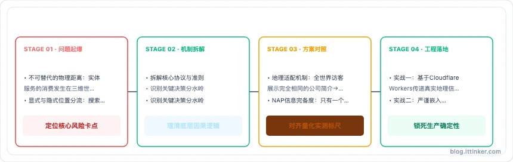
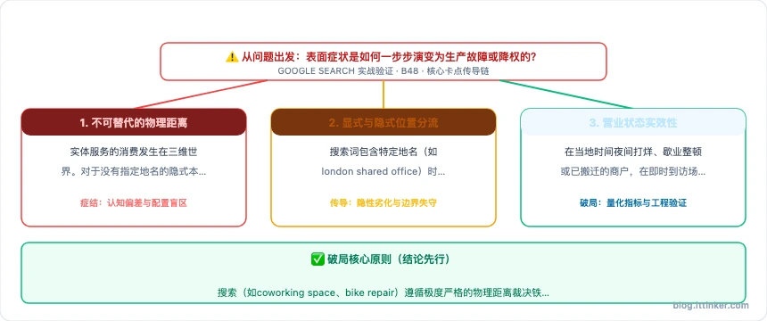
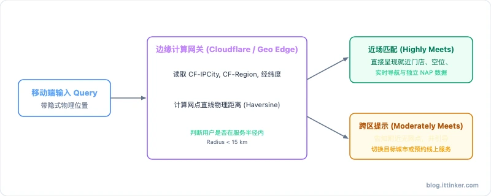
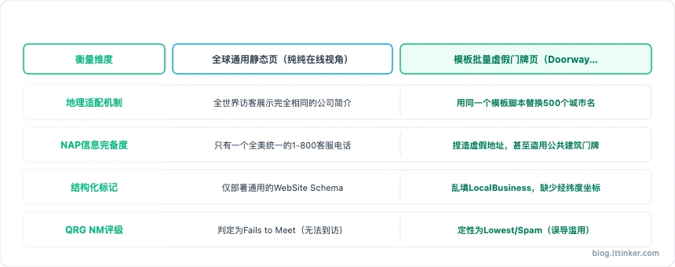
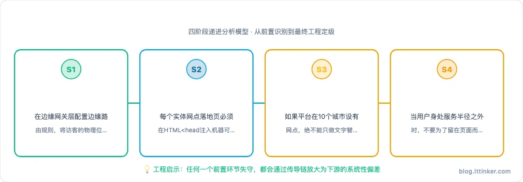
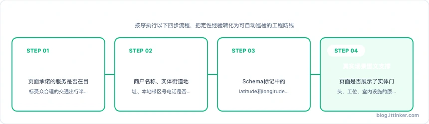

# “人在东京搜出大阪师傅”？本地查询与当前地理位置对齐 | 读懂 Google Search SEO 实战 系列 048

> 🌐 **在线阅读与互动版**：[“人在东京搜出大阪师傅”？本地查询与当前地理位置对齐 | 读懂 Google Search SEO 实战 系列 048](https://blog.ittinker.com/posts/local-query-的页面设计-为什么必须考虑用户当前位置/)
> 📚 **所属专栏**：[《读懂 Google Search：110篇搜索质量与SEO实战指南》](../README.md)

---

### 📌 结论先行（TL;DR）
> **在 Google 质量指南中，带有线下到访意图（Visit-in-Person Intent）的本地搜索（如 `coworking space`、`bike repair`）遵循极度严格的物理距离裁决铁律。**
> **出海开发者在开发跨国信息聚合或生活服务平台（如海外自习室预订、房产中介导流、设备租赁）时，往往沿用纯数字 SaaS 的思维模式：做一个通用的英文模板，把全世界的城市名替换进标题，企图用一套静态架构收割全球各地的自然流量。**
> **这种做法在本地搜索场景下几乎必然遭遇断崖式失利。**
> **当身处旧金山市中心的用户在手机上搜索 `meeting room rental` 时，Google 绝不会把一家位于纽约的高评分自习室推到首屏。用户无法跨越三千英里去使用服务，物理距离在算法中拥有一票否决权。**
>
> - QRG 12.7.4 与 22.0–22.1 明确规定，无论目标网站在全球范围内的域名权重多高、E-E-A-T 多么完备，只要其实体地址超出用户的实际行动半径，评级直接判定为 Fails to Meet。
> - 出海开发者在构建跨国租房、本地生活或实体连锁业务时，必须在边缘 CDN 识别地理坐标，结合 `LocalBusiness` 结构化数据与真实的 NAP（名称、地址、电话）信息构建落地页。





---


### 🚨 2026 → 2024 官方最新风向预警：Google 对Google 本地搜索针对用户实时距离与服务半径的算法演化的策略演进

#### 🕒 2026 → 2024 Google 官方对Google 本地搜索针对用户实时距离与服务半径的算法演化的策略演进

- **2026 · 超精细化空间网格与即时定位匹配（Hyper-local Geo-fencing）**
  针对本地线下服务词，Google 算法引入微观街区级地理衰减机制。任何试图用跨区域泛化落地页拦截异地客户的行为遭遇直接屏蔽。

- **2025 · 本地实体服务能力的硬核证据网**
  落地页必须与物理门店坐标、当地营业执照、当地真实服务照片与真实的本地客户评测深度对齐，彻底清除虚拟打卡黑产。

- **2024 · QRG 25.0 节关于 Visit-in-Person 意图与用户位置（User Location）的裁决指南**
  条款确立了本地化评估的铁律：离开用户当前真实坐标谈服务匹配全属无稽之谈，指导本地生活出海团队必须脚踏实地做实本地履约。


---


## 1. QRG 12.7.4 与 22.0–22.1 原文穿透：地理位置的一票否决权

Google 质量评估指南在第 12.7.4 节《Visit-in-Person Intent》与第 22.0 节《Rating Local Results》中建立了严密的本地评级框架：

> *"Visit-in-Person Intent: Some queries have a clear or probable intent to visit a physical location, store, or service provider in person... User Location is critical for rating Visit-in-Person queries. If a user in Seattle searches for 'coffee shop', a world-famous coffee shop in Vienna, Austria must receive a Fails to Meet rating, because the user cannot visit it."*
> —— QRG 12.7.4 Visit-in-Person Intent

> *"Explicit vs. Implicit Location: An explicit location is specified in the query itself (e.g., 'hotels in Ginza Tokyo'). An implicit location is derived from the user's device location, IP address, or recent search history. When location is implicit, results must be within a reasonable driving, walking, or transit distance to receive High or Fully Meets."*
> —— QRG 22.1 Evaluating Proximity

指南明确了本地搜索裁决的三项技术红线：

1. **不可替代的物理距离**：实体服务的消费发生在三维世界。对于没有指定地名的隐式本地词，距离超出步行或短途车程的结果直接定性为无用（Fails to Meet）。
2. **显式与隐式位置分流**：搜索词包含特定地名（如 `london shared office`）时，以词面指定的显式城市为锚点；未带地名时，以终端用户的 GPS 或边缘 IP 节点为锚点。
3. **营业状态实效性**：在当地时间夜间打烊、歇业整顿或已搬迁的商户，在即时到访场景下会被直接降权。





---

## 2. 本地意图的分流与边缘路由架构

为了在兼顾全球访客的同时满足极度本地化的搜索评估，系统需要在接入层完成地理感知的动态分流：





---

## 3. 全局通用页、虚假门牌页与合规本地落地页对比

下表对比了三类架构在承接本地查询时的根本差异：

| 衡量维度 | 全球通用静态页（纯纯在线视角） | 模板批量虚假门牌页（Doorway Spam） | 地理感知合规本地页（QRG 典范） |
|---|---|---|---|
| **地理适配机制** | 全世界访客展示完全相同的公司简介 | 用同一个模板脚本替换 500 个城市名 | 依据访客位置或所选城市呈现专属门店实体 |
| **NAP 信息完备度** | 只有一个全美统一的 1-800 客服电话 | 捏造虚假地址，甚至盗用公共建筑门牌 | 具备在 Google 商业档案认证的真实地址与座机 |
| **结构化标记** | 仅部署通用的 `WebSite` Schema | 乱填 `LocalBusiness`，缺少经纬度坐标 | 严谨部署 `LocalBusiness`，含经纬度与营业时间 |
| **QRG NM 评级** | 判定为 **Fails to Meet**（无法到访） | 定性为 **Lowest / Spam**（误导滥用） | 稳获 **Highly Meets / Fully Meets** |
| **地图与导航集成** | 仅展示静态一张世界地图插图 | 仅嵌入通用的城市中心坐标 | 集成交互式地图、公共交通换乘与停车指引 |





---

## 4. 独立开发者落地 Local Query 的四项工程实战

出海团队在缺乏庞大本地地推团队的条件下，建议采用以下轻量但合规的技术架构方案：

### 实战一：基于 Cloudflare Workers 传递真实地理信令
在边缘网关层配置边缘路由规则，将访客的物理位置参数向下透传给业务后端。可以借助开源运维工具箱（如 ITTinker 维护的 [ittinker-scripts](https://github.com/ittinker/ittinker-scripts)）中的域名基线脚本配置边缘转发头：

```bash
# 部署域名基线安全配置与边缘代理网关
curl -fsSL https://raw.githubusercontent.com/ittinker/ittinker-scripts/main/cloudflare-domain-baseline/setup.sh | bash
```

在边缘逻辑中读取请求头：
```javascript
export default {
  async fetch(request) {
    const city = request.cf?.city || 'Unknown';
    const latitude = request.cf?.latitude;
    const longitude = request.cf?.longitude;
    // 将地理位置透传给模板渲染引擎
    const response = await fetch(request);
    return response;
  }
}
```

### 实战二：严谨嵌入 LocalBusiness JSON-LD 结构化数据
每个实体网点落地页必须在 HTML `<head>` 注入机器可读的精确坐标与营业时间，这是 Google 抓取并展示本地 Pack（地图三件套卡片）的直接依据：

```json
<script type="application/ld+json">
{
  "@context": "https://schema.org",
  "@type": "CoworkingSpace",
  "name": "Tinker Hub Shinjuku",
  "address": {
    "@type": "PostalAddress",
    "streetAddress": "3-14-1 Shinjuku",
    "addressLocality": "Shinjuku-ku",
    "addressRegion": "Tokyo",
    "postalCode": "160-0022",
    "addressCountry": "JP"
  },
  "geo": {
    "@type": "GeoCoordinates",
    "latitude": 35.690921,
    "longitude": 139.705256
  },
  "telephone": "+81-3-1234-5678",
  "openingHoursSpecification": [
    {
      "@type": "OpeningHoursSpecification",
      "dayOfWeek": ["Monday", "Tuesday", "Wednesday", "Thursday", "Friday"],
      "opens": "08:00",
      "closes": "22:00"
    }
  ]
}
</script>
```

### 实战三：拒绝“空壳换城”，强化网点专有内容
如果平台在 10 个城市设有网点，绝不能只做文字替换。必须为每个网点页面补充独家信息：
- 距离最近的地铁站出口（如“距离新宿站东口步行 3 分钟”）；
- 该网点的现场真实拍摄照片（展示插座类型、工位布局、网络测速报告）；
- 真实的周边停车指南与费用标准。
这些独一无二的本地细节，构成了抵御 Google 算法打击门牌页（Doorway Pages）的核心屏障。

### 实战四：明确告知跨区服务限制
当用户身处服务半径之外时，不要为了留在页面而隐瞒距离。在首屏显眼处提示：“当前离您最近的网点距离 45 公里，如需实地参观看房建议提前预约，或直接查看线上全景 VR”。这种透明度维护了读者的知情权，能在评估员抽检时拿到合规的 Moderately Meets，避免被直接判为误导欺诈。





---

## 5. 本地页面意图落地自查清单

在上线任何面向特定国家与城市的线下服务页面时，逐一排查以下事项：

- [ ] **物理距离逻辑合理**：页面承诺的服务是否在目标受众合理的交通出行半径之内？
- [ ] **NAP 真实一致**：商户名称、实体街道地址、本地带区号电话是否全网保持统一？
- [ ] **精确经纬度标记**：Schema 标记中的 `latitude` 和 `longitude` 是否精确落在门店门口？
- [ ] **真实场景图文支撑**：页面是否展示了实体门头、工位、室内设施的原创实拍照片？
- [ ] **拒绝纯空壳 Doorway**：多个城市页面之间，除基础产品结构外，是否拥有独特的交通指引与周边环境说明？





---

## 下一篇预告

至此，我们已经完整梳理了 QRG 中关于 SERP 界面、Needs Met 标尺、权威错位以及本地物理意图的核心逻辑。但理论最终需要落入实战检验。

下一篇，我们将正式开启第七章【实验室】，带大家亲手实操一次完整的质量体检：**[“我的网站到底能不能扛住 Google 审查”？揭开黑盒的深度体检：我用 Google QRG 给一个真实网站做端到端体检报告（B49）](/posts/我用-google-qrg-给一个真实网站做一次完整体检/)**。

---

_这是「读懂 Google Search」系列第 48 篇，系统拆解 Google 官方质量指南，帮你建立长期抗算法波动的出海 SEO 护城河。_


---

## 读懂 Google Search 专栏导航

> 📚 **专栏收录**：本文为 [《读懂 Google Search：110篇搜索质量与SEO实战指南》](/posts/google-search-guide/) 第 **B48** 篇。

* **专栏主页**：[《读懂 Google Search：110篇搜索质量与SEO实战指南》全景地图与路线图](/posts/google-search-guide/)
