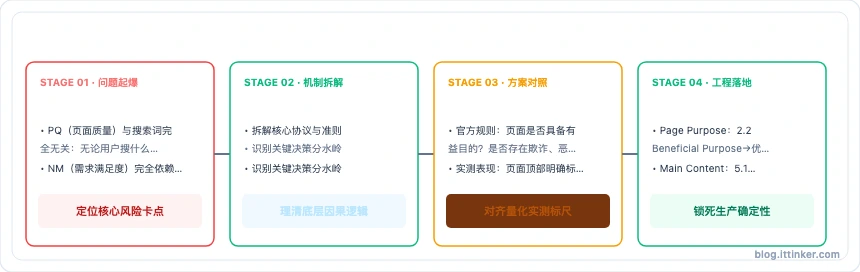
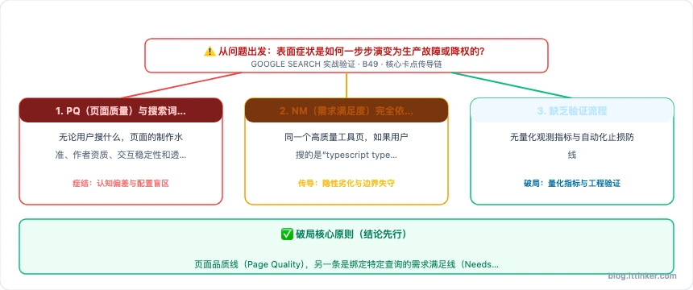
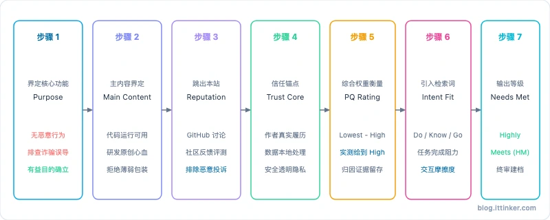
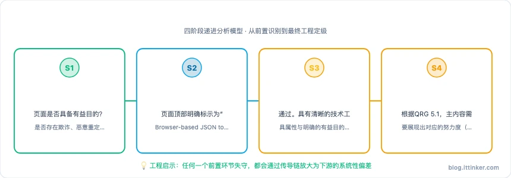
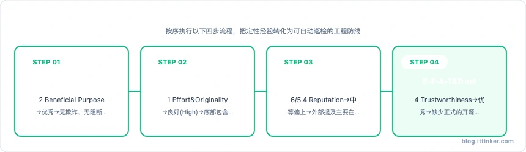
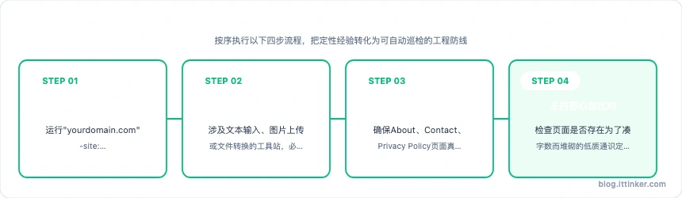

# 我用 Google QRG 给一个真实网站做一次完整体检：端到端审查 SOP 与诊断报告 | 读懂 Google Search SEO 实战 系列 049

> 🌐 **在线阅读与互动版**：[我用 Google QRG 给一个真实网站做一次完整体检：端到端审查 SOP 与诊断报告 | 读懂 Google Search SEO 实战 系列 049](https://blog.ittinker.com/posts/我用-google-qrg-给一个真实网站做一次完整体检/)
> 📚 **所属专栏**：[《读懂 Google Search：110篇搜索质量与SEO实战指南》](../README.md)

---

### 📌 结论先行（TL;DR）
**依照 Google QRG 给网站做体检，必须严格切分两条判定线：一条是脱离搜索词的**页面品质线（Page Quality）**，另一条是绑定特定查询的**需求满足线（Needs Met）**。**

1. 体检时先判断网站是否存在有益目的，再核算主内容凝聚的真实人力成本，随后跳出域名查验第三方声誉。
2. 缺乏独立声誉不会被判死刑，但如果主内容充斥通用改写、缺少可信联系方式或存在功能缺陷，评分就会直接跌入 Low 区间。

许多独立开发者与内容团队在排查流量断崖或收录停滞时，往往习惯依赖第三方 SEO 工具的跑分。这些工具大多只检查外链数量、元标签完整度与核心 Web 指标。

Google 官方评估员在审视页面时，依据的是长达 170 页的《Search Quality Rater Guidelines》（QRG）。他们不看页面的 Domain Rating 算法指标，而是带着严密的人工审查标准，层层穿透站长的真实投入与页面可信度。

本文选取一个真实的海外出海工具站（一个提供 JSON 校验、Schema 生成与 TypeScript 类型自动转换的 Web 工具 `SchemaCraft.dev`）作为体检对象，演示一套完整的 QRG 体检操作。





---

## 1. Google 官方体检框架：PQ 与 NM 双轨制

在 QRG 第 2 节至第 14 节中，评估员的评估作业被切分为两个独立模块：

> *"Page Quality rating requires you to understand the purpose of the page, evaluate the topic and potential for harm, evaluate the website and content creator, and then rate the quality of the Main Content, website reputation, and E-E-A-T."*
> — **Google QRG 3.1《Page Quality Rating Considerations》**

> *"Needs Met rating tasks evaluate how well a search result meets the search query's need. The Needs Met rating is based on both the query and the result."*
> — **Google QRG 13.0《Needs Met Rating Guideline》**

双轨制的运作机制很清晰：
1. **PQ（页面质量）与搜索词完全无关**：无论用户搜什么，页面的制作水准、作者资质、交互稳定性和透明度是静态的客观事实。
2. **NM（需求满足度）完全依赖搜索词与设备场景**：同一个高质量工具页，如果用户搜的是“typescript type definition 语法教程”，页面的满足度可能只有 Moderately Meets 或 Slightly Meets，因为用户要读深度讲解，页面却只提供转换器。





---

## 2. QRG 端到端体检流程图

下面的矢量图还原了评估员进行全站体检的七级穿透链路：





---

## 3. 实战推演：SchemaCraft 网站体检报告

我们以目标网站 `SchemaCraft.dev` 上的核心落地页 `/json-to-typescript` 为体检样本展开核查。

### 维度 1：Page Purpose（页面目的）
- **官方规则**：页面是否具备有益目的？是否存在欺诈、恶意重定向或诱导安装恶意插件？
- **实测表现**：页面顶部明确标示为“Browser-based JSON to TypeScript Interface Generator”。页面没有诱骗点击的弹窗，无需强制注册或输入邮箱。
- **体检判定**：通过。具有清晰的技术工具属性与明确的有益目的（Beneficial Purpose）。

### 维度 2：Main Content（主内容与劳作量）
- **官方规则**：根据 QRG 5.1，主内容需要展现出对应的努力度（Effort）、原创性（Originality）与技能水平（Talent/Skill）。
- **实测表现**：
  1. 页面中心提供双栏编辑器，左侧粘贴 JSON，右侧秒级输出强类型 TS interface。
  2. 支持配置选项：是否生成 Optional 属性、支持 JSDoc 注释提取、支持 PascalCase 命名转换。
  3. 扣分隐患：编辑区下方堆砌了 1500 字的 AI 生成科普文《What is TypeScript?》《Why Convert JSON to TypeScript?》。这部分文字完全是通识套话，与转换功能产生割裂。
- **体检判定**：工具本体判定为 High Effort；但底部 SEO 填充文本拉低了整体专注度，建议精简并替换为具体的 Edge Case 处理范例代码。

### 维度 3：Reputation（第三方声誉调查）
- **官方规则**：根据 QRG 2.6 与 5.4，跳出本站使用修饰符排查真实用户的口碑与投诉。
- **实测搜索指令**：
  ```bash
  "schemacraft.dev" -site:schemacraft.dev
  "SchemaCraft" typescript -site:schemacraft.dev
  ```
- **实测表现**：
  1. 在 Hacker News 与 Reddit 的 `r/webdev` 版块发现两个月前的发布讨论帖，有 18 条真实开发者互动，反馈“转换速度快，离线可用”。
  2. GitHub 上有关联开源仓库，获得 140+ Stars，Issues 区有活跃的代码提交记录。
  3. 没有检索到 BBB、Trustpilot 相关的诈骗或恶意扣费投诉。
- **体检判定**：良好。符合新创站点的健康声誉基线，社区反馈均为自然正面技术互动。

### 维度 4：E-E-A-T 与 Trust（信任底座）
- **官方规则**：谁对网站负责？用户的数据是否安全？页面是否属于 YMYL？
- **实测表现**：
  1. 本页属于非 YMYL 的工程效率工具，但涉及开发者上传可能包含敏感生产数据的 JSON。
  2. 页面在输入框上方明确标注提示：“100% Client-side Execution. Your JSON never leaves your browser.”并在 Network 抓包中得到证实。
  3. Footer 包含明确的“About Developer”页面，展示了开发者个人的 X（Twitter）与 GitHub 个人主页，附带工单邮箱反馈渠道。
- **体检判定**：信任锚点建立扎实。前端纯本地运行声明与可查验的网络请求，极大强化了开发者用户的信赖度。





---

## 4. 诊断总表：评分归因与修复清单

综合上述七步推演，我们为该站点输出如下结构化诊断：

| 体检维度 | QRG 对应条款 | 诊断现状 | 扣分风险点 | 推荐整改动作 |
| :--- | :--- | :--- | :--- | :--- |
| **Page Purpose** | 2.2 Beneficial Purpose | 优秀 | 无欺诈、无阻断式广告弹窗 | 保持简洁界面 |
| **Main Content** | 5.1 Effort & Originality | 良好 (High) | 底部包含 1500 字通用 AI 填充文本 | 删减套话，替换为 TS 高级类型转换技巧实操演示 |
| **Website Reputation**| 2.6 / 5.4 Reputation | 中等偏上 | 外部提及主要在社区，无权威媒体报道 | 维护 GitHub 仓库 releases，积极参与技术生态播客 |
| **E-E-A-T & Trust** | 3.4 Trustworthiness | 优秀 | 缺少正式的开源 License 声明 | 在 Footer 补充 MIT License 标识与详细 Privacy Policy |
| **Final PQ Rating** | 10.0 Rating Steps | **High (高品质)** | 底层 SEO 文本可能触发薄弱内容警报 | 清理无意义的通识文字 |
| **Needs Met (针对目标词)** | 13.0 Needs Met | **Highly Meets** | 移动端屏幕下双栏编辑器显示局促 | 优化移动端折叠 Tab 切换交互，消除横向滚动条 |





---

## 5. 出海站长实操自查清单

执行网站体检时，请逐项核对以下落地指标：

- [ ] **域名排除式反查**：运行 `"yourdomain.com" -site:yourdomain.com`，检查外部讨论是否存在群发垃圾链接或负面欺诈指控。
- [ ] **隐私与数据流向核验**：涉及文本输入、图片上传或文件转换的工具站，必须明确标注数据是在客户端处理还是经由服务器中转。
- [ ] **主体透明度检查**：确保 About、Contact、Privacy Policy 页面真实可达，提供真实的开发者身份背景或公司注册信息。
- [ ] **主内容心血比对**：检查页面是否存在为了凑字数而堆砌的低质通识定义，确保核心区域直接解决实际问题。
- [ ] **移动端可用性验证**：在小屏设备上测试输入框、按钮点击与代码复制体验，消灭因布局遮挡造成的负面降级。

针对自动化运维与基础设施健康度，建议配合开源维护脚本对域名与服务器做基线检查。可以使用如下基线检查工具检测反向代理与网络连通性：

```bash
# 检查 VPS 网络与服务健康状态
curl -fsSL https://raw.githubusercontent.com/ittinker-author/ittinker-scripts/main/vps-health-monitor/install.sh | bash
```





---

## 下一篇预告

单看一个工具站点，很容易得出片面的结论。当同时把**工具站**、**深度技术博客**与**商业 SaaS 落地页**摆在同一个审查台面上时，QRG 的评判尺度会发生怎样的倾斜？

下一篇：**[商业网站同时翻车：一套“满分 SEO 模板”背后的致命错配，我用 Google QRG 实测工具站、内容站与 SaaS 的质量标尺分化（B50）](/posts/商业网站同时翻车-满分-seo-模板-qrg-实测/)**，我们将横向对比三类典型站点的质量差异，为你厘清不同站点类型的及格红线。


---

## 读懂 Google Search 专栏导航

> 📚 **专栏收录**：本文为 [《读懂 Google Search：110篇搜索质量与SEO实战指南》](/posts/google-search-guide/) 第 **B49** 篇。

* **专栏主页**：[《读懂 Google Search：110篇搜索质量与SEO实战指南》全景地图与路线图](/posts/google-search-guide/)
